# 《计算机网络》课程知识点整理（2026 秋）

> 依据：`netun2026/教学要求及考试说明-2026.pdf`，并整合 `netun2026/` 下 0–14 讲课件、习题课与作业答案。
> 用途：期末复习提纲。文中“了解 / 理解 / 掌握”沿用考试说明的三级要求。
> 阅读建议：先看第 0 章掌握考试要求，再按五大部分过知识点，最后用第 6 章计算专题和第 7 章对比表自测。
> 图表说明：本文档中的流程图、时序图、状态转换图与 cwnd 曲线图由 `scripts/matlab/redraw_computer_network_diagrams.m` 绘制；其余知识点示意图来自 `docs/computer-network-example/figs/src/` 下的 MATLAB 脚本。全部图片位于 `public/images/computer-network/`，已统一转换为无损 WebP 格式；公式使用 LaTeX 语法。
>
> 配套练习：[计算机网络题库（2026 秋）](/posts/computer-network/计算机网络-题库-2026/)（340 道选择题 + 52 道综合计算题 + 18 道简答题，答案可折叠）

---

## 目录

- [0. 考试说明与复习总览](#0-考试说明与复习总览)
- [1. 第一部分 网络概论](#1-第一部分-网络概论)
- [2. 第二部分 数据链路层](#2-第二部分-数据链路层)
- [3. 第三部分 网络层](#3-第三部分-网络层)
- [4. 第四部分 传输层](#4-第四部分-传输层)
- [5. 第五部分 应用层](#5-第五部分-应用层)
- [6. 计算题专题](#6-计算题专题)
- [7. 易混概念与设备对比](#7-易混概念与设备对比)
- [8. 考前自测清单](#8-考前自测清单)

---

## 0. 考试说明与复习总览

### 0.1 考试形式与答题要求

| 项目 | 说明 |
|---|---|
| 形式 | 闭卷 |
| 用笔 | 钢笔或中性笔；铅笔答题无效 |
| 计算器 | **不带** |
| 草稿纸 | 试卷最后一页，可撕下，随试卷一起提交 |
| 题型与分值 | 选择题 30 分；问答题 30 分；计算题 40 分 |

| 题型 | 解答要求 |
|---|---|
| 选择题 | 答案写在指定答题区内；在选项上做标记无效 |
| 问答题 | 根据题意论述、讨论；**言简意赅、条目化、要点化** |
| 计算题 | **必须给出计算步骤和过程解释**，必要时应画辅助图；直接列综合算式或只写答案无效 |

> 课程总评（课件 0-Logistics）：上课 10% + 作业 20% + 期末考试 70%。
>
> 教材：谢希仁《计算机网络》（第 8 版），电子工业出版社。参考：[PD22] Peterson & Davie《计算机网络：系统方法》（第 6 版）；[KR22] Kurose & Ross《计算机网络：自顶向下方法》（第 8 版）。

### 0.2 掌握程度的三级要求

| 学习程度 | 基本概念 | 运行原理 | 综合应用 |
|---|---|---|---|
| 了解 | 知道 | 简述 | / |
| 理解 | 辨析 | 详述 | / |
| 掌握 | 辨析 | 详述 | 简算、演算 |

复习时对“掌握”级知识点要能做到：**说清概念 → 讲清机制 → 会画图 → 会算**。

### 0.3 知识地图（自底向上）

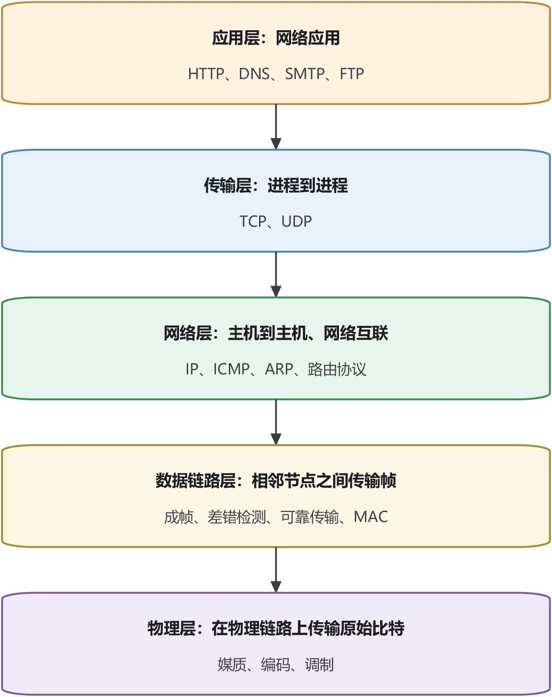

**贯穿全课程的三条主线：**

1. **连通性**：直接连通（点对点、多路接入）→ 间接连通（交换网络）→ 网络互联（路由器）。
2. **资源共享**：电路交换的确定型复用 vs 分组交换的统计型复用。
3. **共性服务**：差错检测、可靠传输、流量控制、拥塞控制，在不同层以不同粒度重复出现。

---

## 1. 第一部分 网络概论

> 对应课件：`1-Intr.pdf`、`2-PktSwitch.pdf`、`3-ErrRecovery.pdf`、`4-NetArch.pdf`、`14-Summ.pdf`

### 1.1 网络基本概念（了解 + 掌握）

#### 1.1.1 定义与本质

- **定义**：计算机网络是**互相连接、自主**的计算机的集合。
  - “计算机”：通信终端，是数据传输的源/目的地；
  - “网络”：相互连通。
- 与电话网等通信网络的区别：**通用性**——支持运行在终端上的各种应用，而非专门服务某一应用。
- 网络巨大能量的根源：通用性 + 连通规模 + 资源共享 + 标准化协议。

#### 1.1.2 构成元素

| 类别 | 元素 | 作用 |
|---|---|---|
| 可见 | 主机（host / 端系统） | 运行网络应用，是数据的源和目的地 |
| 可见 | 交换节点（switch / router） | 转发主机之间传输的数据 |
| 可见 | 链路（link） | 在相邻节点之间传输数据 |
| 不可见 | 网络应用（application） | 真正产生和接收数据的软件进程，决定流量模式与服务需求 |
| 不可见 | 协议（protocol） | 节点/实体之间通信的规范：报文格式、顺序、动作 |

> 协议是本课程的核心。协议三要素：**语法**（字段组织）、**语义**（字段含义）、**时序/规则**（何时、如何发送与响应）。

#### 1.1.3 网络的分类

| 分类依据 | 类别 | 要点 |
|---|---|---|
| 覆盖范围 | WAN 广域网 | 几十至几千公里，互联网核心 |
| | MAN 城域网 | 约 5–50 km，单个城市 |
| | LAN 局域网 | 几十至几百米，楼宇/园区 |
| | PAN 个域网 | 1–10 m，多为无线，连接外设 |
| 用户范围 | 公用网 / 专用（私有）网 | 面向公众 / 面向特定群体 |
| 网络位置 | 接入网（access network） | 主机到边缘路由器，技术多样 |
| | 核心网（core network） | 汇聚与高速交换路由，通常不直接连主机 |
| 拓扑 | 总线、星型、环型、树型、网状 | 现代网络多为网状核心 + 树型接入 |

> 覆盖范围的划分本质上反映的是**适用技术**的不同，而不只是距离。

#### 1.1.4 网络的三个基本需求

1. **可扩展的连通性（scalable connectivity）**
   - 任意主机之间可通信；连通可以是直接或间接；
   - 以合理开销支持系统增长到任意大规模。
2. **成本合算的资源共享（cost-effective resource sharing）**
   - 共享链路带宽、缓存等资源；
   - 高效利用资源。
3. **支持共性服务（support for common services）**
   - 为各类应用提供共性通信服务，如可靠数据传输。

### 1.2 网络连通性

| 连通方式 | 形式 | 说明 |
|---|---|---|
| 直接连通 | 点对点链路 | 同轴电缆、光纤、租用专线 |
| 直接连通 | 多路接入链路 | 无线电、共享电缆；广播式通信 |
| 间接连通 | 交换网络 | 经由交换机/路由器等中间节点 |
| 间接连通 | 互联网络 | 用路由器互联多个不同类型的网络 |

- **编址（addressing）**：为主机（或一组主机）分配唯一标识，如 MAC 地址、IP 地址、手机号。
- **广播网络 vs 交换网络**：

| | 广播网络 | 交换网络 |
|---|---|---|
| 数据传播 | 一个终端发出的数据被广播到所有其它终端 | 只传送给指定终端 |
| 基本问题 | 多路接入控制（MAC）：协调共享介质的使用 | 交换（switching）：中间节点如何转发 |
| 典型例子 | 共享式以太网、无线局域网 | 程控电话网、交换式以太网、IP 网 |
| 关键技术 | CSMA/CD、CSMA/CA、令牌传递 | 电路交换、分组交换 |

- **可扩展性比较**：
  - 广播网络：主机数增加时冲突概率急剧上升（随机接入）或平均等待时间增加（轮转）；开销固定但规模受限 → **可扩展性低**。
  - 交换网络：增加交换机并级联即可扩展；给定 N 台主机，所需交换节点与链路数为 **O(N log N)** → **可扩展性高**。

### 1.3 网络资源共享：电路交换与分组交换（掌握）

#### 1.3.1 电路交换（Circuit Switching）

- 以终端之间的**呼叫（call）**为对象分配资源。
- 链路带宽被划分为多个资源片，每个呼叫固定占用一个片：
  - **FDM**：按频率划分；
  - **TDM**：按时间划分。
- 特点：**确定型复用（deterministic multiplexing）**。
  - 呼叫存续期间独占资源片；无数据发送时资源片闲置，不能被他人使用；
  - 同时支持的呼叫数受资源片数量限制。
- 优点：易于保证服务质量（带宽、时延），实现简单。
- 缺点：不适合计算机通信的**突发性**，资源浪费显著。

#### 1.3.2 分组交换（Packet Switching）

- 以**分组（packet）**为数据传输的基本单元；分组的所有比特必须连续传输。
- 分组 = 用户数据（净荷）+ 控制信息（首部）。
- 交换节点采用**存储转发（store-and-forward）**：
  1. 收到整个分组；
  2. 根据控制信息确定输出端口；
  3. 先暂存，等候输出链路空闲；
  4. 转发出去。
- 资源共享方式：**统计型复用（statistical multiplexing）**，按需占用，资源利用效率高，并发分组流数量无严格限制。
- 固有问题：
  - **网络拥塞**：大量分组短时间注入；
  - **服务质量难保证**：资源分配随机。

#### 1.3.3 电路交换 vs 分组交换

| 比较项 | 电路交换 | 分组交换 |
|---|---|---|
| 资源分配对象 | 呼叫 | 分组 |
| 复用方式 | 确定型（FDM/TDM） | 统计型 |
| 资源占用 | 通话期间固定占用 | 有分组时才占用 |
| 适合流量 | 连续、恒定速率 | 突发性数据 |
| 服务质量 | 易保证 | 难保证 |
| 拥塞 | 呼叫建立时可能被阻塞 | 运行中可能拥塞、丢包 |
| 典型应用 | 电话网、ISDN | Internet、交换式以太网 |

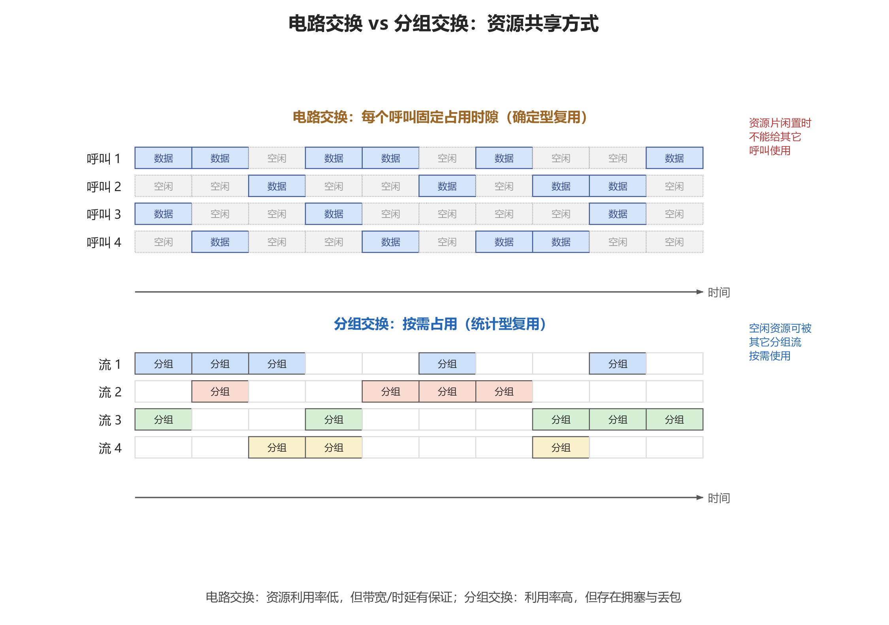

### 1.4 分组交换的两种实现：数据报与虚电路（掌握）

#### 1.4.1 数据报交换（Datagram Switching）

- 分组称为**数据报**；首部填入**目的主机完整地址**。
- 每个交换节点独立查表转发，**不考虑分组之间的逻辑关联**。
- 转发路径没有显式建立过程，表现为沿途交换表中同一目的地表项的集合。
- 交换表由路由协议/算法求解。
- 优点：健壮、无需连接建立、适合突发流量。
- 缺点：每分组都要查表；路径可能不一致；难以做资源预留。

#### 1.4.2 虚电路交换（Virtual Circuit Switching）

- 传输前先建立一条逻辑连接——**虚电路（VC）**。
- 分组首部只填**虚电路号（VCI）**，不填完整目的地址。
- 交换节点以 **`<输入端口, 输入 VCI>`** 为索引查虚电路表，确定输出端口和输出 VCI，然后存储转发。
- 虚电路表表项：`<输入端口, 输入 VCI, 输出端口, 输出 VCI>`。
- **VCI 只有本地意义**：唯一性仅限某交换机的某个端口；不同端口可用相同数值。
- 两类虚电路：

| 类型 | 建立方式 | 生存期 |
|---|---|---|
| 永久虚电路 PVC | 管理员手工配置或信令过程 | 长期存在 |
| 交换虚电路 SVC | 终端主机启动信令过程动态建立 | 短期存在 |

- SVC 建立过程（要求能叙述）：
  1. 源主机发送 VC 设置消息，含目的主机完整地址；
  2. 中间节点确定输出端口，创建表项：输入 VCI 选本端口未用值，输出 VCI 暂空；向下游转发；
  3. 目的主机选择输入 VCI，回复确认消息；
  4. 确认消息向上游逐跳返回，中间节点把下游的输入 VCI 填入自己表项的输出 VCI；
  5. 源主机收到确认后获知输出 VCI，开始数据传输。

#### 1.4.3 数据报 vs 虚电路

| 比较项 | 数据报 | 虚电路 |
|---|---|---|
| 连接建立 | 不需要 | 需要 |
| 分组首部 | 完整目的地址 | VCI |
| 转发依据 | 目的地址 + 交换表 | 输入端口 + VCI + 虚电路表 |
| 分组间关联 | 不考虑 | 由虚电路标识 |
| 路径 | 每分组可不同 | 固定（连接存续期间） |
| 节点状态 | 无连接状态 | 需维护虚电路表 |
| 故障影响 | 路由可绕行，较健壮 | 虚电路中断需重建 |
| 典型 | IP | ATM、帧中继、X.25 |

> 两者都属于分组交换，都采用存储转发；关键区别是**是否显式建立连接、是否在首部使用 VCI、节点是否保存连接状态**。

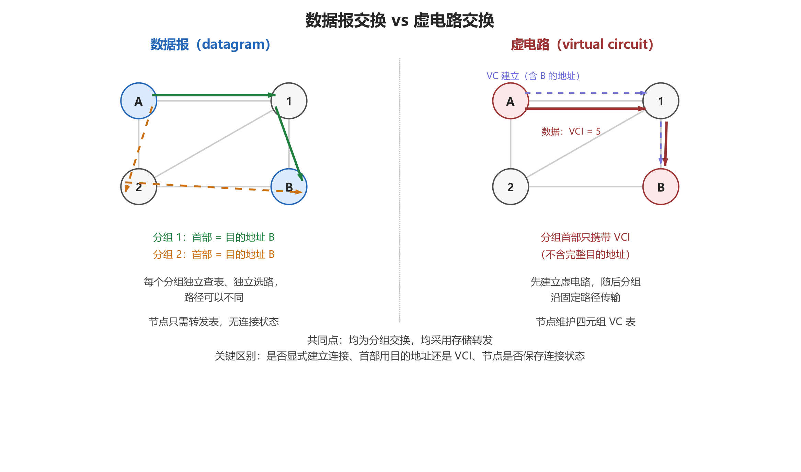

### 1.5 网络性能指标（掌握，必考计算）

#### 1.5.1 带宽与吞吐量

- **带宽/容量/速率**：链路可传输数据的最高速率，单位 bps。
- **吞吐量（throughput）**：网络（或其中一部分）实际的数据输出速率。
  - 瞬时吞吐量、平均吞吐量；
  - 受链路速率、瓶颈链路、协议开销、流量模式等制约。
- **瓶颈链路**：端到端路径中限制吞吐量最大值的链路。
  - 简单场景：max throughput = min(Rs, Rc)。
  - 多条流共享瓶颈：每条流最多分得 R/N（公平共享时）。
- **网络吞吐量**：所有分组流输出速率之和。

#### 1.5.2 节点时延

$$d_{nodal}=d_{proc}+d_{queue}+d_{trans}+d_{prop}$$

| 分量 | 含义 | 计算/说明 |
|---|---|---|
| 处理时延 $d_{proc}$ | 检查比特错误、确定输出端口 | 通常小于毫秒，可忽略 |
| 排队时延 $d_{queue}$ | 在输出缓存等候传输 | 取决于拥塞程度，随机变化 |
| 传输时延 $d_{trans}$ | 把分组全部比特推上链路 | $d_{trans}=L/R$，L 为分组长度（bit），R 为链路速率 |
| 传播时延 $d_{prop}$ | 电磁信号在媒质中传播 | $d_{prop}=d/s$，d 为链路长度，s ≈ $2\times10^8$ m/s |

- **流量强度**：$\rho = La/R$
  - L：分组长度；a：分组平均到达率（个/秒）；R：链路速率。
  - $\rho \approx 0$：排队时延小；
  - $\rho \to 1$：排队时延急剧增大；
  - $\rho > 1$：排队时延趋向无穷，队列溢出丢包。

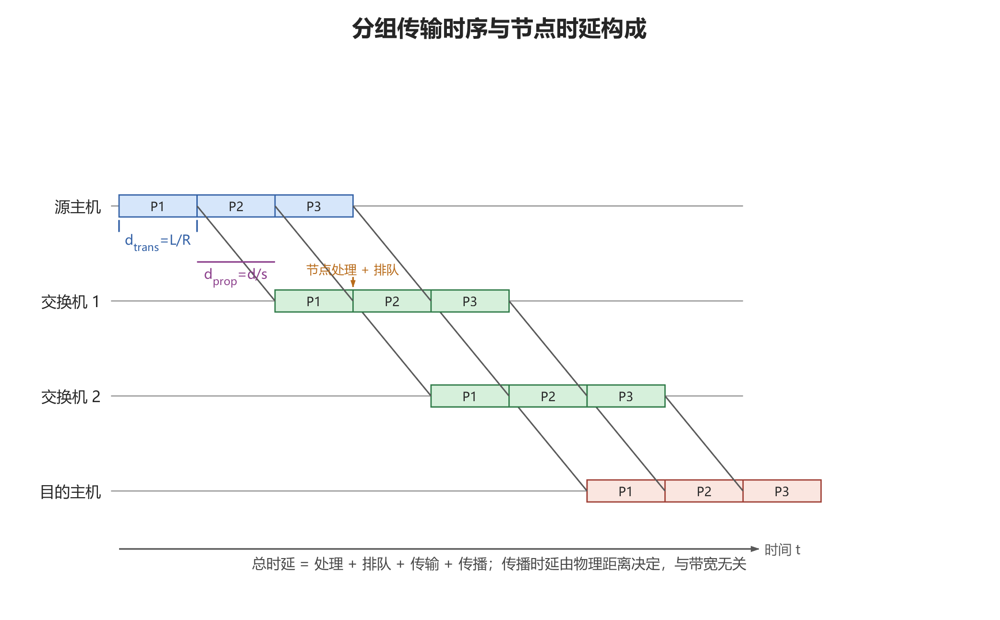

#### 1.5.3 时延带宽积与 RTT

- **时延带宽积 = 时延 × 带宽**。
  - 取**单向时延**：首个分组到达接收端之前，发送端可以连续发送的数据量，即“在链路中飞行”的数据量。
  - 取 **RTT**：收到接收端确认之前，发送端可以发送的数据量。
  - 实际计算通常取 RTT，因为它直接决定滑动窗口参数的选取。
- **RTT（往返时间）**：发送端到接收端再返回的时延。
- 典型数值：

| 链路类型 | 带宽 | 距离 | RTT | 时延带宽积 |
|---|---|---|---|---|
| 拨号 | 56 kbps | 10 km | 87 μs | 5 bit |
| 无线局域网 | 54 Mbps | 50 m | 0.33 μs | 18 bit |
| 卫星链路 | 45 Mbps | 35,000 km | 230 ms | 10 Mb |
| 跨国家光纤 | 10 Gbps | 4,000 km | 40 ms | 400 Mb |

#### 1.5.4 有效吞吐量与文件传输时间

$$T_{transfer}=\frac{\text{数据量}}{R}+RTT$$

$$\text{有效吞吐量}=\frac{\text{数据量}}{T_{transfer}}=\frac{\text{数据量}}{\text{数据量}/R+RTT}$$

- 含义：RTT 是固定开销；数据量越小、带宽越高，RTT 占比越大，有效吞吐量越低。
- 例：1 MB 文件、RTT = 100 ms。
  - R = 1 Mbps：时延带宽积 = 0.1 Mb，传输约需 80 个 RTT；
  - R = 1 Gbps：时延带宽积 = 100 Mb，传输仅需约 1/12.5 个 RTT。
- 结论：**带宽和时延共同影响性能**；协议设计要让发送窗口至少覆盖时延带宽积，才能“填满管道”。

#### 1.5.5 丢包

- 原因：
  - 输出缓存溢出（存储转发固有）；
  - 不可纠正的比特错误导致帧被丢弃；
  - 链路/节点失效。
- 处理选择：前一节点重传、源端重传、或不重传（由应用容忍）。

#### 1.5.6 应用需求、时延与抖动

- 带宽需求：
  - **弹性**：能自适应可用带宽，如文件传输；
  - **刚性**：需要最低传输带宽，如流媒体。
- 时延需求：文件传输、实时消息、流媒体直播、视频会议对时延敏感程度不同。
- **抖动（jitter）**：时延的变动，主要由排队时延变化引起；会造成接收数据不平顺，影响流媒体平滑播放。
- 网络作为资源共享系统，单条流的端到端带宽、时延及其抖动都随机起伏；应用注入过多流量会导致拥塞、丢包，影响用户体验（QoE）。

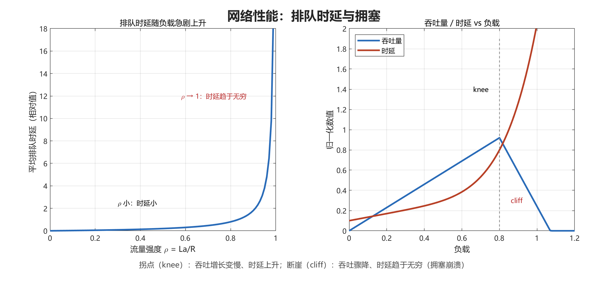

### 1.6 网络体系结构（掌握）

#### 1.6.1 为什么要分层

- 网络系统复杂、异构、应用多样。
- 模块化：把系统分为较小、相对简单的功能模块，细节隐藏在接口之后。
- 分层：每个实体提供的服务只依赖于下层实体提供的服务。

| 优点 | 缺点 |
|---|---|
| 模块化，易于设计、实现、维护 | 层间信息隐藏可能降低效率 |
| 可重用，上层可复用下层功能 | 层间功能划分需要精心设计 |
| 功能抽象，底层变化不影响上层 | |

#### 1.6.2 基本概念

| 概念 | 含义 |
|---|---|
| 实体（entity） | 分层系统中的基本通信功能模块；与远端对等实体通信，向上提供服务，使用下层服务 |
| 接口（interface） | 垂直：服务接口；水平：对等实体接口 |
| 协议（protocol） | 对等实体之间通信的规范：报文格式、顺序、事件动作 |
| 封装（encapsulation） | 下层在上一层数据外添加首部/尾部，携带控制信息 |
| 复用/解复用 | 下层复用多个上层实体的数据；用解复用码（如端口号、协议类型）区分归属 |

#### 1.6.3 三种体系结构

| OSI 七层 | 五层原理性体系结构 | TCP/IP 四层 |
|---|---|---|
| 应用层 | 应用层 | 应用层 |
| 表示层 | — | — |
| 会话层 | — | — |
| 传输层 | 传输层 | 传输层 |
| 网络层 | 网络层 | 互联网层 |
| 数据链路层 | 数据链路层 | 网络接入层 |
| 物理层 | 物理层 | 网络接入层 |

- **OSI**：ISO 1977 年成立工作组，1983 年成文；只是参考模型，不是实际网络架构；相关实现如 X.25、X.400、X.500。
- **Internet 架构特点**：
  - 顶端和底端“宽”、中间“窄”，IP 是粘合剂和中心；
  - 主机复杂、节点简单（边缘复杂、核心简单）；
  - 并非严格分层，应用可直接基于 IP；
  - 没有官方参考模型，强调“提出协议必须给出实现”。
- **Internet 组织**：ISP 网络的网络；松散的等级制（Tier-1 ISP、区域 ISP、接入 ISP、IXP、内容提供商网络）。
- 标准化：IETF 制定 RFC。

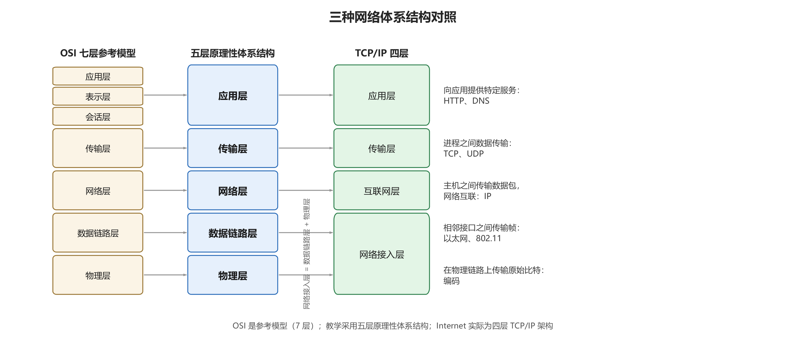

#### 1.6.4 各层功能、PDU 与设备

| 层 | 基本功能 | 数据单元（PDU） | 典型协议 | 典型设备 |
|---|---|---|---|---|
| 应用层 | 向应用提供特定服务 | 消息（message） | HTTP、DNS、SMTP、FTP | 主机 |
| 传输层 | 应用进程之间传输数据 | 报文段（segment） | TCP、UDP | 主机 |
| 网络层 | 主机之间传输数据包，网络互联 | 数据报/数据包（datagram/packet） | IP、ICMP、ARP、RIP、OSPF、BGP | 路由器 |
| 数据链路层 | 相邻网络接口之间传输帧 | 帧（frame） | Ethernet 802.3、WiFi 802.11、PPP、HDLC | 交换机、网桥 |
| 物理层 | 物理链路上传输原始比特 | 比特（bit） | — | 中继器、集线器 |

#### 1.6.5 逐层封装


- 发送方逐层添加首部；接收方逐层剥离首部并上交。
- 路由器通常只实现到网络层；交换机实现到数据链路层；集线器只实现物理层。

#### 1.6.6 Internet 发展简史（了解）

| 阶段 | 关键事件 |
|---|---|
| 1961–1972 | Kleinrock 用排队论证明分组交换有效性；Baran 研究军用分组交换；1967 ARPA 构想 ARPAnet；1969 首个节点运行；1972 公开示范、NCP、首个 email 程序、15 个节点 |
| 1972–1980 | 1970 ALOHAnet；1974 Cerf 和 Kahn 提出网络互联；1976 以太网；DECnet/SNA/XNA；1979 ARPAnet 200 个节点。互联原则：极简主义、自治、尽力交付、无状态路由器、去中心化控制 |
| 1980–1990 | 1982 SMTP；1983 TCP/IP 部署、DNS 提出；1985 FTP；1988 TCP 拥塞控制；NSFnet 等全国性网络；10 万台主机 |
| 1990–2000s | ARPAnet 退役；1991 Web/NSFnet；HTML、HTTP、浏览器；Web 商业化；即时消息、P2P；网络安全受到重视；骨干网 Gbps |
| 2005–现在 | 宽带与 4G/5G/WiFi 普及；SDN（2008）；内容提供商自建全球网络；云计算；超过 100 亿设备；移动终端超过固定主机（2017） |

## 2. 第二部分 数据链路层

> 对应课件：`3-ErrRecovery.pdf`、`5-Layer1n2(I).pdf`、`6-Layer1n2(II).pdf`、`7-Layer1n2(III).pdf`

### 2.1 数据链路层概述

- **功能**：在**相邻网络接口**之间传输帧。
- **直连网络**：主机通过一条链路直接相连，或通过共享介质相连，不经过交换节点；分为点对点链路和多路接入链路。
- 通信的网络接口采用相同的比特传输方式、帧格式和协议；通常与物理层绑定，构成一种底层网络技术（如以太网、WiFi、PPP）。
- 适用范围：局域网、接入网范围，以及路由器之间的点对点链路。

**五个技术要素：**

| 要素 | 解决的问题 |
|---|---|
| 成帧（framing） | 从连续比特流中确定帧的起止 |
| 差错检测 | 检测帧传输过程中产生的比特错误 |
| 可靠传输 | 纠正错误、恢复丢失的帧 |
| 媒体接入控制（MAC） | 协调多台主机对共享链路的使用 |
| 数据链路层交换 | 交换机/网桥如何转发帧 |

#### 2.1.1 物理层背景（了解）

- 物理层：在物理或逻辑链路上传输原始比特。
- 链路类型：点对点、多路接入（广播）。
- 传输媒质：

| 类型 | 例子 | 特点 |
|---|---|---|
| 导引型 | 双绞线（UTP/STP）、同轴电缆、光纤 | 信号沿导体/光纤传播 |
| 非导引型 | 无线电、微波、卫星 | 自由空间传播，受反射、阻挡、干扰影响 |

- 双工方式：全双工、半双工、单工。
- 香农信道容量：$C=B\log_2(1+S/N)$。
- 常见比特编码：

| 编码 | 规则 | 问题/特点 |
|---|---|---|
| NRZ | 0、1 分别对应两种电平 | 连续相同比特导致基线漂移、时钟恢复困难 |
| NRZI | 0 保持当前信号，1 跳变 | 解决连续 1 的问题，连续 0 仍有问题 |
| Manchester | 0、1 分别对应低→高、高→低跳变 | 自带时钟，效率只有波特率的一半 |
| 4B/5B | 4 bit 数据编码为 5 bit | 限制连续 0 的个数，效率 80% |

> 物理层不是考试说明单列的部分，但编码、媒质、链路容量是理解数据链路层的基础，选择题可能涉及。

### 2.2 成帧（理解）

- **帧（frame）**：数据链路层不可分割（连续传输）的数据块。
- **成帧**：在比特流中确定一帧的开始和结尾。
- 两类方法：面向字节（byte-oriented）、面向比特（bit-oriented）。

#### 2.2.1 面向字节的成帧

| 方法 | 典型协议 | 机制 | 问题与解决 |
|---|---|---|---|
| 哨兵式 | BISYNC、PPP | 帧数据放在 STX/ETX（PPP 用 0x7E）之间 | 数据中可能出现 ETX/0x7E → **字节填充**：在特殊字符前加 DLE/转义字符 |
| 字节计数 | DDCMP | 专用 Count 字段给出帧长 | 长度字段出错会导致后续一系列帧定界错误 |

- PPP 帧：Flag = 0x7E；另有 LCP、NCP 用于链路参数协商和网络层参数设置。

#### 2.2.2 面向比特的成帧

- **HDLC**：起始/结尾比特序列 0x7E = `01111110`；基于 IBM SDLC，经 ITU 标准化，用于 X.25。
- 数据部分可能出现 `01111110` → **比特填充**：
  - 发送方每发送 **5 个连续 1**，就在下一比特前插入一个 0；
  - 接收方收到 5 个连续 1 后：
    - 若下一比特为 0：删除该 0；
    - 若随后为 `10`：帧结束；
    - 若随后为 `11`：错误。
- 特点：可能导致连续两帧接收失败；帧长度取决于数据载荷长度（不是固定长度）。

### 2.3 差错检测（理解 + 掌握 CRC 计算）

- 模型：数据 D + 检错码 EDC；接收方根据 EDC 判断是否出错。
- 目标：**低冗余度**（EDC 远短于数据）、**高检错率**。
- EDC 并非百分之百可靠；较长的检错码通常性能更好。

| 方法 | 原理 | 检错能力/用途 |
|---|---|---|
| 二维奇偶校验 | 每行每列加奇偶校验位 | 可检测所有 1、2、3 比特错误和大部分 4 比特错误；用于 BISYNC |
| Internet 校验和 | 16 位反码求和，取反 | 检错能力较弱；用于 IP、UDP |
| CRC | 模 2 多项式除法取余 | 检错能力强；用于 HDLC、以太网、802.11 |

#### 2.3.1 Internet 校验和

- 把数据看成若干个 16 位整数，做**反码和**（最高位进位要加回最低位），结果取反即为校验和。
- 接收方对所有 16 位字（含校验和）再做反码和，结果应为全 1。
- 缺点示例：某些数字变化后校验和不变，因此检错能力有限。

#### 2.3.2 CRC 计算（必须会）

**符号：**

- 待传数据为 n bit，视为 n−1 阶多项式 $M(x)$；
- 生成多项式 $C(x)$ 为 k 阶；
- 传输数据编码 $P(x)$ 由数据 + k 位余数构成。

**步骤：**

1. 在数据 M 后添加 k 个 0，得到 $T(x)=M(x)\cdot x^k$；
2. 用模 2 除法计算 $T(x)\div C(x)$，得到 k 位余数；
3. 把余数附加在原数据后（模 2 减法等价于异或），得到发送的 $P(x)$；
4. 接收方用 $P(x)\div C(x)$：余数为 0 认为无错，否则认为出错。

> 模 2 运算：加、减都不进位/借位，等价于异或。

**例（作业题）：** 数据 `10010110`，生成多项式 $C(x)=x^3+1$，即除数 `1001`，k=3。

- 数据后补 3 个 0：`10010110000`；
- 模 2 除以 `1001`，余数为 `110`；
- 发送：`10010110` + `110` = `10010110110`；
- 若数据部分最右两位翻转，接收方除得余数 `011` ≠ 0，即可发现差错。

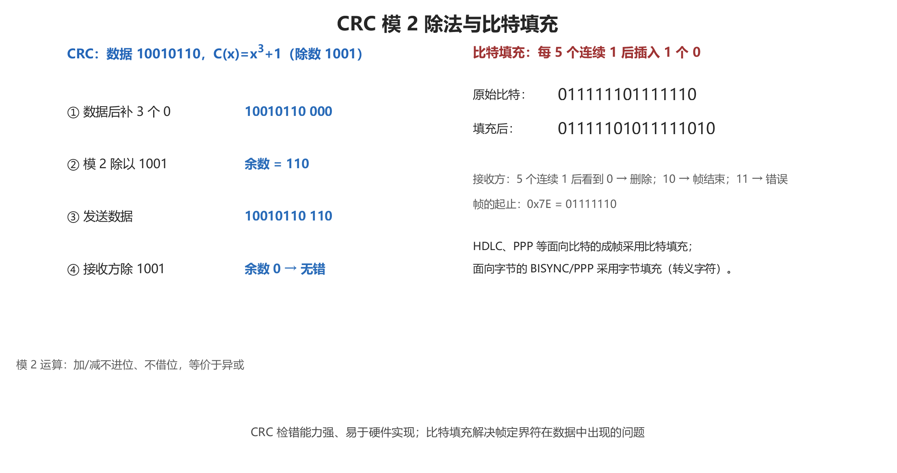

**生成多项式：**

- 合理的 k 阶 $C(x)$ 可检测：所有 1 或 2 比特错误、任意奇数个比特错误、长度小于 k 的连续比特错误，以及部分长度大于 k 的连续错误。
- 常见标准：CRC-8、CRC-10、CRC-12、CRC-16、CRC-CCITT、CRC-32。
- 硬件实现：k 位移位寄存器 + 异或门。

### 2.4 可靠传输与 ARQ（掌握）

#### 2.4.1 分组出错/丢失的原因

| 原因 | 层面 | 说明 |
|---|---|---|
| 比特错误 | 比特级 | 噪声、干扰；用 BER（误码率）衡量 |
| 缓存溢出 | 分组级 | 存储转发 + 流量突发，输出缓存不够 |
| 链路/节点失效 | 链路/节点级 | 器件失效、线缆截断、节点宕机 |

**两类解决方案：**

- **纠错码 ECC**：发送方添加纠错比特，接收方直接纠正。编码比特越多纠错能力越强，但不能纠正所有错误，也不能解决缓存溢出、节点失效导致的丢包。
- **自动重发请求 ARQ**：接收方检测出错或缺失并告知发送方，发送方重传。

#### 2.4.2 ARQ 的基本要素

| 要素 | 作用 |
|---|---|
| 确认 ACK | 接收方告知已正确收到某个/某些分组 |
| 序号 SeqNum | 区分不同分组，识别重传与新分组 |
| 重传 | 未收到确认时发送方重传 |
| 超时 Timeout | 发送后启动定时器，超时即认为“未收到确认” |
| 缓存 | 已发送未确认的分组需缓存以备重传 |

- 发送方和接收方只能通过消息交互了解对方状态，而消息本身也可能丢失——这是可靠传输协议设计的根本困难。

#### 2.4.3 停止等待（Stop-and-Wait）

- 最简 ARQ：发送一个分组，等待 ACK；收到 ACK 再发下一个。
- 1 比特序号足以区分“新分组”和“重传分组”。
- 可能场景：正常、数据丢失、ACK 丢失、ACK 迟到——后三者都靠超时重传解决。
- **链路利用率低**：每个 RTT 只能发送一个分组。
  - 例：2 Mbps、RTT 45 ms、分组 1.5 KB；
  - 实际数据发送率 ≈ $1500\times8/0.045 \approx 266.7$ kbps，远低于 2 Mbps。

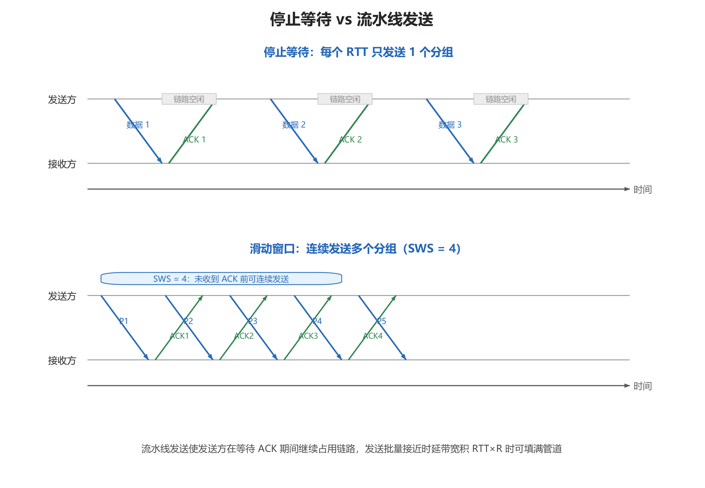

#### 2.4.4 滑动窗口（Sliding Window）

**核心思路：**

1. **流水线发送**：等待 ACK 期间继续发送后续分组，避免链路闲置。
2. **最佳发送批量**：至少覆盖时延带宽积 $RTT\times R$。
3. **更长序号**：避免重传造成的序号混淆。
4. **窗口滑动**：用窗口动态控制可发送/可接收的范围。

**发送方：**

- 维护发送窗口；只能发送序号落在窗口内的分组。
- 每发送一个分组，窗口从后沿收缩；每收到 ACK，窗口从前沿扩展。
- **发送窗口大小 SWS**：未经确认可连续发送的数据量上界。
- 已发送未确认的分组必须缓存。
- 序号 k 比特，取值范围 $0\sim 2^k-1$，循环使用。

**接收方：**

- 维护接收窗口；只接收序号落在窗口内的分组。
- 每收到一个分组，窗口收缩；每发送 ACK，窗口扩展。
- **接收窗口大小 RWS**：可接收但尚未确认的数据量上界。

**确认方式：**

| 方式 | 含义 | 特点 |
|---|---|---|
| 累积确认 | ACK 给出 MaxSeqNumRcvd，表示序号小于它的分组全部收到 | 常用，简单 |
| 每分组确认 | 每个分组都回 ACK | 处理开销大 |
| 多分组确认 | 一个 ACK 确认多个分组 | 字段结构复杂 |

**分组丢失时的确认线索：**

| 方式 | 做法 | 说明 |
|---|---|---|
| 重复确认 | 重复确认前一个分组 | 发送方据此判断丢失；最常用 |
| 选择性确认 | 只确认正确收到的分组 | 发送方可精确知道丢失；实现复杂 |
| 负面确认 NAK | 明确告知“应收到却未收到” | 与超时机制重复，增加复杂度 |

**重传方式：**

| 方式 | 做法 | 接收缓存 | 效率 |
|---|---|---|---|
| Go-Back-N | 序号 k 丢失，重传 k ~ k+N−1 全部 | RWS = 1，最简单 | 较低 |
| 选择性重传 SR | 只重传丢失的分组 | RWS > 1 | 高 |

> 通常采用“重复确认 + 选择性重传”的组合。

**窗口大小与序号：**

$$SWS+RWS\le 2^k$$

- RWS = 1：不缓存错序分组；
- RWS = SWS：可缓存发送方一次发送的所有分组；
- RWS > SWS：没有意义；
- 隐含假设：分组不会乱序到达（仅适用于数据链路层；网络层及以上不成立）。

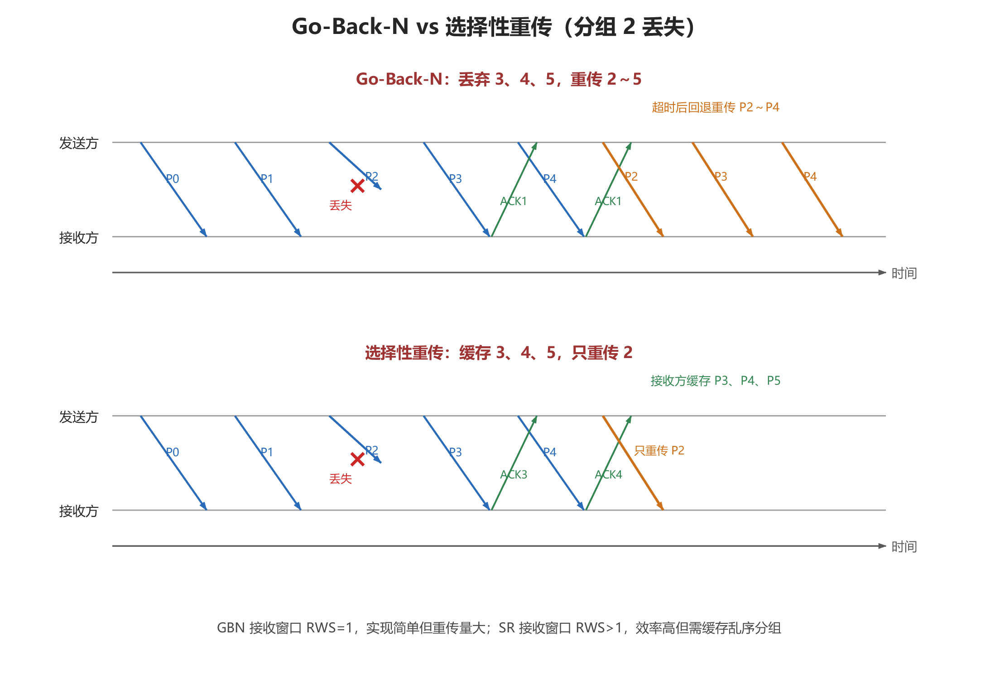

**滑动窗口的三种应用：**

1. 可靠数据传输（按序交付）；
2. 流量控制（避免接收方过载）；
3. 拥塞控制（避免网络过载）。

```text
发送方窗口示意（序号循环使用）：

已确认 | 已发送未确认 | 可发送 | 不可发送
       <-- SWS --------->
       窗口随 ACK 向右滑动
```

### 2.5 多路接入与 MAC（理解）

- **多路接入**：所有主机通过同一条共享链路发送和接收帧；一台主机发出的帧会被所有主机收到，但只有特定主机会接受。
- **基本问题**：多台主机同时发送 → 信号相互干扰 → 帧损坏。因此需要 **MAC（媒体接入控制）**：确定一台主机何时可以传输。
- 挑战：通常没有专用控制信道；需兼顾**带宽利用率**与**公平性**。

| MAC 类型 | 代表技术 | 低负载 | 高负载 |
|---|---|---|---|
| 信道划分 | TDMA、FDMA | 利用率低（空闲片浪费） | 高效、公平 |
| 轮转 | 轮询、令牌传递、蓝牙、FDDI | 有轮候延迟 | 较好，结合两者优点 |
| 随机接入 | ALOHA、CSMA、CSMA/CD、CSMA/CA | 高效 | 冲突带来开销，效率下降 |

- **TDMA**：时间分周期，每周期分时隙，每台主机固定占一个时隙；未用则闲置。
- **FDMA**：频谱分频带，每台主机固定占一个频带；未用则闲置。
- **轮询**：主节点依次邀请从节点发送；问题：轮候延迟、主节点单点失效。
- **令牌传递**：持有令牌才能发送；问题：令牌丢失需恢复、轮候延迟。
- **随机接入**：有帧就发，允许冲突；算法决定如何检测/避免冲突、如何恢复。
- **CSMA（载波侦听多路接入）**：发送前先侦听信道。
  - 1-坚持：信道忙则持续侦听，空闲立即发送（冲突概率较高）；
  - 非坚持：信道忙则随机等待一段时间再侦听（减少冲突，但增加时延）；
  - p-坚持：信道空闲以概率 p 发送，以 1−p 等待下一时隙。
  - 即使先侦听，传播时延仍可能导致冲突：两台主机可能同时侦听到空闲。

### 2.6 以太网（802.3）（理解 + 掌握 CSMA/CD 计算）

#### 2.6.1 概述

- Xerox PARC 的 Metcalfe 于 1970 年代中期提出；Xerox、DEC、Intel 联合标准化为 Ethernet II（DIX Ethernet V2）；IEEE 进一步标准化为 802.3 系列。
- 802.3 系列：**相同的 MAC 协议和帧结构**，不同的速率与物理媒质。
- 速率演进：10 Mbps → 100 Mbps → 1/2.5/5/10/40/100 Gbps。
- 共享式以太网：同轴电缆或集线器连接，广播式发送；交换式以太网：交换机连接，每端口独立链路。

#### 2.6.2 以太网帧格式

| 字段 | 长度 | 作用 |
|---|---|---|
| 前导码 Preamble | 7 字节 `10101010` | 接收方同步发送方时钟 |
| SFD | 1 字节 `10101011` | 帧起始定界符 |
| 目的地址 Dest | 6 字节 | 接收方 MAC 地址 |
| 源地址 Src | 6 字节 | 发送方 MAC 地址 |
| 类型 Type | 2 字节 | 上层协议类型，如 0x0800 表示 IP |
| 数据 Body | 46–1500 字节 | 上层数据；不足 46 字节需填充 |
| CRC/FCS | 4 字节 | 帧检验序列，出错则丢弃 |

- **帧长度（不含前导码）**：64–1518 字节；首部 14 字节，尾部 4 字节。
- **地址类型**：
  - 单播：目的地址为接收方网卡唯一永久 MAC 地址；
  - 广播：目的地址 48 位全 1；
  - 多播：目的地址首比特为 1，动态配置。
- **选择性接受**：网卡只接受“自己的单播地址、广播地址、已配置的多播地址”；混杂模式下接受所有帧。
- 以太网是**无连接、不可靠**的：无连接建立；CRC 检错后直接丢弃，不重传，缺失由上层（如 TCP）弥补。

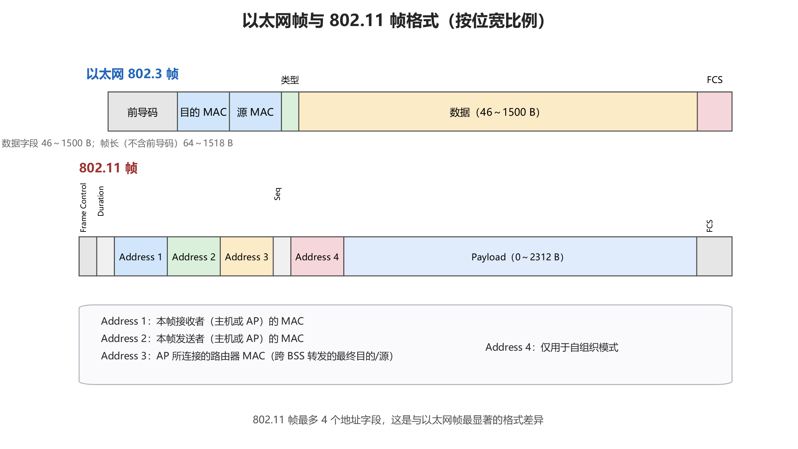

#### 2.6.3 CSMA/CD

- **载波侦听（CS）**：发送前侦听链路是否忙。
- **多路接入（MA）**：多台主机共享同一介质。
- **冲突检测（CD）**：发送过程中检测信号是否被其它帧干扰（比较发送与接收信号）。
- 检测到冲突后立即中止传输，减少信道浪费。

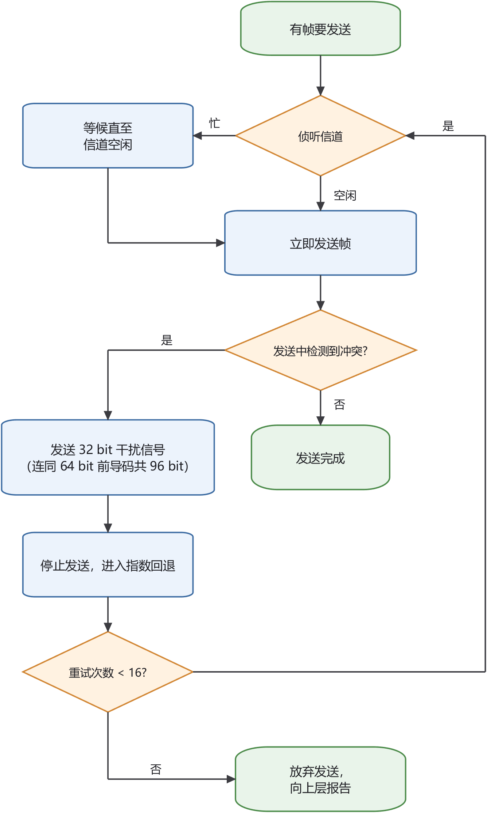

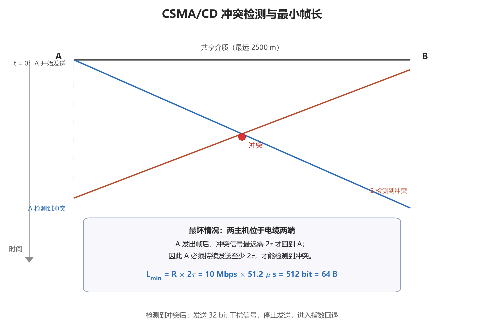

- **1-坚持 CSMA/CD**：链路忙转闲时以概率 1 立即发送（p-坚持的特例）。
- **指数回退**：第 k 次冲突后，从 $\{0,1,\dots,2^k-1\}\times512$ bit 时间中等概率随机选择等待时间。
  - 10 Mbps 链路：512 bit 时间 = 51.2 μs；
  - 第 1 次冲突：{0, 512} bit 时间；第 2 次：{0,512,1024,1536}；依次翻倍；
  - 16 次尝试仍失败则放弃。
- **最小帧长 64 字节的由来**：
  - 最坏情况：两台主机位于电缆两端；
  - 发送方必须在帧传完之前收到冲突信号；
  - 最远 2500 m 的共享式以太网最大 RTT = 51.2 μs；
  - 10 Mbps × 51.2 μs = 512 bit = 64 字节。
- **信道利用率**（KR22）：$\dfrac{1}{1+5t_{prop}/t_{trans}}$，其中 $t_{prop}$ 为两节点间最大传播时延，$t_{trans}$ 为最长帧传输时间。

### 2.7 无线局域网（802.11）（理解）

#### 2.7.1 无线环境的特点

- 半双工：发送和接收分时进行。
- 发送信号强度远大于接收信号 → **难以进行冲突检测**。
- 信号衰减快 → 覆盖范围有限。
- **不能简单沿用 CSMA/CD**，否则会出现隐藏/暴露节点问题。

| 问题 | 场景 | 后果 |
|---|---|---|
| 隐藏节点 | A、C 都能与 B 通信，但 A、C 彼此听不到 | A、C 同时向 B 发送时在 B 处冲突 |
| 暴露节点 | B 向 A 发送时，C 误以为不能向 D 发送 | 不必要地抑制发送，浪费信道 |

#### 2.7.2 网络结构

- **基础设施模式（Infrastructure）**：由接入点 AP 中继终端之间的帧；AP 与其无线终端构成 **BSS**；多个 BSS 通过分布式系统（通常为有线网络）连接。
- **自组织模式（Ad hoc）**：无 AP，每台主机同时充当终端和中继；所有节点构成 **IBSS**。
- 新主机加入：扫描信道，侦听 AP 周期性发送的 Beacon 帧（含 SSID、MAC 地址）→ 选择 AP → 关联 → 身份验证 → DHCP 获取 IP。
  - 被动扫描：等待 Beacon；
  - 主动扫描：广播 Probe Request，AP 回复 Probe Response。

#### 2.7.3 CSMA/CA

- **CSMA**：发送前侦听信道。
- **CA（冲突避免）**：
  - 侦听到忙转闲时，采用随机指数回退，避免同时发送；
  - 数据发送前可交换 RTS/CTS 控制帧，显式告知邻近节点信道占用时间。
- 帧传输采用**停止等待**：每发一帧都要等 ACK。

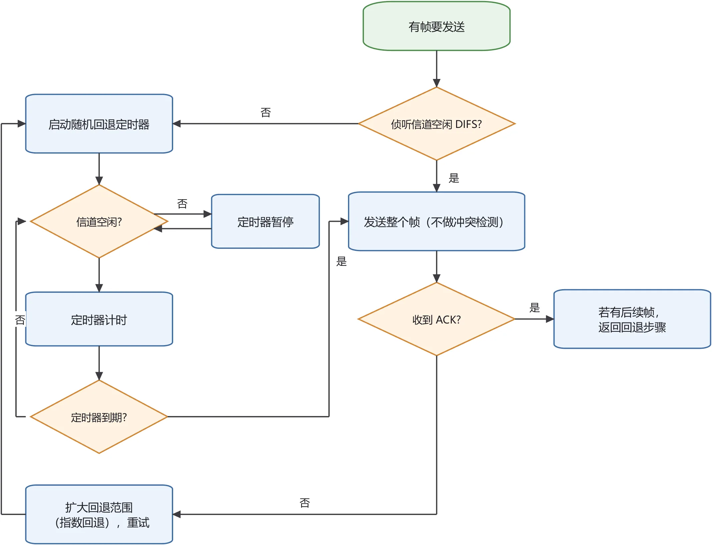

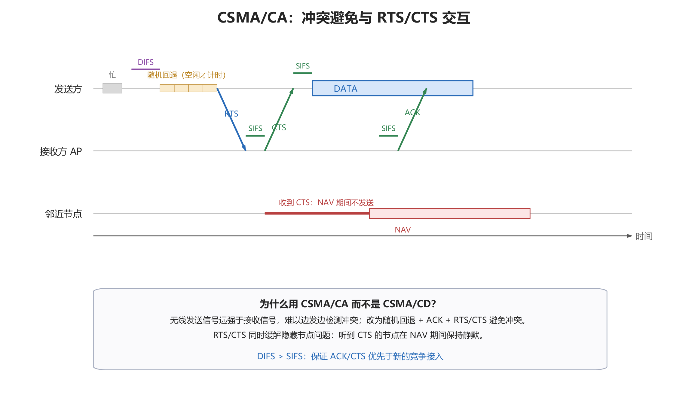

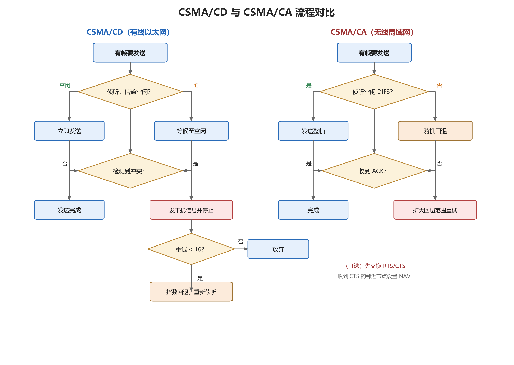

- 接收方：若帧校验无错，等待 **SIFS** 后回复 ACK。
- **DIFS**：分布式帧间间隔；**SIFS**：短帧间间隔（SIFS < DIFS，保证 ACK 优先）。
- **RTS/CTS（可选）**：
  - 发送方发 RTS，声明需要占用信道的时间；接收方回 CTS；
  - 收到 CTS 的节点知道自己靠近接收方，在指定时间内不发送；
  - 收到 RTS 但收不到 CTS 的节点知道自己不靠近接收方，可以发送；
  - 两个 RTS 在接收方冲突时，接收方不回 CTS，发送方据此进行指数回退；
  - 有效缓解隐藏/暴露节点问题，适合长数据帧。

#### 2.7.4 802.11 帧与寻址

| 字段 | 长度 | 含义 |
|---|---|---|
| Frame Control | 2 字节 | 协议版本、类型（RTS/CTS/ACK/数据）、子类型、标志位等 |
| Duration | 2 字节 | 预留传输时间（RTS/CTS） |
| Address 1 | 6 字节 | 本帧接收者（主机或 AP）的 MAC 地址 |
| Address 2 | 6 字节 | 本帧发送者（主机或 AP）的 MAC 地址 |
| Address 3 | 6 字节 | AP 所链接的路由器的 MAC 地址 |
| Seq Control | 2 字节 | 帧序号（可靠传输） |
| Address 4 | 6 字节 | 仅用于自组织模式 |
| Payload | 0–2312 字节 | 上层数据 |
| CRC | 4 字节 | 校验 |

> 802.11 帧最多有 4 个地址字段，这是它与以太网帧最显著的格式差异；Address 3 用于跨 BSS 转发时标识最终目的/源。

### 2.8 局域网扩展：网桥与交换机（理解 + 掌握）

#### 2.8.1 网桥

- 共享式局域网规模受限（如共享式以太网最长 2500 m、最多 4 个中继器、最多 1024 台主机）。
- **基本网桥**：把收到的帧向所有其它端口转发；扩展后全网仍是共享式，最大吞吐量 = 单条链路速率。
- **学习网桥**：选择性转发，采用分组交换；最大吞吐量 = 所有链路速率之和。

**自学习（self-learning）：**

1. 收到帧时，学习“源 MAC 地址 ↔ 输入端口”的关联，写入转发表；
2. 以目的地址为索引查表：
   - 有表项：从对应端口**选择性转发**；
   - 无表项：**洪泛**（向除输入端口外的所有端口转发）；
   - 目的端口 = 输入端口：丢弃（无需转发）。
3. 表项设置有效时间，超时删除（**软状态 soft state**）。

#### 2.8.2 拓扑环路与生成树

- 为提高可靠性额外部署网桥会形成环路，导致：帧无限循环、广播风暴、MAC 地址漂移。
- **生成树算法**：在保留连通性的前提下删除环路，使任意两节点之间只有一条路径。

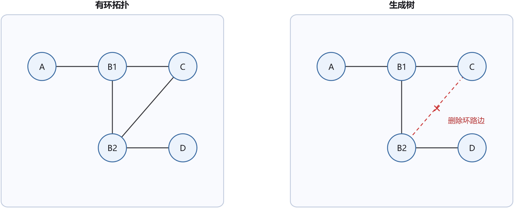

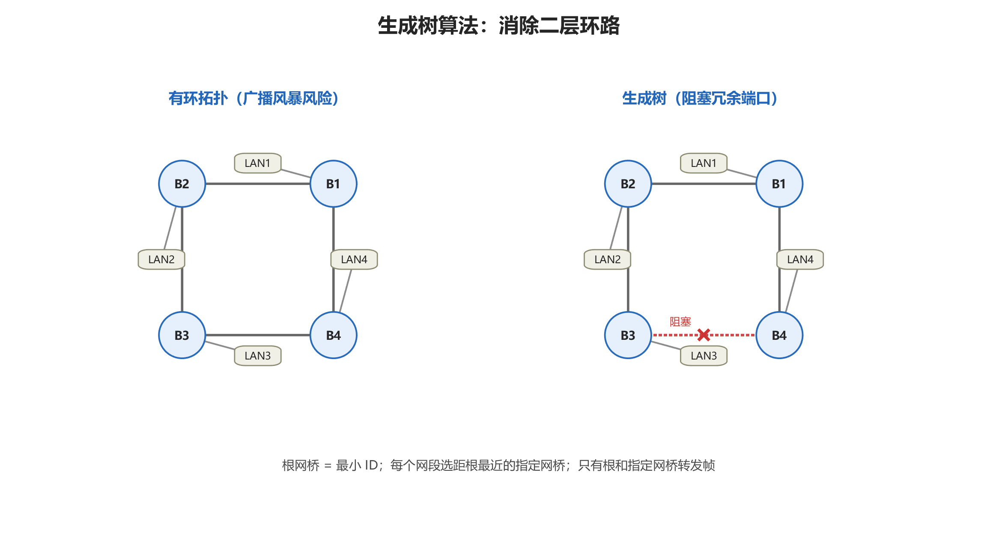

- 生成树要点：
  - 每个网桥有唯一 ID，**ID 最小的网桥为根**；
  - 每个局域网段选择**距离根最近**的网桥作为该网段的**指定网桥**；
  - 根网桥向所有端口转发帧；其它网桥只向其作为指定网桥的端口转发帧；
  - 网桥之间交换配置消息（BPDU），包含源网桥 ID、所认为的根、到根的距离；
  - 稳定后只有根周期性产生配置消息，只有指定网桥转发配置消息；
  - 若一定时间收不到配置消息，网桥会宣称自己是根。
- 标准：IEEE 802.1D STP；改进：RSTP（802.1w，Proposal/Agreement，收敛更快）、MSTP（802.1s，多棵生成树，按 VLAN 负载分担）。
- 其他扩展：链路聚合（Eth-Trunk，多物理链路捆绑为一条逻辑链路）、堆叠/iStack、集群/CSS。

#### 2.8.3 交换式以太网

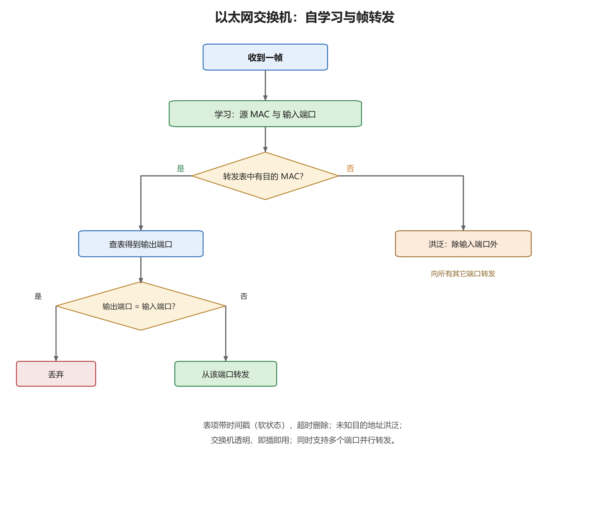

- 每台主机通过专用线缆连接交换机端口，每条链路独立、无竞争，发送帧**没有冲突**。
- 交换机并行转发不同端口之间的帧。
- 最大吞吐量（原理上）= **所有主机链路速率之和**；实际受流量空间分布、交换机间链路容量限制。
- 交换表表项：`<MAC 地址, 端口, 时间戳/TTL>`；建立方式与网桥相同——自学习。
- 交换机是**多端口网桥**：透明、即插即用；如需生成树功能须显式配置。
- **共享式 vs 交换式**：

| | 共享式以太网 | 交换式以太网 |
|---|---|---|
| 介质 | 同轴电缆/集线器，所有主机共享 | 每主机专用链路 |
| 发送方式 | 广播，可能冲突 | 端口间并行、无冲突 |
| MAC | CSMA/CD | 通常无需 CSMA/CD |
| 最大吞吐量 | 单条链路速率 | 所有链路速率之和 |
| 冲突域 | 整个共享网段 | 每个端口一个冲突域 |

> 集线器（Hub）是物理层设备，整体是一个冲突域；交换机是数据链路层设备，每端口一个冲突域。多台集线器级联仍是一个冲突域。

## 3. 第三部分 网络层

> 对应课件：`8-Layer3(I).pdf`、`9-Layer3(II).pdf`、`10-Layer3(III).pdf`、`14-Summ.pdf`

### 3.1 网络层服务（理解）

- **网络互联（internetworking）**：互联多个不同类型的“单一类型”网络，使不同网络中的主机能够相互通信。
- 中间节点：**路由器（router）**，早期称网关（gateway）。
- 网络层协议独立于所互联的底层网络技术。
- 技术挑战：
  - **异质性**：编址、MAC、交换技术、服务模型各不相同；
  - **可扩展性**：编址方案、转发表规模。
- 应对方案：
  - 采用**分组交换**，而非共享式接入；
  - 采用**分层级编址**，而非平铺式 MAC 地址；
  - 采用**路由（routing）**构建转发表，而非自学习。

#### 3.1.1 IP 服务模型

- **最小服务（minimal service）**：只提供最基本的传输功能，复杂操作（可靠传输等）留给主机。
- 好处：可运行于任何底层网络（running over anything），即使未来出现新的网络技术。
- 两个特征：
  - **数据报传送**：无连接，每分组独立处理；
  - **尽力交付（best effort）**：尽可能交付，但不保证可靠、不保证顺序、不保证时延。
- “不可靠”并不等于“一定丢包”，只是不提供保证。

### 3.2 IP 协议与数据报（了解首部 + 掌握分段计算）

#### 3.2.1 IPv4 首部

| 字段 | 长度 | 作用 |
|---|---|---|
| 版本 Version | 4 bit | IPv4 = 4 |
| 首部长度 | 4 bit | 以 32 bit 为单位；最小 5（20 字节），最大 15（60 字节） |
| 服务类型 TOS | 8 bit | DiffServ（6 bit）+ ECN（2 bit） |
| 总长度 | 16 bit | 首部 + 数据，最大 65535 字节 |
| 标识 Identification | 16 bit | 同一数据报的所有分段使用相同标识 |
| 标志 Flags | 3 bit | DF（不分片）、MF（还有分段） |
| 分段偏移 | 13 bit | 以 8 字节为单位，指出该分段在原始数据报中的位置 |
| 生存时间 TTL | 8 bit | 每经过一个路由器减 1，为 0 则丢弃 |
| 协议 Protocol | 8 bit | 上层协议，如 TCP=6、UDP=17、ICMP=1 |
| 首部校验和 | 16 bit | 只校验首部 |
| 源 IP 地址 | 32 bit | 发送方接口地址 |
| 目的 IP 地址 | 32 bit | 接收方接口地址 |
| 选项 | 可变 | 如时间戳、记录路由 |
| 数据 | 可变 | 通常为 TCP 或 UDP 报文段 |

- 最大数据报长度 64 KB；实际常见 1500 字节或更小（受 MTU 限制）。
- 首部校验和每跳都要重新计算（TTL 改变）。

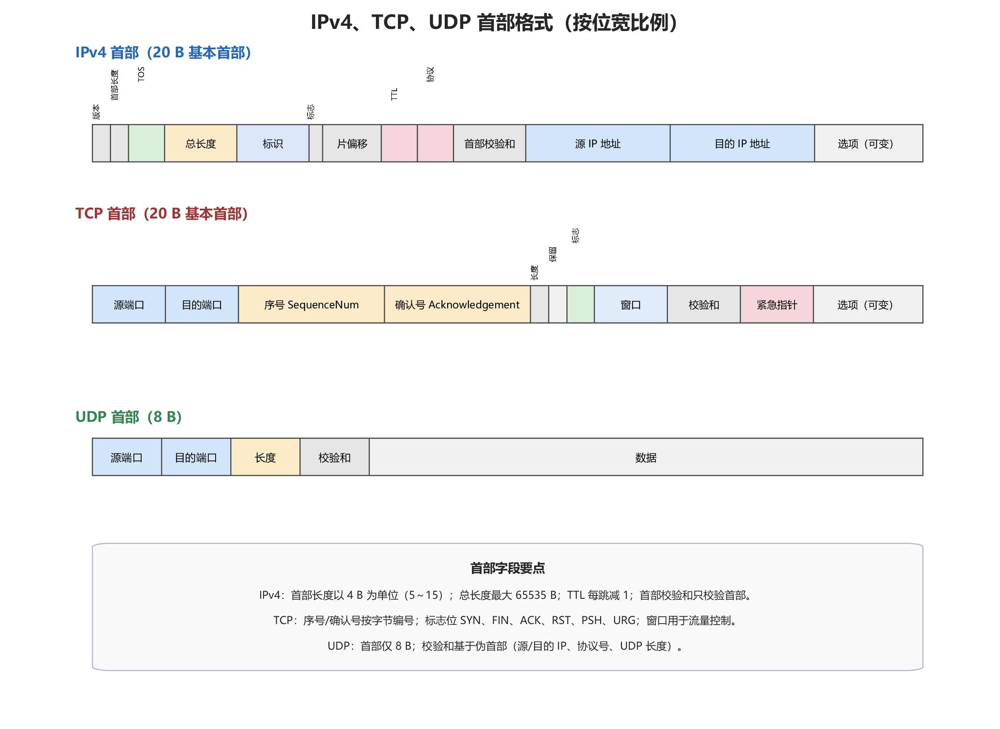

#### 3.2.2 分段与重组

- **MTU（最大传输单元）**：数据链路层可传送的最大分组长度。
  - 以太网 MTU = 1500 字节；PPP 常见 532 字节。
- 为什么不统一采用所有网络的最小 MTU：
  - 未来可能出现新的网络技术，MTU 未知；
  - 小 MTU 会使首部占比过高，增加分组数量和处理开销。
- 基本策略：
  - 主机以所连网络的 MTU 作为发送数据报的长度标准；
  - 途中若数据报长度 > 输出链路 MTU，则分段；必要时可再次分段；
  - 每个分段都是**自包含**的数据报，独立传输；
  - **重组只在目的主机进行**；
  - 任一分段丢失，IP 本身不恢复；目的主机等待重组超时后丢弃整个数据报。

**分段计算（必须会）：**

- 原数据报：首部 20 字节 + 数据 3980 字节，总长 4000 字节；输出链路 MTU = 1500。
- 每个分段的数据部分最多 $1500-20=1480$ 字节。
- 分段：

| 分段 | 数据长度 | 总长度 | 偏移（8 字节单位） | MF |
|---|---|---|---|---|
| 1 | 1480 | 1500 | 0 | 1 |
| 2 | 1480 | 1500 | 185 | 1 |
| 3 | 1020 | 1040 | 370 | 0 |

$$3980=1480+1480+1020,\quad 1480/8=185,\quad 2960/8=370$$

> 偏移字段以 8 字节为单位，因此除最后一段外，每段数据长度必须是 8 的倍数。

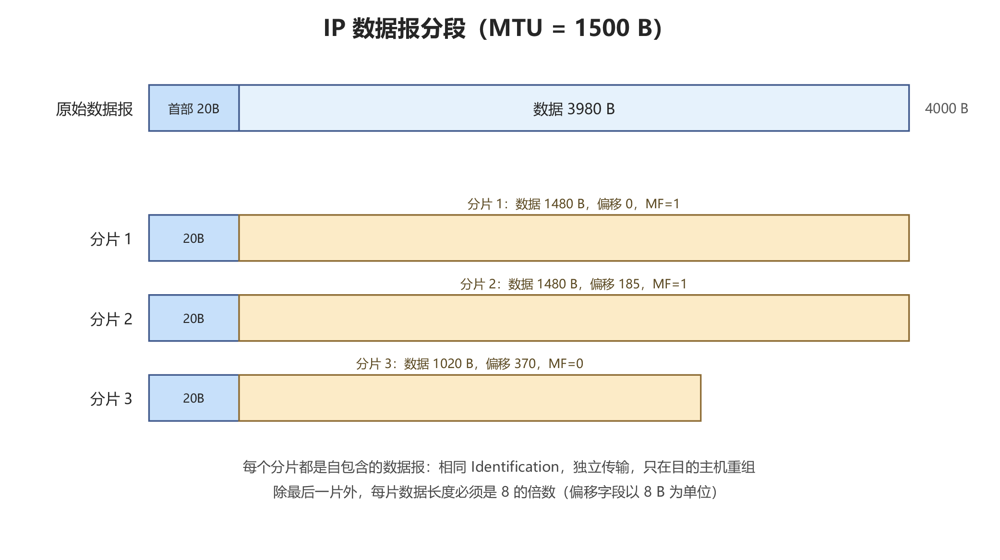

### 3.3 IP 编址（掌握）

#### 3.3.1 编址对象与分层结构

- IP 地址标识**网络接口**，不是主机本身；一台主机/路由器有多个接口就有多个 IP 地址。
- IPv4 地址 32 bit，通常写为点分十进制，如 202.114.0.242。
- **分层级编址**：网络号 + 主机号。
  - 同一网络中的主机和路由器接口具有相同网络号；
  - 网络号用于路由聚合，减少转发表表项。

#### 3.3.2 原始有类别编址

| 类别 | 前导比特 | 网络号位数 | 主机号位数 | 地址范围/用途 |
|---|---|---|---|---|
| A | 0 | 7 | 24 | 1.0.0.0 ~ 126.255.255.255，大型网络 |
| B | 10 | 14 | 16 | 128.0.0.0 ~ 191.255.255.255，中型网络 |
| C | 110 | 21 | 8 | 192.0.0.0 ~ 223.255.255.255，小型网络 |
| D | 1110 | — | — | 多播 |
| E | 1111 | — | — | 保留 |

- 固定类别的问题：
  1. 地址空间利用效率低（网络大小颗粒度只有 17M、65K、256 台主机）；
  2. 路由表规模过大（每个网络一条表项）。
- 改进：子网划分、CIDR、NAT、IPv6。

**特殊地址：**

| 地址 | 含义 |
|---|---|
| 主机号全 0 | 网络地址，表示该网络整体 |
| 主机号全 1 | 直接广播地址，表示该网络全体主机 |
| 127.0.0.0/8 | 环回地址 |
| 0.0.0.0 | 本机/默认路由 |
| 10.0.0.0/8、172.16.0.0/12、192.168.0.0/16 | 私有地址 |

#### 3.3.3 子网划分

- **子网划分**：把一个网络（地址块）分成多个较小的子网（地址块），精细化地址分配。
- 使用不同长度的子网掩码进行划分，称为**变长子网掩码（VLSM）**；它允许同一地址块内不同子网使用不同前缀长度，进一步提高地址利用率。
- **子网掩码**：一串连续 1 + 一串连续 0，用于确定网络号与主机号的边界。
  - 例：255.255.255.192 = `/26`。
- 给定主机号 k 比特，可用主机地址数为 $2^k-2$（去掉全 0 网络地址和全 1 广播地址）。
- **划分原则**：
  - `<子网号, 子网掩码>` 唯一标定一个子网；
  - 不同子网的地址空间不得重叠；
  - 按子网大小**从大到小**依次划分。
- **划分方法**：
  1. 根据每个子网所需主机数，确定主机号比特数 x（满足 $2^x-2\ge$ 主机数）；
  2. 网络号比特数 = 32 − x；
  3. 前 32−x 位相同的地址属于同一子网；
  4. 掩码前 32−x 位为 1，后 x 位为 0。

**例：** C 类地址块 199.1.1.0/24，分为 3 个子网：2 个 64 地址、1 个 128 地址。

- $256=1\times128+2\times64$；
- 从大到小：199.1.1.0/25（128 地址）、199.1.1.128/26（64 地址）、199.1.1.192/26（64 地址）。

**例（作业）：** 机构拥有 212.1.2.0/23（512 个地址），分给 A/B/C/D/E 五个部门，主机数 180/110/52/23/16。

| 部门 | 主机数 | 需主机位 | 子网 | 掩码 |
|---|---|---|---|---|
| A | 180 | 8 | 212.1.2.0/24 | 255.255.255.0 |
| B | 110 | 7 | 212.1.3.0/25 | 255.255.255.128 |
| C | 52 | 6 | 212.1.3.128/26 | 255.255.255.192 |
| D | 23 | 5 | 212.1.3.192/27 | 255.255.255.224 |
| E | 16 | 5 | 212.1.3.224/27 | 255.255.255.224 |

> 检验：256+128+64+32+32 = 512，无重叠，覆盖整个 /23。

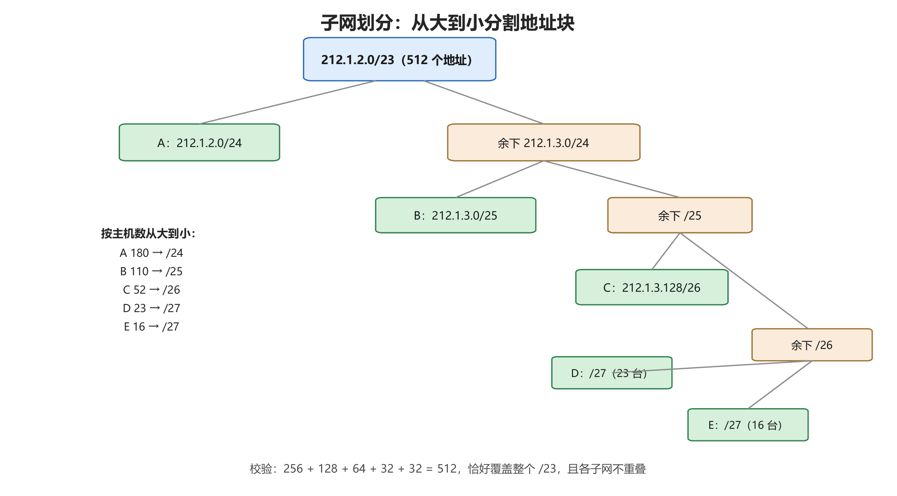

#### 3.3.4 CIDR（无类别域间路由）

- CIDR 用“网络地址/前缀长度”表示地址块，前缀长度可任意（1–30）。
- CIDR 的地址聚合也称为**超网（supernetting）**：把多个连续的小地址块合并成一个更大的地址块。
- 网络大小颗粒度可伸缩：$2^k$（k ≥ 8），如 256、512、1024……
- **路由聚合**：把多个连续、具有相同前缀的地址块合并为一条路由，减小路由表规模。
- **可聚合条件**：
  1. 地址块连续；
  2. 相同前缀（高位比特）能覆盖所有地址块。
- 例：199.199.0.0 ~ 199.199.3.0 共 4 个 C 类块，前 22 位相同 → 199.199.0.0/22。
- 不可聚合例：
  - 199.199.1.0 ~ 199.199.4.0：连续但公共前缀不能覆盖全部；
  - 199.199.1.0、199.200.2.0、199.210.3.0、199.234.1.0：不连续。
- **CIDR + 子网划分**：一个聚合、一个分割，实现地址空间任意伸缩；理论上网络号长度 n ∈ {1,…,30}，n+h=32。

#### 3.3.5 最长前缀匹配（掌握）

- 转发表表项形如 `<网络地址/前缀长度, 下一跳>`。
- 匹配规则：目的 IP 地址的前 m 位 = 表项网络地址的前 m 位。
- 若多条表项匹配，选择**前缀最长**（最具体）的一条——**最长前缀匹配**。
- 若无匹配，使用默认路由。

**例：** 目的地址 200.200.21.1，转发表：

| 网络/前缀 | 下一跳 | 是否匹配 |
|---|---|---|
| 199.199.240.0/22 | Router A | 否 |
| 199.199.0.0/17 | Router B | 否 |
| 200.200.16.0/20 | Router C | 是 |
| 200.200.21.0/24 | Router D | 是（更长） |

→ 选择 200.200.21.0/24，下一跳 Router D。

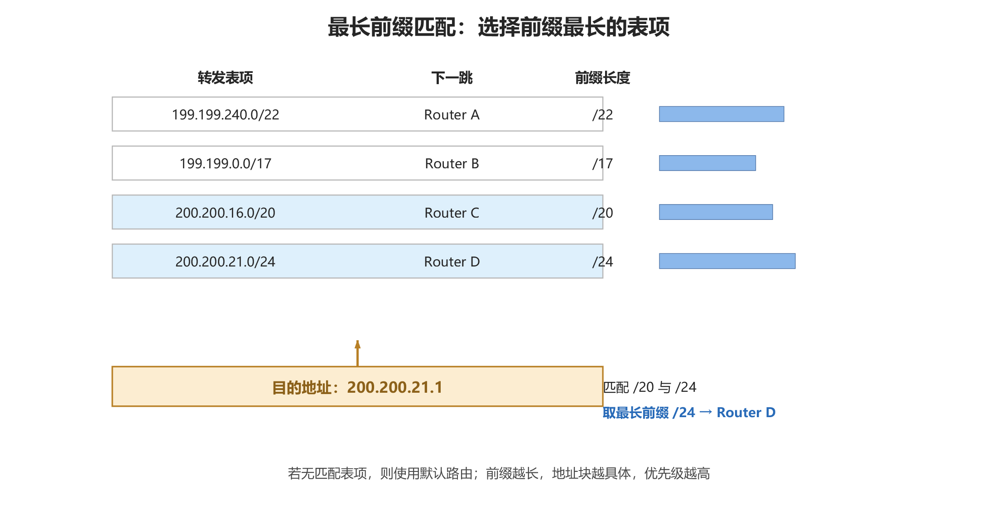

### 3.4 IP 数据报转发与辅助协议（掌握）

#### 3.4.1 转发过程

**主机：**

```text
if (目的网络号 == 本机网络号)
    直接通过数据链路层交付给目的主机
else
    交给默认路由器
```

**路由器：**

```text
if (目的网络号 == 某个直连接口的网络号)
    从该接口直接交付
else if (目的网络号匹配转发表某表项)
    交给该表项的下一跳
else
    交给默认路由器
```

- 每个分组独立查表转发（数据报交换）。
- 路由器区分的是**目的网络号**，不是单个主机地址；这是转发表可扩展的关键。
- 相邻路由器之间、到达目的网络后，数据包通过数据链路层网络（PPP、以太网、WiFi）传输，需要下一跳的 MAC 地址。

#### 3.4.2 ARP（地址解析协议）

- 作用：在同一局域网内，把 IP 地址解析为 MAC 地址。
- 每个 IP 节点维护 **ARP 映射表**：`<IP 地址, MAC 地址, TTL>`，TTL 典型值 20 分钟。
- 工作过程：
  1. 主机 X 要向同局域网的主机 D 发送数据报，但表中无 D 的 MAC；
  2. X **广播** ARP 查询消息（含 D 的 IP）；
  3. D 收到后**单播**回复自己的 MAC；
  4. X 添加/刷新表项；D 也借机添加/刷新 X 的表项；
  5. 局域网内其它主机收到广播后，若表中有 X 的条目则刷新，否则忽略。
- 注意：ARP 只用于同一局域网；跨网络时解析的是下一跳路由器的 MAC。
- **广播风暴**：广播帧（如 ARP 请求）在存在环路的二层网络中被反复洪泛，消耗带宽和 CPU；生成树协议、划分广播域（路由器/VLAN）可抑制。

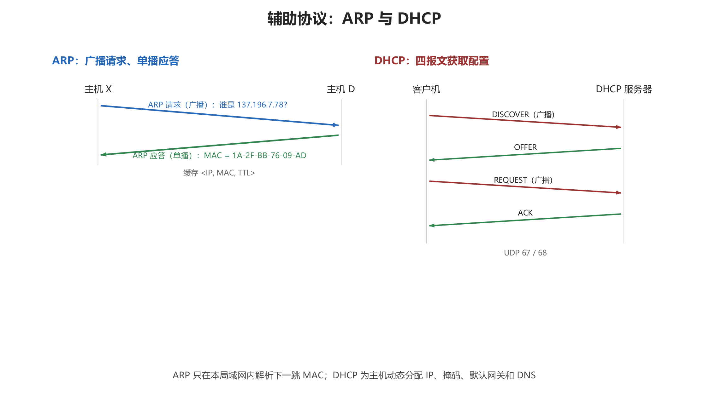

#### 3.4.3 DHCP（动态主机配置协议）

- 主机联网需要四个参数：IP 地址、网络掩码、默认路由器 IP、DNS 服务器 IP。
- 获取方式：静态手工配置；动态 DHCP/BOOTP/RARP。
- DHCP 消息（UDP，服务器 67、客户端 68）：

| 消息 | 方向 | 作用 |
|---|---|---|
| DHCPDISCOVER | 客户端广播 | 寻找 DHCP 服务器 |
| DHCPOFFER | 服务器 → 客户端 | 提供配置参数（IP、掩码、网关、DNS、租期） |
| DHCPREQUEST | 客户端广播 | 告知选择的配置 |
| DHCPACK | 服务器 → 客户端 | 确认配置 |

- 优点：减少大型网络管理负担；移动 IP 的必要补充。

#### 3.4.4 ICMP（互联网控制消息协议）

- 作用：主机/路由器之间交换网络层控制信息。
- 典型功能：
  - 错误报告：目的网络/主机/协议/端口不可达、TTL 过期、坏首部等；
  - 回响请求/回应：`ping`。
- ICMP 消息封装在 IP 数据报中；格式含 Type、Code、产生错误的 IP 数据报前 8 字节。
- **traceroute 原理**：
  - 源主机发送一系列 UDP 报文段，TTL 依次为 1、2、3……
  - 第 n 个数据报到达第 n 个路由器时 TTL 为 0，路由器丢弃并回送 ICMP（type 11, code 0）；
  - 源主机据返回 ICMP 计算 RTT；
  - 目的主机返回“端口不可达”（type 3, code 3）时停止；
  - 每个 TTL 重复 3 次。

#### 3.4.5 NAT（网络地址转换）

- 目的：缓解 IPv4 地址短缺。
- 私有地址块：10.0.0.0/8、172.16.0.0/12、192.168.0.0/16。
- NAT 路由器把“私有 IP + 端口”映射为“公网 IP + 端口”，维护 NAT 表。

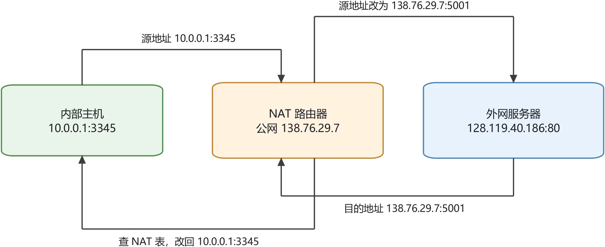
- 出方向：替换源 IP/端口；入方向：根据 NAT 表替换目的 IP/端口。
- 问题：外网主机不能直接访问 NAT 后的服务器（地址不可见）。
  - 解决：静态端口映射、UPnP/IGD 自动配置、中继节点（如 Skype）。
- NAT 对应用的影响：应用数据中携带 IP 地址的协议可能需要特殊处理（如 FTP、H.323）。

### 3.5 路由算法（掌握）

#### 3.5.1 路由与转发

| 概念 | 所属平面 | 作用 |
|---|---|---|
| 路由（routing） | 控制平面 | 运行路由协议，交换拓扑/路由信息，计算路由表 |
| 转发（forwarding） | 数据平面 | 查转发表，把分组从输入端口送到输出端口 |

| 表 | 所属 | 特点 |
|---|---|---|
| 路由表 | 控制平面 | 由路由模块维护，包含完整拓扑信息，用于路由计算 |
| 转发表 | 数据平面 | 针对转发优化，`<目的网络, 输出端口/下一跳>`，可含 MAC 信息 |

**网络拓扑抽象为图：**

- 节点 = 路由器；边 = 链路；边权 = 开销（通常为加性）。
- 路径开销 = 各链路开销之和；跳数是一种特殊开销（每条链路 = 1）。
- 路由问题 = 求最小开销路径；对数据报交换，等价于求**下一跳**。

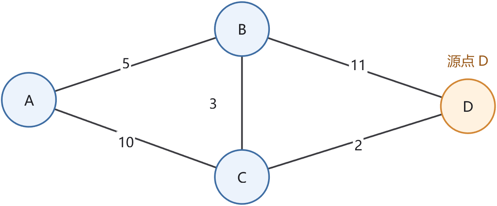

#### 3.5.2 距离向量路由（Bellman-Ford）

**每个节点：**

1. 初始化距离向量：到邻居的距离为链路开销，到其它节点为 ∞；
2. 把距离向量发送给所有邻居；
3. 收到邻居 Y 的距离向量后，对每个目的地 Z：
   - 新距离 = 自己到 Y 的距离 + Y 到 Z 的距离；
   - 若新距离更短，更新距离并把下一跳记为 Y；
4. 重复 2–3，直到收敛。

**特点：**

- 对“好消息”响应快，对“坏消息”响应慢；
- 路由升级消息可能过多；
- **无穷计数（count-to-infinity）**问题。

**无穷计数示例：** A—E 链路失效。

- A 通告到 E 为 ∞，但 B、C 仍通告经对方 2 跳可达 E；
- B 认为经 C 3 跳可达 E，通告 A；A 认为经 B 4 跳可达 E，通告 C；C 又认为 5 跳……
- 距离不断增大，直到达到“无穷大”才停止，收敛很慢。

**解决方案：**

| 方案 | 做法 | 局限 |
|---|---|---|
| 小数值近似无穷 | 如 RIP 用 16 表示 ∞ | 限制最大跳数（RIP 最大 15 跳） |
| 水平分裂 | 不向邻居通告从该邻居学到的路由 | 只能解决两个节点间的环路 |
| 毒性逆转水平分裂 | 对从某邻居学到的路由，向其通告距离 ∞ | 仍不能解决三个及以上节点的环路 |

#### 3.5.3 链路状态路由（Dijkstra）

**基本思路：**

1. 每个节点把自己与邻居的链路状态（邻居、开销）通告给**所有其它节点**（洪泛）；
2. 所有节点获得全局拓扑；
3. 每个节点用 Dijkstra 算法计算到所有目的地的最短路径和下一跳。

**Dijkstra 伪代码：**

```text
M = {s}                         // 已确定最短路径的节点集合
for each n in N - {s}:
    C(n) = l(s, n)              // 初始距离
while (M != N):
    find w in N - M such that C(w) is minimum
    M = M ∪ {w}
    for each n in N - M:
        C(n) = MIN(C(n), C(w) + l(w, n))
```

**前向搜索实现：**

- 维护**证实表（Confirmed List）**和**临时表（Tentative List）**；
- 表项：`(Destination, Cost, NextHop)`；
- 每次从临时表取最小开销表项移入证实表，再用其邻居更新临时表；
- 临时表空时结束，证实表即路由表。

**例：** 拓扑 A—B（5）、A—C（10）、B—C（3）、B—D（11）、C—D（2），以 D 为源：

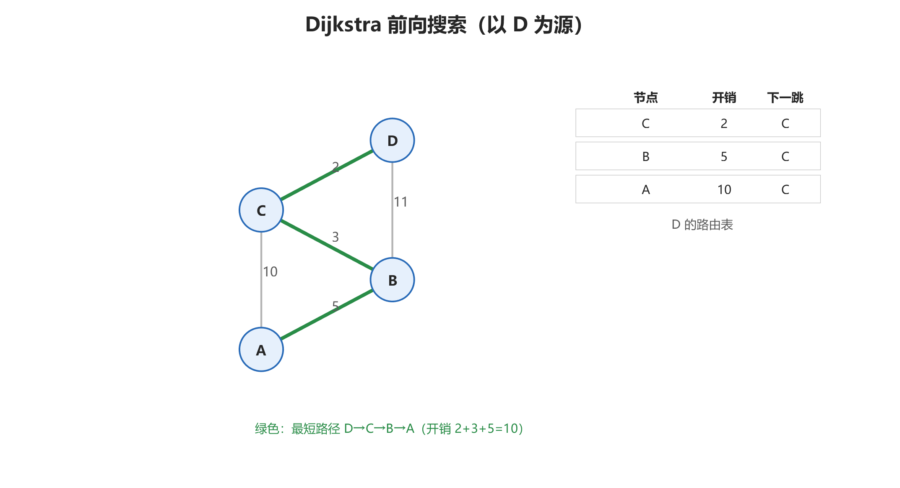

| 步骤 | 证实表 | 临时表 | 说明 |
|---|---|---|---|
| 1 | (D,0,-) | — | 初始化 |
| 2 | (D,0,-) | (C,2,C), (B,11,B) | 用 D 的邻居更新 |
| 3 | (D,0,-), (C,2,C) | (B,11,B) | C 开销最小，移入证实表 |
| 4 | (D,0,-), (C,2,C) | (B,5,C), (A,12,C) | 经 C 到 B 更短，替换 |
| 5 | (D,0,-), (C,2,C), (B,5,C) | (A,12,C) | B 开销最小，移入 |
| 6 | (D,0,-), (C,2,C), (B,5,C) | (A,10,C) | 经 B 到 A 更短，替换 |
| 7 | (D,0,-), (C,2,C), (B,5,C), (A,10,C) | — | A 移入，结束 |

→ D 的路由表：C 经 C（2）、B 经 C（5）、A 经 C（10）。

**特点：**

- 收敛快，对拓扑变化响应快；
- 洪泛产生的流量较重；
- 与距离向量的区别：
  - 链路状态：每个节点把**链路状态**告诉**所有节点**；
  - 距离向量：每个节点把**到所有节点的距离**告诉**邻居**。

### 3.6 Internet 路由（理解 + 掌握 RIP/OSPF/BGP 要点）

#### 3.6.1 自治系统与两层路由

- **自治系统（AS）**：在单一管理实体控制下的网络集合，如 ISP 网络、大型企业网。
- 引入 AS 的考虑：
  - 可扩展性：路由层次可聚合路由信息；
  - 管理：对应社会管理结构；
  - 安全：拓扑信息、路由策略。
- AS 与 IP 网络是不同维度的划分：一个 AS 通常包含多个不同网络号的 IP 网络。
- **两层路由**：

| 层次 | 范围 | 协议类别 | 例子 |
|---|---|---|---|
| 域内路由 | 一个 AS 内部 | IGP（内部网关协议） | RIP、OSPF、IS-IS |
| 域间路由 | AS 之间 | EGP（外部网关协议） | BGP |

#### 3.6.2 RIP

- 基于**距离向量**算法。
- 距离 = 跳数：路由器与直连网络、直接相连路由器之间距离均为 1。
- 有效距离 1–15，**16 表示无穷大**。
- 拓扑信息分发：周期性（每 30 秒）+ 触发式（路由升级时）。
- 局限：最大 15 跳限制网络规模；收敛慢；无穷计数。

#### 3.6.3 OSPF

- 基于**链路状态**算法，直接封装在 IP 数据报中（绕过传输层）。
- 链路状态通告 **LSA**：
  - 建立 LSA 的节点 ID；
  - `<AdjacentNode, Cost>` 列表；
  - 序号（sequence number）；
  - TTL。
- **可靠洪泛**：
  - 输入端口不转发；
  - 启动时序号为 0，周期性生成新 LSA，序号递增；
  - 每个节点只存储最新 LSA；
  - 每转发一次 TTL 减 1，为 0 丢弃。
- 洪泛触发：周期性定时、拓扑变化（新增/失效，靠链路层协议和 Hello 消息检测）。
- 路由计算：Dijkstra。
- **两级分层**：主干区域 area 0 + 非主干区域。
  - 链路状态只在区域内通告；
  - 区域边界路由器（ABR）汇总本区域网络开销并通告其它区域；
  - 主干路由器在 area 0 运行 OSPF；
  - 边界路由器连通其它 AS，同时运行 OSPF 和 BGP。
- 特点：所有消息需认证；支持等开销多路径（ECMP）；可按 TOS 设置链路开销；单播/多播路由集成；可扩展。

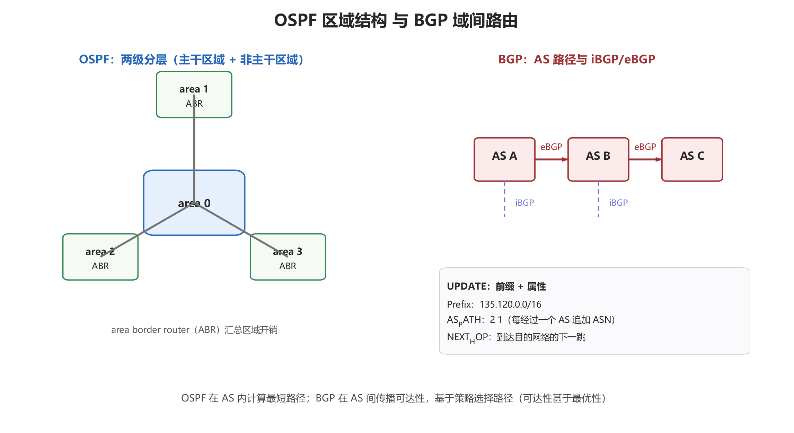

#### 3.6.4 BGP

- **路径向量（path vector）**路由：向邻居通告完整的 AS 路径，而非简单距离。
- 基于**策略**：允许丰富的路径选择和通告策略。
- 两个部分：
  - **iBGP**：同一 AS 内 BGP 路由器之间；
  - **eBGP**：不同 AS 的 BGP 路由器之间。
- BGP 消息类型：

| 消息 | 作用 |
|---|---|
| OPEN | 建立对等会话 |
| UPDATE | 通告新路由或撤销旧路由 |
| NOTIFICATION | 关闭对等会话 |
| KEEPALIVE | 周期性确认会话有效 |

- 对等会话基于 **TCP** 专门建立。
- 路由通告 = 前缀（Prefix）+ 属性（Attributes）：
  - `AS_PATH`：经过的 AS 序列，必需；
  - `NEXT_HOP`：到达目的网络的下一跳，必需；
  - 其它可选属性。
- AS 号（ASN）加入 AS_PATH，形成 AS 级路径；所有 AS 地位相同（无论大小）。
- **域间路由的首要目标**：找到至任一目的网络的**无环路由**；可达性甚于最优性。
- 技术挑战：大规模、自治、信任关系、策略。
- **AS 分类**：

| 类型 | 连接 | 承载流量 |
|---|---|---|
| 末梢 AS（stub） | 与其它 AS 单一连接 | 只承载本地流量 |
| 多穴 AS（multihomed） | 多个连接 | 不承载过境流量 |
| 中转 AS（transit） | 多个连接 | 承载本地 + 过境流量 |

- **基于策略的路由**：连通性不等于可达性；策略决定流量如何流过互联网。
- **无谷（valley-free）原则**：路径经过 provider-customer 或 peer-peer 链路后，不能再经过 customer-provider 或 peer-peer 链路；用于判断 AS 路径是否有效。

#### 3.6.5 IPv6

- 动因：IPv4 地址耗尽；Internet 规模持续增长（主机、IoT 设备）。
- 地址空间：128 bit，约为 IPv4 的 $10^{29}$ 倍。
- 特点：
  - 无类别编址（类似 CIDR），按前导比特细分；
  - 首部简化；
  - 支持服务质量、自动配置、安全、移动性、多播、任播（anycast）。
- **首部**：固定 40 字节。

| 字段 | 作用 |
|---|---|
| Version | 6 |
| Traffic Class | 服务质量 |
| Flow Label | 流量标识 |
| Payload Length | 载荷长度 |
| Next Header | 后续首部类型（代替 IPv4 的 protocol/options） |
| Hop Limit | 相当于 TTL |
| Source Address | 128 bit |
| Destination Address | 128 bit |

- 相比 IPv4 消失的字段：首部长度、服务类型、分片相关字段、首部校验和。
- **扩展首部**：指向传输层报文段或选项；最后一个是传输层首部；已定义分片、源路由、认证与安全等；顺序有要求。
- **地址表示**：
  - 8 组 16 bit 十六进制，冒号分隔；
  - 每组前导 0 可省略；
  - 连续为 0 的组可用一次 `::` 省略（只能出现一次）。
  - 例：`47CD:1358:0:0:0:0:6479:DAEF` → `47CD:1358::6479:DAEF`。
- **地址空间分配**：

| 前缀 | 用途 |
|---|---|
| 2000::/3 | 全局单播 |
| FC00::/7 | 唯一区域单播（私有网络） |
| FE80::/10 | 链路本地单播（自动配置、邻居发现） |
| FF00::/8 | 多播 |
| ::x.x.x.x/96 | IPv4 兼容地址 |
| ::FFFF:x.x.x.x/96 | IPv4 映射地址（迁移过渡） |

- **自动配置**：无状态自动配置——主机向本地路由器请求 network+subnet ID 和掩码，用自己的链路层地址作为 interface ID；也支持有状态（类似 DHCP）和静态配置。
- **迁移**：双栈（同时运行 IPv4/IPv6）、IP 隧道（把 IPv6 封装在 IPv4 中传输，或反之）。

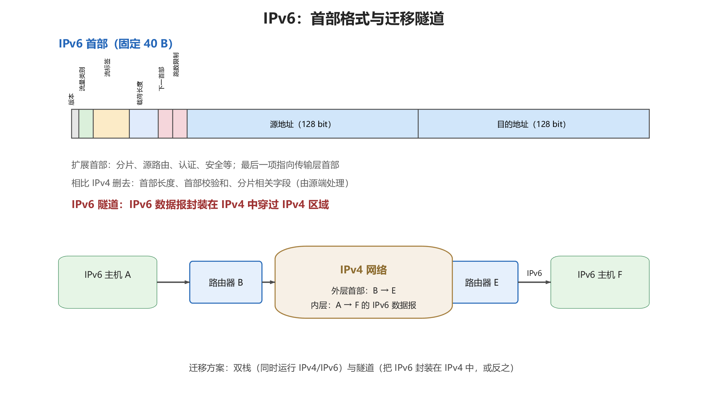

### 3.7 路由器（掌握）

- **数据平面**：
  - 从输入端口接收数据包；
  - 查转发表，确定输出端口；
  - 递减 TTL、重新计算首部校验和；
  - 必要时分段；
  - 在输出端口排队、转发。
- **控制平面**：
  - 运行路由协议（RIP/OSPF/BGP），交换路由信息；
  - 计算并维护路由表/转发表。
- 输入/输出端口有缓存；缓存不足会丢包。
- 路由器与交换机的区别：
  - 路由器工作在网络层，基于 IP 地址转发，连接不同网络；
  - 交换机工作在数据链路层，基于 MAC 地址转发，连接同一类型局域网；
  - 路由器隔离广播域，交换机不隔离广播域（除非划分 VLAN）。

## 4. 第四部分 传输层

> 对应课件：`11-Layer4(I).pdf`、`12-Layer4(II).pdf`、`14-Summ.pdf`

### 4.1 传输层概述（理解）

- 传输层为运行在终端主机中的网络应用提供**共性服务**（可靠传输、流量控制、拥塞控制等）。
- 位于操作系统内核，可被所有应用进程调用。
- **端到端协议**：在应用进程之间提供逻辑通道。
  - 发送方：把应用消息分割成合适大小的报文段，交给网络层；
  - 接收方：从网络层接收报文段，交给应用层。

**端到端可靠传输的技术挑战：**

| 挑战 | 原因 | 应对 |
|---|---|---|
| 多对进程同时通信 | 每对进程需要独立的滑动窗口状态 | 用逻辑连接把状态与“本地—远端进程对”关联 |
| RTT 动态范围大 | 网络距离、排队时延随机变化 | 超时重传自适应于 RTT 及其变化 |
| 分组可能乱序、极晚到达 | 网络层不保证顺序 | 滑动窗口必须能正确处理迟到分组 |
| 接收方资源动态变化 | 缓存空间随负载变化 | 流量控制 |
| 网络资源动态变化 | 多条流竞争带宽 | 拥塞控制 |

### 4.2 UDP（理解）

- **UDP（用户数据报协议）**：面向消息、无连接，只是在 IP 基础上加了一层复用。
- 不提供可靠传输、流量控制、拥塞控制。

**UDP 首部（8 字节）：**

| 字段 | 长度 | 作用 |
|---|---|---|
| 源端口 SrcPort | 16 bit | 发送方应用进程 |
| 目的端口 DstPort | 16 bit | 接收方应用进程 |
| 长度 Length | 16 bit | 首部 + 数据 |
| 校验和 Checksum | 16 bit | 基于 UDP 报文段 + 伪首部计算 |

- **伪首部**（12 字节）：源 IP、目的 IP、0、协议号、UDP 长度；用于校验和计算，不实际传输。
- **复用/解复用**：根据目的端口把报文段交给对应应用进程。

**UDP 的优缺点：**

| 优点 | 缺点 |
|---|---|
| 精细控制发送时机，应用写入即发送 | 不保证可靠、不保证顺序 |
| 无连接建立时延 | 不能自适应网络状态 |
| 无连接状态，易处理大量客户端 | 可能导致网络过载 |
| 首部开销小（8 字节） | 可能压制自适应流量 |

**典型应用：**

- DNS：单条查询通常一个报文段足够，连接建立开销不划算；
- VoIP、视频流：偶尔丢包可接受，重传往往为时已晚。

### 4.3 TCP 基本机制（掌握）

#### 4.3.1 TCP 的特点

| 特点 | 含义 |
|---|---|
| 字节流传输 | 不保留应用消息边界，按自己的节奏划分报文段 |
| 面向连接 | 传输前建立连接；全双工，支持双向并行 |
| 可靠传输 | 按序、无损 |
| 流量控制 | 避免接收方过载 |
| 拥塞控制 | 避免网络过载 |

- **MSS（最大报文段长度）**：$MSS=MTU-\text{IP 首部长度}-\text{TCP 首部长度}$；以太网典型 MSS = 1500−20−20 = 1460 字节。
- TCP 发送报文段的时机：
  1. 待传数据达到 MSS；
  2. 应用进程触发（如 push 操作）；
  3. 发送触发定时器到期。

#### 4.3.2 TCP 首部

| 字段 | 长度 | 作用 |
|---|---|---|
| 源端口 | 16 bit | 发送方进程 |
| 目的端口 | 16 bit | 接收方进程 |
| 序号 SequenceNum | 32 bit | 本报文段数据第一个字节的序号 |
| 确认号 Acknowledgement | 32 bit | 期望收到的下一个字节序号 |
| 首部长度 | 4 bit | 以 32 bit 为单位 |
| 保留 | 4 bit | — |
| 标志位 Flags | 6 bit | URG、ACK、PSH、RST、SYN、FIN |
| 窗口 AdvertisedWindow | 16 bit | 流量控制，通告接收窗口 |
| 校验和 | 16 bit | 首部 + 数据 |
| 紧急指针 Urgent Pointer | 16 bit | 紧急数据位置 |
| 选项 | 可变 | 如 MSS、窗口扩大、SACK、时间戳 |

- 标志位含义：
  - SYN：建立连接；
  - FIN：终止连接；
  - ACK：确认号有效；
  - URG：紧急数据；
  - PSH：不等待填满即发送；
  - RST：重置/中断连接。
- **捎带累积确认**：接收方通常不专门发 ACK，而是在反向数据报文段中携带确认；ACK=1 表示确认字段有效，确认号 = 期望收到的下一字节序号。

#### 4.3.3 端口与连接标识

- 服务器使用**熟知端口**（1–1023）：HTTP 80、FTP 21、DNS 53、SMTP 25 等。
- 客户机使用**临时端口**（通常 1024–5000），由主机系统临时分配。
- **TCP 连接四元组**：`<源 IP, 源端口, 目的 IP, 目的端口>` 唯一标识一条连接。
- **端到端分组流五元组**：`<源 IP, 源端口, 协议, 目的 IP, 目的端口>`，协议可为 TCP/UDP；是最精细的服务区分颗粒度。
- 从主动连接方看，`<目的 IP, 协议, 端口>` 对应 Socket API 中的 socket。

#### 4.3.4 三次握手（连接建立）

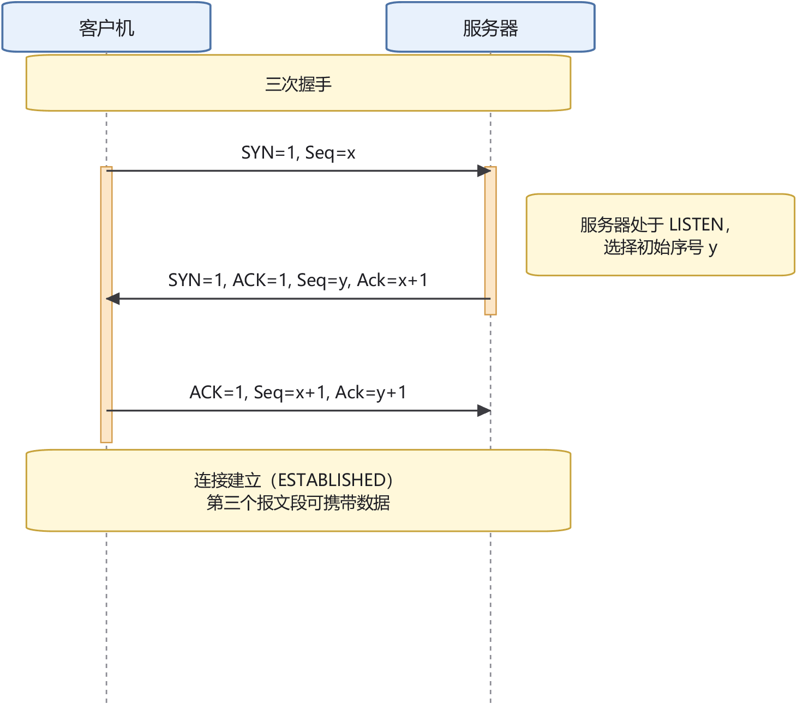

- 共交换三个报文段，双方把各自初始字节序号（随机生成）告知对方。
- 第三次握手的 ACK 可以携带客户机到服务器的数据。
- 为什么需要三次：确认双方“发送能力”和“接收能力”都正常，并同步初始序号。

#### 4.3.5 四次挥手（连接释放）

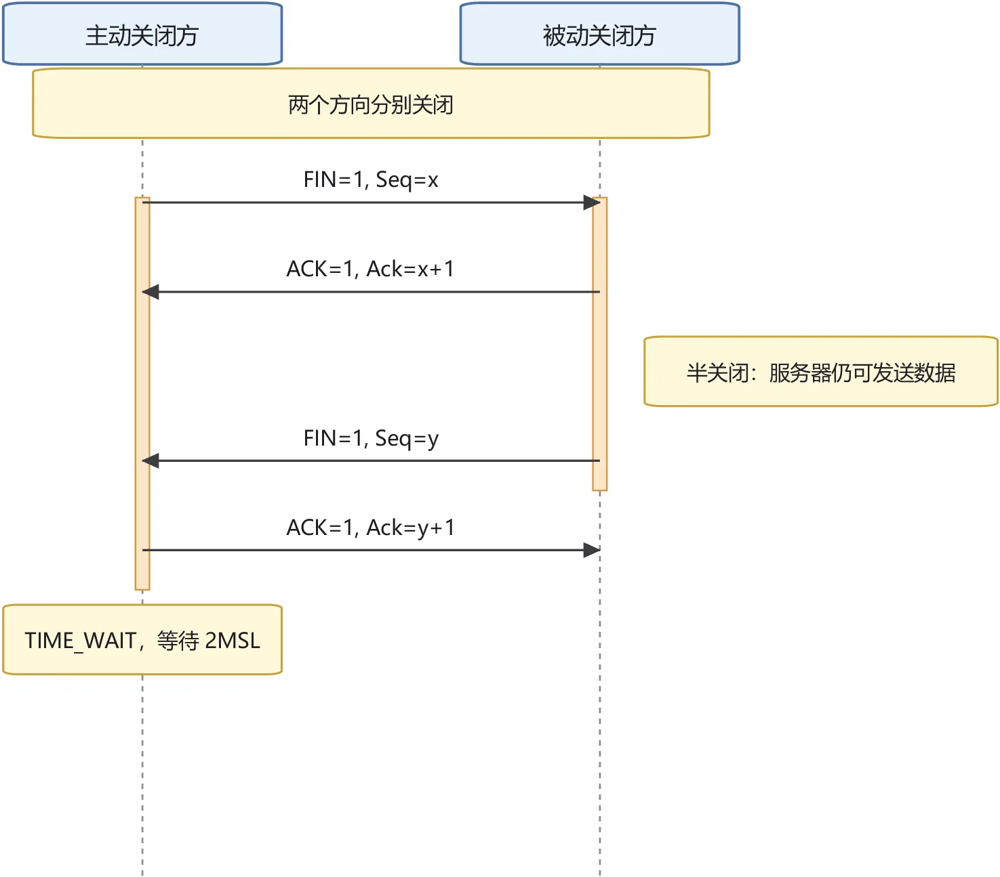

- TCP 连接是全双工的，两个方向需要分别终止，因此需要两轮握手、共四个报文段。
- FIN 报文段在序号空间中占用一个单位，因此确认号为 x+1、y+1。
- 主动关闭方进入 **TIME_WAIT**，等待 **2MSL**（Maximum Segment Lifetime，推荐 120 秒）：
  - 确保最后一个 ACK 丢失时能重传；
  - 让旧连接的迟到报文段在网络中消失，避免影响新连接。

**主要状态：**

| 状态 | 含义 |
|---|---|
| CLOSED | 关闭 |
| LISTEN | 被动等待连接 |
| SYN_SENT | 已发 SYN，等待 SYNACK |
| SYN_RCVD | 收到 SYN，已发 SYNACK |
| ESTABLISHED | 连接建立，可传输数据 |
| FIN_WAIT_1 | 已发 FIN，等待 ACK |
| FIN_WAIT_2 | 已收 FIN 的 ACK，等待对方 FIN |
| CLOSE_WAIT | 收到对方 FIN，已回 ACK，等待本地关闭 |
| CLOSING | 双方同时关闭 |
| LAST_ACK | 已发 FIN，等待最后 ACK |
| TIME_WAIT | 等待 2MSL 后关闭 |

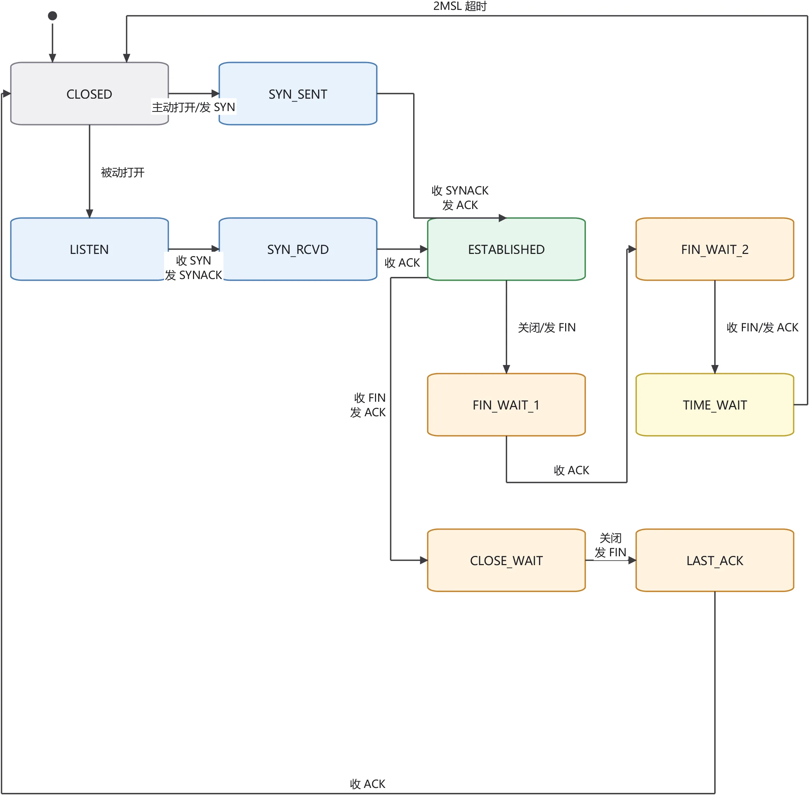

> 同时关闭时还会经过 CLOSING 状态；图中只画主要路径，便于记忆。

#### 4.3.6 序号、窗口与扩展

- 避免序号回绕：序号空间至少为窗口大小的 2 倍。
- TCP 序号空间 $2^{32}$ 远大于窗口 $2^{16}$；但高速链路下 32 位序号仍可能回绕，需要扩展。
- 基本要求：发送窗口（受 AdvertisedWindow 限制）应大于时延带宽积，才能填满管道。
- TCP 扩展（通常以选项形式）：
  1. **时间戳**：精确测量 RTT、防止序号回绕（PAWS）；
  2. **窗口扩大因子**：扩大通告窗口；
  3. **选择性确认 SACK**：提高重传效率。

#### 4.3.7 发送时机与 Nagle 算法

- **糊涂窗口综合症（Silly Window Syndrome）**：一味利用任何小窗口发送小报文段，导致大量小容器无法合并，效率低。
- **Nagle 算法**（ACK 自同步）：

```text
当应用产生数据时：
if 可用数据量 >= MSS 且 窗口 >= MSS:
    发送完整报文段
else if 有未确认数据在飞行中:
    缓存新数据，直到 ACK 到达
else:
    立即发送所有新数据
```

- 兼顾传输效率（尽量发长报文段）和交互式应用实时性（无未确认数据时立即发送）。

#### 4.3.8 自适应重传

**原始算法：**

$$EstimatedRTT=\alpha\cdot EstimatedRTT+(1-\alpha)\cdot SampleRTT$$

$$Timeout=2\times EstimatedRTT$$

- $\alpha$ 推荐 0.8–0.9；SampleRTT = 报文段被确认时刻 − 发送时刻。
- 问题：ACK 只确认“收到数据”，不区分确认的是初始传输还是重传，导致 RTT 采样歧义。

**Karn/Partridge 算法：**

- 重传报文段时**不采样 RTT**；
- 每次重传把超时值加倍（指数后退）；
- 理由：丢包可能由拥塞引起，发送应保守。

**Jacobson/Karels 算法：**

$$Difference=SampleRTT-EstimatedRTT$$

$$EstimatedRTT=EstimatedRTT+\delta\cdot Difference$$

$$Deviation=(1-\delta)\cdot Deviation+\delta\cdot|Difference|$$

$$Timeout=\mu\cdot EstimatedRTT+\phi\cdot Deviation$$

- 通常 $\mu=1$，$\phi=4$，$\delta\in(0,1)$；
- Deviation 表示 RTT 估计的偏离程度；RTT 波动越大，超时值越大。

### 4.4 TCP 流量控制（掌握）

- 目的：发送方尽快发送，同时避免接收方缓存溢出。
- 机制：接收方通过首部 **AdvertisedWindow** 字段通告当前接收窗口，发送方据此限制发送窗口。

$$AdvertisedWindow=MaxRcvBuffer-((NextByteExpected-1)-LastByteRead)$$

$$SndWindow=\min\{CongestionWindow,AdvertisedWindow\}-(LastByteSent-LastByteAcked)$$

- 连接建立时：接收方把 AdvertisedWindow 设为其接收缓存大小。
- 第一回合：发送量 ≤ min(有效数据量, AdvertisedWindow)。
- 随后：发送量 ≤ min(有效数据量, AdvertisedWindow − 未确认数据量)。
- 当接收方通告 0 窗口时，发送方周期性发送**零窗口探测**报文段，探测窗口是否变化。
- 流量控制 vs 拥塞控制：
  - 流量控制：接收方告知其可用缓存，防止**接收方**过载；
  - 拥塞控制：源端根据网络状况调整，防止**网络**过载。

### 4.5 TCP 拥塞控制（掌握）

#### 4.5.1 网络拥塞

- 网络是资源（带宽、缓存）受限系统，多条分组流竞争共享资源。
- 源端不知道当前网络有效容量和其它流的存在，注入流量常超过容量。
- 拥塞后果：持续丢包、时延增大、资源浪费（下游丢弃使上游传输全部作废）。
- **吞吐量/时延随负载变化**：
  - **拐点（knee）**：吞吐量增长变慢，时延增长加快；
  - **断崖（cliff）**：吞吐量快速下降至 0（拥塞崩溃），时延趋于无穷。
- **拥塞避免**：保持在拐点左侧；**拥塞控制**：保持在断崖左侧。
- 方法分类：
  - **基于终端**：源端观察丢包/时延，调整发送速率（TCP 属于此类）；
  - **网络协助**：路由器提供反馈或主动丢包（ECN、AQM、DECbit 等）；
  - 其它：流量工程、增加网络容量。
  - 增加路由器缓存**不能**消除拥塞。

#### 4.5.2 拥塞窗口

- TCP 源端把**超时**（以及 3 个重复 ACK）视为网络拥塞信号。
- 维护**拥塞窗口 CongestionWindow（cwnd）**：可发送且不会导致拥塞的最大数据量。
- 发送窗口：

$$SndWindow=\min\{CongestionWindow,AdvertisedWindow\}-(LastByteSent-LastByteAcked)$$

- 除发送窗口由 cwnd 和 AdvertisedWindow 共同决定外，其余滑动窗口操作与标准版本相同。

#### 4.5.3 TCP 拥塞控制的五个元素

| 元素 | 作用 |
|---|---|
| AIMD（加性增加/乘性减小） | 无拥塞时缓慢增加，拥塞时快速减小 |
| 慢启动（Slow Start） | 连接初期快速提升 cwnd |
| 拥塞避免（Congestion Avoidance） | cwnd 达到阈值后改为线性增长 |
| 快速重传（Fast Retransmit） | 3 个重复 ACK 时立即重传，不等超时 |
| 快速恢复（Fast Recovery） | 快速重传后不回到慢启动，直接进入拥塞避免 |

**AIMD：**

- 加性增加：每个 RTT，cwnd 增加 1 个 MSS；
- 乘性减小：检测到拥塞时，cwnd 乘以一个小于 1 的因子（通常减半）；TCP 具体实现中，超时通常把 cwnd 直接降为 1，3 个重复 ACK 则减半。
- 形成锯齿状，探查合理发送速率 ≈ cwnd / RTT。
- 简化模型：$x_i(t+1)=a_I+b_I x_i(t)$（增加），$x_i(t+1)=a_D+b_D x_i(t)$（减小）；AIMD 对应 $a_I>0,b_I=1,a_D=0,0<b_D<1$。
- AIMD 收敛到效率线（总带宽充分利用）与公平线（各流相等）的交点。

**慢启动：**

- 动机：连接刚建立时，加性增加太慢。
- cwnd 初始为 1 个 MSS；每收到一个 ACK，cwnd 加倍（每个 RTT 翻倍）。
- 触发条件：TCP 连接起始；连接停滞（发送窗口耗尽、等待确认）后。
- “慢”是相对于原始 TCP 直接把 cwnd 设为 AdvertisedWindow 而言。

**拥塞避免：**

- 引入**拥塞阈值 ssthresh**（初始 64 KB）。
- 当 cwnd < ssthresh：慢启动，每 ACK 加倍；
- 当 cwnd ≥ ssthresh：拥塞避免，每 RTT 增加 1 个 MSS。
- 超时时：ssthresh = 当前 cwnd / 2，cwnd = 1，重新慢启动。

**快速重传：**

- 收到 **3 个重复 ACK** 时，源端不等超时，立即重传丢失的报文段。
- 重复 ACK 可能由单个报文段丢失或乱序交付引起。

**快速恢复：**

- 动机：偶尔丢包不一定由严重拥塞引起，若回到慢启动（cwnd=1）会严重降低效率。
- 做法：快速重传后，ssthresh = cwnd/2，cwnd 减半，然后进入拥塞避免（加性增加），不回到慢启动。
- 稳定时 cwnd 在最佳值附近振荡。

**TCP Reno**：集成 AIMD、慢启动、拥塞避免、快速重传、快速恢复。

**其它扩展**：TCP SACK、ECN、TCP Vegas（基于时延）、CUBIC、Westwood+、Compound TCP 等。

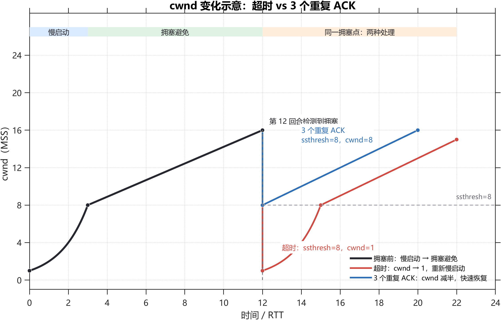

> 第 12 回合检测到拥塞后：**超时**使 `ssthresh=8、cwnd=1`，重新慢启动；**3 个重复 ACK** 只把 `cwnd` 减半到 8，随后进入快速恢复与拥塞避免。

## 5. 第五部分 应用层

> 对应课件：`13-App.pdf`、`14-Summ.pdf`

### 5.1 网络应用概述（了解）

- 应用层向网络应用提供特定服务；应用进程之间交换消息。
- 网络应用是数据传输真正的源和目的地，其流量模式和服务需求决定了传输层协议的选择。

#### 5.1.1 应用模式

| 模式 | 特点 | 例子 |
|---|---|---|
| C/S（客户机/服务器） | 服务器一直在线、永久 IP、可成簇扩展；客户机间歇连接、IP 不固定、相互不通信 | Web、FTP、SMTP |
| P2P（对等） | 无专门服务器，节点既使用服务又提供服务；可扩展，但难管理 | BitTorrent |
| 混合 | 部分操作 C/S，部分 P2P | 即时消息、Skype、BitTorrent 的目录服务 |

#### 5.1.2 应用层协议

- **公开协议**：由 RFC 定义，如 HTTP、SMTP，遵循同一协议即可互操作。
- **私有协议**：细节不公开，如 QQ、Skype。
- 协议定义包含：
  - 消息语法（字段组织）；
  - 消息语义（字段取值含义）；
  - 消息交换规则（时序与逻辑）。

#### 5.1.3 应用的服务需求

| 应用 | 数据丢失 | 带宽 | 时间敏感 |
|---|---|---|---|
| 文件传输 | 不能丢失 | 弹性 | 否 |
| 电子邮件 | 不能丢失 | 弹性 | 否 |
| Web 文档 | 不能丢失 | 弹性 | 否 |
| 实时音视频 | 可容忍丢失 | 音频 5 kbps–1 Mbps；视频 10 kbps–5 Mbps | 是，几百 ms |
| 存储音视频 | 可容忍丢失 | 同上 | 是，几秒 |
| 交互式游戏 | 可容忍丢失 | 几 kbps 上行 | 是，几百 ms |
| 即时消息 | 不能丢失 | 弹性 | 是/否 |

#### 5.1.4 应用与传输层协议

| 应用 | 应用层协议 | 传输层协议 |
|---|---|---|
| 电子邮件 | SMTP | TCP |
| 远程终端 | Telnet | TCP |
| Web | HTTP | TCP |
| 文件传输 | FTP | TCP |
| 流媒体 | 私有协议（如 RealNetworks） | TCP 或 UDP |
| Internet 电话 | 私有协议（如 Vonage） | 通常 UDP |

### 5.2 DNS（了解）

#### 5.2.1 名字服务

- 网络通信实际使用 IP 地址 + 传输层协议 + 端口，用户难以记忆。
- **命名服务**：把可读名字映射为网络通信地址及端口，如 `www.hust.edu.cn` → `202.114.0.245:80`。

#### 5.2.2 DNS 体系

- **DNS（域名服务）**：Internet 命名服务，采用分布式数据库，由多个域名服务器构成层次体系。
- 域名空间分层：根 → 顶级域（com、org、net、edu、cn、uk…）→ 二级域 → 主机。
- 分为多个**区域（zone）**，每个区域有域名服务器负责解析。

| 服务器 | 作用 |
|---|---|
| 本地域名服务器 | 回答主机查询；必要时转发；缓存最近映射；每个机构通常有一个 |
| 专责（授权）域名服务器 | 提供本机构网络内所有命名主机的权威映射 |
| 顶级域（TLD）服务器 | 负责 com、org、net、edu 及国家域 |
| 根域名服务器 | 全球 13 个，指向 TLD 服务器 |

#### 5.2.3 迭代查询与递归查询

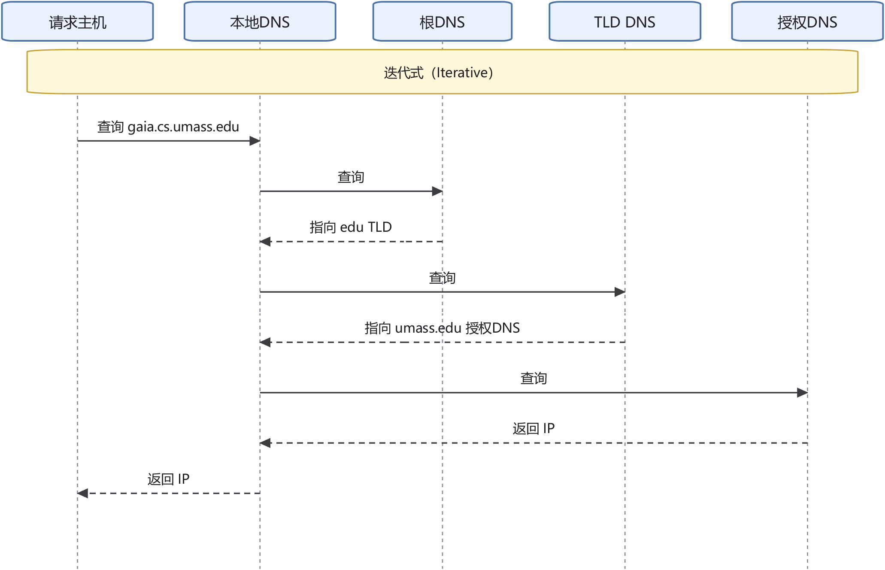

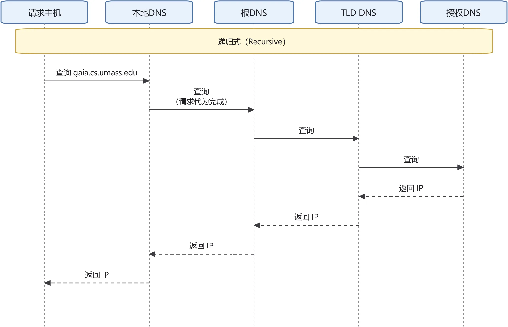

- 迭代式：被查询服务器只返回“下一步该问谁”，由本地 DNS 继续查询。
- 递归式：被查询服务器代为完成后续查询，最终返回结果；对服务器负担更重。

#### 5.2.4 缓存

- 域名服务器获得映射后缓存记录，超过 TTL 删除。
- 本地 DNS 通常缓存 TLD 信息，减少对根服务器的访问。
- 缓存可能过时；RFC 2136 定义了动态更新与通告机制。
- DNS 通常使用 **UDP 53**（区域传送等场景使用 TCP）。

### 5.3 HTTP 与 Web（了解）

#### 5.3.1 概述

- **HTTP（超文本传输协议）**：Web 应用层协议，C/S 模式。
- 客户机（浏览器）：请求、接收、显示 Web 对象；
- 服务器（Web 服务器）：响应请求，发送对象。
- 基于 **TCP**，服务器默认端口 **80**。
- **无状态（stateless）**：服务器不维护以前的客户请求信息。
  - 优点：简单、易扩展；
  - 缺点：需要 Cookies 等机制补充状态。

#### 5.3.2 Web 对象与 URL

- Web 由**对象**构成：HTML 文件、JPEG 图片、Java 小程序、音频等。
- 基础 HTML 文件 + 多个引用对象。
- **URL**：`协议://主机名/路径名`，如 `www.someschool.edu/someDept/pic.gif`。

#### 5.3.3 非坚持式 vs 坚持式 HTTP

| | 非坚持式 HTTP | 坚持式 HTTP |
|---|---|---|
| 连接使用 | 一个 TCP 连接只发送一个对象 | 一个 TCP 连接可发送多个对象 |
| 版本 | HTTP/1.0 | HTTP/1.1 默认 |
| 响应时间 | 每个对象 2 RTT + 传输时间 | 所有引用对象约 1 RTT（流水线） |
| 开销 | 每个对象都要建立/关闭连接 | 连接复用，开销小 |

- **非坚持式 HTTP 响应时间**：

$$T=2RTT+\text{文件传输时间}$$

  1. 建立 TCP 连接：1 RTT；
  2. 发送请求并收到响应首部：1 RTT；
  3. 传输文件：文件大小 / 带宽。

- 浏览器可打开多个并行 TCP 连接，并行获取引用对象。
- **坚持式 HTTP**：服务器发送响应后保持连接；客户机获知引用对象后立即发送请求；所有引用对象只需 1 个 RTT（流水线方式）。

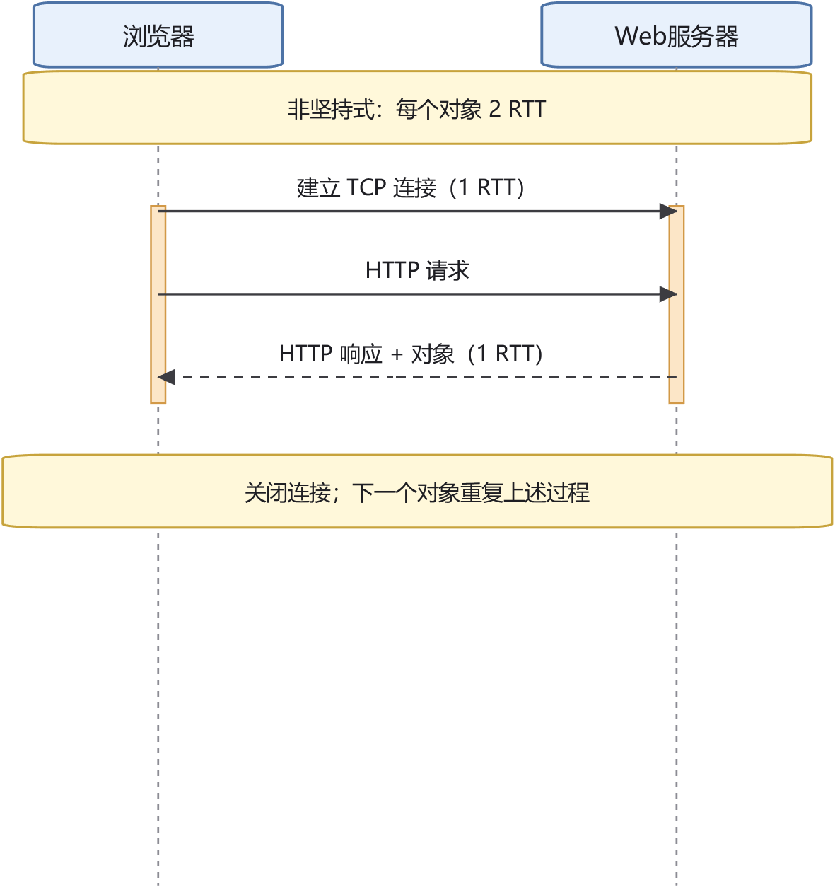

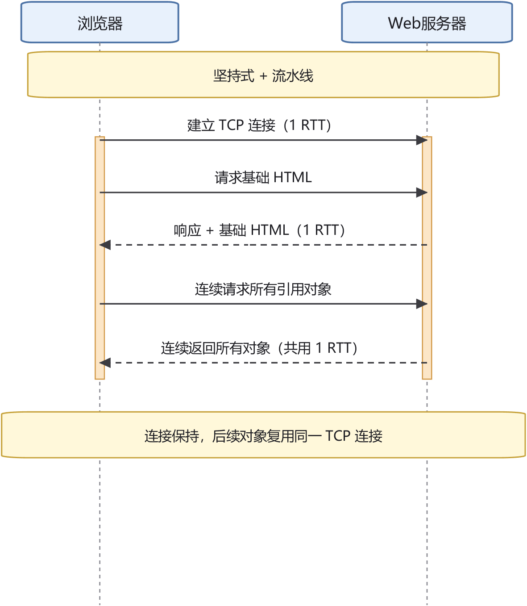

#### 5.3.4 HTTP 消息

**请求消息（ASCII，可读）：**

```http
GET /index.html HTTP/1.1
Host: www-net.cs.umass.edu
User-Agent: Firefox/3.6.10
Accept: text/html,application/xhtml+xml
Accept-Language: en-us,en;q=0.5
Accept-Encoding: gzip,deflate
Connection: keep-alive

```

- 结构：请求行（方法、URL、版本）+ 首部行 + 空行（CRLF）+ 实体主体。
- 方法：

| 方法 | 作用 |
|---|---|
| GET | 请求对象；表单参数可放在 URL 中 |
| POST | 请求对象；表单参数放在实体主体中 |
| HEAD | 只要响应首部，不要对象 |
| PUT | 上传文件，URL 指定路径 |
| DELETE | 删除 URL 指定的文件 |

**响应消息：**

```http
HTTP/1.1 200 OK
Date: Sun, 26 Sep 2010 20:09:20 GMT
Server: Apache/2.0.52 (CentOS)
Last-Modified: Tue, 30 Oct 2007 17:00:02 GMT
Content-Length: 2652
Content-Type: text/html; charset=ISO-8859-1

data data data ...
```

- 状态码：

| 状态码 | 含义 |
|---|---|
| 200 OK | 请求成功，对象附在消息中 |
| 301 Moved Permanently | 对象已永久移动，新位置在消息中 |
| 400 Bad Request | 服务器不理解请求 |
| 404 Not Found | 找不到请求的文档 |
| 505 HTTP Version Not Supported | 不支持该 HTTP 版本 |

#### 5.3.5 Cookies

- HTTP 本身无状态；Cookies 在客户端保存状态信息，使服务器能识别用户。
- 四个组成部分：
  1. 响应消息中的 `Set-Cookie` 首部；
  2. 后续请求消息中的 `Cookie` 首部；
  3. 浏览器管理的 cookie 文件；
  4. 网站后端数据库。
- 用途：授权、购物车、推荐、用户会话状态（如 Web 邮件）。
- 隐私问题：网站可获知访问者信息。

#### 5.3.6 Web 缓存（代理服务器）

- 目标：无需源服务器介入即可满足客户请求。
- 浏览器把所有 HTTP 请求发往缓存节点：
  - 缓存中有对象：直接返回；
  - 没有：缓存节点向源服务器请求，再转发给客户机。
- 缓存节点同时充当服务器（对客户机）和客户机（对源服务器）。
- 优点：减少客户响应时间；减少访问源服务器的流量；帮助内容提供商高效分发内容。
- **条件式 GET**：
  - 请求中带 `If-modified-since: <date>`；
  - 若本地缓存已是最新，服务器返回 `304 Not Modified`，不传对象；
  - 否则返回 `200 OK` 和新对象。

### 5.4 NAT（补充，见 3.4.5）

- NAT 通过“私有 IP:端口 ↔ 公网 IP:端口”的映射扩展 IPv4 地址空间。
- 支持大多数不携带 IP 地址的 TCP/UDP 应用（HTTP、Telnet、NTP 等）；
- 对在应用数据中携带 IP 地址的协议（FTP、H.323、SIP 等）需要特殊处理（ALG）。
- NAT 穿越：静态端口映射、UPnP/IGD、中继。

## 6. 计算题专题

> 计算题占 40 分，评分看**步骤**：必须写出所用公式、代入的数值、中间结果与最终单位；只写答案不得分。下面每道例题都给出完整题干与解答过程，可直接作为答题模板。

### 6.0 单位与常用换算

| 项目 | 换算关系 |
|---|---|
| 数据量 | 1 B = 8 bit；1 KB = 2¹⁰ B = 1024 B；1 MB = 1024 KB |
| 速率 | 1 kbps = 10³ bps；1 Mbps = 10⁶ bps；1 Gbps = 10⁹ bps |
| 传播速度 | 铜缆/光纤约 2×10⁸ m/s = 2×10⁵ km/s |
| 时间 | 1 ms = 10⁻³ s；1 μs = 10⁻⁶ s |

**易错点：**

- 文件大小用 2 的幂（1024），链路速率用 10 的幂（1000），两者不能混用；
- 题目问“最后一个比特到达”时，要在传输时间之外**再加一次单程传播时延**；
- 分组数不能直接取整，除不尽时必须向上取整；
- 结果保留 3 位有效数字并写出单位（s、bit、bps）。

### 6.1 时延、吞吐量与时延带宽积

**基本公式：**

$$d_{nodal}=d_{proc}+d_{queue}+d_{trans}+d_{prop},\qquad d_{trans}=\frac{L}{R},\qquad d_{prop}=\frac{d}{s}$$

$$BDP=RTT\times R,\qquad N_{BDP}=\frac{RTT\times R}{L}$$

**解题步骤：**

1. 文件大小换算成比特数：$N_{bit}=\text{字节数}\times8$；
2. 分组数 $N=\lceil \text{字节数}/L_{B}\rceil$；
3. 总传输时间 $=N_{bit}/R$（连续发送时各分组首尾相接）；
4. 按题目给出的等待规则累加 RTT；
5. 最后加一次单程传播时延 $RTT/2$，表示“最后一个比特到达接收方”。

#### 例 6.1-1（习题课：四种发送方式）

**【题目】** 主机 A 通过一条速率 $R=10$ Mbps 的链路向主机 B 发送 1.5 MB 的文件。链路单向传播时延 40 ms（即 $RTT=80$ ms），分组长度 1 KB，传输前需 2 个 RTT 建立连接，忽略首部与确认开销。分别求下列四种方式下，从开始建立连接到 B 收到最后一个比特所需的时间：

(a) 分组连续发送，不等确认；
(b) 每发完一个分组等待 1 个 RTT 再发下一个；
(c) 每个 RTT 发送 20 个分组；
(d) 第 $n$ 个 RTT 发送 $2^{n-1}$ 个分组。

**【解答】**

第 1 步：换算比特数与分组数

$$N_{bit}=1.5\times1024\times1024\times8=12{,}582{,}912\ \text{bit}$$

$$N=\frac{1.5\times1024\times1024\ \text{B}}{1024\ \text{B}}=1536\ \text{个分组}$$

第 2 步：计算传输时延

$$T_{trans}=\frac{N_{bit}}{R}=\frac{12{,}582{,}912}{10\times10^{6}}=1.2582912\ \text{s}$$

单个分组的传输时延：

$$\frac{L}{R}=\frac{1024\times8}{10\times10^{6}}=0.8192\ \text{ms}$$

第 3 步：列出固定开销

- 建立连接：$2RTT=2\times0.08=0.16\ \text{s}$；
- 最后一个比特的单程传播：$RTT/2=0.04\ \text{s}$。

第 4 步：按四种方式累加

(a) 连续发送，只付出一次总传输时间：

$$T_a=0.16+1.2582912+0.04\approx1.458\ \text{s}$$

(b) 每分组停等：1536 个分组之间有 1535 个 RTT 的等待：

$$T_b=0.16+1535\times(0.0008192+0.08)+0.0008192+0.04\approx124.3\ \text{s}$$

(c) 每 RTT 发 20 个分组：批数 $M=\lceil1536/20\rceil=77$，等待 76 个 RTT：

$$T_c=0.16+1.2582912+76\times0.08+0.04\approx7.54\ \text{s}$$

(d) 第 $n$ 批发 $2^{n-1}$ 个：因 $\sum_{i=1}^{11}2^{i-1}=2^{11}-1=2047\ge1536$，11 批即可发完，等待 10 个 RTT：

$$T_d=0.16+1.2582912+10\times0.08+0.04\approx2.26\ \text{s}$$

**【答】** (a) ≈ 1.458 s；(b) ≈ 124.3 s；(c) ≈ 7.54 s；(d) ≈ 2.26 s。

**结论：** 等待次数越少、单批发送量越接近时延带宽积，总时间越短；只有“可连续发送的数据量 ≥ 时延带宽积”时链路才能被填满。

#### 例 6.1-2（作业：同一模型的另一组数据）

**【题目】** 文件 2 MB，链路速率 2 Mbps，$RTT=50$ ms，分组 1 KB，建立连接需 2 个 RTT。求例 6.1-1 中 (a)–(d) 四种方式的总时间（忽略首部与确认开销）。

**【解答】**

第 1 步：比特数与分组数

$$N_{bit}=2\times1024\times1024\times8=16{,}777{,}216\ \text{bit},\qquad N=\frac{2\times1024\times1024}{1024}=2048\ \text{个}$$

第 2 步：传输时延与固定开销

$$T_{trans}=\frac{16{,}777{,}216}{2\times10^{6}}=8.388608\ \text{s},\qquad \frac{L}{R}=\frac{8192}{2\times10^{6}}=4.096\ \text{ms}$$

$$2RTT=0.1\ \text{s},\qquad RTT/2=0.025\ \text{s}$$

第 3 步：四种方式

(a) 连续发送：

$$T_a=0.1+8.388608+0.025\approx8.51\ \text{s}$$

(b) 每分组停等，2047 个 RTT 等待：

$$T_b=0.1+2047\times(0.004096+0.05)+0.004096+0.025\approx110.9\ \text{s}$$

(c) 每 RTT 发 20 个：$M=\lceil2048/20\rceil=103$，等待 102 个 RTT：

$$T_c=0.1+8.388608+102\times0.05+0.025\approx13.6\ \text{s}$$

(d) 指数增长：$\sum_{i=1}^{11}2^{i-1}=2047<2048\le\sum_{i=1}^{12}2^{i-1}=4095$，需 12 批、等待 11 个 RTT：

$$T_d=0.1+8.388608+11\times0.05+0.025\approx9.06\ \text{s}$$

**【答】** (a) ≈ 8.51 s；(b) ≈ 110.9 s；(c) ≈ 13.6 s；(d) ≈ 9.06 s。

> 易错点：2 MB 恰好是 2048 个 1 KB 分组，而 $\sum_{i=1}^{11}2^{i-1}=2047$ 差 1 个，因此必须发到第 12 批。

#### 例 6.1-3（时延带宽积与窗口的对应关系）

**【题目】** 一条 1 Gbps 链路，单向传播时延 50 ms，分组长度 1500 B。求：

(1) 时延带宽积；
(2) 填满管道所需的分组数；
(3) 若发送窗口只有 64 KB，链路利用率是多少？

**【解答】**

第 1 步：往返时延

$$RTT=2\times50\ \text{ms}=0.1\ \text{s}$$

第 2 步：时延带宽积

$$BDP=RTT\times R=0.1\times10^{9}=10^{8}\ \text{bit}=100\ \text{Mbit}$$

第 3 步：换算成分组数

$$N_{BDP}=\frac{10^{8}}{1500\times8}=\frac{10^{8}}{12{,}000}\approx8333\ \text{个分组}$$

第 4 步：64 KB 窗口对应的利用率

窗口折算为分组数：

$$W=\frac{64\times1024\ \text{B}}{1500\ \text{B}}\approx43.7\Rightarrow43\ \text{个分组}$$

$$U=\frac{W\cdot L}{RTT\cdot R+L}=\frac{43\times12{,}000}{10^{8}+12{,}000}\approx0.516\%$$

**【答】** (1) 100 Mbit；(2) 约 8333 个分组；(3) 约 0.52%。

**结论：** 64 KB 远小于 100 Mbit 的时延带宽积，链路几乎空闲——这正是高速长距离链路需要窗口扩大选项的原因。

### 6.2 滑动窗口：窗口大小、序号位数与利用率

**基本公式：**

$$SWS+RWS\le 2^{k}\quad(\text{k 为序号位数})$$

$$U=\frac{SWS\cdot L}{RTT\cdot R+L}\quad(\text{结果超过 100\% 按 100\% 计})$$

$$U=\frac{SWS\cdot L}{RTT\cdot R+m\cdot L}\quad(\text{每 }m\text{ 个分组确认一次})$$

**解题步骤：**

1. 求时延带宽积（以分组为单位）：$N_{BDP}=RTT\cdot R/L$；
2. 填满管道的条件：$SWS\cdot L\ge RTT\cdot R+L$，即 $SWS\ge N_{BDP}+1$；
3. 由 $SWS+RWS\le2^{k}$ 反推序号位数（回退 N 取 $RWS=1$，选择性重传取 $RWS=SWS$）；
4. 代入利用率公式；结果大于 100% 说明窗口已足够，按 100% 计。

#### 例 6.2-1（卫星链路）

**【题目】** 卫星链路速率 $R=2$ Mbps，单程传播时延 0.25 s，帧长 $L=1$ KB，接收方逐帧确认。求：

(1) 时延带宽积（以分组数表示）；
(2) 停止等待协议的链路利用率；
(3) $SWS=64$ 与 $SWS=128$ 时的链路利用率；
(4) 若改为每 16 帧确认一次、$SWS=128$，利用率是多少？
(5) 若要求窗口能填满管道，回退 N 与选择性重传各需多少位序号？

**【解答】**

第 1 步：基本量

$$RTT=2\times0.25=0.5\ \text{s},\qquad L=1024\times8=8192\ \text{bit}$$

$$\frac{L}{R}=\frac{8192}{2\times10^{6}}=4.096\ \text{ms}$$

第 2 步：时延带宽积

$$RTT\cdot R=0.5\times2\times10^{6}=10^{6}\ \text{bit}$$

$$N_{BDP}=\frac{10^{6}}{8192}\approx122.07\ \text{个分组}$$

第 3 步：停止等待（$SWS=1$）

$$U=\frac{1\times8192}{10^{6}+8192}=\frac{8192}{1{,}008{,}192}\approx0.81\%$$

第 4 步：$SWS=64$

$$U=\frac{64\times8192}{1{,}008{,}192}=\frac{524{,}288}{1{,}008{,}192}\approx52.0\%$$

第 5 步：$SWS=128$

$$U=\frac{128\times8192}{1{,}008{,}192}=\frac{1{,}048{,}576}{1{,}008{,}192}\approx104\%>100\%\Rightarrow U=100\%$$

只要 $SWS\ge N_{BDP}+1\approx123.07$，即 $SWS\ge124$，窗口就能填满管道，利用率恒为 100%。

第 6 步：每 16 帧确认一次，$SWS=128$

$$U=\frac{1{,}048{,}576}{10^{6}+16\times8192}=\frac{1{,}048{,}576}{1{,}131{,}072}\approx92.7\%$$

第 7 步：序号位数

取能填满管道的最小窗口 $SWS=124$：

- 回退 N：$SWS+RWS=124+1=125\le2^{8}=256\Rightarrow k=8$；
- 选择性重传：$SWS+RWS=124+124=248\le2^{8}=256\Rightarrow k=8$。

**【答】** (1) 122.07 个分组；(2) 0.81%；(3) 52.0% 与 100%；(4) 92.7%；(5) 两种方式均为 8 位。

#### 例 6.2-2（火星链路）

**【题目】** 地球—火星链路速率 256 kbps，单程传播时延 400 s，帧长 1 KB。若要求发送窗口能填满管道，分别求回退 N 与选择性重传所需的序号位数。

**【解答】**

第 1 步：时延带宽积

$$RTT=800\ \text{s},\qquad RTT\cdot R=800\times256{,}000=204{,}800{,}000\ \text{bit}$$

$$N_{BDP}=\frac{204{,}800{,}000}{8192}=25{,}000\ \text{个分组}$$

第 2 步：窗口下限

$$SWS\ge N_{BDP}+1=25{,}001$$

第 3 步：序号位数

- 回退 N：$SWS+RWS=25{,}002$，由 $2^{14}=16{,}384<25{,}002\le2^{15}=32{,}768$ 得 $k=15$；
- 选择性重传：$SWS+RWS=50{,}002$，由 $2^{15}=32{,}768<50{,}002\le2^{16}=65{,}536$ 得 $k=16$。

**【答】** 回退 N 需 15 位，选择性重传需 16 位；教材通常按选择性重传给出 16 位。

> 易错点：序号位数必须由 $SWS+RWS\le2^{k}$ 反推，不能直接用 $SWS\le2^{k}$；SR 的接收窗口等于发送窗口，所以要乘 2。

### 6.3 CRC 计算

**步骤：**

1. 由生成多项式写出除数：$C(x)$ 的最高次为 $k$，除数就是各项系数组成的 $k+1$ 位比特串（如 $x^{3}+1\to1001$，$k=3$）；
2. 数据后补 $k$ 个 0；
3. 用模 2 长除法求 $k$ 位余数（每一步做异或，不进位不借位）；
4. 发送序列 = 原数据 + 余数；
5. 接收方用同一除数去除收到的序列：余数为 0 判无错，否则判有错。

#### 例 6.3-1（作业题）

**【题目】** 待发送数据为 `10010110`，生成多项式 $C(x)=x^{3}+1$。求实际发送的比特序列，并说明接收方如何检错。

**【解答】**

第 1 步：确定除数与补零位数

$$C(x)=x^{3}+1\Rightarrow\text{除数}=1001,\qquad k=3$$

数据后补 3 个 0：

$$T=10010110\,000$$

第 2 步：模 2 长除法

| 步骤 | 运算 | 结果 |
|---|---|---|
| ① | 前 4 位 `1001` ⊕ `1001` | `0000` |
| ② | 下拉得 `110000`；首位 `1100` ⊕ `1001` | 余 `101` |
| ③ | 下拉得 `1010`，⊕ `1001` | 余 `011` |
| ④ | 下拉得 `0110`，不足 4 位，停止 | 余数 = `110` |

第 3 步：拼接发送序列

$$\text{发送}=10010110\;110=10010110110$$

第 4 步：接收方校验

接收方用 `1001` 除 `10010110110`，余数为 0 → 判定无错。

若传输中数据部分最右两比特翻转，接收序列变为 `10010100110`，再除以 `1001` 得余数 `011`≠0 → 判定出错并丢弃。

**【答】** 发送序列为 `10010110110`；接收方余数为 0 表示无错，非 0 表示有错。

#### 例 6.3-2（生成多项式为 4 阶）

**【题目】** 数据 `1101011011`，生成多项式 $C(x)=x^{4}+x+1$。求发送序列，并验证接收方余数为 0。

**【解答】**

第 1 步：除数与补零

$$C(x)=x^{4}+x+1\Rightarrow\text{除数}=10011,\qquad k=4$$

$$T=1101011011\,0000$$

第 2 步：模 2 长除法（余数寄存器 4 位，最高位为 1 时异或 `10011`）

| 处理位 | 寄存器 | 操作后 |
|---|---|---|
| `1 1 0 1` | `1101` | 首位为 1，但寄存器不足 5 位，继续下拉 |
| `0` | `11010` | ⊕ `10011` → `01001` |
| `1` | `10011` | ⊕ `10011` → `00000` |
| `0` | `00000` | 首位 0，仅下拉 |
| `1` | `00001` | 首位 0，仅下拉 |
| `1` | `00011` | 首位 0，仅下拉 |
| `0` | `00110` | 首位 0，仅下拉 |
| `1` | `01101` | 首位 0，仅下拉 |
| `1` | `11011` | ⊕ `10011` → `01000` |
| `0` | `10000` | ⊕ `10011` → `00011` |
| `0` | `00110` | 首位 0，仅下拉 |
| `0` | `01100` | 首位 0，仅下拉 |
| `0` | `11000` | ⊕ `10011` → `01011` |
| `0` | `10110` | ⊕ `10011` → `00101` |
| `0` | `01010` | 首位 0，结束 |

$$余数=1110\Rightarrow\text{发送}=1101011011\;1110$$

第 3 步：接收方验证

用 `10011` 除 `11010110111110`，余数为 `0000`，校验通过。

**【答】** 发送序列为 `11010110111110`；接收方余数为 0。

> 易错点：补零个数等于生成多项式最高次 $k$，不是除数长度；异或时按最高位对齐，不进位不借位。

### 6.4 CSMA/CD 最小帧长与指数回退

**最小帧长公式：**

$$L_{min}=R\times2\tau=R\times\frac{2d}{s}$$

推导要点：最坏情况下两主机位于链路两端，A 发出的帧在到达 B 前与 B 的帧冲突，冲突信号还要再花 τ 传回 A。因此 A 必须在 $2\tau$ 内仍在发送，才能检测到冲突；帧的发送时间 $L/R$ 必须不小于 $2\tau$。

**解题步骤：**

1. 求单程传播时延 $\tau=d/s$（注意 km 与 m 的单位统一）；
2. 求往返传播时延 $2\tau$；
3. 由 $L_{min}=R\cdot2\tau$ 求比特数，再除以 8 换算成字节；
4. 若题目给定最小帧长，可反解最大链路长度 $d\le \frac{L_{min}\cdot s}{2R}$。

#### 例 6.4-1（最小帧长）

**【题目】** 采用 CSMA/CD 的共享式以太网，速率 $R=100$ Mbps，两站间最大距离 $d=1$ km，信号传播速度 $s=2\times10^{5}$ km/s。求最小帧长（分别用比特和字节表示）。

**【解答】**

第 1 步：单程与往返传播时延

$$\tau=\frac{d}{s}=\frac{1\ \text{km}}{2\times10^{5}\ \text{km/s}}=5\times10^{-6}\ \text{s}=5\ \mu s$$

$$2\tau=10\ \mu s=10^{-5}\ \text{s}$$

第 2 步：代入最小帧长公式

$$L_{min}=R\times2\tau=100\times10^{6}\times10^{-5}=1000\ \text{bit}$$

第 3 步：换算成字节

$$\frac{1000}{8}=125\ \text{B}$$

**【答】** 最小帧长为 1000 bit，即 125 字节。

#### 例 6.4-2（反向求解最大距离）

**【题目】** 10 Mbps 共享式以太网规定最小帧长为 64 B，信号传播速度 $2\times10^{5}$ km/s。求该网络允许的最大两站距离。

**【解答】**

第 1 步：换算最小帧长

$$L_{min}=64\times8=512\ \text{bit}$$

第 2 步：由 $L_{min}=R\cdot2\tau$ 解出 $2\tau$

$$2\tau=\frac{L_{min}}{R}=\frac{512}{10\times10^{6}}=51.2\times10^{-6}\ \text{s}=51.2\ \mu s$$

第 3 步：求最大距离

$$\tau=25.6\ \mu s,\qquad d=\tau\cdot s=25.6\times10^{-6}\times2\times10^{8}=5120\ \text{m}$$

**【答】** 最大距离约 5120 m（教材常按 2500 m 的中继器部署约束给出更小的工程值）。

#### 例 6.4-3（指数回退的获胜概率）

**【题目】** 两台主机 A、B 在一次冲突后进入退避：A 从 $\{0,1\}$ 中随机取 $K_A$，B 从 $\{0,1,2,3\}$ 中随机取 $K_B$，退避时间 $=K\times512$ bit 时间，$K$ 小者先发送。求：

(1) A 赢得本次竞争的概率；
(2) 若再次冲突后 A 仍从 $\{0,1\}$ 取值、B 从 $\{0,\dots,7\}$ 取值，A 再次获胜的概率；
(3) A 连续赢得前 $n$ 次竞争的概率。

**【解答】**

第 1 步：列出全部组合（共 $2\times4=8$ 种）

| $K_A\backslash K_B$ | 0 | 1 | 2 | 3 |
|---|---|---|---|---|
| **0** | 平局 | A 胜 | A 胜 | A 胜 |
| **1** | B 胜 | 平局 | A 胜 | A 胜 |

第 2 步：数出 A 获胜的组合

A 获胜组合为 $(0,1),(0,2),(0,3),(1,2),(1,3)$，共 5 种，总组合 8 种：

$$P_1=\frac{5}{8}=62.5\%$$

第 3 步：第二轮

A 仍取 $\{0,1\}$，B 取 $\{0,\dots,7\}$，总组合 $2\times8=16$：

- $K_A=0$：$K_B=1\sim7$，7 种；
- $K_A=1$：$K_B=2\sim7$，6 种。

$$P_2=\frac{7+6}{16}=\frac{13}{16}=81.25\%$$

第 4 步：一般规律

设 A 取 $\{0,1\}$，B 取 $\{0,\dots,2^{n+1}-1\}$，总组合 $2\cdot2^{n+1}$，A 输或平局的组合为 $3$（即 $(0,0),(1,0),(1,1)$）：

$$P_n=1-\frac{3}{2^{n+2}}$$

验证：$P_1=1-\frac{3}{8}=\frac{5}{8}$，$P_2=1-\frac{3}{16}=\frac{13}{16}$，与枚举一致。

第 5 步：连续获胜

$$P(\text{前 }n\text{ 轮全胜})=\prod_{i=1}^{n}\left(1-\frac{3}{2^{i+2}}\right)$$

$n\to\infty$ 时该无穷乘积收敛到约 0.35，说明 A 不可能长期垄断信道。

**【答】** (1) 5/8；(2) 13/16；(3) $\prod_{i=1}^{n}\left(1-\frac{3}{2^{i+2}}\right)$。

> 易错点：概率题必须先写“总组合数”和“有利组合数”，只写一个分数容易漏项；平局要单独扣除，不能算作任一方获胜。

### 6.5 共享式/交换式以太网的最大吞吐量

**判断规则：**

| 设备 | 冲突域 | 最大吞吐量 |
|---|---|---|
| 集线器 | 整个集线器 1 个 | 单条链路速率 |
| 交换机 | 每个端口 1 个 | 各链路速率之和 |
| 集线器级联 | 仍为 1 个 | 单条链路速率 |
| 交换机 + 集线器 | 分段计算后相加 | 各冲突域速率之和 |

**解题步骤：**

1. 先画拓扑，标出每个冲突域；
2. 判断每种设备是否隔离冲突域；
3. 把同一冲突域内的链路只按一条计算；
4. 不同冲突域的速率相加。

#### 例 6.5-1（三种组网方式对比）

**【题目】** 某网络有 3 台服务器、12 台主机，按以下三种方式组网，分别求最大吞吐量：

(a) S0、S1、S2、S3 全部为交换机：S0 与 S1–S3 之间为 1 Gbps 链路，S1–S3 各自下挂 4 台主机，主机链路 100 Mbps；
(b) S0 为 100 Mbps 交换机，S1–S3 为 10 Mbps 集线器；
(c) 全部为 10 Mbps 集线器。

**【解答】**

**(a) 全交换机**

第 1 步：每个端口一个冲突域，全部链路可同时满速工作。

第 2 步：统计链路

- 交换机之间的 1 Gbps 链路：S0–S1、S0–S2、S0–S3 共 3 条；
- 主机链路：12 条 × 100 Mbps。

第 3 步：求和

$$C_a=3\times1\ \text{Gbps}+12\times100\ \text{Mbps}=3+1.2=4.2\ \text{Gbps}$$

**(b) 交换机 + 集线器**

第 1 步：3 个集线器各自构成 1 个冲突域，每个冲突域速率 10 Mbps；集线器与 S0 之间的链路可各自 100 Mbps 同时工作。

第 2 步：求和

$$C_b=3\times100\ \text{Mbps}+3\times10\ \text{Mbps}=330\ \text{Mbps}$$

**(c) 全集线器**

第 1 步：所有集线器级联后仍是一个冲突域，任何时刻只能有一台设备发送。

$$C_c=10\ \text{Mbps}$$

**【答】** (a) 4.2 Gbps；(b) 330 Mbps；(c) 10 Mbps。

**结论：** 交换机把冲突域切到每个端口，因此吞吐量随端口数线性增长；集线器不隔离冲突域，增加设备不会提高总吞吐量。

### 6.6 IP 分段计算

**步骤：**

1. 数据部分长度 = 原总长 − 首部长度（IPv4 基本首部 20 B）；
2. 每段最大数据长度 = MTU − 20；
3. 除最后一段外，每段数据长度必须是 8 的倍数；
4. 偏移量 = 该段之前已发送的数据字节数 ÷ 8；
5. MF：除最后一段为 0，其余为 1；
6. 所有分段共用同一个 Identification。

#### 例 6.6-1（4000 字节数据报）

**【题目】** 一个 IPv4 数据报总长 4000 B（首部 20 B + 数据 3980 B），要经过 MTU = 1500 B 的链路。求各分段的长度、偏移量与 MF 标志。

**【解答】**

第 1 步：可承载的数据长度

$$L_{data}^{max}=MTU-20=1500-20=1480\ \text{B}$$

第 2 步：切分数据

$$3980=1480+1480+1020$$

前两段取满 1480 B（1480 ÷ 8 = 185，是 8 的倍数，合法）；第三段 1020 B（最后一段不受 8 倍数限制）。

第 3 步：计算偏移量（以 8 B 为单位）

| 分段 | 数据长度 | 总长度 | 偏移量 | MF |
|---|---|---|---|---|
| 1 | 1480 | 1500 | 0 ÷ 8 = 0 | 1 |
| 2 | 1480 | 1500 | 1480 ÷ 8 = 185 | 1 |
| 3 | 1020 | 1040 | 2960 ÷ 8 = 370 | 0 |

**【答】** 共分 3 段，长度分别为 1500、1500、1040 B，偏移量为 0、185、370，MF 为 1、1、0。

#### 例 6.6-2（含 8 字节对齐处理）

**【题目】** 一个 IPv4 数据报总长 3000 B（首部 20 B），输出链路 MTU = 800 B。求各分段参数。

**【解答】**

第 1 步：数据长度与每段上限

$$D=3000-20=2980\ \text{B},\qquad L_{data}^{max}=800-20=780\ \text{B}$$

第 2 步：780 不是 8 的倍数，向下取整到 8 的倍数

$$\left\lfloor\frac{780}{8}\right\rfloor\times8=97\times8=776\ \text{B}$$

第 3 步：切分

$$2980=776+776+776+652$$

第 4 步：填表

| 分段 | 数据长度 | 总长度 | 偏移量 | MF |
|---|---|---|---|---|
| 1 | 776 | 796 | 0 | 1 |
| 2 | 776 | 796 | 97 | 1 |
| 3 | 776 | 796 | 194 | 1 |
| 4 | 652 | 672 | 291 | 0 |

**【答】** 分 4 段，偏移量依次为 0、97、194、291，前 3 段 MF=1，最后一段 MF=0。

#### 例 6.6-3（分段丢失与重组）

**【题目】** 上一题的数据报被分成 $n=4$ 段，每段在传输中独立丢失的概率 $p=0.01$。求：

(1) 同一批 4 段全部到达、能成功重组的概率；
(2) 整包丢失的概率；
(3) 若允许每段重传一次（即每段两次传输都丢失才失败），整包仍丢失的概率近似值。

**【解答】**

第 1 步：全到达概率

$$P_{ok}=(1-p)^{4}=0.99^{4}\approx0.9606$$

第 2 步：整包丢失概率

$$P_{loss}=1-(1-p)^{n}=1-0.9606\approx3.94\%$$

第 3 步：每段重传一次

每段失败概率 $p^{2}=10^{-4}$，整包失败概率：

$$P'_{loss}\approx n\cdot p^{2}=4\times10^{-4}=0.04\%$$

（严格值为 $1-(1-p^{2})^{4}\approx0.03999\%$，与近似值一致。）

**【答】** (1) 约 96.06%；(2) 约 3.94%；(3) 约 0.04%。

> 易错点：分段的丢失是**独立事件**，整包成功要所有分段都成功，所以是幂次关系；单个分段（2～3%）丢失换来整包丢失率被放大，这是 IP 分段的代价之一。

### 6.7 子网划分、CIDR 与最长前缀匹配

**子网划分步骤：**

1. 写出地址块的二进制，确定可借用的主机位；
2. 按需求主机数**从大到小**排序；
3. 每个子网的主机位 $x$ 满足 $2^{x}-2\ge$ 需求主机数；
4. 前缀长度 = 32 − x；
5. 依次分配地址块，保证不重叠、不留空洞；
6. 写出网络地址、掩码、可用地址范围与广播地址。

#### 例 6.7-1（VLSM 划分）

**【题目】** 机构获得地址块 212.1.2.0/23（共 512 个地址），要分配给 A、B、C、D、E 五个部门，主机需求分别为 180、110、52、23、16 台。给出每个部门的子网地址、前缀、掩码，并验证无重叠。

**【解答】**

第 1 步：确定各部门的主机位数

| 部门 | 需求 | 所需主机位 x | $2^{x}-2$ | 前缀 | 块大小 |
|---|---|---|---|---|---|
| A | 180 | 8 | 254 | /24 | 256 |
| B | 110 | 7 | 126 | /25 | 128 |
| C | 52 | 6 | 62 | /26 | 64 |
| D | 23 | 5 | 30 | /27 | 32 |
| E | 16 | 5 | 30 | /27 | 32 |

第 2 步：按块大小从大到小依次切分 212.1.2.0/23

- 前 256 个地址给 A：**212.1.2.0/24**，可用 212.1.2.1–212.1.2.254；
- 剩余 212.1.3.0/24 再切：前 128 个给 B：**212.1.3.0/25**，可用 212.1.3.1–212.1.3.126；
- 剩余 212.1.3.128/25 再切：前 64 个给 C：**212.1.3.128/26**，可用 212.1.3.129–212.1.3.190；
- 剩余 /26 再切两个 /27：D 取 **212.1.3.192/27**（212.1.3.193–212.1.3.222），E 取 **212.1.3.224/27**（212.1.3.225–212.1.3.254）。

第 3 步：掩码

| 部门 | 前缀 | 网络地址 | 掩码 |
|---|---|---|---|
| A | /24 | 212.1.2.0 | 255.255.255.0 |
| B | /25 | 212.1.3.0 | 255.255.255.128 |
| C | /26 | 212.1.3.128 | 255.255.255.192 |
| D | /27 | 212.1.3.192 | 255.255.255.224 |
| E | /27 | 212.1.3.224 | 255.255.255.224 |

第 4 步：校验

$$256+128+64+32+32=512$$

恰好等于 /23 的地址数，各块首尾相接且不重叠。

**【答】** 见上表；总用量 512 个地址，无空洞、无重叠。

#### 例 6.7-2（CIDR 聚合判断）

**【题目】** 判断下列地址块能否聚合为一条路由，若能请写出聚合结果：

(1) 199.199.0.0/24、199.199.1.0/24、199.199.2.0/24、199.199.3.0/24；
(2) 199.199.1.0/24 与 199.199.4.0/24；
(3) 200.200.16.0/20 与 200.200.32.0/20。

**【解答】**

第 1 步：聚合条件

必须同时满足：① 地址块数量为 2 的幂且连续；② 存在一个更短前缀能覆盖全部地址块（即各块除公共前缀外其余位任意）。

(1) 4 个连续 /24，第三个字节 0～3：

$$0=0000\,0000,\quad1=0000\,0001,\quad2=0000\,0010,\quad3=0000\,0011$$

前 6 位相同（`000000`），故公共前缀为 24−2=22 位：

$$\text{聚合结果}=199.199.0.0/22$$

(2) 199.199.1.0/24 与 199.199.4.0/24：

$$1=0000\,0001,\qquad4=0000\,0100$$

第三个字节第 3 位不同（`0000001x` 与 `0000010x`），最短公共前缀只到第 21 位，而要覆盖 1～4 必须包含 199.199.2.0 和 199.199.3.0，但这两块不属于该机构，因此**不能聚合**。

(3) 200.200.16.0/20 与 200.200.32.0/20：

$$16=0001\,0000,\qquad32=0010\,0000$$

第三个字节前 2 位不同（`0001` 与 `0010`），公共前缀为 16 位，聚合后是 200.200.0.0/16，会覆盖大量不属于该机构的地址，因此**不能聚合**。

**【答】** (1) 可聚合为 199.199.0.0/22；(2) 不可聚合；(3) 不可聚合。

#### 例 6.7-3（最长前缀匹配）

**【题目】** 路由器转发表如下，分别求目的地址 (a) 200.200.21.1、(b) 200.200.16.5、(c) 199.199.3.7 的下一跳。

| 表项 | 下一跳 |
|---|---|
| 199.199.0.0/17 | Router B |
| 199.199.240.0/22 | Router A |
| 200.200.16.0/20 | Router C |
| 200.200.21.0/24 | Router D |
| 0.0.0.0/0 | Router E |

**【解答】**

第 1 步：(a) 200.200.21.1

- 200.200.21.0/24：前 24 位完全匹配；
- 200.200.16.0/20：前 20 位匹配（21 = `0001 0101`，16 = `0001 0000`，前 4 位 `0001` 相同）；
- 两条都匹配，取最长前缀：

$$\text{下一跳}=\text{Router D}\quad(\text{/24})$$

第 2 步：(b) 200.200.16.5

- 200.200.21.0/24：第 3 字节 16 ≠ 21，不匹配；
- 200.200.16.0/20：前 20 位匹配 → **Router C**。

第 3 步：(c) 199.199.3.7

- 199.199.240.0/22：第 3 字节 3 ≠ 240 段，不匹配；
- 199.199.0.0/17：第 3 字节最高位为 0（3 = `0000 0011`），与 /17 的前 17 位一致 → **Router B**。

**【答】** (a) Router D；(b) Router C；(c) Router B。

> 易错点：/17 覆盖第三个字节的最高位，范围是 199.199.0.0–199.199.127.255；/22 的步长是 4，199.199.240.0/22 覆盖 240–243，不要误以为从 240 开始按 22 位判断。

### 6.8 路由表计算：Dijkstra 与距离向量

**Dijkstra 前向搜索步骤：**

1. 证实表初始化为 `(源点, 0, -)`，临时表为空；
2. 取刚移入证实表的节点，遍历其所有邻居；
3. 新开销 = 源点到当前节点开销 + 当前节点到邻居的开销；
4. 若临时表无该邻居，或新开销更小，则更新表项（记录下一跳）；
5. 从临时表取开销最小者移入证实表；
6. 临时表为空时结束，证实表即路由表。

#### 例 6.8-1（Dijkstra 完整过程）

**【题目】** 网络拓扑为：D—C 开销 2，C—B 开销 3，B—A 开销 5，C—A 开销 10，B—D 开销 11。以 D 为源点，用前向搜索求 D 到各节点的最短路径与下一跳。

**【解答】**

第 1 步：初始化

证实表 = {(D,0,−)}，临时表 = ∅。

第 2 步：逐轮迭代

| 轮次 | 处理节点 | 更新临时表 | 证实表 | 移入节点 |
|---|---|---|---|---|
| 1 | D | (C,2,C)、(B,11,B) | {(D,0,−)} | C（开销 2 最小） |
| 2 | C | (B, min(11, 2+3)=5, C)、(A, 2+10=12, C) | {(D,0,−),(C,2,C)} | B（开销 5 最小） |
| 3 | B | (A, min(12, 5+5)=10, C) | {(D,0,−),(C,2,C),(B,5,C)} | A（开销 10） |
| 4 | A | 无新邻居 | 全部四项 | 结束 |

第 3 步：检查跳数限制

- B—D 直连开销 11，而经 C 只有 2+3=5，故 B 的表项为 (B,5,C)；
- A 经 C 直连 10，经 B 为 2+3+5=10，两者相等，保留先到者（经 C）。

第 4 步：写出路由表

| 目的 | 开销 | 下一跳 |
|---|---|---|
| C | 2 | C |
| B | 5 | C |
| A | 10 | C |

**【答】** 见上表；最短路径 D→C→B→A，总开销 2+3+5=10。

#### 例 6.8-2（距离向量收敛）

**【题目】** 三个节点 A、B、C：A—B 开销 1，B—C 开销 1，A—C 开销 3。初始时每个节点只知道直连邻居。求距离向量算法的收敛过程与最终路由。

**【解答】**

第 1 步：初始距离向量

| 节点 | 到 A | 到 B | 到 C |
|---|---|---|---|
| A | 0 | 1 | 3 |
| B | 1 | 0 | 1 |
| C | 3 | 1 | 0 |

第 2 步：第 1 轮交换（Bellman-Ford：$D_x(y)=\min_z\{c(x,z)+D_z(y)\}$）

- A 计算到 C：min(直连 3, 经 B：1+1=2) = 2；
- C 计算到 A：min(直连 3, 经 B：1+1=2) = 2。

第 3 步：第 2 轮交换

A、C 的向量已更新，B 计算到 A、C 仍为 1，无变化 → 收敛。

第 4 步：最终结果

| 节点 | 到 A | 到 B | 到 C | 下一跳 |
|---|---|---|---|---|
| A | 0 | 1 | 2 | B→B；C→B |
| B | 1 | 0 | 1 | A→A；C→C |
| C | 2 | 1 | 0 | A→B；B→B |

**【答】** 2 轮后收敛；A 到 C 经 B，C 到 A 经 B，均为开销 2。

#### 例 6.8-3（无穷计数）

**【题目】** 接上题，若 A—B 链路断开（开销变为 ∞），其余不变。说明在未加防护措施时距离向量如何产生无穷计数，并给出两种解决办法。

**【解答】**

第 1 步：故障后的错误通告

- B 发现 A 不可达（直连开销 ∞），但 C 仍通告“到 A 的距离为 2（经 B）”；
- B 计算：经 C 到 A = 1 + 2 = 3，误以为找到了新路径，更新为 (A,3,C)；
- B 把“到 A 距离 3”通告给 C，C 再算得 1+3=4，又通告回 B；
- 每轮双方的距离各加 2，形成 A 的距离不断增大的“计数到无穷”现象。

第 2 步：解决办法

1. **定义无穷大**：RIP 规定 16 跳即不可达，把无穷计数限制在 15 轮以内；
2. **水平分裂（split horizon）**：若到 A 的最优路径是经 C 得到的，则 B 向 C 通告时把到 A 的距离置为 ∞，切断互相欺骗；
3. **毒性逆转（poisoned reverse）**：通告“经你到达该目的”的表项时把距离写成 ∞，等价于水平分裂的显式写法；
4. **触发更新 + 抑制时间**：拓扑变化立即通告，并在抑制时间内不接受同一目的地的旧信息。

**【答】** 故障后 B、C 互相通告经对方可达 A，距离每轮加 2 直至无穷；可用“16 表示无穷”“水平分裂/毒性逆转”“触发更新”解决。注意水平分裂只能消除两节点之间的环路，三节点环路仍需毒性逆转或触发更新配合。

### 6.9 TCP 流量控制与拥塞控制计算

**流量控制公式：**

$$AdvertisedWindow=MaxRcvBuffer-\big((NextByteExpected-1)-LastByteRead\big)$$

$$SndWindow=\min\{CongestionWindow,\ AdvertisedWindow\}-\big(LastByteSent-LastByteAcked\big)$$

**解题步骤：**

1. 计算“已接收但未被应用读取”的字节数；
2. 用接收缓存上限减去该值，得接收窗口通告值；
3. 取 cwnd 与通告窗口的较小者；
4. 再减去“已发送但未确认”的在途字节数，得到当前可发送窗口。

#### 例 6.9-1（发送窗口计算）

**【题目】** 某 TCP 连接的接收缓存 $MaxRcvBuffer=5000$ B，$LastByteRead=1000$，$NextByteExpected=3001$；发送方 $LastByteAcked=2000$，$LastByteSent=3000$，拥塞窗口 $cwnd=2000$ B。求接收窗口通告值与发送方当前可用窗口。

**【解答】**

第 1 步：已接收未上交的字节数

$$\big(NextByteExpected-1\big)-LastByteRead=(3001-1)-1000=2000\ \text{B}$$

第 2 步：接收窗口

$$AdvertisedWindow=5000-2000=3000\ \text{B}$$

第 3 步：在途未确认字节数

$$LastByteSent-LastByteAcked=3000-2000=1000\ \text{B}$$

第 4 步：可用发送窗口

$$SndWindow=\min(2000,\ 3000)-1000=1000\ \text{B}$$

**【答】** 接收窗口通告 3000 B，发送方还可发送 1000 B。

#### 例 6.9-2（慢启动与拥塞避免全过程）

**【题目】** 某 TCP 连接 $MSS=1000$ B，初始 $cwnd=1$ MSS，初始 $ssthresh=8$ MSS。第 1～12 回合无丢包，第 12 回合结束时发生**超时**，之后又恢复到拥塞避免。求各回合的 cwnd、ssthresh，并指出 cwnd 首次达到 16 MSS 的回合。

**【解答】**

第 1 步：慢启动阶段（cwnd < ssthresh，每 RTT 翻倍）

| 回合 | 阶段 | cwnd (MSS) |
|---|---|---|
| 1 | 慢启动 | 1 |
| 2 | 慢启动 | 2 |
| 3 | 慢启动 | 4 |
| 4 | 慢启动 | 8（达到 ssthresh） |

第 2 步：拥塞避免阶段（每 RTT 加 1）

| 回合 | 5 | 6 | 7 | 8 | 9 | 10 | 11 | 12 |
|---|---|---|---|---|---|---|---|---|
| cwnd | 9 | 10 | 11 | 12 | 13 | 14 | 15 | 16 |

故 **cwnd 首次达到 16 MSS 是第 12 回合**。

第 3 步：第 12 回合末超时

$$ssthresh=\frac{cwnd}{2}=\frac{16}{2}=8\ \text{MSS},\qquad cwnd=1\ \text{MSS}$$

第 4 步：超时后的恢复

| 回合 | 13 | 14 | 15 | 16 | 17 | 18 |
|---|---|---|---|---|---|---|
| 阶段 | 慢启动 | 慢启动 | 慢启动 | 慢启动 | 拥塞避免 | 拥塞避免 |
| cwnd | 1 | 2 | 4 | 8 | 9 | 10 |

**【答】** 前 12 回合 cwnd 为 1、2、4、8、9、…、16；超时后 $ssthresh=8$、$cwnd=1$，第 13–16 回合重新慢启动到 8，第 17 回合起进入拥塞避免。

#### 例 6.9-3（同样场景但触发 3 个重复 ACK）

**【题目】** 条件同例 6.9-2，但第 12 回合末不是超时，而是收到 3 个重复 ACK。求此后 ssthresh、cwnd 的变化，并与超时情形对比。

**【解答】**

第 1 步：快速重传/快速恢复的处理

$$ssthresh=\frac{cwnd}{2}=\frac{16}{2}=8\ \text{MSS},\qquad cwnd=8\ \text{MSS}$$

即 cwnd 减半但**不回到 1**。

第 2 步：进入拥塞避免

| 回合 | 13 | 14 | 15 | 16 |
|---|---|---|---|---|
| cwnd | 9 | 10 | 11 | 12 |

第 3 步：与超时对比

| 事件 | ssthresh | 下一回合 cwnd | 恢复到 16 MSS 所需回合 |
|---|---|---|---|
| 超时 | 8 | 1（慢启动） | 约 12 个回合 |
| 3 个重复 ACK | 8 | 8（拥塞避免） | 8 个回合 |

**【答】** 3 个重复 ACK 时 $ssthresh=8$、$cwnd=8$，随后 9、10、11…加性增长；比重启慢启动恢复得快。

> 识图技巧：cwnd 曲线**陡降到 1** → 超时；**降到当前值的一半** → 3 个重复 ACK。

#### 例 6.9-4（吞吐量估算）

**【题目】** 某 TCP 连接 $MSS=1460$ B，平均 RTT = 100 ms，平均拥塞窗口 20 MSS。求该连接的平均吞吐量；(2) 若要在 RTT 100 ms 的链路上达到 1 Gbps，窗口至少需要多大（以 MSS 计）？

**【解答】**

第 1 步：平均吞吐量

$$\text{吞吐量}\approx\frac{cwnd}{RTT}=\frac{20\times1460\times8\ \text{bit}}{0.1\ \text{s}}=\frac{233{,}600}{0.1}=2.336\ \text{Mbps}$$

第 2 步：达到 1 Gbps 所需窗口

$$cwnd=\frac{\text{吞吐量}\times RTT}{MSS}=\frac{10^{9}\times0.1}{1460\times8}=\frac{10^{8}}{11{,}680}\approx8562\ \text{MSS}$$

第 3 步：说明

8562 MSS 远超 16 位窗口字段能表示的 65535 B（约 44 MSS），必须启用**窗口扩大选项**才能达到 1 Gbps。

**【答】** (1) 约 2.34 Mbps；(2) 约 8562 MSS，需要窗口扩大选项。

### 6.10 HTTP 响应时间

**计算公式：**

| 方式 | 总时间（忽略传输时间） |
|---|---|
| 非坚持式 | $N_{obj}\times2RTT$ |
| 坚持式、无流水线 | $2RTT+(N_{obj}-1)\times RTT$ |
| 坚持式、流水线 | $2RTT+1\times RTT$ |

其中 $N_{obj}$ 为对象总数（含基础 HTML）。

#### 例 6.10-1（忽略传输时间）

**【题目】** 一个网页含 1 个基础 HTML 和 10 个引用对象，$RTT=100$ ms，忽略传输时间。分别求非坚持式、坚持式无流水线、坚持式流水线三种方式的响应时间。

**【解答】**

第 1 步：非坚持式

每个对象都要先建 TCP 连接（1 RTT）再请求（1 RTT），共 11 个对象：

$$T_1=11\times2RTT=22\times0.1=2.2\ \text{s}$$

第 2 步：坚持式无流水线

基础 HTML 2 RTT，之后每个对象复用连接、各 1 RTT：

$$T_2=2RTT+10RTT=12\times0.1=1.2\ \text{s}$$

第 3 步：坚持式流水线

基础 HTML 2 RTT，10 个引用对象并行请求，共用 1 RTT：

$$T_3=2RTT+1RTT=3\times0.1=0.3\ \text{s}$$

**【答】** 2.2 s、1.2 s、0.3 s。

#### 例 6.10-2（考虑传输时间）

**【题目】** 条件同上，但基础 HTML 大小 10 KB、每个引用对象 100 KB，链路速率 1 Mbps，$RTT=100$ ms。求三种方式的响应时间（不考虑慢启动和拥塞控制）。

**【解答】**

第 1 步：各对象传输时间

$$t_{html}=\frac{10\times1024\times8}{10^{6}}=0.08192\ \text{s}$$

$$t_{obj}=\frac{100\times1024\times8}{10^{6}}=0.8192\ \text{s}$$

第 2 步：非坚持式

每个对象占用 2 RTT + 自身传输时间：

$$T_1=11\times2RTT+t_{html}+10t_{obj}=2.2+0.08192+8.192\approx10.47\ \text{s}$$

第 3 步：坚持式无流水线

$$T_2=2RTT+t_{html}+10\times(RTT+t_{obj})=0.2+0.08192+10\times(0.1+0.8192)\approx9.47\ \text{s}$$

第 4 步：坚持式流水线

引用对象可连续发送，传输时间按串行累加、只付 1 个 RTT：

$$T_3=2RTT+t_{html}+RTT+10t_{obj}=0.3+0.08192+8.192\approx8.57\ \text{s}$$

**【答】** 约 10.47 s、9.47 s、8.57 s。

**结论：** 对象较小时 RTT 占主导，坚持式与流水线收益巨大；对象很大时传输时间占主导，三种方式差距缩小。

### 6.11 IPv6 地址表示判断

**规则：**

1. 8 组 16 bit 十六进制，冒号分隔；
2. 每组前导 0 可省略（`0F53` 可写 `F53`，也可保留）；
3. `::` 只能出现一次，用于省略一段连续的全 0 组；
4. IPv4 映射地址前缀是 `::FFFF:`，IPv4 兼容地址前缀是 `::`；
5. 地址中出现 IPv4 点分十进制时，该部分占最后 32 bit。

#### 例 6.11-1（合法性判断）

**【题目】** 判断下列 IPv6 地址是否合法，并说明理由：

(1) `::0F53:6382:AB00:67DB:BB27:7332`
(2) `7803:42F2:::88EC:D4BA:B75D:11CD`
(3) `::4BA8:95CC::DB97:4EAB`
(4) `74DC::02BA`
(5) `::00FF:128.112.92.116`

**【解答】**

| 序号 | 判断 | 理由 |
|---|---|---|
| (1) | 合法 | 前导 0 可保留；`::` 只出现一次，省略了前面的全 0 组 |
| (2) | 非法 | `:::` 不是合法省略符，连续三个冒号无法解析 |
| (3) | 非法 | `::` 出现两次，无法唯一确定省略的组数 |
| (4) | 合法 | `::` 省略中间全 0 组，后接 1 组，共 2 组有效值 |
| (5) | 非法 | IPv4 映射地址前缀必须是 `FFFF`，`00FF` 不合法 |

**【答】** (1)(4) 合法；(2)(3)(5) 非法，理由见表中最后一列。

#### 例 6.11-2（地址缩写与还原）

**【题目】** 将 `47CD:1358:0000:0000:0000:0000:6479:DAEF` 缩写为最短形式；再把 `2001:DB8::1` 还原成完整形式。

**【解答】**

第 1 步：缩写

原地址中间有 4 组连续 0：

$$47CD:1358:0:0:0:0:6479:DAEF$$

用一次 `::` 替代这 4 组：

$$47CD:1358::6479:DAEF$$

第 2 步：还原 `2001:DB8::1`

`::` 前有 2 组、后有 1 组，共 8 组，故省略了 5 组全 0：

$$2001:0DB8:0000:0000:0000:0000:0000:0001$$

**【答】** 缩写形式 `47CD:1358::6479:DAEF`；完整形式 `2001:0DB8:0000:0000:0000:0000:0000:0001`。

> 易错点：`::` 只能出现一次；还原时先数已有组数，用 8 减去即得被省略的组数。

## 7. 易混概念与设备对比

### 7.1 网络设备与所在层次

| 设备 | 所在层 | 转发依据 | 主要功能 | 冲突域/广播域 |
|---|---|---|---|---|
| 中继器（Repeater） | 物理层 | 比特 | 放大、再生信号，延长传输距离 | 不隔离冲突域 |
| 集线器（Hub） | 物理层 | 比特 | 多端口中继，广播式复制比特 | 整个集线器一个冲突域，不隔离广播域 |
| 网桥（Bridge） | 数据链路层 | MAC 地址 | 连接多个局域网，选择性转发帧 | 每端口一个冲突域，不隔离广播域 |
| 交换机（Switch） | 数据链路层 | MAC 地址 | 多端口网桥，并行转发，自学习 | 每端口一个冲突域，不隔离广播域（VLAN 可划分） |
| 路由器（Router） | 网络层 | IP 地址/网络号 | 连接不同网络，路由与转发，隔离广播域 | 每接口一个冲突域和一个广播域 |

> 记忆：**集线器看比特，交换机看 MAC，路由器看 IP。**

### 7.2 关键对比表

#### 7.2.1 停止等待、GBN、选择性重传

| | 停止等待 | Go-Back-N | 选择性重传 SR |
|---|---|---|---|
| 发送窗口 | 1 | N | N |
| 接收窗口 | 1 | 1 | >1 |
| 重传范围 | 当前分组 | k ~ k+N−1 全部 | 仅丢失分组 |
| 接收缓存 | 1 个分组 | 1 个分组 | 多个分组 |
| 效率 | 低 | 中 | 高 |
| 实现复杂度 | 低 | 中 | 高 |

#### 7.2.2 CSMA/CD vs CSMA/CA

| | CSMA/CD | CSMA/CA |
|---|---|---|
| 适用 | 有线共享式以太网 | 无线局域网 802.11 |
| 冲突检测 | 可以检测冲突，检测到后中止 | 难以检测冲突，改为避免 |
| 关键机制 | 边发边听、冲突后退避 | 随机回退、ACK、RTS/CTS |
| 确认 | 不需要链路层 ACK | 停止等待，每帧需 ACK |
| 帧间间隔 | 无 | DIFS、SIFS |
| 问题 | 传播时延导致冲突 | 隐藏/暴露节点 |

#### 7.2.3 共享式 vs 交换式以太网

| | 共享式 | 交换式 |
|---|---|---|
| 介质 | 同轴电缆/集线器 | 交换机，专用链路 |
| 冲突 | 有，需 CSMA/CD | 无，端口并行 |
| 吞吐量 | 单链路速率 | 所有链路速率之和 |
| 冲突域 | 整个网段 | 每端口 |
| 广播 | 广播到所有主机 | 未知单播/广播仍会洪泛 |

#### 7.2.4 集线器、网桥、交换机、路由器

| 比较项 | 集线器 | 网桥 | 交换机 | 路由器 |
|---|---|---|---|---|
| 层次 | 物理层 | 数据链路层 | 数据链路层 | 网络层 |
| 转发依据 | 无（复制比特） | MAC 地址 | MAC 地址 | IP 网络号 |
| 是否隔离冲突域 | 否 | 是（每端口） | 是（每端口） | 是（每接口） |
| 是否隔离广播域 | 否 | 否 | 否 | 是 |
| 是否即插即用 | 是 | 是（自学习） | 是（自学习） | 需配置路由 |
| 典型用途 | 扩展距离/端口 | 连接局域网 | 组建交换式局域网 | 网络互联 |

#### 7.2.5 MAC 地址 vs IP 地址

| | MAC 地址 | IP 地址 |
|---|---|---|
| 层次 | 数据链路层 | 网络层 |
| 长度 | 48 bit | IPv4 32 bit；IPv6 128 bit |
| 结构 | 平铺式（无层次） | 分层级（网络号 + 主机号） |
| 作用范围 | 同一局域网/链路 | 全局（互联网） |
| 分配 | 网卡出厂固定（理论上唯一） | 网络管理员/ISP/DHCP 分配 |
| 转发设备 | 交换机、网桥 | 路由器 |

#### 7.2.6 ARP、DHCP、ICMP、DNS

| 协议 | 作用 | 层次 | 传输方式 |
|---|---|---|---|
| ARP | IP → MAC 地址解析 | 网络层/链路层之间 | 局域网广播请求、单播回复 |
| DHCP | 主机自动获取 IP、掩码、网关、DNS | 应用层（基于 UDP） | 广播/单播，67/68 |
| ICMP | 网络层差错报告、ping、traceroute | 网络层 | 封装在 IP 中 |
| DNS | 域名 → IP 地址 | 应用层（通常 UDP 53） | 查询/响应 |

#### 7.2.7 RIP、OSPF、BGP

| | RIP | OSPF | BGP |
|---|---|---|---|
| 类型 | 域内 IGP | 域内 IGP | 域间 EGP |
| 算法 | 距离向量 | 链路状态 | 路径向量 |
| 度量 | 跳数（最大 15） | 链路开销 | 策略/AS 路径 |
| 信息分发 | 每 30 秒 + 触发，发给邻居 | LSA 洪泛到全网 | UPDATE 发给对等体 |
| 收敛 | 慢 | 快 | 慢但可扩展 |
| 特点 | 简单、规模受限 | 分层、支持 ECMP、认证 | 基于策略、无环、大规模 |

#### 7.2.8 IPv4 vs IPv6

| | IPv4 | IPv6 |
|---|---|---|
| 地址长度 | 32 bit | 128 bit |
| 首部 | 20–60 字节，含校验和、分片字段 | 固定 40 字节，无校验和，用扩展首部 |
| 编址 | 有类别 + 子网 + CIDR | 无类别，按前导比特分配 |
| 分片 | 路由器可分片 | 路由器不分片，源端处理 |
| 配置 | 手工/DHCP | 无状态自动配置 + DHCPv6 |
| 过渡 | — | 双栈、隧道 |

#### 7.2.9 UDP vs TCP

| | UDP | TCP |
|---|---|---|
| 连接 | 无连接 | 面向连接 |
| 数据形式 | 面向消息 | 字节流 |
| 可靠性 | 不保证 | 可靠、按序 |
| 流量控制 | 无 | 有（通告窗口） |
| 拥塞控制 | 无 | 有（cwnd、AIMD 等） |
| 首部 | 8 字节 | 20–60 字节 |
| 时延/开销 | 小 | 大 |
| 适用 | DNS、VoIP、视频流 | Web、文件传输、邮件 |

#### 7.2.10 流量控制 vs 拥塞控制

| | 流量控制 | 拥塞控制 |
|---|---|---|
| 保护对象 | 接收方（缓存） | 网络（链路带宽、缓存） |
| 信息来源 | 接收方通告窗口 AdvertisedWindow | 源端观察丢包/时延，维护 cwnd |
| 控制变量 | 发送窗口 ≤ 通告窗口 | 发送窗口 ≤ min(cwnd, AdvertisedWindow) |
| 典型机制 | 零窗口探测、窗口更新 | 慢启动、AIMD、快速重传/恢复 |

#### 7.2.11 路由 vs 转发、路由表 vs 转发表

| | 路由 | 转发 |
|---|---|---|
| 平面 | 控制平面 | 数据平面 |
| 时间尺度 | 较慢（秒级） | 极快（每分组） |
| 作用 | 交换拓扑信息、计算路径 | 查表、把分组送到输出端口 |
| 结果 | 路由表 | 转发表 |

| | 路由表 | 转发表 |
|---|---|---|
| 所属 | 控制平面 | 数据平面 |
| 内容 | 完整拓扑、路由信息 | `<目的网络, 下一跳/端口>` |
| 优化目标 | 路由计算 | 快速查找 |
| 关系 | 转发表的依据 | 由路由表生成 |

#### 7.2.12 子网划分 vs CIDR

| | 子网划分 | CIDR |
|---|---|---|
| 方向 | 分割大地址块 | 聚合小地址块 |
| 目的 | 精细化分配、减少浪费 | 减小路由表、路由聚合 |
| 前缀 | 从原网络借位，变长 | 任意长度，可跨类别 |
| 典型 | A/B 类分成合适大小 | 多个 C 类合并为 /22 等 |

### 7.3 常见问答题要点

#### Q1：为什么要分层？分层有什么优缺点？

- 复杂系统模块化，便于设计、实现、维护；
- 上层复用下层功能；
- 底层变化不影响上层（功能抽象）；
- 缺点：层间信息隐藏可能降低效率；层间功能划分需要精心设计。

#### Q2：为什么电路交换不适合计算机网络？

- 计算机流量具有突发性；
- 电路交换是确定型复用，呼叫期间固定占用资源片；
- 无数据时资源闲置，利用率低；
- 建立呼叫有开销，不适合短时、随机通信。
- 但电路交换时延、带宽有保证，适合实时话音。

#### Q3：数据报与虚电路的区别？

- 数据报：无连接、每分组带完整目的地址、独立查表转发、节点无连接状态；
- 虚电路：先建立连接、分组带 VCI、按虚电路表转发、节点保存连接状态；
- 数据报更健壮、适合突发；虚电路路径固定、便于资源预留。

#### Q4：交换机与路由器有什么区别？

- 交换机：数据链路层，按 MAC 地址转发，连接同一类型局域网，不隔离广播域；
- 路由器：网络层，按 IP 网络号转发，连接不同网络，隔离广播域；
- 交换机即插即用、速度快；路由器需配置路由、功能更强。

#### Q5：为什么以太网最小帧长是 64 字节？

- 最坏情况两主机位于共享介质两端；
- 发送方必须在整帧发送完毕前收到冲突信号，才能检测到冲突；
- 帧的传输时间至少为往返传播时延；
- 10 Mbps、2500 m 共享式以太网 RTT = 51.2 μs → 512 bit = 64 B。

#### Q6：CSMA/CD 与 CSMA/CA 的区别？

- CD 用于有线，能检测冲突，检测到冲突立即中止；
- CA 用于无线，难以检测冲突，采用随机回退、ACK、RTS/CTS 避免冲突；
- CA 需要停止等待确认，CD 不需要链路层 ACK；
- 无线还有隐藏/暴露节点问题，CA 用 RTS/CTS 缓解。

#### Q7：为什么 TCP 建立连接需要三次握手、释放需要四次挥手？

- 三次握手：双方都要确认对方的发送和接收能力，并同步初始序号；两次握手可能因旧连接请求造成死锁/资源浪费。
- 四次挥手：TCP 全双工，两个方向需分别关闭；收到 FIN 的一方可能还有数据要发，先回 ACK，数据发完再发 FIN。

#### Q8：TCP 流量控制与拥塞控制的区别？

- 流量控制保护接收方，依据接收方通告窗口；
- 拥塞控制保护网络，依据源端观察到的丢包/时延，维护拥塞窗口；
- 发送窗口取两者较小值。

#### Q9：慢启动、拥塞避免、快速重传、快速恢复分别是什么？

- 慢启动：cwnd 从 1 开始，每 ACK 加倍，快速逼近阈值；
- 拥塞避免：cwnd ≥ ssthresh 后每 RTT +1 MSS，线性增长；
- 快速重传：收到 3 个重复 ACK 立即重传，不等超时；
- 快速恢复：快速重传后 cwnd 减半并进入拥塞避免，不回到慢启动。

#### Q10：DNS 迭代查询与递归查询的区别？

- 迭代：被查询服务器返回“下一步该问谁”，本地 DNS 继续查询；
- 递归：被查询服务器代为完成后续查询，返回最终结果；
- 递归对服务器负担更重，迭代更常见于根/TLD 查询。

#### Q11：NAT 的作用和问题？

- 作用：私有地址映射为公网地址 + 端口，缓解 IPv4 地址短缺；
- 问题：外网不能直接访问 NAT 后的主机；应用数据携带 IP 地址的协议需特殊处理；破坏端到端透明性。

#### Q12：IPv6 相比 IPv4 有哪些改进？

- 128 位地址空间；
- 首部简化（固定 40 字节，无校验和、无路由器分片）；
- 扩展首部；
- 无状态自动配置；
- 支持 QoS、安全、移动性、多播、任播；
- 分层式地址分配，便于路由聚合。

## 8. 考前自测清单

> 按考试说明逐条列出。能不看书画出图、说出要点、算出结果，才算“掌握”。

### 8.1 第一部分 网络概论

- [ ] 了解计算机网络的发展历史（ARPANET、TCP/IP、Web、SDN、移动/云）。
- [ ] 理解计算机网络的定义：互连、自治的计算机集合；理解通用性。
- [ ] 理解典型分类：WAN/MAN/LAN/PAN、公用/私有、接入/核心、拓扑。
- [ ] 掌握电路交换与分组交换的概念与区别（确定型 vs 统计型复用）。
- [ ] 掌握带宽、吞吐量、时延、RTT、时延带宽积，能完成相关计算。
- [ ] 掌握层次化网络体系结构原理。
- [ ] 理解实体、协议、服务、接口、封装、复用/解复用。
- [ ] 掌握 OSI 七层、TCP/IP 四层、五层模型及各层功能。
- [ ] 熟悉各层 PDU 和典型网络设备。

### 8.2 第二部分 数据链路层

- [ ] 了解直连网络的概念。
- [ ] 理解差错控制：二维奇偶校验、CRC（会算余数、会判断错误）。
- [ ] 掌握可靠传输的基本机制：停止等待、Go-Back-N、选择性重传。
- [ ] 掌握滑动窗口参数计算：SWS、RWS、序号位数、$SWS+RWS\le2^k$、利用率。
- [ ] 理解 MAC 的基本概念和 CSMA。
- [ ] 理解 802.3 以太网 MAC 设计要点。
- [ ] 掌握 CSMA/CD 冲突检测原理。
- [ ] 掌握传统以太网参数计算：最小帧长、指数回退、吞吐量。
- [ ] 理解 802.11 MAC 设计要点和 CSMA/CA 冲突避免原理。
- [ ] 理解局域网扩展、网桥、交换机、生成树算法。
- [ ] 理解共享式与交换式以太网的区别、冲突域概念。
- [ ] 掌握中继器、集线器、网桥、交换机的功能、所在层次及区别。

### 8.3 第三部分 网络层

- [ ] 理解数据报交换、虚电路交换的原理。
- [ ] 理解面向连接、无连接分组交换的实现方式。
- [ ] 理解 TCP/IP 网络层设计原理和尽力服务模型。
- [ ] 了解 IP 首部设计。
- [ ] 理解 IPv4 分段与重组的概念及计算。
- [ ] 掌握路由器数据面主要功能和 IP 数据报转发原理。
- [ ] 掌握分类 IP 地址：网络地址、广播地址、掩码、子网。
- [ ] 掌握 IP 地址规划：划分子网、分配地址。
- [ ] 掌握 CIDR：变长前缀、超网、路由聚合。
- [ ] 掌握 CIDR 最长前缀匹配转发。
- [ ] 了解 ARP 实现要点和广播风暴概念。
- [ ] 理解路由器控制面功能、ICMP 及应用。
- [ ] 了解自治系统概念，理解域内/域间路由。
- [ ] 掌握距离向量算法、RIP 实现要点及局限性。
- [ ] 掌握链路状态算法、OSPF 实现要点、可靠洪泛。
- [ ] 能根据拓扑求解最短路径和路由表（Dijkstra、距离向量）。
- [ ] 了解路径向量算法和 BGP 实现要点。
- [ ] 了解 IPv6 设计要点，能识别 IPv6 地址。
- [ ] 掌握路由器功能及其与交换机的区别。

### 8.4 第四部分 传输层

- [ ] 理解传输层设计挑战、端到端设计原则。
- [ ] 理解在传输层实现可靠传输的必要性。
- [ ] 理解端口的概念和作用。
- [ ] 理解 UDP 的实现要点（首部、复用、特点、应用）。
- [ ] 掌握 TCP 可靠字节流服务模型。
- [ ] 掌握 TCP 基本滑动窗口：分段、字节序号、确认号。
- [ ] 掌握 TCP 连接管理：三次握手、四次挥手，能画时序图。
- [ ] 了解 TCP 扩展首部、传输效率改进措施（Nagle 等）。
- [ ] 掌握 TCP 流量控制：通告窗口机制及相关计算。
- [ ] 理解拥塞控制概念、拥塞窗口机制。
- [ ] 理解拥塞控制与流量控制的区别。
- [ ] 掌握 AIMD、慢启动、快速重传、快速恢复及相关计算。

### 8.5 第五部分 应用层

- [ ] 了解 DNS 工作原理、层次结构、迭代/递归查询、依赖的传输协议。
- [ ] 了解 HTTP 和 Web 工作原理、坚持/非坚持式、依赖的传输协议。
- [ ] 了解 C/S、P2P、混合模式。
- [ ] 了解 Cookies、Web 缓存、条件式 GET。
- [ ] 了解 NAT 的作用与穿越问题（课件内容）。

### 8.6 考前三天建议

1. **第一天**：过第 1–3 章概念与对比表；手写一遍封装图、CSMA/CD 流程、Dijkstra 表和子网划分。
2. **第二天**：过第 4–5 章；手画 TCP 三次握手/四次挥手、DNS 查询、HTTP 非坚持/坚持式时序；做 3–5 道窗口与拥塞控制计算。
3. **第三天**：做第 6 章计算题，重点练：
   - 文件传输时间/吞吐量/时延带宽积；
   - 滑动窗口利用率与序号位数；
   - CRC、最小帧长、指数回退；
   - IP 分段、子网划分、最长前缀匹配；
   - Dijkstra/距离向量；
   - TCP 流量控制与 cwnd 曲线；
   - HTTP 响应时间。
4. 最后一遍：看第 7 章问答题要点，确保答题“条目化、要点化”。

---

## 附：课件与章节对应

| 课件 | 内容 | 本文章节 |
|---|---|---|
| 0-Logistics | 课程介绍、成绩构成 | 0 |
| 1-Intr | 网络概论 | 1 |
| 2-PktSwitch | 分组交换、性能 | 1.3–1.5 |
| 3-ErrRecovery | 差错检测、ARQ、滑动窗口 | 2.3–2.4 |
| 4-NetArch | 体系结构、Internet | 1.6 |
| 5-Layer1n2(I) | 物理层、成帧、MAC 分类 | 2.1–2.2、2.5 |
| 6-Layer1n2(II) | 以太网、802.11 | 2.6–2.7 |
| 7-Layer1n2(III) | 网桥、交换机、生成树 | 2.8 |
| 8-Layer3(I) | IP、编址、ARP/DHCP/ICMP | 3.1–3.4 |
| 9-Layer3(II) | 距离向量、链路状态 | 3.5 |
| 10-Layer3(III) | Internet 路由、BGP、IPv6 | 3.6–3.7 |
| 11-Layer4(I) | UDP、TCP 基础、连接管理 | 4.1–4.3 |
| 12-Layer4(II) | TCP 流量控制、拥塞控制 | 4.4–4.5 |
| 13-App | DNS、HTTP、NAT | 5 |
| 14-Summ | 课程总结 | 全书 |

---

## 附：MATLAB 绘图脚本

本文插图均由 MATLAB 生成，源码与输出位置如下：

| 位置 | 内容 |
|---|---|
| `scripts/matlab/redraw_computer_network_diagrams.m` | 流程图、时序图、TCP 状态机、cwnd 曲线（15 张） |
| `docs/computer-network-example/figs/src/fig*.m` | 知识点示意图脚本（示例图库共 29 张，本文选用 22 张） |
| `docs/computer-network-example/figs/tools/` | 通用绘图函数：画布、矩形、箭头、菱形、位宽条带等 |
| `docs/computer-network-example/figs/runfigs.m` | 批量运行示例图脚本 |
| `scripts/convert-webp.mjs` | 将 PNG 统一转换为无损 WebP |

重新生成全部图片（Windows，MATLAB R2024b）：

```matlab
cd scripts/matlab
run redraw_computer_network_diagrams
```

示例图库：

```matlab
cd docs/computer-network-example/figs
runfigs
```

只生成某一张：

```matlab
cd docs/computer-network-example/figs
runfigs('fig17_cwnd')
```

> 脚本使用 `Microsoft YaHei` 显示中文；若在其他平台运行，可把 `mnewfig.m`、`mtext.m`、`mbox.m` 等文件中的字体名改为本机可用的中文字体（如 `SimHei`、`Noto Sans CJK SC`）。
