# 计算机网络题库（2026 秋）

> **来源**：课程作业详情（综合计算题 52 道、简答题 18 道）与《计网选择题库（含解析）》（选择题 340 道）。
>
> **使用建议**：先独立作答，再点击每题的“答案与解析”核对。选择题按 15 讲分类；计算题与简答题保留原作业题号，题目中的插图来自作业附件。
>
> **统计**：选择题 340 题；综合计算题 52 题；简答题 18 题。

## 一、选择题（340 题）

### L01-选择题-网络组成与分类

**1.** 计算机网络可以视为是\_\_\_\_\_\_\_\_\_和\_\_\_\_\_\_\_\_\_的合成。

- **A.** 计算机技术与多媒体技术
- **B.** 计算机技术与通信技术
- **C.** 电子技术与通信技术
- **D.** 数字技术与模拟技术

答案与解析

**答案：** B

**解析：** 计算机网络是“计算机技术＋通信技术”结合的产物：计算机负责数据处理，通信负责数据传输，二者缺一不可。多媒体技术、电子技术、数字/模拟技术都只是其中某一侧面的支撑技术，不能构成网络的完整定义。

**2.** 下列不属于计算机网络定义中的关键词是\_\_\_\_\_\_\_\_\_

- **A.** 资源共享
- **B.** 相互连接
- **C.** 自治计算机
- **D.** 分组交换

答案与解析

**答案：** D

**解析：** 计算机网络的定义有四要素：自治的计算机、相互连接、共同的网络协议、实现资源共享。“分组交换”回答的是“数据怎么传”，属于实现技术而非定义关键词，故选 D。

**3.** 计算机网络最重要的功能是\_\_\_\_\_\_\_\_\_

- **A.** 实现可靠数据通信
- **B.** 提高计算机的可靠性和可用性
- **C.** 通过网络连接主机实现资源共享
- **D.** 实现计算机技术与通信技术的结合

答案与解析

**答案：** C

**解析：** 建立网络的根本目的是打破地理限制、共享资源（硬件、软件、数据），可靠数据通信只是实现这一目的的手段。B 提高可靠性是分布式系统带来的附带好处，D 只是技术来源，都不是“最重要功能”。

**4.** 计算机网络中可以共享的资源包括\_\_\_\_\_\_\_\_\_

- **A.** 硬件、软件、数据
- **B.** 主机、外设、软件
- **C.** 硬件、程序、数据
- **D.** 主机、程序、数据

答案与解析

**答案：** A

**解析：** 可共享资源按性质分三类：硬件资源（打印机、大容量存储）、软件资源（应用程序、工具软件）、数据资源（数据库、文件）。B、D 把“主机、外设”这类具体设备与类别混在一起，C 用“程序”代替“软件”，范围偏窄，只有 A 类别完整、层次一致。

**5.** 不属于计算机网络组成部分的是\_\_\_\_\_\_\_\_\_

- **A.** 电话机
- **B.** 主机
- **C.** 节点
- **D.** 通信线路

答案与解析

**答案：** A

**解析：** 计算机网络的基本组成是主机（资源子网）、节点（交换机、路由器、网卡等）和通信线路。电话机只是接入网络的终端设备，即便不接电话网，计算机网络依然成立，故不属于必要组成部分。

**6.** 下列对计算机网络描述正确的是\_\_\_\_\_\_\_\_\_

- **A.** 由自治的计算机互联起来的集合
- **B.** 多个处理器通过共享内存实现的紧耦合系统
- **C.** 执行计算机数据处理的软件
- **D.** 用于共同完成某一任务的分布式系统

答案与解析

**答案：** A

**解析：** 定义的关键词是“自治”与“互联”：各计算机独立拥有软硬件、没有主从控制关系，通过通信线路连接起来。B 是共享内存的紧耦合多处理机，不是网络；C 是软件；D 的分布式系统强调统一调度、对用户“像一台机器”，与网络“各自自治”不同。

**7.** 常见的网络拓扑不包括\_\_\_\_\_\_\_\_\_

- **A.** 环形结构
- **B.** 总线结构
- **C.** 层次结构
- **D.** 网状结构

答案与解析

**答案：** C

**解析：** 常见的基本拓扑只有星形、环形、总线形、树形、网状五种，它们描述的是节点与链路的几何连接关系。“层次结构”描述的是协议分层（体系结构）或网络分级，不是拓扑形状，故选 C。注意树形拓扑才是“分层”的连接形状，不要与层次结构混淆。

**8.** 网络拓扑结构中，若每一个结点和网中其他任何结点均有链路连接，该拓扑结构为\_\_\_\_\_\_\_\_\_

- **A.** 星形结构
- **B.** 树形结构
- **C.** 网状结构
- **D.** 环形结构

答案与解析

**答案：** C

**解析：** “每一个结点与其他任何结点均有链路连接”即两两直连，是网状拓扑的全连接形式，链路冗余最大、可靠性最高，但所需链路数为 n(n-1)/2。星形只有中心与各点相连，环形只与左右邻居相连，树形是父子关系，均不满足条件。

**9.** 分布式网络最主要的特点是\_\_\_\_\_\_\_\_\_

- **A.** 网络地理范围大
- **B.** 网络带宽大
- **C.** 网络用户多
- **D.** 网状网络无中心节点

答案与解析

**答案：** D

**解析：** 分布式网络采用网状拓扑，没有中心节点，任一链路或节点故障都可绕行，因此可靠性高、抗毁性强。A、B、C 说的是覆盖范围、带宽和用户规模，是规模与性能指标，不是“分布式”的本质特征。

**10.** 公用电话交换网中的交换设备提供\_\_\_\_\_\_\_\_\_交换方式。

- **A.** 分组
- **B.** 信元
- **C.** 电路
- **D.** 报文

答案与解析

**答案：** C

**解析：** 公用电话交换网（PSTN）为实时语音设计：通话前先建立端到端的专用物理通路，通话期间独占该通路，属于典型的电路交换。分组、报文、信元都是存储转发方式，存在排队时延和抖动，不适合当时的模拟语音业务。

**11.** 世界上第一个投入运行的分组交换网是\_\_\_\_\_\_\_\_\_

- **A.** Ethernet
- **B.** NSFNet
- **C.** ARPANET
- **D.** Internet

答案与解析

**答案：** C

**解析：** ARPANET 于 1969 年建成并投入运行，是公认的第一个分组交换网，也是 Internet 的前身。Ethernet 是 1973 年出现的局域网技术，NSFNet 是 1986 年建立的骨干网，Internet 是众多网络互联后的结果，均晚于 ARPANET。

**12.** 现有的公共数据网主要采用的技术是\_\_\_\_\_\_\_\_\_

- **A.** 报文交换
- **B.** 电路交换
- **C.** 语音插空
- **D.** 分组交换

答案与解析

**答案：** D

**解析：** 公共数据网的业务是突发性数据，分组交换可对线路做统计复用，空闲带宽可被其他用户使用，还可以逐段选择路由、实现差错控制。报文交换时延太大，电路交换独占线路利用率低，语音插空是语音通信中的时分复用技术，故选 D。

**13.** 关于数据交换技术，以下哪一种说法是正确的？

- **A.** 分组交换的优点在于目的站点不需要对报文进行重新组装
- **B.** 交换技术适用于任何一种拓扑结构的计算机网络
- **C.** 分组交换中，每个分组的长度都是相同的
- **D.** 采用数据报方式的分组交换中，每个分组中都必须包含目的站点的地址

答案与解析

**答案：** D

**解析：** 数据报方式下每个分组独立选择路由、独立转发，可能走不同路径，因此每个分组都必须携带完整的目的地址，故 D 正确。A 错：分组可能乱序、丢失，目的站必须重新排序组装；B 错：交换技术要求网络中存在中间节点，全连接网状网络两两直连，无需交换；C 错：分组长度有上限，但不同分组长度可以不同。

**14.** 与电路交换相比，分组交换的缺点不包括哪些？

- **A.** 不能保证传输性能
- **B.** 时延可能波动
- **C.** 有可能存在拥塞
- **D.** 连接数量有限

答案与解析

**答案：** D

**解析：** 本题问“不包括”。分组交换的典型缺点是：无法保证带宽和时延（A）、排队造成时延抖动（B）、负载过大时可能拥塞甚至丢包（C）。“连接数量有限”是电路交换的缺点（同时可建立的呼叫数受线路数限制），因此不属于分组交换的缺点。

**15.** 下列关于电路交换方式的描述，正确的是\_\_\_\_\_\_\_\_\_

- **A.** 电路交换方式的优点是系统效率高、适用于突发性通信
- **B.** 电路交换方式通信缺点是实时性弱，不适用于交互式会话类通信
- **C.** 电路交换方式比分组交换方式相比，通信效率总是偏低
- **D.** 电路交换方式传输的数据不需要额外的协议开销

答案与解析

**答案：** D

**解析：** 电路交换在建立连接后独占整条通路，数据沿途直通，不需要在每个数据单元中携带目的地址、序号、校验等控制信息，额外开销最小，故 D 正确。A 错：电路交换效率低、不适合突发通信；B 错：实时性好正是其优点；C 错：“总是偏低”过于绝对，通信量大且持续时电路交换的效率反而更高。

**16.** 电路交换最适用的场景是：\_\_\_\_\_\_\_\_\_

- **A.** 传输信息量较小
- **B.** 实时和交互式通信
- **C.** 不可靠的信息传输
- **D.** 存储转发

答案与解析

**答案：** B

**解析：** 电路交换建立通路后无排队、时延小且稳定，最适合语音、视频会议等实时交互业务。信息量小、突发性强的数据业务建链开销占比过高，用分组交换更划算，故 A 不选；D 存储转发是分组交换的特点。

**17.** 计算机网络的存储转发技术包括\_\_\_\_\_\_\_\_\_

- **A.** 报文交换、帧交换
- **B.** 报文交换、分组交换
- **C.** 电路交换、分组交换
- **D.** 报文交换、数据交换

答案与解析

**答案：** B

**解析：** 存储转发指先把整个数据单元接收、检查后再转发出去，包括报文交换（以整报文为单位）和分组交换（以分组为单位）。电路交换是建立通路后直通，不属于存储转发；“帧交换”只是链路层的转发方式，不在教材这一分类中。

**18.** 下列说法不正确的是\_\_\_\_\_\_\_\_\_

- **A.** 电路交换一定是面向连接的
- **B.** 分组交换一定是无连接的
- **C.** 电路交换传输的协议数据单元一定不需要携带完整的地址
- **D.** 分组交换传输的协议数据单元不一定需要携带完整的地址

答案与解析

**答案：** B

**解析：** 分组交换有两种工作方式：数据报（无连接）和虚电路（面向连接），所以“一定是无连接的”说法错误，选 B。A 正确，电路交换必须先建立连接；C 正确，通路独占无需完整地址；D 正确，虚电路分组只需携带很短的虚电路号。

**19.** 计算机网络按照网络规模大小可以分为\_\_\_\_\_\_\_\_\_

- **A.** 个域网、局域网、城域网、广域网
- **B.** 移动计算机网络、固定计算机网络
- **C.** 专用网络、公共网络
- **D.** 接入网、承载网、骨干网

答案与解析

**答案：** A

**解析：** 按覆盖范围由小到大分为个域网 PAN（10 m 级）、局域网 LAN（楼宇、校园）、城域网 MAN（城市）、广域网 WAN（国家、全球）。B 按是否移动划分，C 按使用性质划分，D 按网络层级与角色划分，都不是“规模大小”这一标准。

**20.** 哪一组网络分类方法有误？\_\_\_\_\_\_\_\_\_

- **A.** 局域网/广域网
- **B.** 对等网/城域网
- **C.** 有线网/无线网
- **D.** 环型网/星型网

答案与解析

**答案：** B

**解析：** 同一组内的两个名称必须按同一标准划分。A 都按覆盖范围，C 都按传输介质，D 都按拓扑结构；而 B 中“对等网”是按网络工作模式划分，“城域网”是按覆盖范围划分，两个标准混在一起，故 B 有误。

**21.** 局域网的英文缩写为\_\_\_\_\_\_\_\_\_

- **A.** WAN
- **B.** LAN
- **C.** SAN
- **D.** MAN

答案与解析

**答案：** B

**解析：** LAN = Local Area Network，局域网。WAN 为广域网（Wide），MAN 为城域网（Metropolitan），SAN 为存储区域网络（Storage），注意与 LAN 区分。

**22.** 计算机网络从逻辑功能上可分为\_\_\_\_\_\_\_\_\_

- **A.** 服务器和客户机
- **B.** 资源子网和通信子网
- **C.** 局域网和广域网
- **D.** 有线网络和无线网络

答案与解析

**答案：** B

**解析：** 计算机网络在逻辑功能上分为资源子网和通信子网：资源子网由主机、终端、软件与数据组成，负责数据处理与资源共享；通信子网由路由器、交换机与通信链路组成，负责数据转发。A 是应用层的角色划分，C、D 是网络的分类维度，不是逻辑功能划分。

**23.** 一层宿舍楼的计算机网络系统通常属于\_\_\_\_\_\_\_\_\_

- **A.** PAN
- **B.** MAN
- **C.** LAN
- **D.** WAN

答案与解析

**答案：** C

**解析：** 一层宿舍楼的覆盖范围只有几十米，属于局域网 LAN。PAN 是个人随身设备间的互联（如蓝牙耳机），MAN 覆盖整座城市，WAN 跨城市、跨国家，规模都不符。

**24.** 连接武汉三镇的计算机网络系统通常属于\_\_\_\_\_\_\_\_\_

- **A.** WAN
- **B.** LAN
- **C.** MAN
- **D.** PAN

答案与解析

**答案：** C

**解析：** “连接武汉三镇”意味着一座城市内多个区域的网络互联，覆盖范围是城市级，属于城域网 MAN。跨城市或跨国才是 WAN，楼内是 LAN，个人设备间是 PAN。

**25.** 下面关于客户和服务器的描述错误的是\_\_\_\_\_\_\_\_\_

- **A.** 一个客户程序可与多个服务器进行通信
- **B.** 客户和服务器是指通信中所涉及的两个应用进程
- **C.** 服务器是服务请求方，客户是服务提供方
- **D.** 客户/服务器方式描述的是进程之间服务与被服务的关系

答案与解析

**答案：** C

**解析：** 客户/服务器描述的是两个应用进程之间的服务关系：客户主动发起请求，服务器被动等待并响应。C 把角色说反了，故错误。A 正确，一个客户可同时访问多个服务器（如浏览器开多个网站）；B 正确，二者都是进程；D 正确，正是服务与被服务的关系。

**26.** 计算机网络通信的一个显著特点是\_\_\_\_\_\_\_\_\_

- **A.** 稳定性
- **B.** 流量间歇性、突发性
- **C.** 易用性
- **D.** 安全性

答案与解析

**答案：** B

**解析：** 网络流量由人的操作和应用触发，表现为“长时间静默＋短时突发”，这种间歇性、突发性正是分组交换采用统计复用、不预留带宽的根本原因。稳定性、易用性、安全性是网络的性能或目标要求，不是通信流量的特点。

**27.** 根据计算机网络的定义，其主要特征不包括\_\_\_\_\_\_\_\_\_

- **A.** 支持计算机资源的共享
- **B.** 互联的计算机系统是自治的系统
- **C.** 支持持续通信的流量
- **D.** 联网的计算机系统之间需要遵循共同的网络协议

答案与解析

**答案：** C

**解析：** 计算机网络的定义特征有三条：支持资源共享、互联的计算机是自治系统、通信双方遵循共同的网络协议。C“支持持续通信的流量”不是定义特征，实际网络流量恰恰是间歇、突发的，故选 C。

### L02-选择题-网络的性能与架构

**1.** 节点发送数据时，数据块从节点进入到传输媒体所需要的时间为\_\_\_\_\_\_\_\_\_

- **A.** 数据块长度与链路带宽之比
- **B.** 链路带宽
- **C.** 链路长度与信号在链路上的传播速率之比
- **D.** 传播时延

答案与解析

**答案：** A

**解析：** 这是发送时延（又称传输时延）的定义：把数据块的全部比特推上传输媒体所需的时间，等于“数据块长度 ÷ 链路带宽”。B 只给出了带宽本身，C 是传播时延的算法，D 是概念名称而非计算方法。

**2.** 下列哪个词与其他词不同义？\_\_\_\_\_\_\_\_\_

- **A.** 发送时延
- **B.** 传输时延
- **C.** 传送时延
- **D.** 传播时延

答案与解析

**答案：** D

**解析：** 发送时延、传输时延、传送时延是同一概念的三种叫法，都表示“数据块从节点进入传输媒体所需时间＝数据量÷带宽”。传播时延则是信号在介质中走过链路长度所需的时间（距离÷传播速率），物理含义完全不同，故选 D。

**3.** \_\_\_\_\_\_\_\_\_表示单位时间内成功地传送数据的数量

- **A.** 吞吐量
- **B.** 带宽
- **C.** 宽带
- **D.** 发送速率

答案与解析

**答案：** A

**解析：** 吞吐量是单位时间内真正成功传送的数据量，是实测值，受带宽、协议开销、设备处理能力和拥塞等影响。带宽是链路的理论上限（能力），宽带是接入方式的泛称，发送速率是接口把比特推上线路的速率，都不等于“成功传送的数据量”。

**4.** 以下关于带宽的描述中，错误的是\_\_\_\_\_\_\_\_\_

- **A.** 链路的带宽是指链路上每秒所能传送的比特数
- **B.** 链路的带宽往往大于链路的吞吐量
- **C.** 在单位时间内通过网络中某一点的最高数据率，常用的单位为bps
- **D.** 网络设备的总带宽等于网络设备各端口带宽之和

答案与解析

**答案：** D

**解析：** 本题问“错误”。交换机、路由器的总带宽受交换结构（背板容量）和处理能力限制，并不等于各端口带宽的简单相加；只有理想的无阻塞设备才近似如此。A、B、C 都是带宽的正确表述：带宽是每秒可传送的比特数，且由于开销与拥塞，吞吐量通常小于带宽。

**5.** 链路的带宽是指\_\_\_\_\_\_\_\_\_

- **A.** 在单位时间内，链路能传输的数据量
- **B.** 信噪比的大小
- **C.** 同一时刻能传送的二进制比特数
- **D.** 信号在通信介质中的传播速率

答案与解析

**答案：** A

**解析：** 链路带宽指单位时间内链路能够传输的数据量（上限），单位 bps，是链路的“理论能力”。B 是信噪比，衡量信号质量；C“同一时刻能传送的比特数”实际对应时延带宽积；D 是传播速率，单位是 m/s，不要与 bps 混为一谈。

**6.** 以下关于链路吞吐量的描述中，错误的是\_\_\_\_\_\_\_\_\_

- **A.** 受各种低效率因素的影响，由带宽为10Mbps的链路连接的一对节点可能只达到2Mbps的吞吐量
- **B.** 链路吞吐量为单位时间内成功地传送数据的数量
- **C.** 一段链路由两端结点以及结点之间的通信线路组成，链路吞吐量取值为三者的最小值
- **D.** 链路吞吐量的大小等于链路的带宽

答案与解析

**答案：** D

**解析：** 本题问“错误”。吞吐量是实测的成功传送速率，由于协议开销、处理与拥塞，通常小于甚至远小于带宽，不能说“等于链路带宽”。A 举例说明低效率会使 10 Mbps 链路只跑出 2 Mbps，正确；B 是吞吐量定义；C 说明链路吞吐量受两端节点处理能力和线路速率中最小的那一段制约（木桶效应），也正确。

**7.** 关于网络设备（如交换机）的吞吐量，描述不正确的是\_\_\_\_\_\_\_\_\_

- **A.** 单位时间内，网络设备各端口存储转发的比特数之和
- **B.** 吞吐量的大小主要由网络设备的输入输出端口硬件，以及程序算法的效率决定
- **C.** 没有帧丢失时，设备能够接收并转发的最大数据速率
- **D.** 吞吐量是指链路上每秒所能传送的比特数

答案与解析

**答案：** D

**解析：** 本题问“不正确”。网络设备吞吐量指单位时间内各端口成功存储转发的比特数之和，由端口硬件能力与转发算法效率决定，也等于无丢帧时设备能接收并转发的最大速率，A、B、C 均正确。D 说的“链路上每秒能传送的比特数”是链路带宽，不是设备吞吐量。

**8.** 分组从网络的一端传送到另一端所需的时间叫时延，网络中时延组成不包括\_\_\_\_\_\_\_\_\_

- **A.** 传播时延
- **B.** 发送时延
- **C.** 排队时延
- **D.** 运算时延

答案与解析

**答案：** D

**解析：** 分组端到端时延由四部分组成：发送时延（推上线路）、传播时延（在介质中传输）、处理时延（节点查表校验）、排队时延（等待输出）。没有“运算时延”这一项，故选 D。

**9.** 提高链路带宽，可以减少数据的\_\_\_\_\_\_\_\_\_

- **A.** 传播时延
- **B.** 排队时延
- **C.** 等待时延
- **D.** 发送时延

答案与解析

**答案：** D

**解析：** 发送时延＝数据长度÷链路带宽，带宽提高，把比特推上线路的速度加快，发送时延按比例减小。传播时延只与链路长度和介质中的传播速率有关，提高带宽对它没有影响；排队时延取决于拥塞程度，不能靠加带宽直接消除。

**10.** 交换节点为存储转发而进行一些处理所花费的时间，就是\_\_\_\_\_\_\_\_\_

- **A.** 传播时延
- **B.** 处理时延
- **C.** 发送时延
- **D.** 排队时延

答案与解析

**答案：** B

**解析：** 交换节点为存储转发所做的处理——查转发表、做差错校验、进行排队调度——所花的时间就是处理时延。传播时延是信号在链路上传输的时间，发送时延是把比特推上线路的时间，排队时延是等待输出端口空闲的时间。

**11.** 计算机网络通信过程中的各种时延中，与数据大小无关的是\_\_\_\_\_\_\_\_\_

- **A.** 传输时延
- **B.** 传播时延
- **C.** 处理时延
- **D.** 排队时延

答案与解析

**答案：** B

**解析：** 传播时延＝链路长度÷信号传播速率，只与距离和介质有关，与数据块大小无关。发送时延（数据量÷带宽）、处理时延（与分组数有关）、排队时延（与流量负荷有关）都会随数据量或负荷变化，故选 B。

**12.** 网络中常见的时延，不包括\_\_\_\_\_\_\_\_\_

- **A.** 发送时延
- **B.** 接收时延
- **C.** 处理时延
- **D.** 传播时延

答案与解析

**答案：** B

**解析：** 网络时延的标准组成为发送时延、传播时延、处理时延和排队时延四项，“接收时延”不是标准术语（接收端的处理已计入处理时延），故选 B。

**13.** 计算机网络中的性能指标，不包括\_\_\_\_\_\_\_\_\_

- **A.** 时延抖动
- **B.** 带宽
- **C.** 时延
- **D.** 跳数

答案与解析

**答案：** D

**解析：** 常用性能指标包括速率与带宽、吞吐量、时延、时延抖动、丢包率和利用率。跳数是描述路径长短的拓扑/路由度量参数（影响时延的原因之一），本身不是网络性能指标，故选 D。

**14.** 时延带宽积的物理意义表示\_\_\_\_\_\_\_\_\_

- **A.** 网络传输比特的能力
- **B.** 网络容纳比特的能力
- **C.** 网络传送比特的能力
- **D.** 网络传播比特的能力

答案与解析

**答案：** B

**解析：** 时延带宽积＝传播时延×带宽，单位是比特，表示一条链路这条“管道”中同一时刻能够容纳的比特数，即“以比特为单位的链路长度”。它衡量的是容纳能力（缓冲/在途数据量），不是传输速率，也不是传播速度。

### L03-选择题-网络体系结构

**1.** 为进行网络中的数据交换而建立的规则、标准或约定称为\_\_\_\_\_\_\_\_\_

- **A.** 因特网
- **B.** 文件
- **C.** 协议
- **D.** RFC文档

答案与解析

**答案：** C

**解析：** 协议是为进行网络中的数据交换而建立的规则、标准或约定，由语法、语义、时序三要素构成。因特网是最大的互联网络，文件是资源，RFC 文档只是协议的书面载体，三者都不是“规则”本身。

**2.** 关于网络协议和网络体系结构，说法正确的包括\_\_\_\_\_\_\_\_\_

- **A.** 协议要素包括语义、语法、词汇。
- **B.** 协议接口主要是指对等实体之间的通信接口
- **C.** 计算机网络必须采用分层架构来进行组织
- **D.** 计算机网络的分层可以有助于各层的独立设计

答案与解析

**答案：** D

**解析：** 本题问“正确”。分层把复杂系统切成若干相对独立的功能块，各层只依赖下层提供的服务，因此可以独立设计、独立演进，D 正确。A 错：协议三要素是语法、语义、时序，没有“词汇”；B 错：接口是相邻两层之间的界面（SAP），对等实体之间靠协议通信；C 错：“必须”过于绝对，分层是通用的组织方法，并不强制。

**3.** 两个对等实体之间通信所需遵从的特定规则称为\_\_\_\_\_\_\_\_\_

- **A.** 同步
- **B.** 协议
- **C.** 语法规范
- **D.** 端到端的协议

答案与解析

**答案：** B

**解析：** 对等实体（不同系统中同一层次的实体）之间通信所遵循的规则即为协议。同步只是协议的一个要素（时序），语法规范也只是要素之一，都不足以概括整套规则。

**4.** 协议的基本要素包括\_\_\_\_\_\_\_\_\_

- **A.** 实体、文件、规则
- **B.** 实体、规则、时序
- **C.** 语法、地址、次序
- **D.** 语法、语义、时序

答案与解析

**答案：** D

**解析：** 协议三要素：语法（数据与控制信息的格式）、语义（各字段的含义与应做的动作）、时序（事件顺序与速度匹配）。实体、文件、地址、速率都不是协议要素。

**5.** 协议的要素不包括\_\_\_\_\_\_\_\_\_

- **A.** 语义
- **B.** 速率
- **C.** 同步
- **D.** 语法

答案与解析

**答案：** B

**解析：** 协议要素只有语法、语义、时序（同步）三项，速率不是协议要素，属于性能参数，故选 B。

**6.** 两个或多个网络对等实体之间通信所需遵从的特定规则称做\_\_\_\_\_\_\_\_\_

- **A.** 同步技术
- **B.** 端到端的通信规程
- **C.** 语法规范
- **D.** 协议

答案与解析

**答案：** D

**解析：** 两个或多个对等实体之间通信必须遵守的规则就是协议。同步技术、语法规范都只是协议的局部要素；端到端的通信规程是传输层协议的具体名称，不能作为通用定义。

**7.** 对等实体的定义，正确的是\_\_\_\_\_\_\_\_\_

- **A.** 同一系统中，处于相同层的两个实体
- **B.** 不同系统中，处于相同层的两个实体
- **C.** 同一系统中，处于不同层的两个实体
- **D.** 不同系统中，处于不同层的两个实体

答案与解析

**答案：** B

**解析：** 对等实体必须同时满足两个条件：位于不同的系统中、处于相同的层次。同一系统内不同层之间是服务关系（上层是下层的服务用户），不是对等关系，所以 A、C、D 都错。

**8.** 构成网络系统各个层次的抽象对象称做\_\_\_\_\_\_\_\_\_

- **A.** 服务访问点
- **B.** 实体
- **C.** 协议
- **D.** 体系结构

答案与解析

**答案：** B

**解析：** 实体是各层中能够发送或接收信息的抽象对象，可以是软件进程，也可以是硬件。服务访问点是层间接口，协议是规则，体系结构是层次与协议的集合。

**9.** 网络协议主要要素包括\_\_\_\_\_\_\_\_\_

- **A.** 数据格式、编码、信号电平
- **B.** 数据格式、控制信息、速度匹配
- **C.** 语法、语义、时序
- **D.** 编码、控制信息、时序

答案与解析

**答案：** C

**解析：** 网络协议的主要要素是语法、语义、时序。A、D 中的编码、信号电平属于物理层的具体技术细节，B 中的数据格式、速度匹配也不是标准的三要素表述。

**10.** 同一系统相邻两层之间的交互接口，称为\_\_\_\_\_\_\_\_\_

- **A.** 协议栈
- **B.** 网卡
- **C.** 服务访问点
- **D.** 自治系统

答案与解析

**答案：** C

**解析：** 相邻两层之间的交互接口称为服务访问点 SAP（Service Access Point），上层通过 SAP 使用下层提供的服务。协议栈是各层协议的集合，网卡是硬件，自治系统是路由概念。

**11.** 在封装过程中，加入的地址信息是指\_\_\_\_\_\_\_\_\_

- **A.** 物理地址
- **B.** IP地址
- **C.** 网络服务访问点
- **D.** 根据具体协议而定

答案与解析

**答案：** D

**解析：** 封装时加入的地址取决于该层协议：链路层加 MAC 地址、网络层加 IP 地址、传输层加端口号，所以不能一概而论，应选“根据具体协议而定”。

**12.** 以下关于网络体系结构概念的描述中错误的是\_\_\_\_\_\_\_\_\_

- **A.** 网络体系结构是网络层次结构模型与各层协议的集合
- **B.** 所有的计算机网络都必须遵循OSI体系结构
- **C.** 网络体系结构是抽象的，而实现网络协议的技术是具体的
- **D.** 网络体系结构对计算机网络应该实现的功能进行定义

答案与解析

**答案：** B

**解析：** 本题问“错误”。OSI 只是一个参考模型，因特网实际采用的是 TCP/IP 体系结构，B 说“所有网络都必须遵循 OSI”显然错误。A 是体系结构的定义；C 正确，体系结构是抽象的功能划分，实现才是具体的；D 正确，体系结构正是对各层应完成功能的定义。

**13.** 下列选项中，不属于网络体系结构所描述的内容是\_\_\_\_\_\_\_\_\_

- **A.** 网络的层次
- **B.** 每一层使用的协议
- **C.** 协议的内部实现细节
- **D.** 每一层必须完成的功能

答案与解析

**答案：** C

**解析：** 网络体系结构描述的是分层、每层的功能以及每层使用的协议，是抽象的框架，不规定协议内部如何实现（数据结构、算法、代码），故选 C。

**14.** 服务与协议是完全不同的两个概念，下列关于它们的说法错误的是\_\_\_\_\_\_\_\_\_

- **A.** 协议规定了层与层之间的信息交换的数据单元
- **B.** 协议的实现保证了能够向上一层提供服务，要实现本层协议，还需要使用下面一层所提供的服务
- **C.** 在协议的控制下，两个对等实体间的通信使得本层能够向上一层提供服务。
- **D.** 协议是水平的，即协议是控制对等实体间通信的规则。服务是垂直的，即服务是下层向上层通过层间接口提供的

答案与解析

**答案：** A

**解析：** 本题问“错误”。协议是水平方向的，只约束对等实体之间的通信；层与层之间交换的信息单元（服务数据单元、原语）由服务接口规定，不由协议规定，A 混淆了协议与服务。B、C、D 都是对二者关系的正确表述：本层协议靠下层服务实现，并向上层提供服务；协议水平、服务垂直。

**15.** 关于计算机网络架构的分层，不正确的包括\_\_\_\_\_\_\_\_\_

- **A.** 每一层都实现一种相对独立的功能，降低大系统的复杂度。
- **B.** 各层之间界面清晰，交互接口尽可能简单。
- **C.** 下层对上层相对独立，下层调用上层提供的服务
- **D.** 各层的定义主要在功能方面，不应指定具体的实现方法。

答案与解析

**答案：** C

**解析：** 本题问“不正确”。分层的服务方向是单向的：下层向上层提供服务，上层调用下层的服务，C 把方向说反了。A、B、D 都是分层的基本原则：功能相对独立、接口简单清晰、只定义功能不规定实现。

**16.** 计算机网络体系采用层次结构，其优势不包括\_\_\_\_\_\_\_\_\_

- **A.** 层次结构允许每一层只能同相邻的上下层次发生联系，便于工程设计的协作与分工
- **B.** 层次结构是使用最广泛的模块化结构
- **C.** 使各层次的功能相对独立，使得各层次实现技术的进步不影响相邻层次，从而保持体系结构的稳定性
- **D.** 层次结构的方法可以简化计算机网络的实现

答案与解析

**答案：** B

**解析：** 分层结构的优势是：层间只与相邻层交互、便于分工协作（A），各层功能独立、技术升级不影响邻层从而保持体系稳定（C），简化实现（D）。B 只是对“模块化结构流行程度”的描述，不是分层带来的优势，故选 B。

**17.** 在OSI参考模型中，第N层与第N+1层之间的关系是\_\_\_\_\_\_\_\_\_

- **A.** 第N层是第N+1层的服务提供者
- **B.** 第N+1层从第N层接收报文并添加报头
- **C.** 第N层使用第N+1层提供的服务
- **D.** 第N层与第N+1层没有直接关系

答案与解析

**答案：** A

**解析：** OSI 中第 N 层向第 N+1 层提供服务，是服务提供者；第 N+1 层是服务用户。B 描述的是封装动作的局部现象，C 把方向说反，D 否认了相邻层的服务关系。

**18.** 在分层网络模型中，第N层提供的服务是\_\_\_\_\_\_\_\_\_与对等层实体交换信息来实现的。

- **A.** 利用N-1层提供的服务以及按N层协议
- **B.** 利用第N层提供的服务以及按N-1层协议
- **C.** 利用N+1层提供的服务以及按N层协议
- **D.** 利用第N层提供的服务以及按N+1层协议

答案与解析

**答案：** A

**解析：** 第 N 层要提供自己的服务，一方面使用第 N-1 层提供的服务（借助下层递交数据），另一方面必须按第 N 层协议与对等实体交换信息，故选 A。

**19.** 下列说法不正确的是\_\_\_\_\_\_\_\_\_

- **A.** 第N层的协议的运行要以第N-1层向第N层提供服务为基础
- **B.** 第N层的实体是第N层的服务用户
- **C.** 第N-1层向第N层提供服务是以第N-1层协议的运行为基础
- **D.** 第N-1层实体是第N层实体的服务提供者

答案与解析

**答案：** B

**解析：** 本题问“不正确”。第 N 层实体既向上为第 N+1 层提供服务（是服务提供者），又使用第 N-1 层的服务（是第 N-1 层的服务用户）。B 说“第 N 层实体是第 N 层的服务用户”，层次自指，说不通，故错误。A、C、D 都正确说明了协议运行与服务提供之间的依赖关系。

**20.** 在OSI参考模型中，物理层的功能是\_\_\_\_\_\_\_\_\_

- **A.** 建立和释放连接
- **B.** 透明地传输原始比特流
- **C.** 在物理实体间传送数据帧
- **D.** 发送和接受用户数据

答案与解析

**答案：** B

**解析：** 物理层的功能是透明传输原始比特流：把比特变成信号送到介质上并送到对端，不关心比特的含义。建立和释放连接是传输层（端到端）或数据链路层的功能，传送帧是数据链路层，收发用户数据是应用层的职责。

**21.** 在OSI参考模型中，自下而上第一个提供端到端服务的层次是\_\_\_\_\_\_\_\_\_

- **A.** 物理层
- **B.** 数据链路层
- **C.** 网络层
- **D.** 传输层

答案与解析

**答案：** D

**解析：** 传输层是自下而上第一个提供端到端（进程到进程）服务的层次，物理层、链路层只解决点到点（相邻节点），网络层解决主机到主机。因此“端到端”是传输层的标志性特征，选 D。

**22.** 在OSI参考模型中，为数据分组提供路由功能的是\_\_\_\_\_\_\_\_\_

- **A.** 物理层
- **B.** 数据链路层
- **C.** 网络层
- **D.** 传输层

答案与解析

**答案：** C

**解析：** 为分组选择路径并转发是网络层的核心功能，依靠路由表和路由协议实现。物理层传比特，链路层在相邻节点间传帧，传输层负责端到端可靠性。

**23.** 在OSI参考模型中，直接为会话层提供服务的是\_\_\_\_\_\_\_\_\_

- **A.** 应用层
- **B.** 表示层
- **C.** 传输层
- **D.** 网络层

答案与解析

**答案：** C

**解析：** OSI 自下而上为物理层、数据链路层、网络层、传输层、会话层、表示层、应用层，会话层的直接下层是传输层，故由传输层为它提供服务，选 C。

**24.** 在OSI参考模型中，下列功能需由应用层的相邻层实现的是\_\_\_\_\_\_\_\_\_

- **A.** 对话管理
- **B.** 数据格式转换
- **C.** 路由选择
- **D.** 可靠数据传输

答案与解析

**答案：** B

**解析：** 应用层的相邻层是表示层，负责数据格式转换、加密解密和压缩解压，故选 B。对话管理属会话层，路由选择属网络层，可靠数据传输属传输层。

**25.** 数据被分割成帧是在OSI协议中的\_\_\_\_\_\_\_\_\_

- **A.** 物理层
- **B.** 数据链路层
- **C.** 网络层
- **D.** 传输层

答案与解析

**答案：** B

**解析：** 数据链路层把网络层交来的分组封装成帧（加帧头帧尾、帧定界），以帧为单位在相邻节点间传输，故选 B。分组的封装在网络层，比特流的传输在物理层。

**26.** 关于OSI参考模型，以下陈述正确的是\_\_\_\_\_\_\_\_\_

- **A.** 每层之间相互直接通讯
- **B.** 数据总是由物理层传输到应用层
- **C.** 物理层确保数据可在物理媒体上传输
- **D.** 真正传输的数据很大，而控制头小

答案与解析

**答案：** C

**解析：** 物理层负责把比特流转换为信号并在物理媒体上传输，确保数据可以在介质上正确传送，C 正确。A 错：各层之间是通过接口调用服务，不能直接通信，只有对等层才逻辑上“直接对话”；B 错：发送时数据自上而下，接收时才自下而上，不能一概而论；D 错：每层都要加控制头，控制开销并不小。

**27.** 在OSI参考模型中，提供建立、维护和拆除端到端连接功能的是\_\_\_\_\_\_\_\_\_

- **A.** 物理层
- **B.** 数据链路层
- **C.** 网络层
- **D.** 传输层

答案与解析

**答案：** D

**解析：** 提供端到端连接的建立、维护和释放是传输层的功能（如 TCP 的三次握手与四次挥手），故选 D。网络层提供的是主机到主机的分组传输。

**28.** OSI参考模型中，哪个层次用来在设备的进程间传递报文？\_\_\_\_\_\_\_\_\_

- **A.** 网络层
- **B.** 传输层
- **C.** 会话层
- **D.** 表示层

答案与解析

**答案：** B

**解析：** 在设备的进程之间传递报文是传输层的职责，靠端口号区分不同进程，实现进程到进程的通信，故选 B。网络层只到主机一级，会话层、表示层不再负责进程间寻址。

**29.** 在分层网络模型中，控制相邻两个结点间通信流量的工作应安排在\_\_\_\_\_\_\_\_\_

- **A.** 传输层
- **B.** 网络层
- **C.** 物理层
- **D.** 数据链路层

答案与解析

**答案：** D

**解析：** 控制相邻两个结点之间的通信流量（点到点、逐段进行）由数据链路层的流量控制完成，如滑动窗口协议，故选 D。传输层做的是端到端的流量控制。

**30.** 控制计算机网络端到端流量的工作应安排在\_\_\_\_\_\_\_\_\_

- **A.** 网络层
- **B.** 传输层
- **C.** 物理层
- **D.** 数据链路层

答案与解析

**答案：** B

**解析：** 端到端（源主机到目的主机进程）的流量控制由传输层负责，通过窗口机制调节发送速率，故选 B。链路层只管相邻节点间的流量。

**31.** \_\_\_\_\_\_\_\_\_会将原始的比特流断界成分离的单元，并且遵循协议交换这些单元。

- **A.** 物理层
- **B.** 网络层
- **C.** 数据链路层
- **D.** 传输层

答案与解析

**答案：** C

**解析：** 把原始比特流划分成有边界的单元（帧），并按协议交换这些单元，正是数据链路层的工作，故选 C。物理层只传比特流，网络层处理分组，传输层处理报文段。

**32.** 决定使用哪条途径通过网络，应属于下列OSI的哪一层处理？\_\_\_\_\_\_\_\_\_

- **A.** 物理层
- **B.** 数据链路层
- **C.** 传输层
- **D.** 网络层

答案与解析

**答案：** D

**解析：** 决定分组走哪条路径即路由选择，属网络层功能，依据路由表与路由协议完成，故选 D。

**33.** 局域网与OSI模型相对应的层次有\_\_\_\_\_\_\_\_\_

- **A.** 物理层
- **B.** 数据链路层
- **C.** 物理层、数据链路层
- **D.** 数据链路层、网络层

答案与解析

**答案：** C

**解析：** 局域网技术（以太网、令牌环等）只涉及 OSI 的最低两层：物理层负责信号与介质，数据链路层负责帧、MAC 地址和媒体访问控制，网络层及以上由上层协议负责，故选 C。

**34.** Internet架构（TCP/IP协议族）共分\_\_\_\_\_\_\_\_\_

- **A.** 4层
- **B.** 5层
- **C.** 6层
- **D.** 7层

答案与解析

**答案：** A

**解析：** TCP/IP 体系结构通常划分为四层：网络接口层、网际层（IP）、传输层（TCP/UDP）、应用层，故选 A。（教学中也常按五层讲解，即把网络接口层拆为物理层与数据链路层。）

**35.** 关于TCP/IP协议族与OSI模型关系的论述，正确的是\_\_\_\_\_\_\_\_

- **A.** TCP/IP的传输层包含OSI模型中的传输层和数据链路层
- **B.** TCP/IP应用层汇集了OSI模型中的会话层、表示层和应用层
- **C.** TCP/IP网络接口层对应OSI模型中的物理层
- **D.** TCP/IP网络接口层对应OSI模型中的网络层

答案与解析

**答案：** B

**解析：** TCP/IP 应用层汇集了 OSI 的会话层、表示层和应用层三层功能，B 正确。A 错：TCP/IP 传输层只对应 OSI 传输层；C、D 错：网络接口层对应 OSI 的物理层和数据链路层两层。

**36.** TCP/IP协议族中的TCP和IP所提供的服务分别为\_\_\_\_\_\_\_\_\_

- **A.** 链路层服务和网络层服务
- **B.** 网络层服务和传输层服务
- **C.** 传输层服务和应用层服务
- **D.** 传输层服务和网络层服务

答案与解析

**答案：** D

**解析：** TCP 工作在传输层，提供面向连接的可靠字节流服务；IP 工作在网络层，提供无连接的分组传送服务，故选 D。

**37.** 报文段（Segment）的概念是在\_\_\_\_\_\_\_\_\_层用到的

- **A.** 物理层
- **B.** 数据链路层
- **C.** 网络层
- **D.** 传输层

答案与解析

**答案：** D

**解析：** 传输层的协议数据单元称为报文段（Segment，UDP 称数据报），故选 D。物理层是比特，链路层是帧，网络层是分组（数据报）。

**38.** 物理层、数据链路层、网络层传送的数据单位分别为\_\_\_\_\_\_\_\_\_

- **A.** 比特、帧、分组
- **B.** 比特、分组、帧
- **C.** 帧、分组、比特
- **D.** 分组、比特、帧

答案与解析

**答案：** A

**解析：** 三层的数据单位依次为：物理层——比特，数据链路层——帧，网络层——分组（包），故选 A。

**39.** 以下哪类设备涉及OSI模型层次最多？\_\_\_\_\_\_\_\_\_

- **A.** 网桥
- **B.** 路由器
- **C.** 集线器
- **D.** 网关

答案与解析

**答案：** D

**解析：** 网关（协议转换器）可以工作在全部七层，甚至要在不同协议族之间做高层转换，涉及层次最多，故选 D。网桥涉及物理层与链路层，路由器涉及下三层，集线器只涉及物理层。

**40.** 以下哪类设备涉及OSI模型层次最少？\_\_\_\_\_\_\_\_\_

- **A.** 网桥
- **B.** 路由器
- **C.** 集线器
- **D.** 网关

答案与解析

**答案：** C

**解析：** 集线器是物理层设备，只做比特流的放大与转发，涉及 OSI 层次最少，故选 C。网桥涉及两层，路由器涉及三层，网关涉及最多层。

### L04-选择题-直连网络

**1.** 下列选项中，不属于计算机网络物理层的特性是\_\_\_\_\_\_\_\_\_

- **A.** 机械特性
- **B.** 电气特性
- **C.** 功能特性
- **D.** 传输特性

答案与解析

**答案：** D

**解析：** 物理层的四个接口特性是：机械特性（接口形状、引脚数目与排列）、电气特性（电压范围、阻抗、传输速率）、功能特性（各引脚的功能定义）、规程特性（各信号线的工作时序与规则）。没有“传输特性”这一项，故选 D。

**2.** 信息传输速率的单位是\_\_\_\_\_\_\_\_\_

- **A.** 比特/秒
- **B.** 波特
- **C.** 兆
- **D.** 吉

答案与解析

**答案：** A

**解析：** 信息传输速率（比特率）指每秒传输的二进制比特数，单位是比特/秒（bps）。波特是码元传输速率的单位，兆、吉只是数量级前缀。

**3.** 码元传输速率的单位是\_\_\_\_\_\_\_\_\_

- **A.** 比特/秒
- **B.** 波特
- **C.** 兆
- **D.** 吉

答案与解析

**答案：** B

**解析：** 码元传输速率（又称调制速率、波特率）指每秒传输的码元个数，单位是波特（Baud）。比特/秒是信息传输速率（比特率）的单位，二者在四进制及以上调制时数值不同。

**4.** 承载信息量的基本信号单位是\_\_\_\_\_\_\_\_\_

- **A.** 码元
- **B.** 比特
- **C.** 数据传输速率
- **D.** 误码率

答案与解析

**答案：** A

**解析：** 码元是承载信息量的基本信号单位，一个码元可以携带 1 个或多个比特（取决于调制状态数）。比特是信息量的单位，数据传输速率和误码率都是性能指标，不是信号单位。

**5.** 通信系统必须具备的三个基本要素是\_\_\_\_\_\_\_\_\_

- **A.** 终端、电缆、计算机
- **B.** 信号发生器、通信线路、信号接收设备
- **C.** 信源、通信媒体、信宿
- **D.** 终端、通信设施、接收设备

答案与解析

**答案：** C

**解析：** 通信系统三要素是信源（产生信息）、通信媒体（传输通道）、信宿（接收信息）。终端、电缆、计算机只是具体设备形态，信号发生器与接收设备只是收发环节，都不能完整概括“源—道—宿”模型。

**6.** 以下陈述中错误的说法是\_\_\_\_\_\_\_\_\_

- **A.** 调制速率，即每秒钟载波调制状态改变的数值，其单位是1/s（称为波特，Baud）
- **B.** 调制速率又称为波特率，即码元传输的速率
- **C.** 数据传输速率，即每秒钟传输的二进制比特数，单位bit/sec，又称为比特率
- **D.** 在计算二进制数据通信速率时，1K = 1024

答案与解析

**答案：** D

**解析：** 本题问“错误”。通信速率中 1 kbps＝1000 bps、1 Mbps＝10^6 bps，按十进制进位；1024 是存储容量（KB、MB）的进位方式，二者不能混用，故 D 错。A、B、C 都是波特率与比特率的正确表述。

**7.** 采用全双工通信方式，数据\_\_\_\_\_\_\_\_\_

- **A.** 可以在两个方向上同时传输
- **B.** 只能在一个方向上传输
- **C.** 可以在两个方向上传输，但不能同时进行
- **D.** 使用两条线传输

答案与解析

**答案：** A

**解析：** 全双工允许数据在两个方向上同时传输，如电话、以太网（同时收发）。B 是单工，C 是半双工，D 说的是线对数量，不是通信方式。

**8.** 在同一信道上不同时刻，可进行双向数据传送的通信方式是\_\_\_\_\_\_\_\_\_

- **A.** 单工
- **B.** 双工
- **C.** 半双工
- **D.** 串行

答案与解析

**答案：** C

**解析：** 半双工可以在两个方向上传输，但同一时刻只能朝一个方向，需要分时切换，如对讲机。单工只能单向；全双工可同时双向；“串行”指比特逐位传输，与方向无关。

**9.** 某网络的物理层规定，信号的电平用+10~+15V表示二进制0，用-10~-15V表示二进制1，电线长度限于15m以内，这体现了物理层接口的\_\_\_\_\_\_\_\_\_

- **A.** 机械特性
- **B.** 功能特性
- **C.** 电气特性
- **D.** 规程特性

答案与解析

**答案：** C

**解析：** 规定多少伏电压表示 0、多少伏表示 1，属于对信号电气参数的约定，是电气特性；题干中“长度限 15 m”属于对传输介质的限制条件。机械特性讲接口形状与引脚，功能特性讲引脚功能，规程特性讲信号时序。

**10.** 中继器的作用是\_\_\_\_\_\_\_\_

- **A.** 根据输入端的信号重新生成原始信号再通过输出端传送出去
- **B.** 存储转发数据帧
- **C.** 将输入端的信号滤波再通过输出端传送出去
- **D.** 将输入端的信号放大再通过输出端传送出去

答案与解析

**答案：** A

**解析：** 中继器的核心作用是“再生”：把衰减、畸变的信号重新整形、定时、放大，恢复成与原始信号一致的波形再送出，从而延长传输距离。B 是网桥/交换机的功能；D 只放大不整形，会把噪声一起放大。

**11.** 在理想状态的信道中，数据从发送端到接收端是无差错的，但在实际应用中，数据的传输会产生差错，下面不是由于物理介质影响差错的因素是\_\_\_\_\_\_\_\_

- **A.** 信号在物理线路上随机产生的信号幅度、频率、相位的畸形和衰减
- **B.** 电气信号在线路上产生反射造成的回波效应
- **C.** 数据的压缩率太高，造成在传输中出现的错误无法克服
- **D.** 相邻线路之间的串线干扰，以及闪电、电磁的干扰等

答案与解析

**答案：** C

**解析：** 本题问“不是物理介质造成的”。幅度、频率、相位畸变与衰减（A）、反射回波（B）、串扰与电磁干扰（D）都是介质与电磁环境引起的传输损伤。压缩率属于信源编码层面的问题，与物理介质无关，故选 C。

**12.** 电缆屏蔽的好处是\_\_\_\_\_\_\_\_

- **A.** 减少信号衰减
- **B.** 减少电磁干扰辐射
- **C.** 减少物理损坏
- **D.** 减少电缆的阻抗

答案与解析

**答案：** B

**解析：** 屏蔽层的作用是把外界电磁干扰挡在外面、同时把自身信号辐射限制在里面，所以选 B。它能间接降低误码，但不能减少信号衰减、不能减小阻抗，也不是为了防物理损坏。

**13.** 在两台设备之间实现通信，必须具备\_\_\_\_\_\_\_\_\_

- **A.** 网卡、传输介质、协议
- **B.** 网卡、交换机、计算机
- **C.** 网卡、交换机、路由器
- **D.** 交换机、路由器、集线器

答案与解析

**答案：** A

**解析：** 两台设备直接通信的最低要求是：各有网卡（实现链路层、连接介质）、有传输介质把它们连起来、双方遵循相同的协议。交换机、路由器是网络中间设备，两台设备直连时并不必需。

**14.** 网络适配器的主要功能不包括\_\_\_\_\_\_\_\_\_

- **A.** 实现数据链路层协议
- **B.** 进行串行/并行转换
- **C.** 缓存数据
- **D.** 流量控制

答案与解析

**答案：** D

**解析：** 网卡的主要功能包括：实现数据链路层协议（成帧、寻址、CRC 校验）、并行与串行转换、数据缓存、编码解码。流量控制主要在网络层以上或由上层协议完成，不是网卡的主要功能，故选 D。

**15.** 数据链路层的数据封装与解封是由\_\_\_\_\_\_\_\_\_完成的

- **A.** 集线器
- **B.** 网卡
- **C.** CPU
- **D.** 路由器

答案与解析

**答案：** B

**解析：** 数据链路层的封装（加帧头帧尾、计算校验）与解封由网卡的硬件逻辑完成，故选 B。集线器只在物理层放大信号，CPU 处理上层数据，路由器主要处理网络层分组。

**16.** 数据链路层的功能，不包括\_\_\_\_\_\_\_\_\_

- **A.** 帧定界
- **B.** 链路管理
- **C.** 差错控制
- **D.** 流量控制

答案与解析

**答案：** D

**解析：** 按本卷答案选 D。需要说明的是：主流教材（如谢希仁）把数据链路层的功能列为帧定界与帧同步、差错控制、流量控制、链路管理、透明传输和寻址，四项都在其中，严格讲本题无正确选项。命题口径是把“流量控制”主要归到传输层的端到端机制，只把相邻结点间的调节算作链路管理的一部分，因此答案为 D；考试时按 D 作答，但要理解四种功能的完整归属。

**17.** 帧定界的方法可分为\_\_\_\_\_\_\_\_\_

- **A.** 字符计数法、起止标记法
- **B.** 0比特插入法、字符插入法
- **C.** CRC、奇偶校验
- **D.** 调制、解调

答案与解析

**答案：** A

**解析：** 帧定界（确定帧的边界）的常用方法有字符计数法（在帧头给出帧长）、起止标记法（用特殊字符/比特序列标识首尾，含零比特填充与字符填充）。B 中的插入法是解决透明传输的手段，C 是差错检测方法，D 是调制解调。

**18.** 下列属于奇偶校验码的特征是\_\_\_\_\_\_\_\_\_

- **A.** 能检查出奇数个比特错误
- **B.** 能检查出偶数个比特错误
- **C.** 能查出任意数量比特的错误
- **D.** 只能查出一个比特的错误

答案与解析

**答案：** A

**解析：** 奇偶校验通过增加 1 个校验位，使 1 的个数为奇数（或偶数）。它能检出奇数个比特错误，但偶数个比特同时出错时校验结果不变，因此检不出，故选 A。

**19.** 下列属于CRC的特征是\_\_\_\_\_\_\_\_\_

- **A.** 能检查出奇数个比特错误
- **B.** 能检查出偶数个比特错误
- **C.** 能查出一定数量比特的错误
- **D.** 只能查出一个比特的错误

答案与解析

**答案：** C

**解析：** CRC 能检测出：所有单个比特错误、所有双比特错误、所有奇数个比特错误，以及长度不超过 r（校验位数）的突发错误，因此说“能查出一定数量比特的错误”，故选 C。它并非只能查 1 位，也不能保证查出任意多位错误。

**20.** 使用HDLC数字链路传送比特串11100111111111111001，经过零比特填充的比特串为\_\_\_\_\_\_\_\_\_

- **A.** 1110011111011111011001
- **B.** 11100111110111110110010
- **C.** 1110011111011111110010
- **D.** 11100111110111110110001

答案与解析

**答案：** A

**解析：** 原串结构为 111｜00｜连续 12 个 1｜00｜1。按“连续 5 个 1 后插一个 0”的规则，12 个 1 在第 5 个和第 10 个之后各插入一个 0，变为 11111 0 11111 0 11。拼接得 1110011111011111011001（22 位），与原串 20 位相比多出 2 位，故选 A。

**21.** 下面关于循环冗余校验的说法中错误的是\_\_\_\_\_\_\_\_\_

- **A.** 带r个校验位的多项式编码可以检测到所有长度小于或等于r的突发性错误
- **B.** 通信双方可以无需商定就直接使用多项式编码
- **C.** CRC校验可以通过硬件实现
- **D.** 有一些特殊的多项式，因其特性良好而成为CRC的国际标准

答案与解析

**答案：** B

**解析：** 本题问“错误”。CRC 的生成多项式必须由通信双方事先约定、使用同一个多项式，接收方才能用同一除数去除并检验余数，B 说“无需商定”显然错误。A 正确，r 位校验可检测长度≤r 的突发错误；C 正确，可用移位寄存器硬件实现；D 正确，CRC-32 等已是国际标准。

**22.** 采用CRC方法传输比特流1010001101，生成多项式为x^5+x^4+x^2+1，则待传输的比特串是\_\_\_\_\_\_\_\_\_

- **A.** 101000110101110
- **B.** 101000110111110
- **C.** 101000110101111
- **D.** 101000110101100

答案与解析

**答案：** A

**解析：** 生成多项式 x^5＋x^4＋x^2＋1 的系数为 1 1 0 1 0 1，即除数 110101（r＝5）。在被除数 1010001101 后补 5 个 0，做模 2 除法（异或、不借位），余数为 01110。发送序列＝原数据＋余数＝1010001101 01110，即 101000110101110，选 A。

**23.** 不属于自动请求重传的策略是\_\_\_\_\_\_\_\_\_

- **A.** 停止等待ARQ协议
- **B.** 后退N机制
- **C.** 选择重传机制
- **D.** CSMA

答案与解析

**答案：** D

**解析：** 自动请求重传（ARQ）包括停止等待 ARQ、后退 N 帧（GBN）ARQ 和选择重传（SR）ARQ 三种。CSMA 是载波监听多路访问，属于介质访问控制（MAC）方法，不是 ARQ 策略，故选 D。

**24.** \_\_\_\_\_\_是源机器向目的机器发出独立的帧，而目的机器对收到的帧不做确认

- **A.** 面向连接的服务
- **B.** 面向确认的服务
- **C.** 无确认，面向连接服务
- **D.** 无确认，无连接服务

答案与解析

**答案：** D

**解析：** 发送方发出独立的帧、接收方不作确认，正是“无确认、无连接服务”的特征，适合误码率低、能容忍偶尔丢失的实时业务。面向连接或面向确认的服务都需要建立关联或返回确认。

**25.** 透明传输是数据链路层的基本功能，所谓透明性是指\_\_\_\_\_\_\_\_\_

- **A.** 传输的数据内容、格式及编码有限
- **B.** 传输数据的方式透明
- **C.** 传输的数据内容、格式及编码无限制
- **D.** 传输数据的方向透明

答案与解析

**答案：** C

**解析：** “透明”指数据链路层对上层交来的数据内容、格式和编码不加任何限制，任意比特组合都能原样传输；为此才需要零比特填充、字符填充等机制来避免数据与控制信息混淆。注意透明不等于“方式透明”或“方向透明”。

### L05-选择题-可靠传输与媒体接入

**1.** 在可靠传输通信协议中，回复报文ACK表示\_\_\_\_\_\_\_\_\_

- **A.** 拆除建立链路
- **B.** 正确接收发送方报文的确认
- **C.** 请求远程站的响应
- **D.** 未正确接收发送方报文的响应

答案与解析

**答案：** B

**解析：** ACK（Acknowledgment）是肯定确认，表示接收方已正确收到并接受了发送方的报文。拆除连接用的是 FIN/RST 等报文；否定确认（NAK）才表示“未正确接收、请求重发”。

**2.** 数据链路层实现可靠传输的方法不包括\_\_\_\_\_\_\_\_\_

- **A.** 帧定界
- **B.** 确认
- **C.** 超时重传
- **D.** 帧序号

答案与解析

**答案：** A

**解析：** 可靠传输依靠三大机制：确认（知道对方收到）、超时重传（丢了能补上）、帧序号（识别重复与乱序）。帧定界只解决“帧从哪开始、到哪结束”，属于成帧问题，与是否可靠无关，故选 A。

**3.** 数据链路层解决可靠传输及流量控制问题的基本方法包括\_\_\_\_\_\_\_\_\_

- **A.** 确认、定时器超时、帧序号
- **B.** 确认、重传、停止等待协议
- **C.** 确认、重传、帧序号
- **D.** 超时、滑动窗口协议、选择重传

答案与解析

**答案：** A

**解析：** 可靠传输与流量控制的基本机制可以概括为三件套：确认、定时器超时、帧序号。重传是超时或收到否认后的具体动作，不是独立机制；“停止等待协议”是协议方案，不是基本方法，故选 A。

**4.** 接收端发现有差错时，设法通知发送端重发，直到收到正确的分组为止，这种差错控制方法称为\_\_\_\_\_\_\_\_\_

- **A.** 前向纠错
- **B.** 冗余校验
- **C.** 混合差错控制
- **D.** 自动请求重传

答案与解析

**答案：** D

**解析：** 接收端检出错误后，通过否认或沉默让发送方重发，直到收到正确分组，这种方式叫自动请求重传（ARQ）。前向纠错（FEC）靠冗余码自行纠错、不需要重传；冗余校验只是检错手段；混合差错控制是二者结合。

**5.** 在停止等待协议算法中，使用帧序号的目的是\_\_\_\_\_\_\_\_\_

- **A.** 处理数据帧的丢失
- **B.** 处理确认帧的丢失
- **C.** 处理重复帧
- **D.** 处理差错

答案与解析

**答案：** C

**解析：** 停止等待协议用 0/1 交替的帧序号区分“新帧”与“重传的重复帧”：确认丢失后发送方会重传，接收方靠序号识别并丢弃重复帧，因此序号的作用是处理重复帧，故选 C。帧丢失靠超时解决，ACK 丢失也靠超时＋序号配合。

**6.** 在停止等待协议中，如果帧出现丢失，发送端不会永远的等待下去，解决这种死锁问题的方法是\_\_\_\_\_\_\_\_\_

- **A.** 差错校验
- **B.** 帧编号
- **C.** ACK机制
- **D.** 超时机制

答案与解析

**答案：** D

**解析：** 发送方每发一帧就启动超时定时器，超时仍未收到确认就重传，从而打破无限等待的死锁，故选 D。差错校验只能发现错误，帧编号用于识别重复，ACK 机制在丢失时无法自救。

**7.** 为实现可靠传输，当数据帧丢失时，系统将重传数据帧，当ACK丢失时，系统会\_\_\_\_\_\_\_\_\_

- **A.** 重新建立连接
- **B.** 重传ACK
- **C.** 调整窗口大小
- **D.** 重传数据帧

答案与解析

**答案：** D

**解析：** ACK 丢失时，发送方仍在等待确认，超时后按“未收到确认”处理，重传数据帧；接收方收到重复帧后靠帧序号识别并丢弃，再补发一次 ACK。所以系统重传的是数据帧，而不是 ACK，故选 D。

**8.** 在以下滑动窗口概念的描述中，错误的是\_\_\_\_\_\_\_\_\_

- **A.** 由于ARQ机制中多帧、连续工作等需求，引入了滑动窗口的概念
- **B.** 连续工作ARQ可以分为回退N帧和选择重传
- **C.** 发送窗口W\_s表示在没有接收到确认的情况下，发送方最多可以连续发送的数据量
- **D.** 帧序号长度为三位，ARQ能够使用的最大窗口范围为16

答案与解析

**答案：** D

**解析：** 本题问“错误”。n 位帧序号只能提供 2^n 个序号：后退 N 帧的发送窗口最大为 2^n－1，选择重传的窗口最大为 2^(n-1)。3 位序号共 8 个序号，GBN 窗口最大为 7、SR 最大为 4，都不可能达到 16（16 需要 4 位序号），故 D 错。A、B、C 均正确。

**9.** 以下关于连续工作ARQ方式的描述中，错误的是\_\_\_\_\_\_\_\_\_

- **A.** 停止等待方式的优点是协议简单，但是协议效率低
- **B.** 滑动窗口的ARQ提升了链路的传输效率，同时也付出了窗口缓存的开销
- **C.** 发送方在选择重传ARQ方式下只需要发送出错的帧
- **D.** 回退N帧方式虽然重发的帧可能多一些，但是它的效率高于选择重传方式

答案与解析

**答案：** D

**解析：** 本题问“错误”。选择重传只重发真正出错或丢失的帧，在误码率较高时效率明显高于后退 N 帧；回退 N 帧虽然实现简单、接收缓存小，但要成批重发，效率一般低于选择重传，故 D 错。A、B、C 的描述都正确。

**10.** 从滑动窗口的观点来看，当发送窗口大于1，接收窗口等于1时，相当于ARQ的\_\_\_\_\_\_\_\_\_方式。

- **A.** 后退N帧ARQ
- **B.** 选择重传ARQ
- **C.** 停止等待协议
- **D.** 连续ARQ

答案与解析

**答案：** A

**解析：** 滑动窗口与 ARQ 的对应关系是：Ws＝1、Wr＝1 为停止等待；Ws＞1、Wr＝1 为后退 N 帧（接收方只能按序接收，错一个就全部回退）；Ws＞1、Wr＞1 为选择重传。故选 A。

**11.** 数据链路层采用了后退N帧（GBN）协议，发送方已经发送了编号为0-7的数据帧。当发送方计时器超时时，若发送方只收到了0、2、3、4号帧的确认，则发送方需要重新发送的帧数是\_\_\_\_\_\_\_\_\_

- **A.** 1
- **B.** 2
- **C.** 3
- **D.** 4

答案与解析

**答案：** C

**解析：** GBN 采用累积确认：收到 ACK4 表示 0、1、2、3、4 号帧都已正确到达（即使之前 ACK1 丢失也不要紧，因为累积确认把它覆盖了）。超时后只需重发未被确认的 5、6、7 号帧，共 3 帧，故选 C。

**12.** 数据链路层采用选择重传（Selective ACK）协议传输数据，发送方已经发送了0-3号数据帧，现已收到1号帧的ACK确认，而0、2号帧依次超时，则此时需要重传的帧数是\_\_\_\_\_\_\_\_\_

- **A.** 1
- **B.** 2
- **C.** 3
- **D.** 4

答案与解析

**答案：** B

**解析：** 选择重传只重发未被确认的帧。已收到 1 号帧的 ACK，说明 1 号无需重传；0 号和 2 号超时未确认，需要重传；3 号尚未超时，仍可等待其确认，暂不重传，故需重传 0、2 两帧，选 B。

**13.** 两台主机之间的数据链路层采用后退N帧协议传输数据，数据传输速率为16kbps，单向传播时延为270ms，数据帧长度范围是128-512字节，接收方总是以与数据帧等长的帧进行确认，为使信道利用率达到最高，帧序列的比特数至少为\_\_\_\_\_\_\_\_\_

- **A.** 5
- **B.** 4
- **C.** 3
- **D.** 2

答案与解析

**答案：** B

**解析：** 信道利用率最高要求“窗口内发出的数据能填满一个往返时间”。取最短帧 128 B＝1024 bit，发送时延 Tf＝1024/16000＝64 ms；单向传播 270 ms，故往返传播 540 ms；确认帧等长，Tack＝64 ms。窗口至少需容纳 Tf＋540＋Tack＝668 ms 的数据，即 W≥668/64≈10.4，取 11。后退 N 帧要求 W≤2^n－1：n＝3 时只有 7 帧，不够；n＝4 时 15 帧，满足要求，故帧序号至少 4 位，选 B。

### L06-选择题-局域网

**1.** 以下属于局域网研究范畴的是( )

- **A.** 传输媒质、差错检错方法和拥塞控制
- **B.** 通信方式、同步方式和拓扑结构
- **C.** 数据编码技术、媒质访问控制和数据交换技术
- **D.** 传输媒质、拓扑结构和媒质访问控制方法

答案与解析

**答案：** D

**解析：** 局域网要解决的核心问题是“用什么介质、连成什么形状、多个站点如何共享信道”，即传输媒质、拓扑结构和介质访问控制方法三要素。差错检错、拥塞控制、数据交换属于更上层或其他网络的研究范畴，故 D 最贴切。

**2.** IEEE802将数据链路层划分为两个子层，上子层是\_\_\_\_\_\_\_\_，下子层是\_\_\_\_\_\_\_\_。

- **A.** LLC，MAC
- **B.** MAC，LLC
- **C.** PDU，HDLC
- **D.** HDLC，PDU

答案与解析

**答案：** A

**解析：** IEEE 802 把数据链路层分成两个子层：上层是逻辑链路控制子层 LLC（负责成帧、差错与流量控制、向上提供服务），下层是介质访问控制子层 MAC（负责介质访问与物理寻址）。

**3.** 解决媒质接入控制问题的前提是\_\_\_\_\_\_\_\_\_：

- **A.** 资源预留
- **B.** 主机物理标识
- **C.** 滑动窗口协议
- **D.** 碰撞检测

答案与解析

**答案：** B

**解析：** 介质接入控制要解决“谁能发、发给谁、怎么区分不同站点”，前提是每个站点有唯一的物理标识（MAC 地址），否则无法寻址和识别，故选 B。资源预留、滑动窗口、碰撞检测都是具体的控制手段，不是前提。

**4.** 对于术语10base-T，base表示\_\_\_\_\_\_\_\_\_

- **A.** 基础设施
- **B.** 连接线上的信号是基带信号
- **C.** 最基本的传输速率
- **D.** 连接线上的信号是数字信号

答案与解析

**答案：** B

**解析：** 10BASE-T 中：10 表示 10 Mbps，BASE 表示基带传输（信号直接以数字基带形式送到线路上，不调制到载波），T 表示双绞线（Twisted pair）。故选 B。

**5.** 关于100BASE-T的描述中错误的是\_\_\_\_\_\_\_\_\_

- **A.** 数据传输速率为100Mbit/S
- **B.** 信号类型为基带信号
- **C.** 采用5类双绞线介质，其最大传输距离为185M
- **D.** 支持共享式和交换式两种组网方式

答案与解析

**答案：** C

**解析：** 本题问“错误”。100BASE-T 用 5 类双绞线时，单段最大传输距离是 100 m，而不是 185 m（185 m 是 10BASE-5 粗缆以太网的距离指标）。A、B、D 都正确：100 Mbps、基带传输，既可用于共享式集线器组网，也可用于交换式组网。

**6.** 以太网的优点不包括\_\_\_\_\_\_\_\_\_

- **A.** 可扩展性好
- **B.** 成本低
- **C.** 实时传输性能好
- **D.** 施工和维护方便

答案与解析

**答案：** C

**解析：** 以太网的优点是可扩展性好（便于扩展升级）、成本低、施工维护方便。传统共享式以太网用 CSMA/CD 争用信道，冲突带来时延不确定，实时性恰恰是它的短板，故选 C。

**7.** 以下对于MAC地址，描述正确的是\_\_\_\_\_\_\_\_\_

- **A.** 32位，存放在内存中
- **B.** 48位，存放在操作系统上
- **C.** 32位，存放在硬盘上
- **D.** 48位，存放在网卡上

答案与解析

**答案：** D

**解析：** MAC 地址为 48 位（6 字节），前 24 位是厂商代码（OUI），后 24 位由厂商分配，通常固化在网卡的 ROM 中，可全球唯一标识一块网卡，故选 D。32 位是 IPv4 地址的长度。

**8.** 以下关于以太网的说法中，正确的是\_\_\_\_\_\_\_\_\_

- **A.** 以太网的物理拓扑总是总线型的结构
- **B.** 以太网提供有确认的无连接的服务
- **C.** 以太网只包括物理层和数据链路层
- **D.** 以太网必须采用CSMA/CD协议

答案与解析

**答案：** C

**解析：** 以太网规范只定义物理层和数据链路层（含 MAC 子层），上层由 IP 等协议负责，C 正确。A 错：交换式以太网是星型拓扑；B 错：以太网提供无连接、不可靠服务，不返回确认；D 错：全双工交换式以太网不需要 CSMA/CD。

**9.** 下面关于传统共享式以太网的描述哪个是正确的？\_\_\_\_\_\_\_\_\_

- **A.** 数据是以广播方式发送的
- **B.** 所有节点可以同时发送和接受数据
- **C.** 两个节点相互通信时，第3个节点不检测总线上的信号
- **D.** 网络中有一个控制中心，用于控制所有节点的发送和接收

答案与解析

**答案：** A

**解析：** 共享式以太网所有站点挂在同一总线上，发出的帧沿总线向两端传播，所有站都能收到（由网卡按目的地址过滤），因此是广播式发送，A 正确。B 错：共享总线是半双工，不能同时收发；C 错：任何站都在监听总线；D 错：以太网没有控制中心，是分布式控制。

**10.** CSMA/CD协议不涉及的设计元素包括\_\_\_\_\_\_\_\_\_

- **A.** 碰撞检测
- **B.** 多点接入
- **C.** 载波侦听
- **D.** 冲突避免

答案与解析

**答案：** D

**解析：** CSMA/CD＝载波侦听（先听）+ 多点接入（共享信道）+ 碰撞检测（边发边听）。它用“检测并重发”处理冲突，不做“避免”，冲突避免是 CSMA/CA（无线）的思路，故选 D。

**11.** 早期设计的传统以太网采用的拓扑结构是\_\_\_\_\_\_\_\_\_

- **A.** 总线型
- **B.** 星型
- **C.** 树型
- **D.** 全连接

答案与解析

**答案：** A

**解析：** 早期传统以太网（10BASE-5/10BASE-2）把站点接在同一根同轴电缆上，是典型的总线型拓扑；后来用集线器组网变成物理星型、逻辑总线，交换式以太网才是真正的星型。

**12.** 长2km、数据传输率为10Mbps的传统总线型以太网，信号传播速度为200m/μs，试计算1000比特的帧从发送开始到接收结束的最大时间是多少？\_\_\_\_\_\_\_\_\_

- **A.** 100μs
- **B.** 110μs
- **C.** 120μs
- **D.** 90μs

答案与解析

**答案：** B

**解析：** 总时间＝发送时延＋传播时延＝1000 bit÷10 Mbps＋2000 m÷200 m/μs＝100 μs＋10 μs＝110 μs，故选 B。注意题目问的是“从发送开始到接收结束”，只需加单程传播时延，不要再加处理与排队时延。

**13.** 在一个采用CSMA/CD协议的网络中，传输介质是一个完整的电缆，传输速率是1Gbps，电缆中的信号传播速度是200000km/s。若最小数据帧长度减少800bit，则最远的两个站点之间的距离至少要\_\_\_\_\_\_\_\_\_

- **A.** 增加160m
- **B.** 增加80m
- **C.** 减少160m
- **D.** 减少80m

答案与解析

**答案：** D

**解析：** 最小帧长必须保证发送时延不小于往返传播时延：Lmin/C＝2d/v，故 d＝Lmin·v/(2C)。代入 ΔL＝800 bit、v＝2×10^8 m/s、C＝10^9 bps，得 Δd＝800×2×10^8÷(2×10^9)＝80 m。帧变短后冲突窗口变小，网络最大跨距必须相应缩短 80 m，故选 D。

**14.** 在共享式以太网中，冲突\_\_\_\_\_\_\_\_\_

- **A.** 是由于介质访问控制方法的错误使用造成的
- **B.** 是由于网络管理员的失误造成的
- **C.** 是一种正常现象
- **D.** 是一种不正常现象

答案与解析

**答案：** C

**解析：** 共享式以太网采用争用型介质访问控制，多个站同时发送必然发生冲突，CSMA/CD 正是为处理冲突而设计，因此冲突属于机制内的正常现象，不是故障，选 C。

**15.** 以太网媒体访问控制技术CSMA/CD的机制是\_\_\_\_\_\_\_\_\_

- **A.** 争用带宽
- **B.** 预约带宽
- **C.** 循环使用带宽
- **D.** 按优先级分配带宽

答案与解析

**答案：** A

**解析：** CSMA/CD 是争用型（随机竞争）方式：谁先抢到信道谁先发，冲突后随机退避再抢。它不预留、不轮转、不按优先级分配带宽，故选 A。

**16.** 使用CSMA/CD协议的站点在发送帧的过程中发生冲突时，它将\_\_\_\_\_\_\_\_。

- **A.** 不做处理，继续将当前帧发完，然后经差错检测后重发
- **B.** 立即停止发送当前帧，进入监听状态
- **C.** 立即停止发送当前帧，改发强化冲突信号，然后进行退避处理
- **D.** 不做处理，继续将当前帧发完，冲突造成的错误交由高层处理

答案与解析

**答案：** C

**解析：** 检测到冲突的标准动作是：立即停止发送当前帧（不再浪费带宽）→ 发送强化的冲突（干扰）信号通知所有站 → 执行截断二进制指数退避，等待随机时间后重试，故选 C。

**17.** 以太网提供的是\_\_\_\_\_\_\_\_\_

- **A.** 无连接、不可靠服务
- **B.** 连接、不可靠服务
- **C.** 无连接、可靠服务
- **D.** 连接、可靠服务

答案与解析

**答案：** A

**解析：** 以太网发送前不建立连接、收到帧也不返回确认，出错或丢失的帧直接丢弃，可靠性由上层（如 TCP）保证，属于“无连接、不可靠”服务，故选 A。

**18.** 以下关于CSMA/CD发送流程的描述中，错误的是\_\_\_\_\_\_\_\_\_

- **A.** 先听后发
- **B.** 边发边听
- **C.** 冲突加强
- **D.** 延迟重发

答案与解析

**答案：** C

**解析：** CSMA/CD 的流程口诀是“先听后发、边发边听、冲突停止、随机退避重发”。“冲突加强”不是独立的流程环节——发送强化干扰信号（jam）只是“冲突停止”步骤中的一个动作，因此按本卷口径选 C。

**19.** 以下关于CSMA/CD“冲突窗口”的描述中，错误的是\_\_\_\_\_\_\_\_\_

- **A.** 冲突窗口长度为51.2us
- **B.** 冲突窗口的51.2us可以发送64B数据
- **C.** 64B是以太网的最小帧长度
- **D.** 主机在发送一个帧前64B没有发现冲突，仍然不能表明它已经成功获得总线发送权

答案与解析

**答案：** D

**解析：** 本题问“错误”。冲突窗口（争用期）＝2τ＝51.2 μs（10 Mbps 以太网），这段时间正好能发送 64 B，故 64 B 被定为最小帧长；站如果在发送完前 64 B 内没有检测到冲突，就说明已独占信道，可以放心把整帧发完。D 说“仍不能表明已获得发送权”，与实际相反，故选 D。

**20.** 共享式Ethernet采用的媒体访问控制方式是\_\_\_\_\_\_\_\_\_

- **A.** CSMA/CA
- **B.** CSMA/CD
- **C.** 令牌环
- **D.** 令牌总线

答案与解析

**答案：** B

**解析：** 共享式以太网采用 CSMA/CD；CSMA/CA 用于无线局域网，令牌环、令牌总线是另外两种早期共享介质访问方式。

**21.** 在以太网中，MAC帧中的源地址域的内容是\_\_\_\_\_\_。

- **A.** 发送站点的物理地址
- **B.** 目地站点的物理地址
- **C.** 源主机的服务访问控制点地址
- **D.** 目的主机的服务访问控制点地址

答案与解析

**答案：** A

**解析：** MAC 帧头中有源地址和目的地址两个字段，源地址填发送站的物理（MAC）地址，供接收方回帧和交换机学习使用；SAP 是 LLC 层的服务访问点，不属于 MAC 地址域，故选 A。

**22.** 对于基带CSMA/CD而言，为了确保发送站点在传输时能检测到可能存在的冲突，数据帧的传输时延至少要等于信号传播时延的\_\_\_\_\_\_\_\_\_

- **A.** 1倍
- **B.** 2倍
- **C.** 3倍
- **D.** 1/2倍

答案与解析

**答案：** B

**解析：** 要保证发送站在整帧发送期间都能检测到冲突，发送时延必须不小于信号在总线上往返一次的时间（2τ），即至少是单程传播时延的 2 倍，这就是最小帧长的由来，选 B。

**23.** 以太网的碰撞窗口或争用期为\_\_\_\_\_\_\_\_\_

- **A.** 传播时延
- **B.** 往返传播时延
- **C.** 发送时延
- **D.** 处理时延

答案与解析

**答案：** B

**解析：** 碰撞窗口（争用期）等于信号在总线上往返传播的时延 2τ，10 Mbps 以太网规定为 51.2 μs。它决定了最小帧长，也决定了网络的比特时延上限。

**24.** 在802.11无线局域网中，应对隐藏终端、暴露终端问题的方法是\_\_\_\_\_\_\_\_\_

- **A.** 载波监听
- **B.** 碰撞检测
- **C.** RTS/CTS机制
- **D.** 多径传播

答案与解析

**答案：** C

**解析：** 隐藏终端（听不到对方却会撞车）和暴露终端（误判信道忙而不敢发）都源于无线站点只能听到自己范围内的信号，用 RTS/CTS 在发送前预约信道、由接收方回 CTS 通告其他站退避，即可缓解，故选 C。

**25.** 在以下针对802.11无线局域网工作原理中，描述错误的是\_\_\_\_\_\_\_\_\_

- **A.** 在发送数据帧之前交换RTS/CTS等控制信息
- **B.** 如果发送方收到针对自己的CTS，则可以发送数据
- **C.** 非收发节点收到CTS，则认定信道在指定长度数据帧发送期间处于繁忙状态
- **D.** 发送方预约信道失败后，无需等待，可立刻重发RTS帧再次预约信道

答案与解析

**答案：** D

**解析：** 本题问“错误”。RTS 预约失败（未收到 CTS 或发生碰撞）说明信道竞争激烈，必须执行退避、等随机时间后再重试，不能立刻重发，否则会连续碰撞使网络更糟，故 D 错误。A、B、C 都正确描述了 RTS/CTS 的工作过程与 NAV 机制。

**26.** 截断二进制指数类型退避算法解决了\_\_\_\_\_\_\_\_\_

- **A.** 站点检测到冲突后延迟发送的时间计算的问题
- **B.** 站点检测到冲突后多点接入的方法
- **C.** 站点是如何对冲突进行检测
- **D.** 站点如何避免冲突

答案与解析

**答案：** A

**解析：** 截断二进制指数退避算法解决的是“冲突后等多久再发”的问题：第 i 次冲突后从 {0,…,2^i－1} 中随机取 k，退避 k×2τ，重传 16 次仍失败则丢弃并报告。它算的是延迟时间，不是检测手段，也不是避免冲突的方法，故选 A。

**27.** 无线局域网不使用CSMA/CD，而使用CSMA/CA的原因是\_\_\_\_\_\_\_\_\_

- **A.** 无线局域网采用了二进制指数退避的冲突恢复策略
- **B.** 无线通信信号有效通信范围内，实施冲突避免更易于实现
- **C.** 无线介质传输特征复杂，存在隐藏终端、暴露终端等问题
- **D.** 无线通信的覆盖范围小，不进行冲突检测不影响正确性

答案与解析

**答案：** C

**解析：** 无线环境无法像有线那样“边发边听”检测冲突：发送时自身信号远强于接收信号，难以检测，且存在隐藏终端、暴露终端问题。因此无线局域网改用 CSMA/CA，尽量在发送前避免冲突，故选 C。

**28.** 关于无线局域网，叙述错误的是\_\_\_\_\_\_\_\_\_

- **A.** 无线局域网可分为两大类，即有固定基础设施的和无固定基础设施的
- **B.** 无固定基础设施的无线局域网又叫做自组织（AD HOC）网络
- **C.** 有固定基础设施的无线局域网，使用无线接入点（AP）作为基础设施
- **D.** 有固定基础设施的无线局域网的MAC层使用CSMA/CD协议

答案与解析

**答案：** D

**解析：** 本题问“错误”。无线局域网的 MAC 层用 CSMA/CA（冲突避免），不能用 CSMA/CD（冲突检测），D 错误。A、B、C 都正确：无线局域网分为有固定基础设施（用 AP）和无固定基础设施（自组织 Ad Hoc）两大类。

**29.** 802.11无线局域网主要采用了\_\_\_\_\_\_\_\_\_方法解决数据帧的碰撞问题。

- **A.** 碰撞检测
- **B.** 预约信道
- **C.** 超时重传
- **D.** 提高信噪比

答案与解析

**答案：** B

**解析：** 802.11 用 CSMA/CA，核心手段是“预约信道”：可选地用 RTS/CTS 交换告知周围站点即将占用信道的时长，减少碰撞；无线无法做冲突检测，故 A 不对。

**30.** 以下关于无线局域网的描述中，错误的是\_\_\_\_\_\_\_\_\_

- **A.** 如果主机同时要将数据帧发送到基站AP时，将会导致“冲突”现象发生
- **B.** “冲突”现象发生在AP利用共享无线信道以“点对点”方式转发数据帧时
- **C.** 如果有两个或两个以上无线主机同时发送就会发生“冲突”
- **D.** 无线局域网MAC层协议就是要解决多个无线主机对共享无线信道的争用问题

答案与解析

**答案：** B

**解析：** 本题问“错误”。冲突发生在多个无线站点同时争用共享无线信道发送的时刻（C 正确），或主机同时向 AP 发送时（A 正确）。“AP 以点对点方式转发数据帧”是 AP 依次向各站单播，不构成争用，因此 B 的描述错误。

**31.** IEEE 802.11系列协议对应OSI模型的\_\_\_\_\_\_\_\_\_

- **A.** 数据链路层和网络层
- **B.** 物理层和数据链路层
- **C.** 数据链路层
- **D.** 物理层

答案与解析

**答案：** B

**解析：** IEEE 802.11 系列只规定无线局域网的物理层（扩频、OFDM 等）和 MAC 子层（CSMA/CA、帧格式），网络层及以上由 IP 等协议负责，故选 B。

### L07-选择题-局域网的扩展

**1.** 集线器的缺点是\_\_\_\_\_\_\_\_\_

- **A.** 不能延伸网络可操作的距离
- **B.** 不能隔离网络冲突域
- **C.** 不能在网络上发送变弱的信号
- **D.** 不能放大变弱的信号

答案与解析

**答案：** B

**解析：** 集线器是物理层设备，只做信号再生与广播转发，所有端口工作在同一个冲突域内，任一时刻只能有一个站发送，站点越多冲突越多、效率越低。它反而能延长距离（A 错）、能放大再生信号（C、D 错），故选 B。

**2.** 网桥实现的功能不包括\_\_\_\_\_\_\_\_\_

- **A.** 过滤数据帧
- **B.** 转发数据帧
- **C.** 扩展LAN
- **D.** 处理数据帧

答案与解析

**答案：** D

**解析：** 网桥的功能是依据 MAC 地址过滤（目的站在同一侧就不转发）、转发（目的站在另一侧才转发）以及扩展局域网、隔离冲突域。它只读取帧头地址，不修改、不处理帧的内容（不做差错重传、不改数据），故选 D。

**3.** 网桥工作在哪一层？\_\_\_\_\_\_\_\_\_

- **A.** 物理层
- **B.** 网络层
- **C.** 数据链路层
- **D.** 应用层

答案与解析

**答案：** C

**解析：** 网桥工作在数据链路层的 MAC 子层，根据 MAC 地址表决定丢弃还是转发，属于二层设备。物理层设备是集线器、中继器，网络层设备是路由器。

**4.** 网桥可以访问同一个网络中站点的\_\_\_\_\_\_地址。

- **A.** 物理
- **B.** IP
- **C.** 服务访问点
- **D.** 网络

答案与解析

**答案：** A

**解析：** 网桥依据站点的物理地址（MAC 地址）建立转发表并做转发决策，所以它关心的是链路层地址。IP 地址属于网络层，由路由器使用；服务访问点 SAP 属 LLC 层，用于标识上层用户。

**5.** 透明网桥是通过查找端口-地址表来决定转发路径的，而端口-地址表是\_\_\_\_\_\_\_\_\_生成的。

- **A.** 通过广播一个探测帧来搜集路径信息
- **B.** 网桥通过正向自学习方法
- **C.** 由网络管理员在设置网桥时通过手工输入
- **D.** 网桥通过自学习方法

答案与解析

**答案：** D

**解析：** 透明网桥的转发表靠“自学习”动态生成：每收到一帧，就把帧的源地址与进入的端口登记下来，逐步构建“地址—端口”表，无需管理员手工配置。本题 D 是规范说法；B 中的“正向自学习”不是标准术语（学习依据源地址，转发依据目的地址），故不选。

**6.** 网桥通过将帧中的\_\_\_\_\_\_\_\_和自己地址表中的信息进行比较，实现帧的转发和过滤。

- **A.** 源节点的物理地址
- **B.** 目的节点的物理地址
- **C.** 源节点IP地址
- **D.** 目的节点IP地址

答案与解析

**答案：** B

**解析：** 网桥收到帧后，用帧中的目的 MAC 地址查地址表：目的站在入口侧则过滤（丢弃），在另一侧则从对应端口转发，查不到则向除入口外的所有端口扩散，故选 B。源地址用于学习，不用于转发判断。

**7.** 某一链路带宽为100Mbps的交换机有20个端口，则每个端口的传输速率为\_\_\_\_\_\_\_\_\_

- **A.** 5Mbps
- **B.** 10Mbps
- **C.** 100Mbps
- **D.** 2000Mbps

答案与解析

**答案：** C

**解析：** 交换机为每个端口提供独立的带宽，各端口可同时以 100 Mbps 线速收发，因此每个端口的传输速率都是 100 Mbps，而不是把 100 Mbps 平均分给 20 个端口，故选 C。

**8.** 数据报交换中，交换机根据\_\_\_\_\_\_\_\_\_选择分组转发时的输出端口。

- **A.** 分组首部所记录的路径
- **B.** 分组所属的电路号
- **C.** 分组首部中的目的地址
- **D.** 分组首部中的源地址

答案与解析

**答案：** C

**解析：** 在数据报方式中，每个分组都携带目的地址，交换机（路由器）据此查表选择输出端口，逐跳独立转发，故选 C。路径由各跳自行决定，不预先记录在首部；电路号是虚电路方式才用的。

**9.** 有10个站连接到以太网上。若10个站都连接到一个10Mbit/s以太网集线器上，则每个站能得到的带宽为\_\_\_\_\_\_\_\_\_；若10个站都连接到一个10Mbit/s以太网交换机上，则每个站得到的带宽为\_\_\_\_\_\_\_\_\_。

- **A.** 共享10Mbit/s，独占10Mbit/s
- **B.** 独占10Mbit/s，共享10Mbit/s
- **C.** 共享10Mbit/s，共享10Mbit/s
- **D.** 独占10Mbit/s，独占10Mbit/s

答案与解析

**答案：** A

**解析：** 集线器是共享介质设备，所有端口同处一个冲突域，10 Mbps 由 10 个站共享；交换机为每个端口提供独立的冲突域和独享带宽，每个站都能得到 10 Mbps。故选 A。

**10.** 用集线器连接起来的10Mbps共享式以太网，若共有10个用户，则每个用户能够占有的平均带宽约为\_\_\_\_\_\_\_\_\_

- **A.** 1Mbps
- **B.** 2Mbps
- **C.** 10Mbps
- **D.** 100Mbps

答案与解析

**答案：** A

**解析：** 用集线器连接的以太网是一个冲突域，10 Mbps 带宽由 10 个用户共享，平均每人约 10÷10＝1 Mbps（实际还因冲突和开销更低），故选 A。

**11.** 下面关于虚拟局域网VLAN的叙述错误的是\_\_\_\_\_\_\_\_\_

- **A.** VLAN是由一些局域网网段构成的与物理位置无关的逻辑组
- **B.** 利用以太网交换机可以很方便地实现VLAN
- **C.** 虚拟局域网是一种新型局域网
- **D.** 每一个VLAN的工作站可处在不同的局域网中

答案与解析

**答案：** C

**解析：** 本题问“错误”。VLAN 是在现有交换式局域网基础上，按管理需要划分出来的逻辑工作组，网络层看起来像若干个独立的小局域网，但它本身不是一种“新型局域网”技术，C 错误。A、B、D 均正确：VLAN 与物理位置无关、可用交换机实现、同一 VLAN 的成员可分布在不同网段。

**12.** 对于用交换机互连的没有划分VLAN的交换式以太网，哪种描述是错误的？\_\_\_\_\_\_\_\_\_

- **A.** 交换机将信息帧只发送给目的端口
- **B.** 交换机中所有端口属于一个冲突域
- **C.** 交换机中所有端口属于一个广播域
- **D.** 交换机各端口可以并发工作

答案与解析

**答案：** B

**解析：** 本题问“错误”。交换机每个端口是独立的冲突域（可全双工、可并发工作），但所有端口默认同属一个广播域（广播帧会被泛洪到所有端口，除非划分 VLAN）。因此 B 说“所有端口属于一个冲突域”错误，故选 B。

### L08-选择题-网络互联

**1.** 数据报交换的特点不包括\_\_\_\_\_\_\_\_\_

- **A.** 主机可以随时随地发送分组
- **B.** 主机知道网络是否可以传送该分组
- **C.** 每个分组的转发均基于首部的目的地址，分组之间相互独立
- **D.** 把较长的报文划分成较短的数据段

答案与解析

**答案：** B

**解析：** 本题问“不包括”。数据报交换的特点是：主机随时可发（A）、每个分组按首部目的地址独立转发（C）、长报文被切分成较短的数据段（D）。它不提供任何保证，主机（以及网络）事先无法知道分组能否到达，这正是“不可靠”的含义，所以 B 不是其特点。

**2.** 数据报从源节点到目的节点可能需要经过多个网络和路由器。在整个传输过程中，数据报报头中的\_\_\_\_\_\_\_\_\_

- **A.** 源地址和目的地址都不会发生变化
- **B.** 源地址有可能发生变化而目的地址不会发生变化
- **C.** 源地址不会发生变化而目的地址有可能发生变化
- **D.** 源地址和目的地址都有可能发生变化

答案与解析

**答案：** A

**解析：** 在普通转发过程中，路由器只根据目的地址查表转发，不会改写首部的源地址和目的地址（只有 NAT 等特殊情况才改写）。改变的只是链路层的 MAC 帧头（逐跳重新封装），因此 A 正确。

**3.** \_\_\_\_\_\_\_\_\_能提供面向连接的服务

- **A.** 数据报交换
- **B.** 虚电路交换
- **C.** 报文交换
- **D.** 分组交换

答案与解析

**答案：** B

**解析：** 虚电路交换在传输数据前先建立一条逻辑连接（沿途登记虚电路号），属于面向连接的服务。数据报、报文交换都是无连接方式，“分组交换”是总称，本身不说明是否有连接。

**4.** \_\_\_\_\_\_\_\_\_\_\_\_\_\_不需要呼叫建立。

- **A.** 数据报交换
- **B.** 虚电路交换
- **C.** 电路交换
- **D.** 所有交换方式

答案与解析

**答案：** A

**解析：** 数据报方式无需呼叫建立，主机有数据就直接封装、发送，故 A 正确。虚电路交换与电路交换都必须先建立连接（呼叫建立）才能传数据。

**5.** 计算机网络数据交换技术中，不属于分组交换技术的有\_\_\_\_\_\_\_\_\_

- **A.** 电路交换
- **B.** 数据报
- **C.** 源路由
- **D.** 虚电路

答案与解析

**答案：** A

**解析：** 分组交换的两种实现是数据报和虚电路，源路由也是分组交换的一种路由方式。电路交换是与分组交换并列的另一种交换技术，不属于分组交换，故选 A。

**6.** 下列交换技术中，节点不采用“存储—转发”方式的是\_\_\_\_\_\_\_\_\_

- **A.** 电路交换技术
- **B.** 报文交换技术
- **C.** 虚电路交换技术
- **D.** 数据报交换技术

答案与解析

**答案：** A

**解析：** 电路交换先建立端到端的专用物理通路，之后比特流直通，节点不做“收完再发”的处理，因此不采用存储转发。报文交换、数据报交换、虚电路交换都要先把整个报文或分组收下、检查后再转发。

**7.** 在下列关于交换技术的描述中，哪一项说法是正确的？\_\_\_\_\_\_\_\_\_

- **A.** 虚电路与电路交换中的电路没有实质不同
- **B.** 在通信的两个主机之间只能建立一条虚电路
- **C.** 虚电路也有连接建立、数据传输、连接释放三阶段
- **D.** 虚电路的沿途节点需要为每个分组作路径选择判定

答案与解析

**答案：** C

**解析：** 虚电路的工作分三阶段：连接建立、数据传输、连接释放，C 正确。A 错：虚电路只是逻辑连接，沿途不预留带宽，与电路交换的专用物理通路有本质区别；B 错：一对主机间可建多条虚电路；D 错：虚电路在建立阶段一次性确定路由，传输时按虚电路号转发，不再逐分组选路。

**8.** 在下列关于交换技术的描述中，哪一项说法是正确的？\_\_\_\_\_\_\_\_\_

- **A.** 对电路交换来说，在信息发送之前没有时间延迟
- **B.** 数据报使用呼叫请求报文分组，这在每个节点上都会产生延迟
- **C.** 一旦数据报线路建立，消息在分组中传送
- **D.** 在发短消息时，数据报比虚电路报文分组交换，甚至比电路交换更快

答案与解析

**答案：** D

**解析：** 发送很短的报文时，电路交换要先花时间建立通路、虚电路要先建立逻辑连接，这些固定开销比数据本身还大；数据报无需建链，直接发出，往往最快，故选 D。A 错：电路交换建立阶段有明显时延；B 错：呼叫请求是虚电路/电路交换才有的；C 错：数据报根本没有“线路建立”这一步。

**9.** 在下列对虚电路方法的陈述中，哪一项说法有误？\_\_\_\_\_\_\_\_\_

- **A.** 在任何报文分组发送之前，都预先计划好发送路由
- **B.** 由于路由在逻辑连接期间是固定的，同电路交换网络的线路类似
- **C.** 报文分组在虚电路上传递时无须对每个报文分组进行路由选择
- **D.** 该方法的健壮性较数据报方法好

答案与解析

**答案：** D

**解析：** 本题问“有误”。虚电路的路由在连接期间固定，一旦某段链路或节点故障，所有经过它的虚电路都会中断，需要重新建立；而数据报可以逐分组绕行，对故障的适应能力（健壮性）更强，所以 D 说反了。A、B、C 都是虚电路的正确描述。

**10.** \_\_\_\_\_\_\_\_\_方式需在两站之间建立一条专用通路。

- **A.** 电路交换
- **B.** 报文交换
- **C.** 虚电路分组交换
- **D.** 数据报分组交换

答案与解析

**答案：** A

**解析：** 电路交换在通信前要在两站之间建立一条专用物理通路，通信期间独占，故选 A。报文交换、数据报交换完全不需要建立通路；虚电路只建立逻辑连接，不独占物理资源。

**11.** 在有关虚电路交换的描述中，哪一项有错误？\_\_\_\_\_\_\_\_\_

- **A.** 需要建立连接
- **B.** 每个报文分组都携有较短的虚电路号
- **C.** 各虚电路要占据路由表空间
- **D.** 按报文分组为单位选择路由

答案与解析

**答案：** D

**解析：** 本题问“有错误”。虚电路在连接建立阶段一次性选好路径并分配虚电路号，之后每个分组只按虚电路号转发，不再逐分组选路，D 错。A、B、C 均正确：要建连接、分组携带较短的虚电路号、每条虚电路都在节点路由表中占一项。

**12.** 在有关数据报交换的描述中，哪一项有错误？\_\_\_\_\_\_\_\_\_

- **A.** 所有报文分组经由同样的路由传递
- **B.** 网络设备无需储存交换的状态信息
- **C.** 每个报文分组都携有完整的信源/信宿地址
- **D.** 不需要建立连接

答案与解析

**答案：** A

**解析：** 本题问“有错误”。数据报的各分组独立选路，可能走不同路径、乱序到达，A 错。B、C、D 均正确：网络设备不必保存连接状态、每个分组都要带完整源/目的地址、无需建立连接。

**13.** \_\_\_\_\_\_允许数据分组含有电路号，而不用目的端的全地址。

- **A.** 数据报交换
- **B.** 虚电路交换
- **C.** 虚电路和数据报交换
- **D.** 电路交换

答案与解析

**答案：** B

**解析：** 虚电路方式中，分组只需携带一个较短的虚电路号（VCI），沿途节点按号查表转发，不必携带完整目的地址，这正是虚电路相对数据报的地址开销优势，故选 B。

**14.** 下列组合中，各术语都属于计算机网络的数据交换技术的是\_\_\_\_\_\_\_\_\_

- **A.** 虚电路、报文交换、分组交换
- **B.** 帧交换、电路交换、虚电路
- **C.** 线路交换、包交换、存储转发交换
- **D.** 帧交换、电路交换、数据报

答案与解析

**答案：** A

**解析：** 数据交换技术的分类是：电路交换、报文交换、分组交换（分组交换又分为数据报和虚电路）。A 中三项都属这一体系；B、D 里的“帧交换”是链路层的帧转发（网桥），C 中的“包交换”“存储转发交换”是别的分类说法、与“线路交换”不同层次，故选 A。

**15.** 以下各项中，不是数据报交换操作特点的是\_\_\_\_\_\_\_\_\_

- **A.** 每个分组自身携带有足够的信息，它的传送是被单独处理的
- **B.** 在整个传送过程中，不需建立虚电路
- **C.** 使所有分组按顺序到达目的端系统
- **D.** 网络节点要为每个分组做出路由选择

答案与解析

**答案：** C

**解析：** 本题问“不是”。数据报交换中每个分组自带完整地址、独立处理（A）、不建虚电路（B）、节点逐分组选路（D）。它不保证顺序，可能乱序或丢失，因此 C 不是数据报的特点。

**16.** Internet上的各种不同网络及不同类型的计算机进行互联的基础是\_\_\_\_\_\_\_\_\_

- **A.** HTTP
- **B.** DNS
- **C.** TCP
- **D.** IP

答案与解析

**答案：** D

**解析：** IP 协议为所有底层网络提供统一的编址与分组格式，屏蔽了以太网、令牌环、ATM 等的差异，是各种异构网络与计算机互联的基础。HTTP、DNS 是应用层协议，TCP 只负责端到端传输。

**17.** 如果网络层使用数据报服务，那么需要\_\_\_\_\_\_\_\_\_

- **A.** 在连接建立时做一次路由选择
- **B.** 为每个到来的分组做路由选择
- **C.** 仅在网络拥塞时做新的路由选择
- **D.** 不必做路由选择

答案与解析

**答案：** B

**解析：** 数据报服务没有连接状态，每个分组到达路由器都要独立查表、独立选路，故选 B。连接建立时只选一次路是虚电路/电路交换的做法。

**18.** IP地址是网际层中识别主机的\_\_\_\_\_\_\_\_\_

- **A.** 虚拟地址
- **B.** 逻辑地址
- **C.** 物理地址
- **D.** 前置地址

答案与解析

**答案：** B

**解析：** IP 地址是网络层的逻辑地址，由软件配置、与位置相关，用于在互联网范围内标识主机或接口；MAC 地址才是固化在网卡上的物理地址。

**19.** 下列不能缓解IP地址危机问题的是\_\_\_\_\_\_\_\_\_

- **A.** IPv6
- **B.** NAT
- **C.** DHCP
- **D.** CIDR

答案与解析

**答案：** C

**解析：** 本题问“不能缓解”。IPv6 用 128 位地址从根本上扩大地址空间；NAT 让大量私有地址共享少量公网地址；CIDR 提高地址分配与聚合效率、减少浪费。DHCP 只是动态分配地址、减轻管理负担，并不能增加可用地址总量，故选 C。

**20.** 网络号在一个IP地址中起什么作用？\_\_\_\_\_\_\_\_\_

- **A.** 它规定了主机所属的网络
- **B.** 它规定了网络上计算机的身份
- **C.** 它规定了网络上的哪个节点正在被寻址
- **D.** 它规定了设备可以与哪些网络进行通讯

答案与解析

**答案：** A

**解析：** IP 地址由网络号和主机号两部分组成：网络号标识主机所在的网络（用于路由选择），主机号标识该网络中的具体主机。B、C 描述的是主机号的作用，D 与地址结构无关。

**21.** 下列属于B类IP地址的是\_\_\_\_\_\_\_\_\_

- **A.** 128.2.2.10
- **B.** 202.96.209.5
- **C.** 20.113.233.246
- **D.** 192.168.0.1

答案与解析

**答案：** A

**解析：** A 类首字节 1~126，B 类 128~191，C 类 192~223。128.2.2.10 首字节 128 落在 B 类范围，故选 A；202.96.209.5 与 192.168.0.1 是 C 类，20.113.233.246 是 A 类。

**22.** 如采用有类别编址，IP地址135.7.69.28属于\_\_\_\_\_\_\_\_\_类地址。

- **A.** A类
- **B.** B类
- **C.** C类
- **D.** D类

答案与解析

**答案：** B

**解析：** 135 在 128~191 之间，因此 135.7.69.28 是 B 类地址（默认网络号 135.7，掩码 255.255.0.0），选 B。

**23.** C类地址的最高三个比特位，依次是\_\_\_\_\_\_\_\_\_

- **A.** 010
- **B.** 110
- **C.** 100
- **D.** 101

答案与解析

**答案：** B

**解析：** C 类地址最高三位固定为 110（首字节 192~223），B 类为 10，A 类为 0，D 类为 1110，故选 B。

**24.** 以下地址中，不是子网掩码的是\_\_\_\_\_\_\_\_\_

- **A.** 255.255.255.0
- **B.** 255.255.0.0
- **C.** 255.241.0.0
- **D.** 255.255.254.0

答案与解析

**答案：** C

**解析：** 子网掩码由连续的 1 后接连续的 0 组成。255.241.0.0 的第二个字节 241＝11110001，中间夹了一个 0，1 不连续，因此不是合法掩码，故选 C。255.255.254.0（/23）是合法掩码。

**25.** 一个IP网段需要划分子网，且每个子网的主机IP需要14个，应当使用的掩码是\_\_\_\_\_\_\_\_\_

- **A.** 255.255.255.128
- **B.** 255.255.255.224
- **C.** 255.255.255.240
- **D.** 255.255.255.248

答案与解析

**答案：** C

**解析：** 每子网需 14 个可用主机地址，主机位 n 位需满足 2^n－2≥14，故 n＝4（16－2＝14），网络位为 32－4＝28 位，掩码 255.255.255.240，选 C。若用 .248（3 位主机位）只有 6 个可用地址，不够。

**26.** 如果用户网络需要划分5个子网，每个子网最多20台主机，则适用的子网掩码是\_\_\_\_\_\_\_\_\_

- **A.** 255.255.255.192
- **B.** 255.255.255.240
- **C.** 255.255.255.224
- **D.** 255.255.255.248

答案与解析

**答案：** C

**解析：** 5 个子网至少需要 3 位子网位（2^3＝8≥5），20 台主机需要 5 位主机位（2^5－2＝30≥20），共 3＋5＝8 位，C 类地址掩码为 255.255.255.224，选 C。注意 240 虽能分出 16 个子网，但只剩 4 位主机位（14 台主机），不满足 20 台的要求。

**27.** 某公司申请到一个C类网络，由于有地理位置上的考虑切割成5个大小相同的子网，请问子网掩码要设为\_\_\_\_\_\_\_\_\_

- **A.** 255.255.255.224
- **B.** 255.255.255.192
- **C.** 255.255.255.254
- **D.** 255.255.255.240

答案与解析

**答案：** A

**解析：** 把 C 类网络切成 5 个大小相同的子网，子网数需满足 2^n≥5，故 n＝3（可分出 8 个），掩码在 /24 基础上加 3 位即 /27＝255.255.255.224，选 A。

**28.** IP地址129.66.51.37（子网掩码为255.255.0.0），其网络号为\_\_\_\_\_\_\_\_\_

- **A.** 129.66
- **B.** 129
- **C.** 129.66.51
- **D.** 37

答案与解析

**答案：** A

**解析：** 网络号＝IP 地址与掩码按位与：129.66.51.37 AND 255.255.0.0＝129.66.0.0，即前两字节 129.66，选 A。

**29.** 某主机IP地址为135.7.69.28，网络掩码为255.255.254.0，其网络号为\_\_\_\_\_\_\_\_\_。

- **A.** 135.7.68.0
- **B.** 135.7.69.0
- **C.** 135.7.67.0
- **D.** 135.7.66.0

答案与解析

**答案：** A

**解析：** 掩码 255.255.254.0 意味着第三个字节只有高 7 位是网络位。69＝01000101，与 254（11111110）按位与得 01000100＝68，故网络号为 135.7.68.0，选 A。（该子网覆盖 135.7.68.0~135.7.69.255。）

**30.** IP地址为191.168.200.2，子网掩码为255.255.255.192，则网络标识为\_\_\_\_\_\_\_\_\_

- **A.** 191.0.0.0
- **B.** 191.168.200.192
- **C.** 191.168.200.0
- **D.** 191.168.200.128

答案与解析

**答案：** C

**解析：** 200＝11001000，掩码 192＝11000000，按位与得 11000000＝192，因此该子网的网络标识应为 191.168.200.192/26，对应选项 D。本卷给定的答案 C 与标准算法不符（只有当掩码为 255.255.255.0 时才是 191.168.200.0），考试时以“与掩码按位与”的算法为准，并留意此题可能印错答案。

**31.** 一个主机的IP地址为192.168.5.121，子网掩码为255.255.255.248，那么该主机的网络号是\_\_\_\_\_\_\_\_\_

- **A.** 192.168.5.12
- **B.** 192.168.5.121
- **C.** 192.168.5.120
- **D.** 192.168.5.32

答案与解析

**答案：** C

**解析：** 121＝01111001，248＝11111000，按位与得 01111000＝120，网络号为 192.168.5.120/29，选 C。该子网范围是 .120~.127，121 是其中第 2 个可用地址。

**32.** 哪个地址是网络123.10.0.0（掩码为255.255.0.0）的广播地址？\_\_\_\_\_\_\_\_\_

- **A.** 123.255.255.255
- **B.** 123.10.255.255
- **C.** 123.13.0.0
- **D.** 123.1.1.1

答案与解析

**答案：** B

**解析：** 123.10.0.0/16 的主机位是后 16 位，全置 1 得 123.10.255.255，即该网络的广播地址，选 B。A 是 123.0.0.0/8 的广播地址，C、D 都是普通主机地址。

**33.** 某主机IP地址为135.7.69.28，网络掩码为255.255.254.0，所在IP网络广播地址为\_\_\_\_\_\_\_\_\_。

- **A.** 135.7.68.255
- **B.** 135.7.66.255
- **C.** 135.7.69.255
- **D.** 135.7.67.255

答案与解析

**答案：** C

**解析：** 该主机所在子网为 135.7.68.0/23（掩码 255.255.254.0），第三个字节的取值是 68~69，主机位全 1 得 135.7.69.255，选 C。注意掩码 254 使得 .68 与 .69 属于同一子网，广播地址落在 .69 上。

**34.** 一台主机的IP地址为202.113.224.70，子网掩码为255.255.255.240，那么该主机的主机号为\_\_\_\_\_\_\_\_\_

- **A.** 4
- **B.** 6
- **C.** 8
- **D.** 68

答案与解析

**答案：** B

**解析：** 掩码 255.255.255.240 的主机位是低 4 位。70＝01000110，与 240 按位与得 01000000＝64，即子网地址为 .64，主机号＝70－64＝6，选 B。

**35.** 与10.110.12.29（掩码为255.255.255.224）属于同一网段的主机IP地址是\_\_\_\_\_\_

- **A.** 10.110.12.0
- **B.** 10.110.12.30
- **C.** 10.110.12.31
- **D.** 10.110.12.32

答案与解析

**答案：** B

**解析：** 掩码 /27（255.255.255.224）把最后一段按 32 个一组划分，29 所在的子网是 10.110.12.0~10.110.12.31，其中 .0 为网络地址、.31 为广播地址。同一网段内可用的主机地址是 .1~.30，四个选项中只有 10.110.12.30 符合，故选 B。

**36.** 哪组网络地址和子网掩码正确标识了172.16.128.0--172.16.159.255地址块？\_\_\_\_\_\_\_\_\_

- **A.** 172.16.128.0、255.255.255.224
- **B.** 172.16.128.0、255.255.0.0
- **C.** 172.16.128.0、255.255.240.0
- **D.** 172.16.128.0、255.255.224.0

答案与解析

**答案：** D

**解析：** 172.16.128.0~172.16.159.255 共覆盖 32 个 /24 网段（159－128＋1＝32＝2^5），故第三字节的高 3 位是网络位，前缀长度为 16＋3＝19，掩码 255.255.224.0，选 D。

**37.** 在IP地址为192.168.1.\*的网络中，如果网络掩码为255.255.255.0，则该网络的网络地址为\_\_\_\_\_\_\_\_\_，广播地址为\_\_\_\_\_\_\_\_\_，主机可用IP地址范围为\_\_\_\_\_\_\_\_\_

- **A.** 192.168.1.0；192.168.1.255；192.168.1.1--192.168.1.254
- **B.** 192.168.1.255；192.168.1.0；192.168.1.1--192.168.1.254
- **C.** 192.168.1.0；192.168.1.255；192.168.1.0--192.168.1.255
- **D.** 192.168.1.255；192.168.1.0；192.168.1.0--192.168.1.255

答案与解析

**答案：** A

**解析：** /24 网络的主机位是最后 8 位：全 0 为网络地址 192.168.1.0，全 1 为广播地址 192.168.1.255，可用主机地址为 192.168.1.1~192.168.1.254，故选 A。

**38.** 假定某网络的IP地址空间为192.168.5.0/24，采用的子网掩码为255.255.255.248，则该网络的最大子网个数为\_\_\_\_\_\_\_\_\_，每个子网内的最大可分配IP地址个数为\_\_\_\_\_\_\_\_\_

- **A.** 32,8
- **B.** 32,6
- **C.** 8,32
- **D.** 8,30

答案与解析

**答案：** B

**解析：** /24 使用 /29 掩码，借了 5 位作子网号，最大子网数 2^5＝32；剩余 3 位主机位，可用地址 2^3－2＝6 个，故选 B。

**39.** 一个B类网络172.16.0.0，使用子网掩码255.255.255.192来划分子网，则理论上可以利用的网络数和每个网络中的主机数分别为\_\_\_\_\_\_\_\_\_

- **A.** 512、126
- **B.** 1000、62
- **C.** 1024、62
- **D.** 2、62

答案与解析

**答案：** C

**解析：** B 类地址默认前缀 /16，改用 /26 掩码相当于借 10 位作子网号，理论上可划分子网数 2^10＝1024；主机位剩 6 位，每个子网可用主机数 2^6－2＝62，故选 C。

**40.** 关于无分类编址CIDR，下列说法不正确的是\_\_\_\_\_\_\_\_\_

- **A.** CIDR使用各种长度的“网络前缀”来代替分类地址中的网络号和子网号
- **B.** CIDR将网络前缀都相同的连续的IP地址组成“CIDR”地址块
- **C.** 网络前缀越短，其地址块所包含的地址数就越少
- **D.** 使用CIDR，查找路由表时可能会得到多个匹配结果，应当从匹配结果中选择具有最长网络前缀的路由。因为网络前缀越长，路由就越具体

答案与解析

**答案：** C

**解析：** 本题问“不正确”。网络前缀越短，可变的位数越多，地址块包含的地址数就越多（/8 比 /24 大得多），C 说反了。A、B、D 都正确，尤其是 D：CIDR 查表可能出现多个匹配，须取最长前缀（最具体的路由）。

**41.** CIDR将\_\_\_\_\_\_\_\_\_都相同的连续的IP地址组成“CIDR”地址块，路由表就利用CIDR地址块来查找目的网络。

- **A.** 物理地址
- **B.** 主机地址
- **C.** 网络前缀
- **D.** 路由协议

答案与解析

**答案：** C

**解析：** CIDR 把网络前缀相同的连续 IP 地址聚合成一个地址块，写作“a.b.c.d/n”，路由表用这个前缀来查目的网络，实现路由聚合、减小路由表规模，故选 C。

**42.** 把网络202.112.78.0/24划分为多个大小相同子网，子网掩码是255.225.255.192，则各子网中可用的主机地址数之和是\_\_\_\_\_\_\_\_\_

- **A.** 254
- **B.** 252
- **C.** 250
- **D.** 248

答案与解析

**答案：** D

**解析：** 掩码 255.255.255.192（/26）把 /24 划成 4 个子网，每个子网 64 个地址、可用 62 个，4×62＝248，故选 D。题干中的“255.225”应为 255.255 的印刷错误。

**43.** 在子网192.168.4.0/30中，能接收目的地址为192.168.4.3的IP分组的最大主机数是\_\_\_\_\_\_\_\_\_

- **A.** 0
- **B.** 1
- **C.** 2
- **D.** 4

答案与解析

**答案：** C

**解析：** /30 子网共 4 个地址，其中 2 个可用（.1、.2），.0 是网络地址、.3 是广播地址。目的地址 192.168.4.3 正是广播地址，该子网内所有主机都会接收这个广播，因此能接收它的最大主机数是 2，选 C。

**44.** 假设目的IP地址为200.200.21.1，路由表中默认路由为：0.0.0.0，倒数第2条记录是：200.200.16.0/20，最后一条记录是：200.200.21.0/24。则路由选择的结果为\_\_\_\_\_\_\_\_\_

- **A.** 200.200.16.0/20
- **B.** 200.200.21.0/24
- **C.** 200.200.16.1
- **D.** 0.0.0.0

答案与解析

**答案：** B

**解析：** 这是最长前缀匹配的典型题。目的地址 200.200.21.1 同时落在 200.200.16.0/20（覆盖 200.200.16.0~200.200.31.255）和 200.200.21.0/24 中，/24 的前缀更长、更具体，故选 B。默认路由 0.0.0.0 只在无其他匹配时使用。

**45.** 四条路由：124.23.129.0/24，124.23.130.0/24，124.23.132.0/24和124.23.133.0/24经过汇聚后得到的网络地址是\_\_\_\_\_\_\_\_\_

- **A.** 124.23.128.0/21
- **B.** 124.23.128.0/22
- **C.** 124.23.130.0/22
- **D.** 124.33.128.0/23

答案与解析

**答案：** A

**解析：** 四条 /24 路由覆盖 124.23.128.0~124.23.135.255，共 8 个 /24 网段（2^3），第三字节 128~135 只有高 5 位相同，故聚合后前缀长度为 24－3＝21，地址块为 124.23.128.0/21，选 A。

**46.** 下列哪种说法是错误的？\_\_\_\_\_\_\_\_\_

- **A.** IP层可以屏蔽各个物理网络的差异
- **B.** IP层可以代替各个物理网络的数据链路层工作
- **C.** IP层可以隐藏各个物理网络的实现细节
- **D.** IP层可以为用户提供通用的服务

答案与解析

**答案：** B

**解析：** 本题问“错误”。IP 层的作用是在各种物理网络之上提供统一的编址与分组格式，屏蔽差异（A）、隐藏实现细节（C）、为用户提供通用服务（D）。但它必须依靠底层数据链路层和物理层来真正传送比特，不能代替链路层工作，B 错误。

**47.** 关于互联网中IP地址，下列叙述不正确的是\_\_\_\_\_\_\_\_\_

- **A.** 在同一个局域网上的主机或路由器的IP地址中的网络号必须是一样的
- **B.** 用网桥互连的网段仍然是一个局域网，只能有一个网络号
- **C.** 路由器总是具有两个或两个以上的IP地址
- **D.** 当两个路由器直接相连时，在连线两端的接口处，必须指明IP地址

答案与解析

**答案：** D

**解析：** 本题问“不正确”。两个路由器直接相连时，这段点到点链路的接口可以采用“不编号”（unnumbered）方式，不必分配 IP 地址，因此 D 说“必须指明”过于绝对。A、B、C 均正确：同一局域网内网络号必须相同，网桥互连的网段属同一局域网、只能有一个网络号，路由器至少有两个接口、因而至少有两个 IP 地址。

**48.** 路由器的功能不包括\_\_\_\_\_\_\_\_\_

- **A.** 解决异构网络之间的互连问题
- **B.** 路由选择
- **C.** 分组转发
- **D.** 流量控制

答案与解析

**答案：** D

**解析：** 本题问“不包括”。路由器的核心功能是异构网络互联（A）、路由选择（B）、分组转发（C），此外还有协议转换、封装解封装、访问控制等。端到端的差错控制与流量控制由传输层（TCP）完成，不是路由器的主要功能，故选 D。

**49.** 路由器在能够开始向输出链路传输分组的第一个比特之前，必须先接收到整个分组，这种机制被称为\_\_\_\_\_\_\_\_\_

- **A.** 存储转发
- **B.** 分组交换
- **C.** 报文交换
- **D.** 分组检测

答案与解析

**答案：** A

**解析：** “必须收完整个分组才能开始转发第一个比特”正是存储转发（store-and-forward）机制：先缓存、校验、查表，再从输出端口发送，代价是引入一个分组的传输时延，故选 A。

**50.** 路由器连接的异构网络指的是\_\_\_\_\_\_\_\_\_

- **A.** 网络的拓扑不同
- **B.** 网络中计算机的操作系统不同
- **C.** 数据链路层和物理层均不同
- **D.** 数据链路层协议相同，物理层协议不同

答案与解析

**答案：** C

**解析：** 路由器的“异构网络互联”指所连网络的物理层和数据链路层实现不同（如以太网、PPP、帧中继），只要都用 IP 就能互通。拓扑不同、操作系统不同都不是“异构网络”的准确含义；D 只覆盖了物理层差异。

**51.** 路由器用于连接多个逻辑上分开的网络，工作于\_\_\_\_\_\_\_\_\_

- **A.** 网络接口层
- **B.** 网络层
- **C.** 传输层
- **D.** 应用层

答案与解析

**答案：** B

**解析：** 路由器工作在网络层，按 IP 地址查路由表转发分组，故选 B。它同时具有下三层的功能，但核心工作是网络层转发。

**52.** 企业Intranet要与Internet互联，必需的互联设备是\_\_\_\_\_\_\_\_\_

- **A.** 调制解调器
- **B.** 交换机
- **C.** 中继器
- **D.** 路由器

答案与解析

**答案：** D

**解析：** 企业网与 Internet 属于不同网络（网络号不同、可能用不同链路技术），需要用路由器做网络层互联、NAT 与访问控制，故选 D。交换机、中继器是二层/一层设备，调制解调器只是信号转换。

**53.** 以下哪个属于网络层的互连设备\_\_\_\_\_\_\_\_\_

- **A.** 网桥
- **B.** 路由器
- **C.** 交换机
- **D.** 集线器

答案与解析

**答案：** B

**解析：** 网络层互连设备是路由器（三层交换机也具备该能力）。网桥、交换机工作在数据链路层，集线器工作在物理层。

**54.** 关于路由器，下列说法正确的是\_\_\_\_\_\_\_\_\_

- **A.** 路由器处理的信息量比交换机少，因而转发速度比交换机快
- **B.** 对于同一目标，路由器只提供延迟最小的最佳路由
- **C.** 路由器可以提供网络层的分组转发
- **D.** 路由器不但可以根据IP地址转发，还可以根据物理地址转发

答案与解析

**答案：** C

**解析：** 路由器要拆开到网络层、查路由表再重新封装，处理的信息比交换机多，转发速度通常更慢（A 错）；路由表可能同时存在多条可达路由、按度量选优，并非只有一条“延迟最小”（B 错）；它根据 IP 地址转发，不根据物理地址转发（D 错）。C 正确：路由器提供网络层的分组转发。

**55.** 将一个局域网连入Internet，首选的设备是\_\_\_\_\_\_\_\_\_

- **A.** 网桥
- **B.** 路由器
- **C.** 中继器
- **D.** 网关

答案与解析

**答案：** B

**解析：** 局域网接入 Internet 需要网络层互联、地址转换与路由，首选路由器。网桥、中继器只能扩展局域网，网关一般指高层协议转换设备，这里不适用。

**56.** 两个局域网需要进行互连，互连后的网络应满足：1）安全性。需要对跨越网络的数据流进行过滤，只有满足一定条件的数据包允许通过。2）独立性。两个网络应能独立管理和维护。3）禁止一方的广播报文泛滥到另一方。则互连设备可采用\_\_\_\_\_\_\_。

- **A.** 局域网交换机
- **B.** 路由器
- **C.** 集线器
- **D.** 中继器

答案与解析

**答案：** B

**解析：** 三项要求分别对应：用访问控制列表过滤数据流（安全性）、各自独立管理与维护（独立性）、隔离广播域（禁止广播泛滥）。只有路由器能在网络层完成这三件事，故选 B。交换机、集线器、中继器都不隔离广播域，也无法按条件过滤。

**57.** 路由器涉及TCP/IP网络架构的\_\_\_\_\_\_\_层。

- **A.** 网络层
- **B.** 网络接口层
- **C.** 传输层
- **D.** 网络接口层和网络层

答案与解析

**答案：** D

**解析：** 路由器要处理 IP 分组（网络层），也必须通过物理接口和链路层协议收发帧（网络接口层），因此涉及网络接口层和网络层两层，故选 D。

**58.** 下面关于网络互连设备叙述错误的是\_\_\_\_\_\_\_\_\_

- **A.** 路由器用来互连不同的网络，是网络层设备
- **B.** 以太网交换机实质上是一个多端口网桥，工作在网络层
- **C.** 在数据链路层扩展局域网可使用网桥
- **D.** 在物理层扩展局域网可使用转发器和集线器

答案与解析

**答案：** B

**解析：** 本题问“错误”。以太网交换机实质是多端口网桥，工作在数据链路层（MAC 子层），不是网络层，B 错误。A、C、D 都正确：路由器是网络层设备，网桥用于链路层扩展，转发器和集线器用于物理层扩展。

**59.** 下列哪种网络设备能够分隔广播域的是\_\_\_\_\_\_\_\_

- **A.** 集线器
- **B.** 交换机
- **C.** 路由器
- **D.** 网关

答案与解析

**答案：** C

**解析：** 广播域是广播帧能到达的范围。集线器、交换机（未划 VLAN）都不隔离广播域；路由器不转发广播帧，天然把两侧分成两个广播域，故选 C。网关是协议转换设备，不是隔离广播域的常规说法。

**60.** 能完成VLAN之间数据传递的设备是\_\_\_\_\_\_\_\_

- **A.** 中继器
- **B.** 交换器
- **C.** 集线器
- **D.** 路由器

答案与解析

**答案：** D

**解析：** VLAN 是在二层上做的逻辑隔离，不同 VLAN 之间通信必须经过三层转发，即由路由器（或三层交换机）完成，故选 D。中继器、集线器、二层交换机都只看 MAC，无法跨 VLAN 转发。

**61.** 路由器不提供哪个功能？\_\_\_\_\_\_\_\_\_

- **A.** 数据分段
- **B.** 差错控制和流量控制
- **C.** 协议转换
- **D.** 数据封装

答案与解析

**答案：** B

**解析：** 路由器负责分组转发、路由选择、数据封装与解封装、必要时分片（A）、协议转换（C）。端到端的差错控制与流量控制由传输层完成（IP 本身不可靠、不做流量控制），故选 B。

### L09-选择题-网络转发

**1.** 为了防止IP数据包在因特网上无限制地传递，告知路由器是否应该丢弃某个数据包，在IP数据包首部设置了\_\_\_\_\_\_\_\_\_字段

- **A.** 服务类型
- **B.** 目的IP
- **C.** 标识
- **D.** 生存时间

答案与解析

**答案：** D

**解析：** TTL（生存时间）字段每经过一个路由器减 1，减到 0 时路由器丢弃该分组并回送 ICMP 超时报文，从而防止分组在网络中无限循环（如路由环路时），故选 D。其余字段分别用于区分服务、寻址和分片标识。

**2.** 在MTU较小的网络，需将数据报分成若干较小的部分进行传输，这种较小的部分叫做\_\_\_\_\_\_\_\_\_

- **A.** Packet分组
- **B.** Fragment分片
- **C.** Segment报文段
- **D.** Datagram数据报

答案与解析

**答案：** B

**解析：** 当 IP 数据报长度超过下一段链路的 MTU 时，必须切成若干小块传输，这些小块称为分片（Fragment），到目的主机再重组。报文段（Segment）是传输层单位，数据报是被切分的整体。

**3.** 在IP数据报报文中，标识、标志、片偏移3个字是与控制\_\_\_\_\_\_\_\_\_有关

- **A.** 生存周期
- **B.** 分片与重组
- **C.** 封装
- **D.** 服务类型

答案与解析

**答案：** B

**解析：** 标识（Identification）、标志（Flags，含 DF/MF）、片偏移（Fragment Offset）三者配合完成分片的标识、是否允许分片与重组排序，故选 B。

**4.** 下列关于IP数据报分片和重组描述正确的是\_\_\_\_\_\_\_\_\_

- **A.** 分片在信源机，重组在目的机
- **B.** 分片在一经过路由器时就进行，重组也一样
- **C.** 分片只可能发生在路由器，而重组必须在目的机
- **D.** 分片只可能发生在路由器，而重组可能发生在目的机，也可能发生在路由器

答案与解析

**答案：** C

**解析：** 本题最佳答案为 C。分片发生在数据报长度超过链路 MTU 时（主要是经过 MTU 较小的网络，在路由器上发生；严格说源主机发现超出本网 MTU 时也会自行分片）；而重组只在目的主机进行，中间路由器不做重组，以减轻路由器负担、也避免各片走不同路径造成无法重组。D 说“重组也可能发生在路由器”错误，A 说“分片在信源机”也不全面，故选 C。

**5.** 考虑转发长度为1600字节的IP数据包到MTU=500字节的物理网络，则四个分片的偏移量分别为\_\_\_\_\_\_\_\_\_

- **A.** 0, 500, 1000, 1500
- **B.** 0, 450, 950, 1450
- **C.** 0, 480, 960, 1440
- **D.** 上述答案都不对

答案与解析

**答案：** C

**解析：** MTU＝500 字节，减去 20 字节首部，每片数据最多 480 字节，且必须是 8 的整数倍，故每片装 480 字节。偏移量以 8 字节为单位：0/8＝0，480/8＝60，960/8＝120，1440/8＝180；最后一片剩 1580－1440＝140 字节。各片的字节偏移依次为 0、480、960、1440，故选 C（选项给出的是字节偏移）。

**6.** IP层广播数据包传输\_\_\_\_\_\_\_\_\_

- **A.** 仅限于单台数据链路层交换机
- **B.** 跨越多台同一类型数据链路层交换机
- **C.** 跨越多台路由器
- **D.** 仅限于单台路由器单个端口连接的IP网络

答案与解析

**答案：** D

**解析：** IP 广播（如 255.255.255.255 或子网定向广播）只在同一个 IP 网络（子网）内部有效，路由器默认不转发广播，因此它的作用范围限制在一台路由器某个端口所连的那个 IP 网络上，故选 D。

**7.** IP数据包在全采用以太网链接的同一IP子网中传输时，则\_\_\_\_\_\_\_\_\_

- **A.** IP地址和MAC地址均不变
- **B.** IP地址不变，MAC地址逐跳变化
- **C.** IP地址逐跳变化，MAC地址不变
- **D.** IP地址和MAC地址均会变化

答案与解析

**答案：** A

**解析：** 在同一个 IP 子网内是“直接交付”：源主机用 ARP 得到目的主机的 MAC，封装成帧直接发出，中途只经交换机（二层）转发，不修改 IP 首部，也不需要重新封装，因此 IP 地址、MAC 地址都不变，选 A。

**8.** IP数据包跨越路由器的端到端传输过程中，如不经过NAT网关，则\_\_\_\_\_\_\_\_\_

- **A.** IP地址和MAC地址均不变
- **B.** IP地址不变，MAC地址逐跳变化
- **C.** IP地址逐跳变化，MAC地址不变
- **D.** IP地址和MAC地址均会变化

答案与解析

**答案：** B

**解析：** 跨路由器转发是“间接交付”：IP 地址标识端到端的最终收发者，全程不变；但每一跳要按下一跳的 MAC 重新封装帧，所以 MAC 地址（源、目的）逐跳改变，故选 B。

**9.** IP数据包跨越路由器的端到端传输过程中，如有经过NAT网关，则\_\_\_\_\_\_\_\_\_

- **A.** IP地址和MAC地址均不变
- **B.** IP地址不变，MAC地址逐跳变化
- **C.** IP地址逐跳变化，MAC地址不变
- **D.** IP地址可能会变化，MAC地址逐跳变化

答案与解析

**答案：** D

**解析：** 经过 NAT 网关时，内网源地址（以及返回时的目的地址）会被改写成公网地址，因此 IP 地址可能变化；而 MAC 地址本来就是逐跳重新封装的，仍然逐跳变化，故选 D。

**10.** 每台路由器都依赖\_\_\_\_\_\_\_\_\_协议，否则该路由器不能正确工作。

- **A.** RIP
- **B.** ARP
- **C.** OSPF
- **D.** BGP

答案与解析

**答案：** B

**解析：** 路由器要把分组封装成帧发到下一跳，必须知道下一跳的 MAC 地址，这要靠 ARP 解析，因此 ARP 是每台路由器都必须具备的基础协议。RIP、OSPF、BGP 是路由协议，缺了某一种仍可手工配置静态路由工作，故选 B。

**11.** 将IP地址转换为物理地址的协议是\_\_\_\_\_\_\_\_\_

- **A.** IP
- **B.** ICMP
- **C.** ARP
- **D.** RARP

答案与解析

**答案：** C

**解析：** ARP（地址解析协议）根据 IP 地址解析出对应的 MAC 地址，用于在同一局域网内封装帧时填写目的 MAC，故选 C。

**12.** 将物理地址转换为IP地址的协议是\_\_\_\_\_\_\_\_\_

- **A.** IP
- **B.** ICMP
- **C.** ARP
- **D.** RARP

答案与解析

**答案：** D

**解析：** RARP（逆地址解析协议）根据 MAC 地址反查 IP 地址，早期用于无盘工作站启动；现在这一功能多由 DHCP 承担，故选 D。

**13.** ARP的功能是\_\_\_\_\_\_\_\_\_

- **A.** 根据IP地址查询MAC地址
- **B.** 根据MAC地址查询IP地址
- **C.** 根据域名查询IP地址
- **D.** 根据IP地址查询域名

答案与解析

**答案：** A

**解析：** ARP 的功能就是“已知目的 IP 地址，查出对应的 MAC 地址”，故选 A。B 是 RARP，C 是 DNS，D 是反向 DNS。

**14.** 有关ARP协议描述不正确的是\_\_\_\_\_\_\_\_\_

- **A.** 在ARP的实现中，有一个ARP服务器负责回答查询请求
- **B.** 由被询问的主机回答ARP查询
- **C.** 给定目的主机的IP地址，ARP可以找到同属一个IP子网内部的目的主机的物理地址
- **D.** ARP采用广播机制

答案与解析

**答案：** A

**解析：** 本题问“不正确”。ARP 是“问者广播、被问者直接应答”的分布式机制，网络中并没有专门的 ARP 服务器，A 错误。B、C、D 都正确：由目标主机自己回答，只能解析同一 IP 子网内的地址，查询采用广播方式。

**15.** 下列\_\_\_\_\_\_\_\_\_设备可以隔离ARP广播帧

- **A.** 集线器
- **B.** 交换机
- **C.** 路由器
- **D.** 网桥

答案与解析

**答案：** C

**解析：** ARP 请求是广播帧，只有三层设备能拦住它：路由器不转发广播，从而隔离广播域。集线器、交换机（同 VLAN）、网桥都在同一广播域内，会把 ARP 广播扩散出去，故选 C。

**16.** 下列哪种情况需要启动ARP请求？\_\_\_\_\_\_\_\_\_

- **A.** 主机需要接收信息，但ARP表中没有源IP地址与MAC地址的映射关系
- **B.** 主机需要接收信息，但ARP表中已经具有了源IP地址与MAC地址的映射关系
- **C.** 主机需要发送信息，但ARP表中没有目的IP地址与MAC地址的映射关系
- **D.** 主机需要发送信息，但ARP表中已经具有了目的IP地址与MAC地址的映射关系

答案与解析

**答案：** C

**解析：** 只有在“要发数据、但 ARP 缓存里没有目的 IP 与 MAC 的映射”时才需要发 ARP 请求；接收数据不需要主动解析。若缓存中已有映射，直接封装发送即可，故选 C。

**17.** ARP查询消息的传输是通过\_\_\_\_\_\_\_\_\_方式

- **A.** 单播
- **B.** 多播
- **C.** 广播
- **D.** 多对多

答案与解析

**答案：** C

**解析：** ARP 请求帧的目的 MAC 是全 1 广播地址，同网段所有主机都会收到，只有被询问者回应（回应用单播），故选 C。

**18.** 将主机名转换成IP地址，要使\_\_\_\_\_\_\_\_\_协议，将IP地址转换成MAC地址，要使用\_\_\_\_\_\_\_\_\_协议

- **A.** DNS,ARP
- **B.** ARP,DNS
- **C.** DNS,RARP
- **D.** DNS,ISP

答案与解析

**答案：** A

**解析：** 主机名→IP 用 DNS；IP→MAC 用 ARP。RARP 是 MAC→IP，ISP 是服务提供商，都不是解析协议。

**19.** 不会产生ICMP差错报文的是\_\_\_\_\_\_\_\_\_

- **A.** 路由器不能正确选择路由
- **B.** 路由器不能传送数据报
- **C.** 路由器检测到一个异常条件影响它转发数据报
- **D.** 针对ICMP差错报告报文

答案与解析

**答案：** D

**解析：** ICMP 规定：当差错报文本身是 ICMP 差错报告报文时，不再对它发送 ICMP 差错报文（避免差错报文互相触发形成风暴），故选 D。A、B、C 都是产生 ICMP 差错报文的典型情形。

**20.** ICMP测试的目的是什么？\_\_\_\_\_\_\_\_\_

- **A.** 确定消息是否能够到达目的地，如果不能，则确定可能的原因
- **B.** 保证网络中的所有活动都是受检测的
- **C.** 确定网络是否是跟据模型建立的
- **D.** 确定网络是处于控制模型还是用户模型

答案与解析

**答案：** A

**解析：** ICMP 的作用是差错报告与网络探测（回送请求/应答、超时、不可达等），帮助判断“消息能否到达、为什么不能到达”，故选 A。B、C、D 都不属于 ICMP 的用途。

**21.** ping命令就是利用\_\_\_\_\_\_\_\_\_协议来测试网络的连通性。

- **A.** TCP
- **B.** ICMP
- **C.** ARP
- **D.** IP

答案与解析

**答案：** B

**解析：** ping 使用 ICMP 的“回送请求（Echo Request）”和“回送应答（Echo Reply）”报文，故选 B。它不依赖 TCP，也不是 ARP。

**22.** 使用ping命令ping另一台主机，就算收到正确的应答，也不能说明\_\_\_\_\_\_\_\_\_

- **A.** 目的主机可达
- **B.** 目的主机的ICMP软件和IP软件运行正常
- **C.** ping报文经过的路由器路由选择正常
- **D.** ping报文经过的网络具有相同的MTU

答案与解析

**答案：** D

**解析：** ping 通了只能说明：目的主机可达、双方 IP/ICMP 软件工作正常、沿途路由选择正常。它不探测路径上各段链路的 MTU，路径中完全可能存在 MTU 不同的网络，故选 D。

**23.** 检查网络连通性的应用程序是\_\_\_\_\_\_\_\_\_

- **A.** Ping
- **B.** DNS
- **C.** ARP
- **D.** FTP

答案与解析

**答案：** A

**解析：** Ping 是检查网络连通性的标准工具；DNS 做域名解析，ARP 做地址解析，FTP 传文件。

**24.** 应用程序Ping发出的是\_\_\_\_\_\_\_\_\_报文

- **A.** TCP请求报文
- **B.** TCP应答报文
- **C.** ICMP请求报文
- **D.** ICMP应答报文

答案与解析

**答案：** C

**解析：** ping 发出的是 ICMP 回送请求报文（类型 8），收到的是 ICMP 回送应答（类型 0），因此“发出”的是 ICMP 请求报文，故选 C。

**25.** 基于ICMP的traceroute运行过程中，变化的IP首部字段、数据包目的地分别为\_\_\_\_\_\_\_\_\_

- **A.** Options、沿途路由器
- **B.** Options、主机
- **C.** TTL、沿途路由器
- **D.** TTL、主机

答案与解析

**答案：** D

**解析：** traceroute 的原理是逐次增大 TTL：TTL＝1 时第一跳路由器丢弃并回 ICMP 超时，TTL＝2 时得到第二跳……目的地址始终是目标主机，靠 TTL 的变化“逼出”沿途路由器，故选 D。

**26.** 一般情况下，ICMP是通过\_\_\_\_\_\_\_\_\_发送差错和控制报文。

- **A.** 网桥
- **B.** 交换机
- **C.** 网卡
- **D.** 路由器

答案与解析

**答案：** D

**解析：** ICMP 报文封装在 IP 数据报中传送，差错与控制报文主要由路由器（以及目的主机）在转发失败或探测时产生并发送，故选 D。网桥、交换机、网卡都是二/一层设备，不处理 ICMP。

### L10-选择题-网络路由

**1.** 路由器的路由表\_\_\_\_\_\_\_\_\_

- **A.** 包含到达目的主机的完整路径信息
- **B.** 包含到达目的主机的下一跳路径信息
- **C.** 包含到达目的网络的完整路径信息
- **D.** 包含到达目的网络的下一跳信息

答案与解析

**答案：** D

**解析：** 路由表是“逐跳转发”用的表，每项记录的是“目的网络 + 下一跳（及出接口）”，不记录完整路径。分组每到一台路由器只查一次表、交给下一跳，因此 D 正确。记录完整路径既浪费空间，也无法适应拓扑变化。

**2.** 使用链路状态路由选择算法的OSPF和使用距离向量路由选择算法的RIP都是\_\_\_\_\_\_\_\_\_

- **A.** 域间路由协议
- **B.** 外部网关协议
- **C.** TCP/IP协议
- **D.** 内部网关协议

答案与解析

**答案：** D

**解析：** RIP 和 OSPF 都是自治系统（AS）内部使用的路由协议，属于内部网关协议 IGP。BGP 才是 AS 之间的外部网关协议 EGP。二者虽运行在 IP 之上，但“TCP/IP 协议”不是路由协议的类别划分。

**3.** 不属于路由选择协议的是：\_\_\_\_\_\_\_\_\_

- **A.** RIP
- **B.** BGP
- **C.** ICMP
- **D.** OSPF

答案与解析

**答案：** C

**解析：** RIP（距离向量）、OSPF（链路状态）、BGP（路径向量）都是路由选择协议；ICMP 是差错与控制报文协议，用来报告不可达、超时和做探测，不参与选路，故选 C。

**4.** 在距离向量路由中，每个路由器从\_\_\_\_\_\_\_\_接收距离向量。

- **A.** 网络中的每个路由器
- **B.** 两跳距离内的路由器
- **C.** 通过软件存储的表格
- **D.** 它的邻居路由器

答案与解析

**答案：** D

**解析：** 距离向量算法的要点是“只和邻居说话”：每台路由器把自己到各目的网络的距离向量发给直连邻居，邻居据此更新自己的表，故选 D。它不需要知道全网拓扑，也不会从所有路由器逐一直接收向量。

**5.** 以下关于距离向量路由选择的描述中，错误的是\_\_\_\_\_\_\_\_\_

- **A.** RIP要求路由器都要维护从它到每个内部路由器的距离向量
- **B.** 与路由器直接连接的网络的距离值为0
- **C.** 每经过一个路由器，距离值加1
- **D.** 路由表更新时可以找到前往每个网络的所有最短路径

答案与解析

**答案：** D

**解析：** 本题问“错误”。距离向量算法只为每个目的网络保存一条当前认为最优的路由（距离 + 下一跳），并不保留所有等长的最短路径，D 错误。A、B、C 符合 RIP 的做法：每台路由器维护到各目的网络的距离向量，直连网络距离记为 0（每经过一台路由器加 1，也有教材从 1 起算，不影响原理）。

**6.** RIP路由算法所支持的最大有效跳数为\_\_\_\_\_\_\_\_\_

- **A.** 10
- **B.** 15
- **C.** 16
- **D.** 32

答案与解析

**答案：** B

**解析：** RIP 用跳数作度量，规定最大有效跳数为 15，16 表示“不可达”，以此限制路由环路的危害范围，故选 B。因此 RIP 只适用于小型网络（直径不超过 15 跳）。

**7.** 以下关于RIP的描述中，错误的是\_\_\_\_\_\_\_\_\_

- **A.** RIP是基于距离向量路由选择算法的
- **B.** RIP要求路由器将它关于整个AS的距离向量信息发布出去
- **C.** RIP要求路由器向整个AS的路由器发布距离向量信息
- **D.** RIP要求路由器按照一定的时间间隔发布距离向量信息

答案与解析

**答案：** C

**解析：** 本题问“错误”。RIP 是距离向量协议，路由器只把距离向量封装在 UDP 报文里发给直连邻居（广播/组播），由邻居再传下去，而不是向整个 AS 的所有路由器直接发布，C 错误。A、B、D 都符合 RIP 的特点，其中 D 指 RIP 每 30 s 周期更新，另有触发更新。

**8.** 关于RIP协议描述不正确的是\_\_\_\_\_\_\_\_\_

- **A.** 每个节点会构造一个包含到所有其他节点的“距离”的一维数组
- **B.** 节点根据接收到的距离向量计算到达其他所有节点的最短路径的下一跳
- **C.** 每个节点会构造一个包含到所有邻居节点的“距离”的一维数组
- **D.** 采用周期性分发和触发更新两种方式分发网络拓扑信息

答案与解析

**答案：** C

**解析：** 本题问“不正确”。RIP 中每个节点维护的是一个“到所有目的网络（或所有其他节点）的距离”向量，而不是只维护到邻居的距离——邻居只是交换对象，故选 C。A、B、D 都是 RIP 的正确描述。

**9.** 以下关于链路状态路由的描述中，错误的是\_\_\_\_\_\_\_\_\_

- **A.** OSPF使用链路状态算法来实现AS内部路由表的更新
- **B.** 链路状态路由要求每个路由器使用洪泛方法向AS中其它路由器发送链路状态消息
- **C.** 链路状态的“度量”可以是距离、带宽、时延或者费用等
- **D.** 链路状态协议要求每隔10s向AS中其它的路由器发送路由信息

答案与解析

**答案：** D

**解析：** 本题问“错误”。链路状态协议不是每隔固定 10 s 向全网发路由信息：各路由器只在启动时和链路状态发生变化时，用洪泛方式发布链路状态通告（LSA），其余时间靠定期刷新（OSPF 默认 30 min）维持。D 把“周期性发送整张路由表”这一距离向量的做法安到了链路状态协议上。

**10.** 关于链路状态协议的描述中错误的是\_\_\_\_\_\_\_\_\_

- **A.** 仅相邻节点交换各自路由表
- **B.** 全网路由器的拓扑数据库是一致的
- **C.** 采用洪泛技术更新链路变化信息
- **D.** 具有快速收敛的优点

答案与解析

**答案：** A

**解析：** 本题问“错误”。链路状态协议中，路由器把链路状态信息洪泛到全网（不是只与邻居交换路由表），每台路由器据此独立构建相同的全网拓扑数据库，再用 Dijkstra 算最短路径，故 A 错误。B、C、D 都正确，尤其“快速收敛”是它的优点。

**11.** 如果在一个使用链路状态路由的互连网络中有5个路由器和6个网络，那么存在\_\_\_\_\_个路由表，每个表中至少有\_\_\_\_\_个表项？

- **A.** 1,5
- **B.** 5,6
- **C.** 6,5
- **D.** 6,1

答案与解析

**答案：** B

**解析：** 每台路由器各自维护一张路由表，5 台路由器就有 5 张表；每个表至少要能为互连网络中的 6 个网络给出一条路由，故至少 6 个表项，即 5 个表、每表 6 项，选 B。

**12.** 如果在一个使用链路状态路由的互连网络中有5个路由器和6个网络，那么在路由器中存在多少个不同的链路状态数据库？\_\_\_\_\_\_\_\_\_

- **A.** 1
- **B.** 5
- **C.** 6
- **D.** 30

答案与解析

**答案：** A

**解析：** 链路状态路由的核心是“全网拓扑一致”：所有路由器通过洪泛收集相同的链路状态通告，最终形成完全相同的链路状态数据库（LSDB），只是各自算出的路由表不同，故选 A（1 个不同的数据库）。

**13.** 在链路状态路由中，洪泛使链路状态的变化能够被\_\_\_\_\_\_\_\_记录

- **A.** 所有路由器
- **B.** 相邻路由器
- **C.** 个别路由器
- **D.** 所有网络

答案与解析

**答案：** A

**解析：** 洪泛的作用就是把链路状态的变化迅速通告给 AS 内的所有路由器，使每台路由器的拓扑数据库同步更新，故选 A。若只通知邻居，远端路由器就无从得知拓扑变化。

**14.** 洪泛法的基本思想是\_\_\_\_\_\_\_\_\_

- **A.** 收到的信息都会根据目的IP地址转发
- **B.** 收到的信息都会根据目的MAC地址转发
- **C.** 收到的信息都会往除了输入端口外的所有其它端口转发
- **D.** 收到的信息都会通过最短路径转发

答案与解析

**答案：** C

**解析：** 洪泛法的基本思想是：节点收到一个分组后，向除输入端口以外的所有端口转发一份，从而保证信息能沿所有可能路径扩散到全网（常用序号和 TTL 抑制重复），故选 C。按目的地址转发是常规路由，不是洪泛。

**15.** 以下关于OSPF协议的描述中，最准确的是\_\_\_\_\_\_\_\_\_

- **A.** OSPF协议根据链路状态法计算最佳路由
- **B.** OSPF协议是用于自治系统之间的外部网关协议
- **C.** OSPF协议不能根据网络通信情况动态地改变路由
- **D.** OSPF协议只能适用于小型网络

答案与解析

**答案：** A

**解析：** OSPF 是基于链路状态算法的内部网关协议（IGP），能根据带宽等度量动态计算并随拓扑变化更新路由，故 A 最准确。B 错（那是 BGP）；C 错，OSPF 支持负载均衡、可动态调整；D 错，OSPF 通过分区域可以支持大规模网络。

**16.** 以下关于区域路由，错误的是\_\_\_\_\_\_\_\_\_

- **A.** OSPF协议将一个自治域划分成若干区域，有一种特殊的区域叫做主干区域
- **B.** 域之间通过区域边界路由器互联
- **C.** 在自治系统中有4类路由器：区域内部路由器、主干路由器、区域边界路由器和自治域边界路由器
- **D.** 主干路由器不能兼做区域边界路由器

答案与解析

**答案：** D

**解析：** 本题问“错误”。OSPF 中路由器角色可兼任：主干路由器同时连接多个区域时就是区域边界路由器（ABR），所以 D 说“不能兼做”错误。A、B、C 都正确：OSPF 把 AS 划分为若干区域，其中区域 0 为主干区域，区域间通过 ABR 互联，路由器分为内部路由器、主干路由器、区域边界路由器和自治系统边界路由器四类。

**17.** OSPF协议的哪项特性保证了该协议支持大规模的自治系统？\_\_\_\_\_\_\_\_\_

- **A.** 支持CIDR
- **B.** 链路状态路由算法
- **C.** 可靠传输
- **D.** 划分区域

答案与解析

**答案：** D

**解析：** OSPF 支持大规模网络的关键是把自治系统划分为多个区域：区域内部只维护本区域的拓扑，区域间只交换汇总路由，从而减小数据库与计算量、限制洪泛范围，故选 D。链路状态算法、CIDR 支持是基础能力，“可靠传输”并非其特性（OSPF 直接跑在 IP 上）。

**18.** IP网络采用最短路径路由，下列描述中最为正确的是\_\_\_\_\_\_\_\_\_

- **A.** 路由算法以总跳数为指标计算最短路径；路由器执行路由算法，计算出到目的网络的最短路径对应的下一跳
- **B.** 路由算法以总开销为指标计算最短路径；路由器执行路由算法，计算出到目的网络的最短路径对应的下一跳
- **C.** 路由算法以总跳数为指标计算最短路径；路由器执行路由算法，计算出到目的网络的最短路径，以及该路径对应的下一跳
- **D.** 路由算法以总开销为指标计算最短路径；路由器执行路由算法，计算出到目的网络的最短路径，以及该路径对应的下一跳

答案与解析

**答案：** B

**解析：** IP 路由的最短路径以“总开销（metric）”为度量（开销可综合带宽、时延、费用等，RIP 则简化为跳数），且路由器只计算并保存到目的网络的下一跳，不保存完整路径，故选 B。C、D 都说“算出完整路径”，与实际转发方式不符。

### L11-选择题-高级互联

**1.** 以下关于BGP特征的描述中，错误的是\_\_\_\_\_\_\_\_\_

- **A.** BGP的路由选择算法是基于路径向量（Path Vector）算法
- **B.** BGP路由器的路由表要包括分组到达目的网络的路径
- **C.** BGP要求相邻的AS边界路由器之间交换到达目的网络的路径
- **D.** BGP要求相邻的AS边界路由器在路径变化时才交换路由信息

答案与解析

**答案：** D

**解析：** 本题问“错误”。BGP 虽以“增量更新”为主（路径变化时才发送 UPDATE），但还要周期性地发送 KEEPALIVE 报文（默认 30 s）维持 TCP 连接、宣告邻居存活，并定期通告整张路由表，因此 D 说“只在路径变化时才交换”不准确。A、B、C 都是 BGP 的正确特征：基于路径向量、路由表记录到达目的网络所经过的 AS 路径、相邻 AS 边界路由器之间交换路径信息。

**2.** BGP协议中所交换的网络可达性信息是\_\_\_\_\_\_\_\_\_

- **A.** 到达某个网络所经过的路径
- **B.** 到达某个网络的距离向量信息
- **C.** 到达某个网络的链路状态信息
- **D.** 到达某个网络的最短距离以及下一跳路由器

答案与解析

**答案：** A

**解析：** BGP 交换的是“到达某网络需要经过哪些自治系统”的 AS 路径（路径向量），而不是距离或链路状态。这种信息能让 BGP 检测环路、按策略选路，故选 A。

**3.** 下列选项中关于BGP协议说法错误的是\_\_\_\_\_\_\_\_\_

- **A.** BGP采用路径向量算法
- **B.** BGP通过UDP报文发布消息
- **C.** BGP支持路由汇聚
- **D.** BGP能够检测路由循环

答案与解析

**答案：** B

**解析：** BGP 运行在 TCP 之上（端口 179），利用 TCP 的可靠传输保证路由信息不丢不乱，因此 B 说“通过 UDP 发布消息”错误。A、C、D 都正确：路径向量算法、支持路由聚合（CIDR）、通过 AS 路径中是否含自己来检测环路。

**4.** 直接封装RIP、OSPF、BGP报文的协议分别为\_\_\_\_\_\_\_\_\_

- **A.** TCP、UDP、IP
- **B.** TCP、IP、UDP
- **C.** UDP、TCP、IP
- **D.** UDP、IP、TCP

答案与解析

**答案：** D

**解析：** RIP 用 UDP（端口 520）封装，因为它简单、可容忍偶尔丢失；OSPF 直接封装在 IP 中（协议号 89），自己实现可靠性与校验；BGP 用 TCP（端口 179）保证可靠。故顺序为 UDP、IP、TCP，选 D。

**5.** 关于因特网的路由选择协议叙述不正确的是\_\_\_\_\_\_\_\_\_

- **A.** 因特网采用静态的、分层次的路由选择协议
- **B.** RIP是基于距离向量的路由选择协议，RIP选择一个到目的网络具有最少路由器的路由
- **C.** OSPF最主要特征是使用分布式链路状态协议，所有的路由器最终都能建立一个链路状态数据库
- **D.** BGP采用路径向量路由选择协议。BGP所交换的网络可达性信息是要到达某个网络所要经过的自治系统序列

答案与解析

**答案：** A

**解析：** 本题问“不正确”。因特网的路由选择是动态的（随拓扑变化自动更新）且分层次的（AS 内部用 IGP，AS 之间用 EGP），因此 A 说“静态的”错误。B、C、D 都正确描述了 RIP、OSPF、BGP 的特点。

**6.** 互联网中所有端系统和路由器都必须实现的协议是：\_\_\_\_\_\_\_\_\_

- **A.** SNMP
- **B.** HTTP
- **C.** IP
- **D.** TCP

答案与解析

**答案：** C

**解析：** IP 是互联网的“细腰”，所有端系统和路由器都必须实现 IP 才能互联互通。SNMP、HTTP 只在管理站/服务器上运行，TCP 只要求端系统实现（路由器转发分组并不需要 TCP），故选 C。

**7.** 以下关于IPv6地址“1A22: 120D: 0000: 0000: 72A2: 0000: 0000: 00C0”的不同表示法中，错误的是\_\_\_\_\_\_\_\_\_

- **A.** 1A22:120D::72A2:0000:0000:00C0
- **B.** 1A22:120D::72A2:0:0:C0
- **C.** 1A22:120D::72A2::00C0
- **D.** 1A22:120D:0:0:72A2::C0

答案与解析

**答案：** C

**解析：** IPv6 规定双冒号“::”在同一个地址中只能出现一次，用来代表一段连续的 0。C 中出现了两个“::”，无法确定各自压缩了多少组 0，因此写法错误。A、B、D 都只用一个“::”，并把末尾的 0000 简写为 0，均合法。

**8.** 某个IPv6地址为8::D0:123:CDEF:89A，其完整形式是\_\_\_\_\_\_\_\_\_

- **A.** 8000:0000:0000:0000:00D0:1230:CDEF:89A0
- **B.** 0008:00D0:0000:0000:0000:0123:CDEF:089A
- **C.** 8000:0000:0000:0000:D000:1230:CDEF:89A0
- **D.** 0008:0000:0000:0000:00D0:0123:CDEF:089A

答案与解析

**答案：** D

**解析：** 8::D0:123:CDEF:89A 的双冒号代表中间 3 组全 0。补全 8 组、每组 4 位十六进制：0008:0000:0000:0000:00D0:0123:CDEF:089A，故选 D。注意每组必须补足 4 位，如 8→0008、D0→00D0、123→0123、89A→089A。

**9.** 下列路由协议列表中，\_\_\_\_\_\_\_\_\_中的协议均为域内路由协议

- **A.** OSPF、EGP、RIP
- **B.** IS-IS、BGP、OSPF
- **C.** RIP、OSPF、BGP
- **D.** RIP、OSPF、IS-IS

答案与解析

**答案：** D

**解析：** 域内（内部网关）协议用于 AS 内部：RIP、OSPF、IS-IS、EIGRP 等。BGP 和 EGP 是域间（外部网关）协议。因此只有 D 全为域内协议。

**10.** 因特网将整个网络划分为许多较小的单位，即AS。由此，路由协议也分为两大类，即：\_\_\_\_\_\_\_\_\_

- **A.** RIP和OSPF
- **B.** 内部网关协议和外部网关协议
- **C.** BGP和RIP
- **D.** TCP和IP

答案与解析

**答案：** B

**解析：** 因特网按自治系统（AS）把路由协议分为两大类：内部网关协议 IGP（如 RIP、OSPF）和外部网关协议 EGP（如 BGP），故选 B。RIP、OSPF、BGP 是具体协议，TCP/IP 是协议族，不是这一分类。

### L12-选择题-传输控制

**1.** 以下有关UDP的描述中，不正确的是\_\_\_\_\_\_\_\_\_

- **A.** 发送数据之前不需要建立连接
- **B.** 网络出现拥塞时，会使源主机的发送速率降低
- **C.** 相对于IP数据报服务，UDP在IP之上只增加了端口的功能和差错检测功能
- **D.** UDP用户数据报只能提供不可靠的交付

答案与解析

**答案：** B

**解析：** 本题问“不正确”。UDP 没有拥塞控制，网络拥塞时它照样按应用给定的速率发送，既不会自动降速，也不会因此获得保护，B 错误。A、C、D 均正确：UDP 无连接，只在 IP 之上加端口和差错检测（伪首部+校验和），只提供不可靠交付。

**2.** 以下有关端口的描述中，不正确的是\_\_\_\_\_\_\_\_\_

- **A.** 端口就是运输层服务访问点
- **B.** 端口号只具有本地意义，在因特网中不同计算机的相同端口号是没有联系的
- **C.** 套接字由IP地址和端口号组成
- **D.** 端口的作用只是让各个应用进程都能将其数据通过端口向下交付给运输层

答案与解析

**答案：** D

**解析：** 本题问“不正确”。端口是传输层的服务访问点，作用有两个方向：发送时把应用数据向下交给传输层，接收时把传输层数据向上交给正确的应用进程，D 只说了一个方向，故错误。A、B、C 均正确：端口号只有本地意义，套接字＝IP 地址＋端口号。

**3.** 在TCP/IP协议族中，UDP协议工作在\_\_\_\_\_\_\_\_\_

- **A.** 应用层
- **B.** 传输层
- **C.** 网络互联层
- **D.** 网络接口层

答案与解析

**答案：** B

**解析：** UDP 与 TCP 同属传输层协议，位于应用层与网络互联层（IP）之间，故选 B。

**4.** 为解决UDP报文的可靠传输问题，可以\_\_\_\_\_\_\_\_\_。

- **A.** 合理使用IP协议
- **B.** 合理使用TCP协议
- **C.** 合理设计应用层协议
- **D.** 无需做任何事情

答案与解析

**答案：** C

**解析：** UDP 本身不提供可靠传输，要保证可靠只能在应用层自己做：加序号、确认、超时重传、去重（如 TFTP、RTP 的某些实现）。改 IP 或换用 TCP 都不现实（换 TCP 就不是“用 UDP 解决可靠”了），故选 C。

**5.** 下列关于UDP的描述，正确的是\_\_\_\_\_\_\_\_\_。

- **A.** 给出数据的按序投递
- **B.** 不允许多路复用
- **C.** 拥有流量控制机制
- **D.** 是无连接的

答案与解析

**答案：** D

**解析：** UDP 是无连接协议（D 正确）。它不保证按序投递（A 错），支持多路复用（B 错，靠端口区分应用），没有流量控制（C 错，那是 TCP 的机制）。

**6.** 下列哪个不是TCP的特性？\_\_\_\_\_\_\_\_\_

- **A.** 字节流
- **B.** 全双工
- **C.** 可靠传输
- **D.** 支持广播

答案与解析

**答案：** D

**解析：** TCP 是面向连接、全双工、基于字节流的可靠传输协议，但它是“一对一”的，不支持广播/组播；广播、组播要用 UDP（或直接 IP 组播），故选 D。

**7.** 关于传输层面向连接服务的特性是\_\_\_\_\_\_\_

- **A.** 不保证可靠和顺序的交付
- **B.** 不保证可靠，但是保证顺序的交付
- **C.** 保证可靠，但不保证顺序的交付
- **D.** 保证可靠和顺序的交付

答案与解析

**答案：** D

**解析：** 传输层的面向连接服务（TCP）提供可靠、按序的字节流交付：靠序号与确认保证不丢不重、按序重组。A 是无连接服务（UDP/IP）的特点，故选 D。

**8.** 面向连接的协议有\_\_\_\_\_\_\_\_\_

- **A.** IP协议
- **B.** UDP协议
- **C.** TCP协议
- **D.** OSPF协议

答案与解析

**答案：** C

**解析：** TCP 是面向连接的协议，通信前必须三次握手建立连接。IP、UDP 都是无连接的，OSPF 虽在 IP 上运行但本身不建立传输层连接，故选 C。

**9.** TCP/IP网络中，\_\_\_\_\_\_\_\_\_与数据链路层有关，\_\_\_\_\_\_\_\_\_与网络层有关，\_\_\_\_\_\_\_\_\_和传输层有关。

- **A.** 物理地址，逻辑地址，端口号
- **B.** IP地址，物理地址，端口号
- **C.** IP地址，端口号，物理地址
- **D.** 物理地址，IP地址，逻辑地址

答案与解析

**答案：** A

**解析：** 数据链路层用物理地址（MAC）标识网卡，网络层用逻辑地址（IP）标识主机/接口，传输层用端口号标识进程，故选 A。

**10.** TCP报头信息和UDP报头信息中都包含下列哪项信息？\_\_\_\_\_\_\_\_\_

- **A.** 序列号
- **B.** 端口号
- **C.** 窗口大小
- **D.** 选项字段

答案与解析

**答案：** B

**解析：** TCP 和 UDP 首部都有源端口、目的端口（各 16 位），这是二者唯一的公共字段。序号、窗口、选项都是 TCP 独有，故选 B。

**11.** 数据段的TCP报头中为什么包含端口号？\_\_\_\_\_\_\_\_\_

- **A.** 指示转发数据段时应使用的正确路由器接口
- **B.** 标识接收或转发数据段时应使用的交换机端口
- **C.** 确定封装数据时应使用的第3层协议
- **D.** 让接收主机转发数据到适当的应用进程

答案与解析

**答案：** D

**解析：** 端口号是传输层的进程标识，作用是在接收主机上把数据段交付给正确的应用进程（以及让接收方知道回送的目的），故选 D。路由器接口、交换机端口、第三层协议与传输层端口号无关。

**12.** 一个TCP连接过程包括\_\_\_\_\_\_\_\_\_

- **A.** 拨号，通话，挂机
- **B.** 连接建立、数据传输、连接释放
- **C.** 下载、安装、使用
- **D.** 注册、登陆、使用

答案与解析

**答案：** B

**解析：** TCP 的连接过程分三个阶段：连接建立（三次握手）、数据传输、连接释放（四次挥手），故选 B。

**13.** TCP可靠传输所依赖的数据结构不包括\_\_\_\_\_\_\_\_\_

- **A.** 序号
- **B.** IP地址
- **C.** 确认号
- **D.** 连接建立和释放的标志字段

答案与解析

**答案：** B

**解析：** TCP 实现可靠传输依靠：序号（编号字节流）、确认号（累积确认）、窗口（流量控制）、标志字段（SYN/FIN/ACK 等）以及超时重传。IP 地址只用于寻址，不参与可靠性机制，故选 B。

**14.** IP层负责\_\_\_\_\_\_\_\_\_的通信，TCP层负责\_\_\_\_\_\_\_\_\_的通信。

- **A.** 主机到主机、进程到进程
- **B.** 进程到进程、主机到主机
- **C.** 进程到进程、端到端
- **D.** 主机到进程、进程到主机

答案与解析

**答案：** A

**解析：** IP 提供主机到主机（点到点、逐跳）的不可靠分组传送，TCP 在 IP 之上提供进程到进程（端到端）的可靠通信，故选 A。

**15.** TCP协议使用三次握手来建立连接，TCP协议规定，在对发送端SYN确认信息中，同时捎带\_\_\_\_\_\_\_\_\_以减少通信的量。

- **A.** 上一个已接收的报文编号
- **B.** 下一个希望接受的报文编号
- **C.** 对发送进程的连接请求SYN
- **D.** 对发送进程的请求确认ACK

答案与解析

**答案：** C

**解析：** 三次握手的第二个报文（SYN＋ACK）在确认对方 SYN 的同时，把自己的 SYN 捎带发出，这样只用一个报文就完成了“确认＋请求”，减少了报文数量，故选 C。A、B 描述的是确认号的含义，D 只说了确认。

**16.** TCP协议在每次建立连接时，都要在收发双方之间交换的报文段数为\_\_\_\_\_\_\_\_\_

- **A.** 2个
- **B.** 3个
- **C.** 4个
- **D.** 1个

答案与解析

**答案：** B

**解析：** TCP 建立连接采用三次握手，双方共交换 3 个报文段（SYN、SYN+ACK、ACK），故选 B。

**17.** TCP的通信双方，有一方发送了带有FIN标志的数据段后表示\_\_\_\_\_\_\_\_\_

- **A.** 将断开通信双方的TCP连接
- **B.** 单方面释放连接，表示本方已经无数据发送，但可以接收对方的数据
- **C.** 中止数据发送，双方都不能发送数据
- **D.** 连接被重新建立

答案与解析

**答案：** B

**解析：** FIN 表示“本方向数据发完了”，即半关闭：发送方不再发送数据，但仍可以接收对方的数据，直到对方也发 FIN 才完全断开，故选 B。A、C 描述的是完全断开，D 显然不对。

### L13-选择题-流量控制

**1.** 关于接收窗口，以下哪一项描述是错误的？\_\_\_\_\_\_\_\_\_

- **A.** 接收缓存大小影响接收窗口大小
- **B.** 接收窗口大小与接收端应用层处理能力无关
- **C.** 接收窗口是接收端允许接收非按序到达的字节的序号范围
- **D.** 传输层向应用层提交数据的方式影响接收窗口大小

答案与解析

**答案：** B

**解析：** 本题问“错误”。接收窗口反映接收端当前还能接收多少字节，它由接收缓存大小和应用程序取走数据的速度决定——应用层处理慢，缓存被占满，窗口就会变小，因此“与接收端应用层处理能力无关”显然错误，B 是答案。A、C、D 都正确。

**2.** 在TCP/IP中，实施流量控制的目的是\_\_\_\_\_\_\_\_\_

- **A.** 避免网络出现拥塞
- **B.** 保证接收方总是来得及接收发送方发出的报文或分组
- **C.** 帮助用户节省上网开支
- **D.** 避免不良用户偷窃网络流量

答案与解析

**答案：** B

**解析：** 流量控制是端到端的“调速”机制：让发送方发送速度不超过接收方来得及处理和缓存的能力，靠接收窗口实现，故选 B。避免网络拥塞是拥塞控制（拥塞窗口）的任务，二者常结合但目的不同。

**3.** 哪种策略不是TCP可靠传输协议的控制策略？\_\_\_\_\_\_\_\_\_

- **A.** 累计确认重传机制
- **B.** 校验和
- **C.** 数据片序号
- **D.** 进程端口号

答案与解析

**答案：** D

**解析：** TCP 可靠传输的策略包括：数据片序号、累计确认与重传、校验和、超时定时器、窗口机制等。进程端口号只是用来区分应用进程的寻址手段，不参与可靠传输控制，故选 D。

**4.** 假设TCP接收端发送一个10000的ACK，接收窗口字段设置为4000。下列哪个选项最好地描述了接收端状态？\_\_\_\_\_\_\_\_\_

- **A.** 接收端预期的下一个数据是10000序列号，并且它具有的缓冲空间可以用来接收到包括13999序列号的数据
- **B.** 接收端告诉发送端，当它接收到消息时它可能会发送多于4000字节的数据（按序列号顺序）
- **C.** 接收端在序列空间（12000~15999）的任何位置都可接收4000字节的新数据
- **D.** 接收端的缓冲空间可以用来接收到序列号4000的数据

答案与解析

**答案：** A

**解析：** ACK＝10000 表示“10000 之前的字节都收到了，下一个期望 10000”，窗口 4000 表示还可以再接收 4000 个字节，即序号 10000~13999，故选 A。C 把窗口起点当成 12000，D 把窗口大小当成序号，都不对。

**5.** 当TCP接收端获得一个有效载荷大小是1000和序列号为8000的数据段时，有效载荷中的最后一个字节的序列号是多少？\_\_\_\_\_\_\_\_\_

- **A.** 7999
- **B.** 9000
- **C.** 8000
- **D.** 8999

答案与解析

**答案：** D

**解析：** TCP 序号按字节编址：序号 8000 指该段第一个字节的编号，1000 字节有效载荷覆盖 8000~8999，最后一个字节的序号是 8999，故选 D。

**6.** 主机A和主机B之间建立了一个TCP连接，主机A向主机B发送了3个连续的TCP段，分别包含300B、400B和500B的有效载荷，第3个段的序号为900。若主机B仅仅正确收到第1个和第3个数据段，则主机B发送给主机A的确认序号为\_\_\_\_\_\_\_\_\_

- **A.** 300
- **B.** 500
- **C.** 1200
- **D.** 1400

答案与解析

**答案：** B

**解析：** 第 3 段序号 900、长度 500，则第 2 段序号为 900－400＝500，第 1 段序号为 500－300＝200。第 1 段覆盖 200~499，已正确收到；第 2 段（500 起）丢失。TCP 用累积确认，只能确认到缺失处，故确认号为 500，选 B。

**7.** 主机甲与主机乙已经建立了一个TCP连接。主机甲向主机乙发送了两个连续的TCP段，分别包含300字节和500字节的有效载荷，第一个段的起始序号为200，主机乙正确收到这两个数据段后，发送给主机甲的确认序号为\_\_\_\_\_\_\_\_\_

- **A.** 500
- **B.** 700
- **C.** 800
- **D.** 1000

答案与解析

**答案：** D

**解析：** 第 1 段序号 200、300 字节，覆盖 200~499；第 2 段接着从 500 开始、500 字节，覆盖 500~999。两段都正确收到，说明 1000 之前全部按序到达，故确认号为 1000，选 D。

**8.** 主机甲和主机乙之间已经建立一个TCP连接，双方持续有效传输，若甲收到乙的一个TCP段，序号1913，确认序号2046，有效载荷100字节，则甲发送给乙的TCP段的序号和确认序号可能是\_\_\_\_\_\_\_\_\_

- **A.** 2046, 2012
- **B.** 2046, 2013
- **C.** 2047, 2013
- **D.** 2047, 2014

答案与解析

**答案：** B

**解析：** 甲收到乙的段：序号 1913、100 字节，覆盖 1913~2012，因此甲应确认 2013（已按序收到 2013 之前全部字节）；该段中乙的确认号 2046 表示“乙已收到 2046 之前的数据，期望下一个是 2046”，所以甲发数据时序号为 2046。故（seq=2046, ack=2013），选 B。

**9.** 主机A和主机B之间建立了一个TCP连接，TCP最大的数据段长度为1000字节，若主机A当前的拥塞窗口为4000字节，在主机A向主机B连续发送两个最大段之后，成功收到主机B回复的第一段的确认，确认报文中通告的接收窗口大小为2000字节，则此时主机A还可以向主机B发送的最大字节数是\_\_\_\_\_\_\_\_\_

- **A.** 0
- **B.** 1000
- **C.** 2000
- **D.** 3000

答案与解析

**答案：** B

**解析：** 发送窗口＝min(拥塞窗口, 接收窗口)＝min(4000, 2000)＝2000 字节。甲已连续发送 2 个段（2000 字节），收到第 1 段的确认后，已发送未确认的只剩 1000 字节（第 2 段），因此还能再发 2000－1000＝1000 字节，即 1 个最大段，选 B。

**10.** 主机甲向主机乙发送了一个连接建立请求（SYN=1, seq=11220），若主机乙接受该请求，主机乙的回复可能是\_\_\_\_\_\_\_\_\_

- **A.** （SYN=0, ACK=0, seq=11221, ack=11221）
- **B.** （SYN=1, ACK=1, seq=11220, ack=11220）
- **C.** （SYN=1, ACK=1, seq=11221, ack=11221）
- **D.** （SYN=0, ACK=0, seq=11220, ack=11220）

答案与解析

**答案：** C

**解析：** 第二次握手是 SYN＋ACK：SYN＝1、ACK＝1；确认号＝对方序号＋1＝11221；序号取自己的初始序号，题目给出可为 11221，故选 C。A、D 的 SYN/ACK 标志不对，B 的确认号没有加 1。

**11.** 主机A基于TCP向主机B连续发送3个TCP报文段。第1个报文段的序号为90，第2个报文段的序号为120，第3个报文段的序号为150。第1个报文段里面的数据有\_\_\_(1)\_\_\_\_字节。第2个报文段里面的数据有\_\_\_(2)\_\_\_\_字节。假设第2个报文段丢失了，而其他两个报文段抵达了主机B，B回复A的确认报文的确认号应该为\_\_\_(3)\_\_\_\_。

- **A.** （1）30 （2）30 （3）120
- **B.** （1）30 （2）30 （3）150
- **C.** （1）90 （2）120 （3）180
- **D.** （1）90 （2）120 （3）150

答案与解析

**答案：** A

**解析：** 三个段的序号 90、120、150 说明：第 1 段数据 90~119 共 30 字节，第 2 段 120~149 共 30 字节。第 2 段丢失，主机 B 收到第 1 段后确认到 120，之后收到第 3 段（150~179）属于失序段，只缓存不确认，仍重复发送确认号 120（累积确认不跨越缺口）。故（1）30、（2）30、（3）120，选 A。

### L14-选择题-拥塞控制

**1.** TCP的拥塞控制算法中，当拥塞窗口cwnd达到哪一个值时，进行线性增长？

- **A.** 接收窗口rwnd
- **B.** 慢启动阈值ssth
- **C.** 发送窗口wnd
- **D.** 慢启动阈值ssth一半

答案与解析

**答案：** B

**解析：** 慢启动阶段 cwnd 从 1 开始按指数增长，一旦达到慢启动门限 ssthresh 就转入拥塞避免，改为每个 RTT 加 1（线性增长），故选 B。rwnd 是接收窗口，与 cwnd 的增长规律无关。

**2.** 在进行流量控制和拥塞控制时，发送端的发送窗口上限值应取“接收方窗口”和“拥塞窗口”的\_\_\_\_\_\_\_\_\_。

- **A.** 较大的一个
- **B.** 较小的一个
- **C.** 二者之和
- **D.** 二者之差

答案与解析

**答案：** B

**解析：** 发送窗口必须同时满足两个约束：不超过接收方通告的窗口（否则淹没接收方）、不超过拥塞窗口（否则压垮网络），因此取二者的较小值，选 B。

**3.** TCP拥塞控制方法中，不正确的描述是：

- **A.** 当已发送报文段的应答到达，拥塞窗口大小加倍
- **B.** 以分组丢失或超时为拥塞标志
- **C.** 当属于一个拥塞窗口的某个已发送报文段丢失，拥塞窗口大小开始线性增长
- **D.** 发送方取“拥塞窗口”和“接收方通告窗口”两者最小值作为发送窗口

答案与解析

**答案：** C

**解析：** 本题问“不正确”。当某个报文段丢失（超时或 3 个重复 ACK）时，说明网络拥塞，应把 ssthresh 减半、cwnd 大幅减小（回到 1 或减半），而不是“开始线性增长”，故 C 错误。A 描述慢启动的指数增长（每个 RTT 翻倍），B 是以丢包为拥塞信号，D 是发送窗口的取法，都正确。

**4.** 以下关于拥塞的描述中，正确的是\_\_\_\_\_\_\_\_\_

- **A.** 拥塞会引发分组丢失
- **B.** 拥塞不会引起分组丢失但会导致分组延迟到达目的地
- **C.** 只要合理分配网络资源，就能完全避免拥塞
- **D.** 拥塞会引发分组丢失但不会导致分组延迟到达目的地

答案与解析

**答案：** A

**解析：** 拥塞的直接表现是路由器队列溢出：排队时延增大，严重时分组被丢弃。因此 A 正确、B 和 D 都说“不会丢包”或“不会延迟”，与事实相反；C 错，即使资源分配合理，突发流量仍可能造成瞬时拥塞，无法“完全避免”。

**5.** TCP协议中观察网络拥塞的办法是\_\_\_\_\_\_\_\_\_

- **A.** 收到ICMP差错报告报文
- **B.** 以超时作为网络拥塞的标志
- **C.** 以窗口大小作为判断网络拥塞的依据
- **D.** 以建立TCP连接的个数作为网络拥塞的依据

答案与解析

**答案：** B

**解析：** TCP 靠“丢包”间接判断拥塞：超时（严重拥塞）或收到 3 个重复 ACK（轻度拥塞）。它不依赖 ICMP 差错报文，也不以窗口大小或连接数判断，故选 B。

**6.** 在TCP协议中，如果发送窗口直接按照接收方的通知窗口设置，其结果是\_\_\_\_\_\_\_\_\_

- **A.** 可能导致分组无法到达接收方
- **B.** 可能导致接收方丢弃分组
- **C.** 不考虑物理信道的可靠性时，能保证分组总是能到达接收方
- **D.** 能实现资源预留

答案与解析

**答案：** A

**解析：** 如果发送窗口只按接收方通告窗口设置，完全不管网络是否拥塞，就会把大量数据灌入网络，导致路由器队列溢出、分组被丢弃甚至大面积丢包，故选 A。D“资源预留”是另一套机制，与窗口无关。

**7.** 在TCP协议中，如果发送方收到三个重复的ACK后，发送方将会\_\_\_\_\_\_\_\_\_

- **A.** 快速将发送窗口调整到一个更大的值
- **B.** 快速重传未被确认的报文段
- **C.** 立刻启动三次握手过程
- **D.** 立刻报告差错已经发生

答案与解析

**答案：** B

**解析：** 收到 3 个重复 ACK 说明某个报文段丢失但其后的段已到达，此时不必等超时，立即快速重传该报文段，并进入快速恢复，故选 B。它不会扩大窗口，也不重启握手。

**8.** 考虑在一个具有10ms往返时延的线路上采用慢启动拥塞机制。假设没有发生网络拥塞，该TCP的报文段大小为2KB，接收方可用接收窗口为24KB。那么发送方需要\_\_\_\_\_\_\_\_时间才能达到该接收窗口大小。

- **A.** 30ms
- **B.** 40ms
- **C.** 50ms
- **D.** 60ms

答案与解析

**答案：** B

**解析：** 慢启动中 cwnd 每个 RTT 翻倍：初始 1 个 MSS（2 KB）→2→4→8→16→32 KB，第 4 个 RTT 末已达 24 KB 的接收窗口上限。4 个 RTT×10 ms＝40 ms，故选 B。

**9.** 设TCP的拥塞窗口的慢启动门限值初始为12（单位为报文段），当拥塞窗口达到16时出现超时，再次进入慢启动过程。问从这时起，需要\_\_\_\_\_\_\_\_\_次传输轮次才能恢复到超时那时的拥塞窗口大小。

- **A.** 8
- **B.** 12
- **C.** 14
- **D.** 16

答案与解析

**答案：** B

**解析：** 超时后 ssthresh 减半为 8，cwnd 重置为 1 并进入慢启动：第 1~4 轮的 cwnd 依次为 1、2、4、8（到 8 即达门限）；之后进入拥塞避免，每轮加 1，第 5 轮 9、第 6 轮 10……第 12 轮正好为 16。故共需 12 个传输轮次，选 B。

**10.** 有一个TCP连接，当其拥塞窗口为32个分组大小时超时。假设网络的RTT是固定的，为5s，不考虑比特开销（即分组不丢失），则系统在超时后处于慢启动的时间有\_\_\_\_\_\_\_\_\_

- **A.** 10s
- **B.** 20s
- **C.** 30s
- **D.** 40s

答案与解析

**答案：** B

**解析：** 超时后 ssthresh＝32÷2＝16，cwnd 从 1 开始慢启动：1→2→4→8→16，用 4 个 RTT 达到 16（恰好等于门限），之后转入拥塞避免。4×5 s＝20 s，故选 B。

**11.** 若主机甲与主机乙已建立一条TCP连接，最大段长（MSS）为1KB，往返时间（RTT）为2ms，则在不出现拥塞的前提下，当前ssthread为8KB，拥塞窗从8KB增长到32KB所需的最短时间是\_\_\_\_\_\_\_\_\_

- **A.** 4ms
- **B.** 8ms
- **C.** 24ms
- **D.** 48ms

答案与解析

**答案：** D

**解析：** ssthresh＝8 KB 时 cwnd 已达门限，之后处于拥塞避免，每个 RTT 只增加 1 KB：8→9→…→32 需要 32－8＝24 个 RTT，24×2 ms＝48 ms，故选 D。

**12.** 主机甲和主机乙建立了一个TCP连接，甲的拥塞控制初始阀值为32KB，甲向乙始终以MSS=1KB大小的数据段发送数据，并且一直有数据发送；乙为该连接分配了16KB的接收缓存，并对每个数据段进行确认，忽略段的传输时延。若乙收到的数据全部存入缓存，不被取走，则甲从连接建立成功时刻起，未发送超时的情况下，经过4个RTT之后，甲的发送窗口是\_\_\_\_\_\_\_\_\_

- **A.** 1KB
- **B.** 8KB
- **C.** 16KB
- **D.** 32KB

答案与解析

**答案：** A

**解析：** 接收缓存 16 KB 且数据不被应用取走，缓存会逐步被填满：4 个 RTT 内累计发送约 1+2+4+8＝15 KB，剩余通告窗口仅 1 KB。发送窗口＝min(cwnd=16 KB, rwnd≈1 KB)＝1 KB，故选 A。这说明真正限制发送的是接收窗口，而不是拥塞窗口。

**13.** 主机甲与主机乙已经建立了一个TCP连接。主机甲始终以MSS=1KB大小的数据段发送数据，并且一直有数据发送；主机乙收到一个数据段后都会发出一个接收窗口为10KB的确认段。若甲在t时刻发生超时时拥塞窗口为8KB，则从t时刻起，不再发生超时的情况下，经过10个RTT，甲的发送窗口大小为\_\_\_\_\_\_\_\_\_

- **A.** 10KB
- **B.** 12KB
- **C.** 14KB
- **D.** 15KB

答案与解析

**答案：** A

**解析：** 超时后 ssthresh＝8÷2＝4 KB、cwnd＝1 KB，10 个 RTT 内 cwnd 依次为 1、2、4（慢启动到 4）后转入拥塞避免，每轮加 1：5、6、…、11 KB。而接收方始终通告 10 KB，故发送窗口＝min(11, 10)＝10 KB，选 A。

**14.** 在一个TCP连接中，MSS为1KB，当拥塞窗口为34KB时收到了3个重复的ACK报文。如果在接下来的4个RTT内报文段传输都是成功的，那么当这些报文段均得到确认后，拥塞窗口的大小为\_\_\_\_\_\_\_\_\_

- **A.** 8KB
- **B.** 16KB
- **C.** 20KB
- **D.** 21KB

答案与解析

**答案：** D

**解析：** 3 个重复 ACK 触发快速重传与快速恢复：ssthresh＝34÷2＝17 KB，cwnd 也置为 17 KB。此后 4 个 RTT 传输成功，处于拥塞避免，每轮加 1 KB：17→18→19→20→21，故为 21 KB，选 D。

**15.** 在一个TCP连接中，MSS为1KB，发送方有足够多的数据要发送，当拥塞窗口为16KB时发生了超时，如果接下来的4个RTT时间内TCP段的传输都是成功的，那么当第4个RTT个时间内发送的所有TCP段都得到肯定应答时，拥塞窗口的大小为\_\_\_\_\_\_\_\_\_

- **A.** 7KB
- **B.** 8KB
- **C.** 9KB
- **D.** 16KB

答案与解析

**答案：** C

**解析：** 超时后 ssthresh＝16÷2＝8 KB、cwnd＝1 KB。第 1~4 个 RTT 的 cwnd 依次为 1、2、4、8 KB（慢启动到门限）；第 4 个 RTT 内发出的 8 个段全部被确认后，cwnd 再加 1，达到 9 KB，此后转入拥塞避免，故选 C。

**16.** 有一个TCP连接，当其拥塞窗口为32个报文段时超时。假设网络的RTT是固定的50ms，不考虑比特开销，即分组不丢失，则系统在超时后处于慢启动阶段的时间有\_\_\_\_\_\_\_\_\_

- **A.** 100ms
- **B.** 150ms
- **C.** 200ms
- **D.** 250ms

答案与解析

**答案：** C

**解析：** 超时后 ssthresh＝32÷2＝16，cwnd 从 1 慢启动：1→2→4→8→16，共 4 个 RTT 后达到门限，随即转入拥塞避免，慢启动阶段结束。4×50 ms＝200 ms，故选 C。

**17.** 假设一个TCP流在慢启动阶段，k个数据段在t与t+RTT之间被发送。假设仍然保持在慢启动阶段，预期有多少个数据段在t+RTT和t+2\*RTT发送？\_\_\_\_\_\_\_\_\_

- **A.** k
- **B.** k+1
- **C.** 2^k
- **D.** 2k

答案与解析

**答案：** D

**解析：** 慢启动阶段拥塞窗口每个 RTT 翻倍，因此某一 RTT 内发送的段数约为上一 RTT 的 2 倍。若 t~t+RTT 发送了 k 个段，则下一 RTT 可发送约 2k 个段，故选 D。

**18.** 多媒体应用经常不使用TCP的原因可能是\_\_\_\_\_\_\_\_\_

- **A.** TCP不能提供可靠的传输服务
- **B.** 音视频数据无法封装为TCP报文段
- **C.** 不希望数据传输速率受限于拥塞窗口
- **D.** TCP不能提供多媒体数据的压缩服务

答案与解析

**答案：** C

**解析：** 音视频等多媒体应用追求平稳的发送速率和较小的时延抖动，而 TCP 的拥塞控制会因丢包大幅削减速率、造成速率波动，因此常用 UDP＋RTP 并在应用层做补偿，故选 C。TCP 本身是可靠的（A 错），音视频也能封装进 TCP（B 错），压缩由应用层负责（D 错）。

### L15-选择题-网络应用

**1.** 在\_\_\_\_\_\_\_\_\_范围内的端口号被称为“熟知端口”并限制使用。这就意味着这些端口号是为常用的应用层协议，如FTP、HTTP等保留的。

- **A.** 0~127
- **B.** 0~255
- **C.** 0~511
- **D.** 0~1023

答案与解析

**答案：** D

**解析：** 端口号 0~1023 是熟知端口（well-known port），由 IANA 统一分配、只允许标准应用使用，如 FTP 21/20、HTTP 80、DNS 53。1024~49151 为登记端口，49152~65535 为动态端口，故选 D。

**2.** 在整个因特网上，使用\_\_\_\_\_\_\_\_\_可以唯一标识一个特定的应用进程。

- **A.** IP地址+传输层协议ID+传输层端口号
- **B.** 物理地址+端口号
- **C.** 端口号
- **D.** 应用程序的ID号

答案与解析

**答案：** A

**解析：** 在整个因特网上唯一标识一个应用进程，需要三元组：IP 地址（定位主机）＋传输层协议（TCP 还是 UDP）＋端口号（定位进程）。仅有端口号只能在本机内区分进程，物理地址、应用 ID 都不能全球寻址，故选 A。

**3.** DNS服务所依赖的协议是\_\_\_\_\_\_\_\_\_

- **A.** TCP
- **B.** ICMP
- **C.** UDP
- **D.** SNMP

答案与解析

**答案：** C

**解析：** DNS 的常规查询使用 UDP（端口 53），因为请求短小、可容忍偶尔重传，开销小；当响应过大或做区域传送时才改用 TCP 53，故选 C。

**4.** 标识主机上的进程，需要的信息包括\_\_\_\_\_\_\_\_\_\_

- **A.** IP地址、MAC地址
- **B.** MAC地址、端口编号
- **C.** 域名地址、MAC地址
- **D.** IP地址、传输层协议、传输层端口号

答案与解析

**答案：** D

**解析：** 标识主机上的进程同样需要三元组：IP 地址、传输层协议（TCP/UDP）、端口号。MAC 地址只标识网卡，域名只是便于记忆的别名，故选 D。

**5.** 属于应用层协议的是\_\_\_\_\_\_\_\_\_

- **A.** TCP、IP
- **B.** ARP、UDP
- **C.** DNS、HTTP
- **D.** ICMP、CSMA/CD

答案与解析

**答案：** C

**解析：** DNS 与 HTTP 都在应用层。TCP、UDP 在传输层，IP 在网络层，ARP 在链路层与网络层之间，ICMP 属网络层协议，CSMA/CD 是介质访问控制方法，故选 C。

**6.** 使用浏览器访问某个大学网站主页时，不会使用到的网络协议是\_\_\_\_\_\_\_\_

- **A.** HTTP
- **B.** ARP
- **C.** TCP
- **D.** ICMP

答案与解析

**答案：** D

**解析：** 用浏览器访问网页的典型过程是：DNS 解析域名（可能用到 UDP/TCP 53）→ ARP 解析网关 MAC → TCP 三次握手 → HTTP 请求/响应。ICMP 只在网络出现差错或做 ping/traceroute 时才用，正常浏览并不需要，故选 D。

**7.** 下述有关DNS描述中，不正确的是\_\_\_\_\_\_\_\_\_

- **A.** 每个域名服务器都维护一个高速缓存，存放最近用过的名字以及从何处获得名字映射信息的记录
- **B.** 当客户请求域名服务器转换名字时，服务器首先按标准过程检查它是否被授权管理该名字
- **C.** 域名服务器向客户报告缓存中有关名字与地址的绑定（binding）信息
- **D.** 因特网不允许各个单位将本单位的域名划分为若干个域名服务器管辖区（zone）

答案与解析

**答案：** D

**解析：** 本题问“不正确”。因特网允许（而且鼓励）各单位把自己的域划分为若干管辖区（zone），分给不同的域名服务器管理，以分散负载、便于授权，D 说“不允许”显然错误。A、B、C 都正确：域名服务器有高速缓存，先查授权再查缓存，并向客户报告名字与地址的绑定。

**8.** Web使用\_\_\_\_\_\_\_\_\_协议进行信息传输。

- **A.** HTML
- **B.** HTTP
- **C.** DNS
- **D.** WWW

答案与解析

**答案：** B

**解析：** Web 使用 HTTP（超文本传输协议）传输信息；HTML 是网页的标记语言，DNS 做域名解析，WWW 是万维网这一信息系统的名称，都不是传输协议。

**9.** 下述有关www描述中，不正确的是\_\_\_\_\_\_\_\_\_

- **A.** 浏览器是运行于计算机上的万维网客户端程序；万维网文档所驻留的计算机则运行服务器程序。
- **B.** HTTP是面向事务的应用层协议，它直接使用IP协议传送
- **C.** WWW工作过程可简要描述为：浏览器与服务器之间建立TCP连接；浏览器发出HTTP请求报文；服务器给出HTTP响应报文；断开TCP连接
- **D.** 一个超文本由多个信息源链接组成，利用一个链接可使用户找到因特网上的另一个文档。

答案与解析

**答案：** B

**解析：** 本题问“不正确”。HTTP 是应用层协议，它依赖传输层的 TCP 建立可靠连接来传送报文，而不是“直接使用 IP 协议”，B 错误。A、C、D 都正确描述了浏览器/服务器结构、HTTP 的事务过程以及超文本的链接特点。

**10.** 在Internet域名体系中，域的下面可以划分子域，各级域名用圆点分开，按照\_\_\_\_\_\_\_\_\_

- **A.** 从左到右越来越小的方式分4层排列
- **B.** 从左到右越来越小的方式分多层排列
- **C.** 从右到左越来越小的方式分多层排列
- **D.** 从右到左越来越小的方式分4层排列

答案与解析

**答案：** C

**解析：** 域名的最右边是顶级域（如 cn、com），越往左范围越小（edu → 具体单位 → 主机）。层级数并不固定（可以 2 层也可以 5 层），因此是“从右到左越来越小、分多层排列”，选 C。

**11.** 超文本的含义是\_\_\_\_\_\_\_\_\_

- **A.** 该文本中含有声音
- **B.** 该文本中含有二进制数
- **C.** 该文本中含有链接到其他文本的链接点
- **D.** 该文本中含有图像

答案与解析

**答案：** C

**解析：** 超文本的核心是“超”——文本中含有指向其他文本或资源的链接点（超级链接），点击即可跳转。含有声音、图像只是多媒体，含有二进制数与超文本无关，故选 C。

**12.** 当一台计算机从Web服务器下载网页文件时，在该服务器上对数据进行封装的五个转换步骤是\_\_\_\_\_\_\_\_\_

- **A.** 比特，数据帧，数据报，报文段，消息
- **B.** 消息，报文段，数据报，数据帧，比特
- **C.** 消息，数据包，数据段，数据帧，比特
- **D.** 数据段，数据包，数据帧，比特，消息

答案与解析

**答案：** B

**解析：** 发送方（服务器）自上而下封装：应用层消息 → 传输层报文段 → 网络层数据报（分组）→ 链路层帧 → 物理层比特流，故选 B。

**13.** DNS服务主要解决的问题是\_\_\_\_\_\_\_\_\_

- **A.** 域名到硬件地址的映射
- **B.** 域名到IP地址的映射
- **C.** 域名到端口号的映射
- **D.** 域名到网页的映射

答案与解析

**答案：** B

**解析：** DNS 解决的是“域名 → IP 地址”的映射，使用户可以用好记的名字访问主机，故选 B。域名到硬件地址需先解析出 IP 再用 ARP；域名与端口号、网页无关。

**14.** 域名与\_\_\_\_\_\_\_\_\_具有一一对应的关系。

- **A.** IP地址
- **B.** MAC地址
- **C.** 主机
- **D.** 以上都不是

答案与解析

**答案：** D

**解析：** 域名与 IP 地址并非严格一一对应：一台主机可有多个域名（别名），一个域名也可对应多台服务器（负载均衡），因此“域名与 IP 一一对应”不成立，选 D。

**15.** 将主机名转换成IP地址，要使\_\_\_\_\_\_\_\_\_协议，将IP地址转换成MAC地址，要使用\_\_\_\_\_\_\_\_\_协议

- **A.** DNS,ARP
- **B.** ARP,DNS
- **C.** DNS,RARP
- **D.** DNS,ISP

答案与解析

**答案：** A

**解析：** 主机名（域名）→IP 用 DNS，IP→MAC 用 ARP，故选 A。RARP 是 MAC→IP，ISP 是服务提供商。

**16.** 在下列有关DHCP的描述中，不正确的是：

- **A.** DHCP允许主机自动从服务器获取IP地址
- **B.** DHCP允许地址重复使用
- **C.** DHCP服务器会给出包含配置参数的提议供主机选择
- **D.** DHCP为特定主机指定特定的IP地址

答案与解析

**答案：** D

**解析：** 本题问“不正确”。DHCP 的核心是“动态”分配：从地址池中租借、到期释放、可重复使用，还能下发掩码、网关、DNS 等参数；为特定主机固定分配 IP 是手工静态配置或保留绑定的做法，不是 DHCP 的一般特征，故选 D。

**17.** DHCP用于主机动态获取\_\_\_\_\_\_\_\_\_

- **A.** IP地址、所在IP网络号、缺省路由器IP地址、DNS服务器IP地址
- **B.** IP地址、所在IP网络号、缺省路由器IP及MAC地址、DNS服务器IP地址
- **C.** IP地址、所在IP网络掩码、缺省路由器IP地址、DNS服务器IP地址
- **D.** IP地址、所在IP网络掩码、缺省路由器IP及MAC地址、DNS服务器IP地址

答案与解析

**答案：** C

**解析：** DHCP 可下发的参数包括：IP 地址、子网掩码、默认网关（路由器）IP 地址、DNS 服务器 IP 地址，以及租期等。它不下发“所在网络号”这种派生信息，更不会下发网关的 MAC 地址，故选 C。

## 二、综合计算题（52 题）

**1.** 已知:①待传输的报文长度为L (bit)。②从源主机到目的主机要经过k条线路。③每一条线路的传播延时为d (sec)。④数据传输速率为b (bps)。⑤在电路交换中，电路的建立时间为s (sec)。⑥交换机排队等待时间忽略不计。求长度为L (bit)的报文通过电路交换网传输的总延时。

参考答案

考虑连接建立延时和连接释放延时时，总延时为 2\*s + L / b + D \* k

**知识点：** 网络概论； 交换网络； 电话交换； 计算机网络的性能（吞吐量/时延/带宽时延积）

**2.** 已知①待传输的报文长度为L (bit)。②分组数据长度为p (bit)，报头长度为h (bit)，分组长度为 (p+h) (bit)。③数据传输速率为b (bps)。④从源主机到目的主机要经过k条线路。⑤路由器排队等待时间与每一条线路的传播延时忽略不计。求长度为L (bit)的报文通过分组交换网传输的总延时。

参考答案

总延时为 ((p+h)/b) \* (L/p) + (k-1)\*(p+h)/b

**知识点：** 网络概论； 交换网络； 分组交换； 计算机网络的性能（吞吐量/时延/带宽时延积）

**3.** 在一个分组交换网中，假设①报文长度为L (bit)。②分组数据长度为p (bit)，报头长度为h (bit)，分组长度为 (p+h) (bit)。③忽略传播延时与节点排队等待延时。求:如果希望总的延时达到最小，那么分组中数据字段长度p (bit)应取多少?

参考答案

p=(L\*h/(k-1))1/2时，总延时最小

**知识点：** 网络概论； 交换网络； 分组交换； 计算机网络的性能（吞吐量/时延/带宽时延积）

**4.** 试在下列条件下比较电路交换和分组交换。要传送的报文共x (bit)。从源点到终点共经过k段链路，每段链路的传播时延为d (sec)，数据率为b (bps)。在电路交换时电路的建立时间为s (sec)。在分组交换时分组长度为p (bit)，且各结点的排队等待时间可忽略不计。问在怎样的条件下，分组交换的时延比电路交换的要小?

参考答案

(k-1)\*p/b &lt; s

**知识点：** 网络概论； 交换网络； 电话交换； 分组交换； 计算机网络的性能（吞吐量/时延/带宽时延积）

**5.** 假设想要在一条由信源、信宿、6 条点对点链路和 5 个交换机组成的网路上传输 n 字 节的文件。假设每条链路传播延迟为 2ms，带宽为 4Mbps，而且交换机支持电路交换和分组 交换。你可以把文件分割成 1KB 的分组或在交换机之间建立起一个电路并把文件作为一个 连续的比特流发送。假设每个分组有 24 字节的分组首部信息和 1000 字节的有效载荷，而且 每个交换机在完全收到一个分组后对分组进行存储转发的过程会引起 1ms 的延迟，分组可以 被链路发送而不需要等待确认。建立电路需要发送 1KB 的消息。在路径上往返一次在每个 交换机产生 1ms 的延迟。假设交换机不会给通过电路的数据带来延迟。也可以假设文件大小 是 1000 字节的整数倍。(i) 文件大小为多少个字节时，电路交换在网络上发送的总字节数少于分组交换。(ii) 文件大小为多少个字节时，电路交换使整个文件到达目的地时产生的总延迟小于分 组交换。

参考答案

(a)n ≥ 86000(byte).(b)考虑连接建立时延+数据传输时延:n ≥ 903000(byte).考虑连接建立时延+数据传输时延+数据ack传输时延+连接释放时延:n ≥ 2124000(byte).

**知识点：** 网络概论； 交换网络； 电话交换； 分组交换； 计算机网络的性能（吞吐量/时延/带宽时延积）

**6.** 假定要在网络上传送1.5MB的文件。设分组长度为1KB，往返时间RTT=80ms。传送数据之前还需要有建立连接的时间，这需要2×RTT=160ms。试计算在以下几种情况下接收方收到该文件的最后一个比特所需的时间。 (1)数据发送速率为10Mb/s，数据分组可以连续发送。 (2)数据发送速率为10Mb/s，但每发送完一个分组后要等待一个RTT时间才能再发送下一个分组。 (3)数据发送速率极快，可以不考虑发送数据所需的时间。但规定在每一个RTT往返时间内只能发送20个分组。 (4)数据发送速率极快，可以不考虑发送数据所需的时间。但在第一个RTT往返时间内只能发送一个分组，在第二个 RTT 内可发送两个分组，在第三个RTT 内可发送四个分组(即23-1=22=4个分组)

参考答案

(1)需要1.458s。 (2)需要124.258s。 (3)需要6.28s。 (4)需要1.00s

**知识点：** 网络概论； 计算机网络； 计算机网络的性能（吞吐量/时延/带宽时延积）

**7.** 设RTT为50ms、分组长度为1KB、数据发送前需要时长为2RTT的握手过程，计算下列情况下传输1000KB长度文件所需时间:情况(i)速率为2 Mbps，分组连续发送;情况(ii)速率为2 Mbps，但发送完一个分组后需要等待一个RTT才能发送下一个分组;情况(iii)速率无限高，但每个RTT只能发送20个分组;情况(iv)速率无限高，但首个RTT只能发送1个分组，第二个RTT可以发送2个分组，第三个RTT可以发送4个分组，依此类推。

参考答案

(i)传输文件所需时间4.125 sec(ii)文件传输所需时间54.171 sec(iii)2 RTTs + 49.5 RTTs = 2.575 sec(iv)完成文件传输所需时间为2 RTTs + 9.5 RTTs = 0.575 sec

**知识点：** 网络概论； 计算机网络； 计算机网络的性能（吞吐量/时延/带宽时延积）

**8.** 有一个点对点链路，长度为50 km。若数据在此链路上的传播速度为2×10^8m/s,试问链路的带宽应为多少才能使传播时延和发送100字节的分组的发送时延样大?如果发送的是512字节长的分组，结果又应如何?

参考答案

分组长度100字节，带宽应该是3.2Mb/s; 分组长度512字节，带宽应该是16.38Mb/s。

**知识点：** 网络概论； 计算机网络； 计算机网络的性能（吞吐量/时延/带宽时延积）

**9.** 假设在地球和新的月球定居地之间架设了一条 100Mbps 的点到点链路。从月球到地球 的距离大约是 385000km，而且数据在链路上以光速传播，即 3\*10^8m/s。问题(1) 计算链路的最小 RTT。问题(2) 使用 RTT 作为延迟，计算链路的延迟与带宽的乘积。问题(3) 上一问中计算的延迟与带宽的乘积值的意义是什么?问题(4) 在月球基地上的一部照相机拍摄了一张地球的照片，并以数字的形式存入磁盘。假设地球上的任务控制中心希望下载最新的图像，大小是 25MB。计算从发出请求到传输完毕耗费的最小时间。

参考答案

(1)2.57 (s)(2)30.64(MB)(3)为保持链路资源满载，发送方在接收到接收方反馈回来的第一个比特之前，发送方可以发送的总比特数(4)4.67(s)

**知识点：** 网络概论； 计算机网络； 计算机网络的性能（吞吐量/时延/带宽时延积）

**10.** 发送的二进制比特序列为0110 1111 1111 1100，如果封装在HDLC的数据字段中，经过“0比特插入”处理之后的二进制序列应该是什么?

参考答案

插入后的二进制比特序列是0110 1111 1011 1110 00。

**知识点：** 数据链路层； 组帧； 起止标记法（零比特填充）

**11.** 接收HDLC的数据字段二进制比特序列为0001 1101 1111 0111 1101 10，经过“0比特删除”处理之后的二进制序列应该是什么?

参考答案

插入后的二进制比特序列是0001 1101 1111 1111 1110。

**知识点：** 数据链路层； 组帧； 起止标记法（零比特填充）

**12.** PPP协议使用同步传输技术传送比特串0110 1111 1111 1100。试问经过零比特填充后变成怎样的比特串若接收端收到的PPP帧的数据部分是0001 1101 1111 0111 10110，问删除发送端加入的零比特后变成怎样的比特串?

参考答案

0001 1101 1111-11111-110。

**知识点：** 数据链路层； 组帧； 起止标记法（零比特填充）

**13.** 如果发送数据比特序列为11110011，生成多项式比特序列为1100l。请回答以下问题 (1)计算CRC校验序列。 (2)给出发送方发送到接收方的比特序列。

参考答案

(1)CRC校验码为1110。 (2)发送带有校验码的比特序列是11110011|1110。

**知识点：** 数据链路层； 差错控制； 循环冗余校验

**14.** 要发送的数据为101110。采用CRC的生成多项式是P(x)=x^3+1。试求应添加在数据后面的余数。

参考答案

CRC校验码为011。

**知识点：** 数据链路层； 差错控制； 循环冗余校验

**15.** 考虑为连接至月球的一条2Mbps点到点链路设计一个滑动窗口协议，其中单程时延是1.25s，每帧携带1KB数据，最少需要多少比特作为序号?

参考答案

采用RTT，时延带宽积为2Mbps × 2.5s ≈ 610.35 KB，即611个分组。发送窗口大小需要至少与之相等，序号空间必须两倍于此，即1222。210 ≤ 1222 ≤ 211，因此最少需要11比特作为序号

**知识点：** 数据链路层； 可靠传输； 滑动窗口协议

**16.** 采取后退N帧(Go-back-N)可靠传输协议中，发送方已经发出编号为0~5的帧，当计时器超时，只收到接收方对0、1、3、4号帧的确认。那么发送方需要重发哪几个帧?

参考答案

重发5号帧。

**知识点：** 数据链路层； 可靠传输； 滑动窗口-后退N帧协议

**17.** 采取选择重传(Selective ACK)协议中，发送方发出编号为0~5的帧，只收到接收方对1号帧的确认，0、2号帧依次超时。那么发送方需要重发哪个或几个帧?

参考答案

重发0、2号帧。

**知识点：** 数据链路层； 可靠传输； 滑动窗口-选择重传协议

**18.** 采取后退N帧GBN协议中，数据传输速率为16kbps，单向传播延时为270ms，数据帧长度范围为128~512B;接收方总是以等长的帧回复确认。为了使信道利用率达到最高，帧序号的比特位至少为多少?

参考答案

数据帧长度取最小值128B时，可发送的数据帧为10帧，信道利用率达到最高时的帧序号的比特位长度为4。

**知识点：** 数据链路层； 可靠传输； 滑动窗口-后退N帧协议

**19.** 在数据传输速率为 100Kbps 的卫星链路上传输长度为 1000bit 的帧。如果采取捎带确认的方法，帧序列号长度为 3bit，接收方也用同样长度的数据帧捎带确认。请计算下面两种情况下的最大信道利用率。(卫星通信两个地 面站的单向信号传播时延是 270ms) 情况(1) 停止-等待协议。 情况(2) 滑动窗口连续传输协议。

参考答案

(1)1.79%(2)12.50%

**知识点：** 数据链路层； 可靠传输； 停止等待协议； 滑动窗口协议

**20.** 假定1km长的CSMA/CD网络(共享式以太网)的数据率为1Gb/s。设信号在网络上的传播速率为200000km/s。求能够使用此协议的最短帧长。

参考答案

最短帧长为10000bit，或1250字节。

**知识点：** 数据链路层； 争用期与最小帧长； CSMA/CD算法

**21.** 如果在一个 Ethernet 网中，连接多台计算机的是一条同轴电缆。光速在同轴电缆中的传播速度为2×10^8m/s。网卡的发送速率为1Gbps。如果最小帧长度减小600bit。那么连接在同轴电缆两端的计算机之间的距离是增加还是减小?变化量为多少米?

参考答案

当网卡发送速率不变，减小最小帧长度600bit，对应的总线长度也要相应减少，减少的值为60m。

**知识点：** 数据链路层； 802.3有线局域网(以太网)； 争用期与最小帧长

**22.** 在采用CSMA/CD算法的局域网中，如果总线长度为2000m，电磁波传播速度为2×10^8m/s。主机A与B分别连接在总线的两端。 (i)如果出现冲突，主机A与主机B能够检测到冲突的最短时间为多少?最长时间为多少?(ii) 如果没有出现冲突，主机A总是以最大帧长度(1518B)向主机B发送数据帧，主机B每接收到一个数据帧立即向主机A发送64B的确认帧;主机A在接收到确认帧之后才可以发送下一帧。求:主机A每秒钟发送多少个数据帧有效数据传输速率是多少?

参考答案

(i) 最短可以检测到冲突的情况即A主机和B主机在总线两端同时向网络中段发送数据帧，在网络中段冲突，检测冲突的时间为5us;最长可以检测到冲突的情况即来自于A主机的数据帧在快抵达B主机时才冲突，检测冲突的时间为10us. (ii) 主机A每秒钟发送784帧，有效发送速率约等于9.41Mbps。

**知识点：** 数据链路层； 随机接入(有线媒体)； CSMA/CD算法

**23.** 图中表示有六个站分别连接在三个局域网上，并且用网桥B1和B2连接起来。每一个网桥都有两个接口(1和2)。在一开始，两个网桥中的转发表都是空的。以后有以下各站向其他的站发送了数据帧B发送给A，E发送给D，C 发送给E，A发送给B，F发送给E。试把有关数据填写在表中。

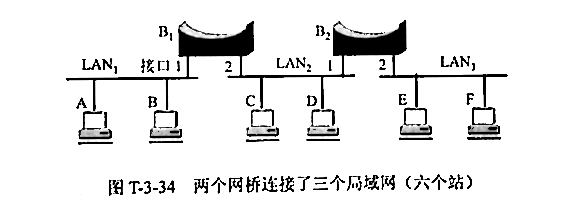

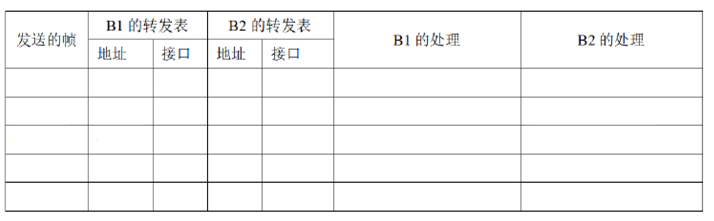

参考答案

见下表

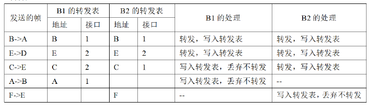

**知识点：** 数据链路层； 局域网扩展(数据链路层)； 学习型网桥

**24.** 如图所示的网络结构中，6 台主机通过透明网桥 B1、B2 连接在互联的局域网中。网 桥初始转发表是空的。假设主机发送帧的顺序是:H1 发送给 H5、H5 发送给 H4、H3 发送给 H6、H2 发送给 H4、H6 发送给 H2、H4 发送给 H3。请根据网桥自学习的原理完成网桥 B1 与 B2 的转发表。

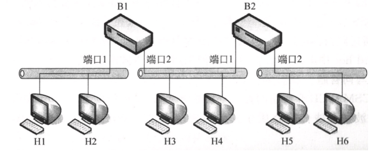

参考答案

根据网桥自学习的原理，如果网络现在能够从端口 x 收到从源地址为 A 的主机发送的数据帧，那么以后就 可以从端口 x 转发目的地址为 A 的数据帧。网桥建立相应的转发表，记录“主机-端口”的映射关系。

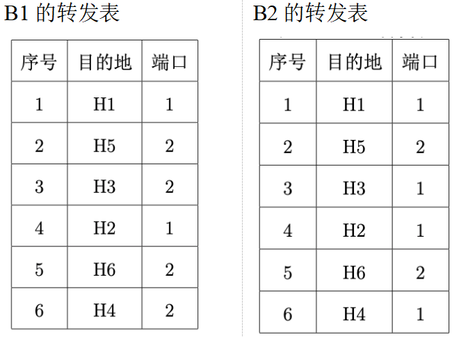

**知识点：** 数据链路层； 局域网扩展(数据链路层)； 透明网桥； 学习型网桥

**25.** 有10个站连接到以太网上。试计算以下三种情况下每一个站所能得到的带宽。(i)10个站都连接到一个10Mb/s以太网集线器;(ii)10个站都连接到一个100Mb/s以太网集线器;(iii)10个站都连接到一个10Mb/s以太网交换机。

参考答案

(i)假定以太网的利用率基本上达到100%，10个站共享10Mbps，即平均每一个站可以得到1Mbps的带宽; (ii)假定以太网的利用率基本上达到100%，10个站共享100Mbps，即平均每一个站可以得到10Mbps的带宽; (iii)假定交换机的总带宽为不少于100Mbps，每一个站点独占交换机的一个接口带宽10Mbps。

**知识点：** 数据链路层； 集线器； 交换机

**26.** 假设我们想要传输消息 11001001，并用 CRC 多项式 x^3 + 1 防止它出错。(1) 使用多项式长除法确定应传输的消息。(2) 假设由于传输链路上的噪声使得消息最左端的比特发生反转。接收方的 CRC 的计算 结果是什么?接收方如何知道发生了一个差错?

参考答案

(1)11001001|011。(2)余数为010不能整除，即可判断出错

**知识点：** 数据链路层； 差错控制； 循环冗余校验

**27.** TCP用户数据长度为8192B，通过Ethernet传送。问是否应该分片如果需要分片，应该分几个分片?写出每个分片的数据字段长度与片偏移值。

参考答案

TCP协议固定首部长度20字节，则待发送的数据长度为8192+20=8212字节;IP协议固定首部长度20字节，在以太网中每个MTU可以包括的数据长度为1500-20=1480字节; 可以分为6个分片，前5个长度为1480B，第6个812B: IP数据报分片的偏移字段的值分别为0，1480/8=185，2×1480/8= 370，3×1480/8= 555，4×1480/8= 740，5×1480/8= 925

**知识点：** IP分组转发； IP分段与重组

**28.** 一个3200位长的TCP报文传到IP层，加上160位的首部后成为数据报。下面的互联网由两个局域网通过路由器连接起来。但第二个局域网所能传送的最长数据帧中的数据部分只有1200位。因此数据报在路由器必须进行分片。试问第二个局域网向其上层要传送多少比特的数据?

参考答案

TCP数据段总长度3200比特;IP协议固定首部长度20字节，即160比特，在局域网中的每个MTU可以包括的数据长度为1200-160=1040比特; 可以分为4个分片，前3个长度为1040比特，第4个为80比特; 收到的数据报分片的总长度为3200+160\*4=3840比特

**知识点：** IP分组转发； IP分段与重组

**29.** 试辨认以下IP地址的网络类别。 (1)128.36.199.3 (2) 21.12.240.17 (3) 183.194.76.253 (4) 192.12.69.248 (5) 89.3.0.1 (6) 200.3.6.2

参考答案

(2)和(5)是A类。因为第一位(类别位)是0 (1)和(3)是B类。因为前两位(类别位)是10 (4)和(6)是C类。因为前三位(类别位)是110。

**知识点：** IP地址设计； 分类IP地址

**30.** 已知A、B、C、D共4台主机的IP地址分别为210.20.1.112、210.20.1.120、210.20.1.135、210.20.1.202，子网掩码为255.255.255.255.224。 求解: (1)4台主机中哪些可以直接通信哪些需要通过路由器才可以通信? (2)增加的主机E要与主机D直接通信，主机E的IP地址应该在哪个范围之内? (3)如果要使所有的主机都能够直接通信，需要对网络地址做什么样的调整?

参考答案

(1)主机A、B在一个子网中，可以直接通信。主机A、B与主机C或主机D，以及主机C与主机D之间不能直接通信，要通过路由器转发。 (2) 主机E的IP地址范围:201.20.1.192~201.20.1.222(不包括210.20.1.202)。 (3) 掩码为255.255.255.0，4台主机之间可以直接通信。

**知识点：** IP地址设计； 无分类IP地址(CIDR)； 无分类IP地址(CIDR)-超网/网络前缀

**31.** 如果将 192.12.66.128/25 划分为三个子网，其中子网 1 可以容纳 50 台计算机，子网 2 和 子网 3 分别容纳 20 台计算机，要求网络地址从小到大依次分配给三个子网，请写出三个子网的掩码与可用的 IP 地址段。

参考答案

每个子网内IP地址的总数量中，包括了该子网的网络地址(主机部分全为0)、广播地址(主机部分全为1)。例如IP总数为64的子网，其主机可用的IP地址数量为64-2=62。本题的答案为: 子网名称 子网 子网掩码 可用主机地址数量 主机地址范围 子网1 192.12.66.128/26 255.255.255.192 62 192.12.66.129-192.12.66.190 子网2 192.12.66.128/27 255.255.255.224 30 192.12.66.193-192.12.66.222 子网3 192.12.66.128/27 255.255.255.224 30 192.12.66.225-192.12.66.254 注:如果题目中提到需要预留上Internet的路由器地址，则可用的主机地址数量为64-3=61。本题目中未提及此条件，可以不考虑。

**知识点：** IP地址设计； 无分类IP地址(CIDR)； 无分类IP地址(CIDR)-超网/网络前缀

**32.** 某机构下属A、B、C、D、E五个部门，分别有175、110、52、23、16台主机。现有IP地址块192.1.2.0/23，需要将其划分用于五个部门的子网编址。给出一种满足上述要求的子网地址划分方案。

参考答案

方案一 子网 主机数 比特数 网络号第3、4字节 网络号 网络掩码 A 175 8 0000 0010.0000 0000 192.1.2.0/24 255.255.255.0 B 110 7 0000 0011.0000 0000 192.1.3.0/25 255.255.255.128 C 52 6 0000 0011.1000 0000 192.1.3.128/26 255.255.255.192 D 23 5 0000 0011.1100 0000 192.1.3.192/27 255.255.255.224 E 16 5 0000 0011.1110 0000 192.1.3.224/27 255.255.255.224 方案二 子网 主机数 比特数 网络号第3、4字节 网络号 网络掩码 A 175 8 0000 0011.0000 0000 192.1.3.0/24 255.255.255.0 B 110 7 0000 0010.1000 0000 192.1.2.128/25 255.255.255.128 C 52 6 0000 0010.0100 0000 192.1.2.64/26 255.255.255.192 D 23 5 0000 0010.0010 0000 192.1.2.32/27 255.255.255.224 E 16 5 0000 0010.0000 0000 192.1.2.0/27 255.255.255.224

**知识点：** IP地址设计； 无分类IP地址(CIDR)； 无分类IP地址(CIDR)-超网/网络前缀

**33.** 对于下图所示网络，给出下列情况下的全局距离向量表:(1)每个节点只知道自己至直接邻居节点的距离。(2)每个节点将上一步获知的信息告知其邻居节点。(3)步骤(2)再次执行。

参考答案

见下表

**知识点：** IP网络路由； 路由算法-距离向量算法

**34.** 对于下图所示网络，给出节点A运行前向搜索算法计算其路由表的步骤。

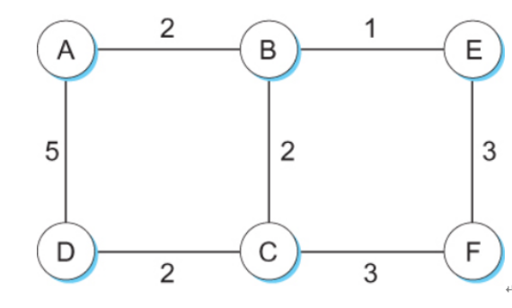

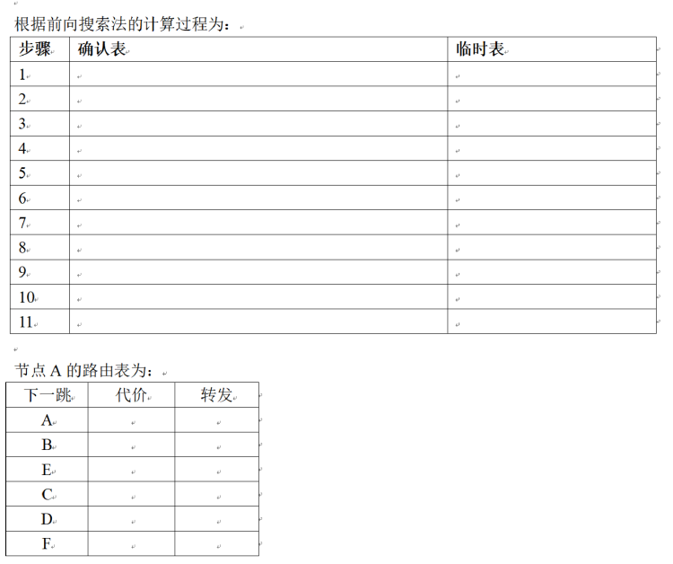

参考答案

见下表

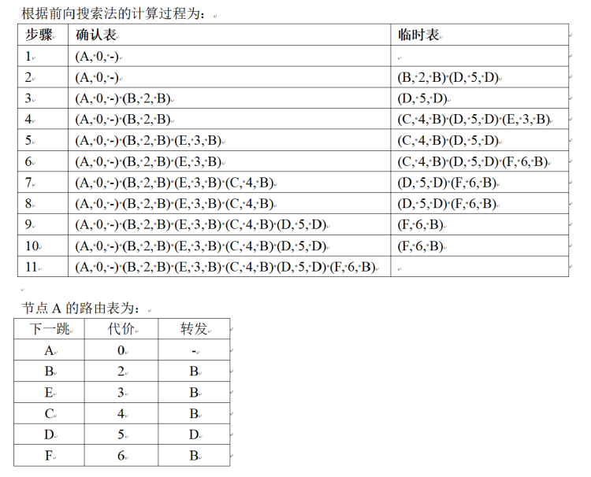

**知识点：** IP网络路由； 路由算法-链路状态算法

**35.** 一个自治系统有5个局域网，其连接图如图T-4-29示。LAN2至LAN5上的主机数分别为91，150，3和15。该自治系统分配到的IP地址块为30.138.118/23。试给出每一个局域网的地址块(包括前缀)。

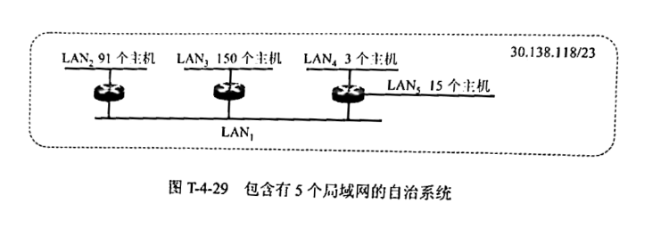

参考答案

可以有多组答案: 第一组: LAN1: 30.138.119.192/29 LAN2: 30.138.119.0/25 LAN3: 30.138.118.0/24 LAN4: 30.138.119.200/29 LAN5: 30.138.119.128/26 第二组: LAN1: 30.138.118.192/27 LAN2: 30.138.118.0/25 LAN3: 30.138.119.0/24 LAN4: 30.138.118.224/27 LAN5: 30.138.118.128/27

**知识点：** 异构网络互联； 无分类IP地址(CIDR)

**36.** 某个公司申请了一个整个C类202.60.31.0的IP地址空间。该公司有100名员工在销售部工作，50名员工在财务部门工作，50名员工在设计部门工作。要求为销售部门、财务部门与设计部门分别组建子网。请按照用户需求划分地址范围。

参考答案

三个部门的IP地址需求为100，50，50。考虑到公司一般有上网需求，加上网络地址、广播地址、默认网关(路由器)地址，其IP地址需求总数为103，53，53。可以分为3个子网IP地址空间，IP地址数量分别为128，64，64。 采用变长子网的划分的三个子网的IP地址分别为: (1)子网1地址空间为202.60.31.1~202.60.31.126，子网掩码为255.255.255.128(或/25) (2)子网2地址空间为202.60.31.129~202.60.31.190，子网掩码为255.255.255.192(或/26) (3)子网3地址空间为202.60.31.193~202.60.31.254，子网掩码为255.255.255.192(或/26) 子网1允许使用的主机号为125个;子网2与子网3可以使用的主机号均为61个。

**知识点：** 异构网络互联； 无分类IP地址(CIDR)

**37.** 一个 ISP 有一个 B 类地址，基于 CIDR 方法将一部分地址分配给一家新公司。新公司网络 中的三个部门的机器需要 IP 地址:工程部、市场部和销售部。这三个部分计划中的增长如 下:工程部在第一年开始时有 5 台机器，伺候每周增加一台;市场部最多需要 16 台机器;销 售部的每两个客户需要一台机器。第一年开始时，公司没有客户，但是销售模式指出第二年 开始，公司将有 6 个客户，并且，此后每周增加一个新客户的概率为 60%，失去一个客户的 概率为 20%，或者以 20% 的概率维持原数目不变。问题(1) 如果市场部使用它所有的 16 个地址，并且销售部和工程部向计划预期的那样，那么， 至少在 7 年内，支持此公司增长的计划的地址范围是什么?问题(2) 这样的地址分配可以维持多长时间?当公司的地址空间用完时，如何给三个部门分配地址?问题(3) 如果在 7 年内不使用 CIDR 编址方法，那么，新公司还有什么得到地址空间的选择?

参考答案

(1)总的机器数要求为 369 + 16 + 66 = 451 个主机，因此这家新公司需要范围 512 的 IP 地址(2)工程部421，市场部16，销售部75(3)一个 B 类或两个 C 类网络地址

**知识点：** 异构网络互联； 无分类IP地址(CIDR)

**38.** 有如下的4个/24地址块，试进行最大可能的聚合。212.56.132.0/24，212.56.133.0/24，212.56.134.0/24，212.56.135.0/24

参考答案

最大可能的聚合的CIDR地址块是212.56.132.0/22

**知识点：** 异构网络互联； 无分类IP地址(CIDR)

**39.** 根据下图所示的网络结构与地址，构造路由器R1的路由表。

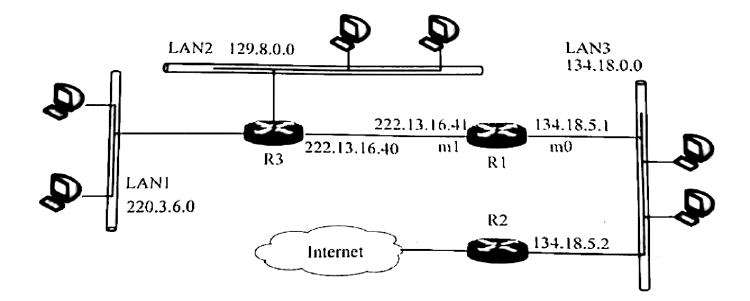

参考答案

R1路由表:

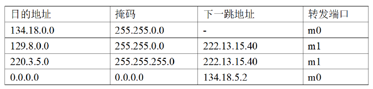

**知识点：** IP网络路由

**40.** 下图给出了一个小型校园网的网络结构。已知:校园网获得了一个202.15.20.0/24的C类IP地址:LAN1，LAN2与LAN3各有最多为60台计算机或服务器;路由器3通过市教育科研网中心接入Internet。回答以下问题:(1)子网划分后的LANl、LAN2、LAN3的主机IP地址范围。(2) 路由器R2的路由表。(3) 路由器R1聚合后的路由表。

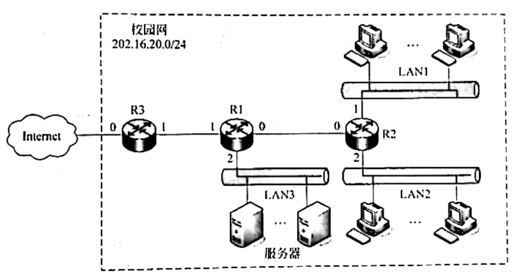

参考答案

考虑到上网需求，每个局域网至少需要61个IP地址;同时还需要为路由器的连接链路分配IP地址。可以区分为202.15.20.0/26，202.15.20.64/26，202.15.20.128/26，202.15.20.192/26四个网段，前三个分别给LAN1~LAN3，第四个进一步细分给R1-R2和R1-R3的串行链路。 LAN1~LAN3相关路由器的接口IP地址可以分配为:LAN1中的202.15.20.1/26分配给路由器R2的接口1;LAN2中的202.15.20.65/26分配给路由器R2的接口2;LAN1中的202.15.20.129/26分配给路由器R1的接口2; 第四个网段细分的两个子网，202.15.20.192/30，202.15.20.252/30，分别给R1-R3的链路、R1-R2的链路，相关路由器的接口IP地址可以分配为:
15.20.253/30给R1的接口0，202.15.20.254/30给R2的接口0;(1)子网划分后的LAN1、LAN2、LAN3的主机IP地址范围:LAN1地址范围为202.15.20.1~202.15.20.62。LAN2地址范围为202.15.20.65~202.15.20.126。LAN3地址范围为202.15.20.129~202.15.20.190。(2) 路由器R2的路由表。
 目的地址
 掩码
 下一跳地址
 转发端口
 202.15.20.0
 255.255.255.192
 直接连接
 1
 202.15.20.64
 255.255.255.192
 直接连接
 2
 202.15.20.128
 255.255.255.192
 202.15.20.253
 0
 0.0.0.0
 0.0.0.0
 202.15.20.253
 0
(3)由于LAN1的地址为202.15.20.0/26，LAN2的地址为202.15.20.64/26，需要对它们进行地址汇聚。汇聚后的网络前缀长度应该为25，对应的掩码为255.255.255.128。路由器R1的路由表。
 目的地址
 掩码
 下一跳地址
 转发端口
 202.15.20.0
 255.255.255.128
 202.15.20.254
 0
 202.15.20.128
 255.255.255.192
 直接连接
 2
 0.0.0.0
 0.0.0.0
 202.15.20.194
 1

**知识点：** IP地址设计； 无分类IP地址(CIDR)； IP网络路由

**41.** 路由器不完整的路由表如下表所示。 目的地址 掩码 下一跳 转发端口 174.11.64.0 255.255.240.0 R1端口1 端口2 176.11.16.0 255.255.240.0 直接交付 端口1 176.11.32.0 255.255.240.0 直接交付 端口2 176.11.48.0 255.255.240.0 直接交付 端口3 0.0.0.0 0.0.0.0 R2端口2 端口1 路由器R接收到以下分别发往6个目的主机的分组。H1: 21.13.24.78 H2: 176.11.64.129 H3: 176.11.35.72 H4: 176.11.31.168 H5: 176.11.60.239 H6: 192.36.8.73 回答以下问题:(1)表中序号1~4的目的地址属于哪类网络它们是由哪个网络中划分出来的?(2)若路由器R1端口1与路由器2端口2连接了主机号均为5，它的IP地址是什么?(3)H1到H6的下一跳地址分别是什么?

参考答案

(1)表中序号1~4的目的地址176.11.64.0、176.11.16.0、176.11.32.0与176.11. 48.0都属于B类地址，掩码为255.255.0.0，因此它们是由176.11.0.0划分出来的。 (2)R1端口1的地址是176.11.32.5。R2的端口2的地址为176.11.16.5。 (3)H1: 21.13.24.78下一跳为R2的端口2，下一跳IP地址为176.11.16.5。H2: 176.11.64.129下一跳为R1的端口1，下一跳IP地址为176.11.32.5。H3: 176.11.35.72由R端口2直接交付。H4: 176.11.31.168由R端口1直接交付。H5: 176.11.60.239由R端口3直接交付。H6: 192.36.8.73下一跳为R2的端口2，下一跳IP地址为176.11.16.5。

**知识点：** IP分组转发； IP网络路由

**42.** 如图所示，网络145.13.0.0/16划分为四个子网N1，N2，N3和 N4。这四个子网与路由器R连接的接口分别是m0， m1， m2和 m3。路由器R的第五个接口m4连接到因特网。 (1)试给出路由器R的路由表。(2)路由器R收到一个分组。其目的地址是145.13.160.78。试给出这个分组是怎样被转发的。

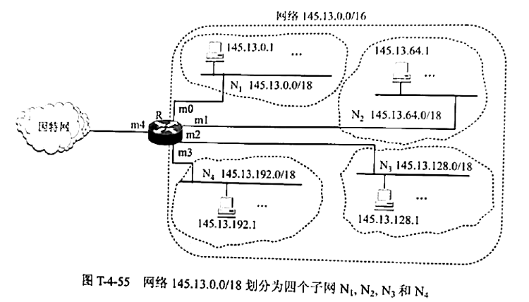

参考答案

(1)R的路由表为
 目的地址
 掩码
 下一跳
 转发接口
 145.13.0.0
 255.255.192.0
 直接交付
 接口m0
 145.13.64.0
 255.255.192.0
 直接交付
 接口m1
 145.13.128.0
 255.255.192.0
 直接交付
 接口m2
 145.13.192.0
 255.255.192.0
 直接交付
 接口m3
 0.0.0.0
 0.0.0.0
 默认路由器
 接口m4
(2)收到的分组从路由器的接口m2转发，实际上就是直接交付连接在这个网络上的目的主机。

**知识点：** IP分组转发； IP网络路由

**43.** 通信信道带宽为1Gbps，端-端延时为10ms，TCP发送窗口为65535字节，传输信道不产生差错。求该TCP连接可能达到最大的吞吐率，以及信道利用率。

参考答案

最大吞吐率为26.214Mbps，信道利用率约为2.62%。

**知识点：** 计算机网络的性能（吞吐量/时延/带宽时延积）； 传输控制TCP协议

**44.** 主机A与主机B建立了TCP连接。主机A向主机B连续发送3个TCP报文段，长度分别为100B、200B、300B，第一个报文段的序列号为201，主机B在正确接收3个报文段之后，发送给主机A的确认序列号应该为多少?

参考答案

主机B发送的确认序号为期待接收的下一个报文段的起始字节序号，201+ 100+ 200+ 300=801。故确认号为801

**45.** 主机A向主机B建立了一个TCP连接，主机A连续向主机B发送了200B、300B与400B共3个报文段。第3个报文段的序号是900。如果主机B正确地接收到第1和第3个报文段，那么主机B向主机A发送的确认序号应该是多少

参考答案

主机B期待接收第2个报文段。第2个报文段的起始字节序号为900-300=600。故确认号为600。

**知识点：** TCP可靠传输-序号/确认号

**46.** 主机A向主机B连续发送了两个TCP报文段，其序号分别是70和100。试问: (1)第一个报文段携带了多少字节的数据? (2)主机B收到第一个报文段后，发回的确认中的确认号应当是多少? (3)如果B收到第二个报文段后，发回的确认中的确认号是180，试问A发送的第二个报文段中的数据有多少字节? (4)如果A发送的第一个报文段丢失了，但第二个报文段到达了B。B在第二个报文段到达后向A发送确认。试问这个确认号应为多少?

参考答案

(1)第一个报文段的数据序号是70到99，共30字节的数据。 (2)B期望收到下一个报文段的第一个数据字节的序号是100，因此确认号应为100。 (3)A发送的第二个报文段中的数据中的字节数是180-100=80字节。 (4)B在第二个报文段到达后向A发送确认，其确认号应为70。

**知识点：** TCP可靠传输-序号/确认号

**47.** 主机 A 与主机 B 的 TCP 连接的 MSS=1000B。主机 A 当前的拥塞窗口为 4000B， 主机 A 连续发送了 2 个最大报文段后，主机 B 返回了对第 1 个报文的确认，确认段中通知的接 收窗口大小为 2000B。那么，这时主机 A 最多还能够发送多少个字节?

参考答案

1000B

**知识点：** 拥塞控制原理； 基于窗口的拥塞控制-拥塞窗口

**48.** 设TCP的ssthresh的初始值为8(单位为报文段)。当拥塞窗口上升到12时网络发生了超时，TCP使用慢开始和拥塞避免。试分别求出第1轮次到第15轮次传输的各拥塞窗口大小。说明拥塞窗口每一次变化的原因

参考答案

见下表

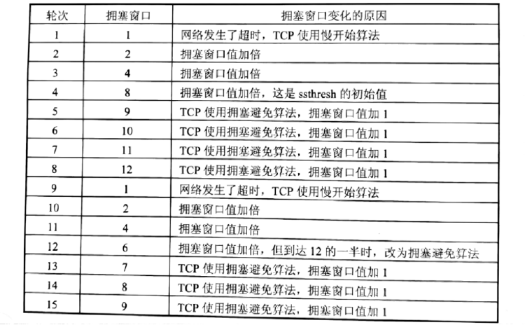

**知识点：** 拥塞控制原理； 基于窗口的拥塞控制-拥塞窗口； 慢启动； 快速重传

**49.** 一个 TCP 连接采用慢开始算法进行拥塞控制。它的最大段长度为 lKB ，发送端一直有数据要发送。在拥塞窗口为 16KB 时发生了超时，如果接下来的 4 个 RTT 时间内的 TCP 端 传输都成功，那么当第 4 个 RTT 时间内发送的所有 TCP 段都得到肯定的应答。请问拥塞窗口是多少?

参考答案

前3个RTT经过慢启动指数增加达到8KB，第4个RTT拥塞避免线性增加达到9KB，故而拥塞窗口为9KB

**50.** TCP的拥塞窗口cwnd大小与传输轮次n的关系如下表所示∶
(1)试画出拥塞窗口与传输轮次的关系曲线。(2)指明TCP工作在慢开始阶段的时间间隔。(3)指明TCP工作在拥塞避免阶段的时间间隔。(4)在第16轮次和第22轮次之后发送方是通过收到三个重复的确认，还是通过超时检测到丢失了报文段(5)在第1轮次、第18轮次和第24轮次发送时，门限ssthresh分别被设置为多大(6)在第几轮次发送出第70个报文段(7)假定在第26轮次之后收到了三个重复的确认，因而检测出了报文段的丢失，那么拥塞窗口cwnd和门限ssthresh应设置为多大

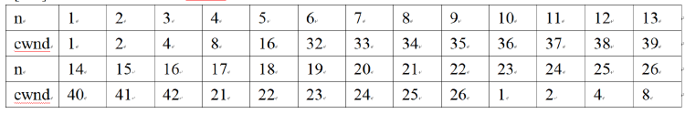

参考答案

(1) 拥塞窗口与传输轮次的关系曲线如图所示。 (2) 慢启动时间间隔:[1,6]和[23,26]。(3) 拥塞避免时间间隔:[6,16]和[17,22]。(4) 在第16轮次之后发送方通过收到三个重复的确认，检测到丢失了报文段，下一个轮次的拥塞窗口减半了。在第22轮次之后发送方是通过超时检测到丢失了报文段，下一个轮次的拥塞窗口下降到1了。(5) 在第1轮次发送时，门限ssthresh被设置为32，因为从第6轮次起就进入了拥塞避免状态，拥塞窗口每个轮次加1。在第18轮次发送时，门限ssthresh被设置为发生拥塞时拥塞窗口42的一半，即21。在第24轮次发送时，门限ssthresh被设置为发生拥塞时拥塞窗口26的一半，即13。(6)第1轮次发送报文段1。(cwnd =1)第2轮次发送报文段2，3。(cwnd = 2)第3轮次发送报文段4~7。(cwnd=4)第4轮次发送报文段8~15。(cwnd=8)第5轮次发送报文段16~31。(cwnd=16)第6轮次发送报文段32~63。(cwnd=32)第7轮次发送报文段64~94。(cwnd=33)因此第70报文段在第7轮次发送出。(7) 检测出了报文段的丢失时拥塞窗口cwnd是8，因此拥塞窗口cwnd的数值应当减半，等于4，而门限ssthresh应设置为检测出报文段丢失时拥塞窗口8的一半，即4。

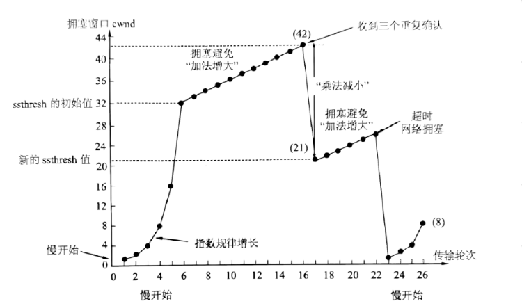

**知识点：** TCP 拥塞控制

**51.** 假设 TCP 实现一个扩展，允许窗口大小远大于 64KB。假定你用这一扩展 TCP 在一条延迟为 100 毫秒(往返时延)的 1Gbps 链路上传送一个 10MB 的文件，而且 TCP 接收窗口为 1MB。如果 TCP 发送 1KB 的分组 (假设无拥塞，无丢失分组):(1) 当慢启动打开发送窗口达到 1MB 时用了多少 RTT?(2) 发送该文件用了多少 RTT?(3) 如果发送文件的时间由所需的 RTT 的数量与链路延迟的乘积给出，传输的有效吞吐 量是多少?链路带宽的利用率是多少?

参考答案

(1) 经过10个RTT后，TCP发送窗口达到1MB(2) 拥塞控制的慢启动阶段10个RTT;达到接收窗口后，之后流量控制起作用，又经过10个RTT，累计20个RTT完成传输(3) 该过程的有效吞吐量为41.94(Mbps)，带宽利用率4.19%

**知识点：** TCP 拥塞控制

**52.** 简答题(共1题，100分) 1、假定在浏览器中点击一条链接以获得对应Web页面，其URL的IP地址及协议端口信息在本地没有缓存，因此需要DNS查询以获得相关地址信息。如果运行浏览器的本地主机从DNS得到地址信息之前已经访问了n个DNS服务器，相继产生的RTT依次为RTT1、…、RTTn。进一步假定该链接对应Web页面只包含一个对象，由少量HTML文本组成。令RTT0表示本地主机和包含请求对象的服务器之间的RTT值。假定该Web对象传输时间为零，从点击该链接到接收到该对象需要多长时间?

参考答案

获取服务器IP地址及协议端口号所需时间为 RTT1 + RTT2 + … + RTTn其后建立TCP连接、请求及接收小Web对象所需时间均为RTT0。因此所需总时长为: RTT1 + RTT2 + … + RTTn + 2RTT0

**知识点：** TCP连接管理-三次握手； 域名解析DNS； 超文本传输协议 HTTP

## 三、简答题（18 题）

**53.** 某数据链路层协议使用同步传输技术传送比特串。试问经过零比特填充后变成怎样的比特串？若接收端收到的数据帧的数据部分是，问删除发送端加入的零比特后变成怎样的比特串？

参考答案

1. 对于比特串 0110111111111100：零比特填充就是在一连 5 个 1 之后必须插入一个 0。经过零比特填充后 变成 011011111011111000（其中带下划线的 0 是填充的）。 2. 对于比特串 0001110111110111101110110：删除发送端加入的零比特，就是把一连 5 个 1 后面的 0 删除。 因此，删除发送端加入的零比特后就得出 00011101111−1111−110（连字符表示删除了 0）。

**54.** 假设我们想要传输消息11001001，并用CRC 多项式防止它出错。
(a)使用二进制长除法确定应传输的消息。
(b)假设由于传输链路上的噪声使得消息最左端的比特发生反转。接收方的CRC 的计算结果是什么？接收方如何知道发生了一个差错？

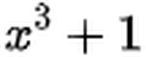

参考答案

参考答案见下图：

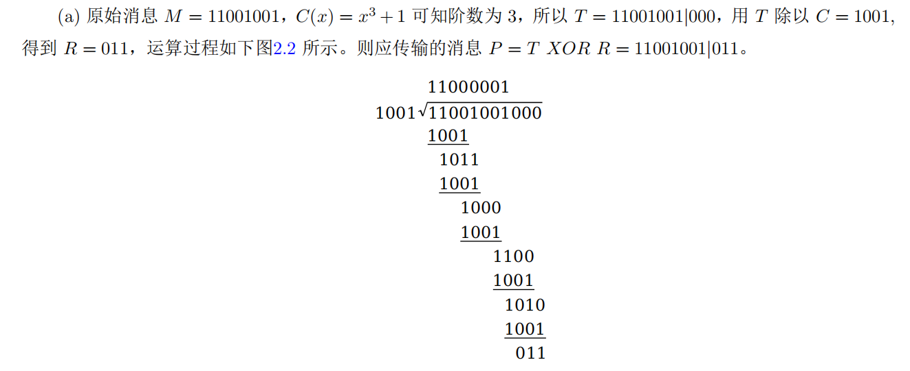

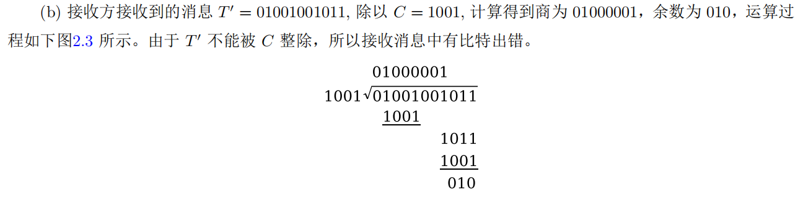

**55.** 根据图所示网络，指出主机H的子网掩码与默认网关分别是什么IP地址？

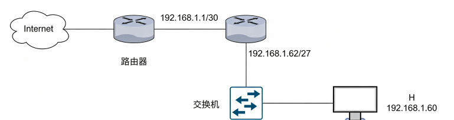

参考答案

默认网关是离当前主机最近的路由器端口地址，即 192.168.1.62。主机所在子网为/27，27-8-8-8=3，对应子 网掩码第四网段前三个 bit 位为 1。11100000 = 224(10)。所以掩码为 255.255.255.224。

**56.** 路由器 R 通过以太网交换机 S1 和 S2 连接两个网络，R 的接口、主机 H1 和 H2 的 IP 地址与 MAC 地址如下图所示。若 H1 向 H2 发送一个 IP 分组 P，则 H1 发出的封装 P 的以太网帧的目的 MAC 地址是多少？ H2 收到的封装 P 的以太网帧的源 MAC 地址分别是多少？

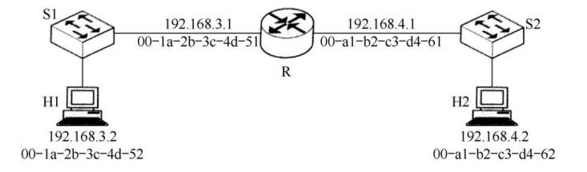

参考答案

H1 向 H2 发送的数据报 P，目的地为 H2 所在的可能是网络 192.168.4.0/24，与 H1 所在的 192.168.3.0/24 不是一张网络，P 必然需要经过路由器 R 转发。 
在交换机 S1 构成的局域网内，R 作为默认网关，其 IP 地址为 192.168.3.1、MAC 地址为 00-1a-2b-3c-4d-51； 则 H1 发送的封装 P 的目的 MAC 地址为 R 的接口地址 00-1a-2b-3c-4d-51。 
在交换机 S2 构成的局域网内，H2 收到的封装 P 的数据帧来自于路由器 R，其 IP 地址为 192.168.4.1、MAC 地址为 00-a1-b2-c3-d4-61，所以 H2 收到的封装 P 的数据帧的来源地址为 00-a1-b2-c3-d4-61。

**57.** 根据图所示的网络结构与地址，填写路由器R1的路由表（与R1的m0接口连接的对方路由器的IP地址为221.6.1.3/24）。

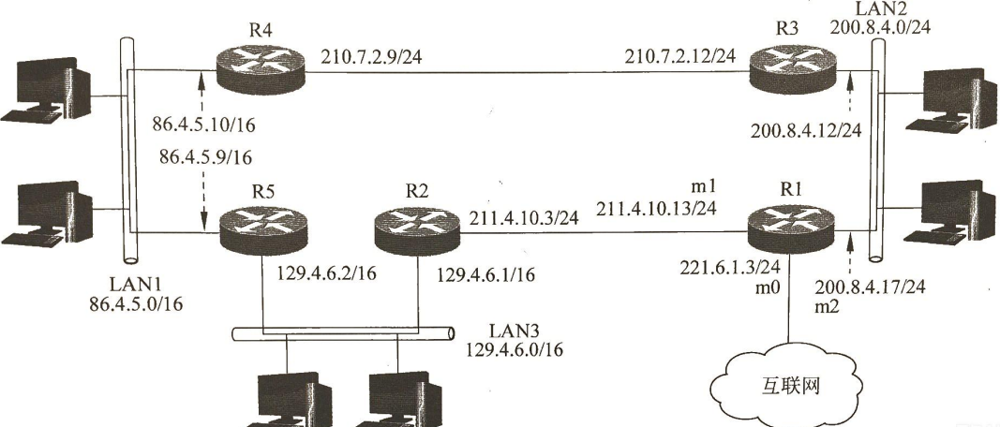

参考答案

参考答案见下图：

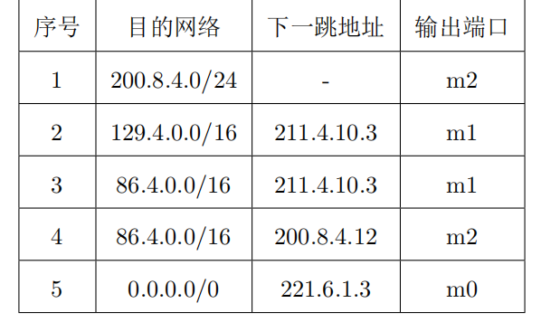

**58.** 某公司网络如图所示。IP 地址空间 192.168.1.0/24 被均分给销售部和技术部两个子网，并已分别为部分主机和路由器接口分配了 IP 地址，销售部子网的 MTU= 1500 B，技术 部子网的 MTU= 800 B。请回答下列问题。
(1) 销售部子网的广播地址是什么？技术部子网的子网地址是什么？若每个主机仅分配一个 IP 地址，则技术部子网还可以连接多少台主机？ (2) 假设主机 192.168.1.1 向主机 192.168.1.208 发送一个总长度为 1500 B 的 IP 分组，IP 分 组的头部长度为 20 B，路由器在通过接口 F1 转发该 IP 分组时进行了分片。若分片时尽可能 分为最大片，则一个最大 IP 分片封装数据的字节数是多少？至少需要分为几个分片？每个分 片的片偏移量是多少？

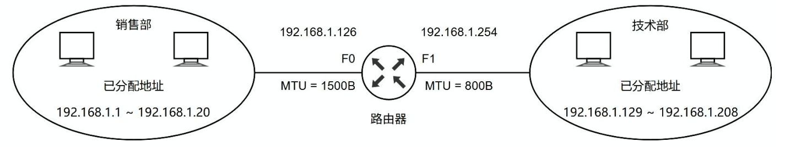

参考答案

参考答案见下图：

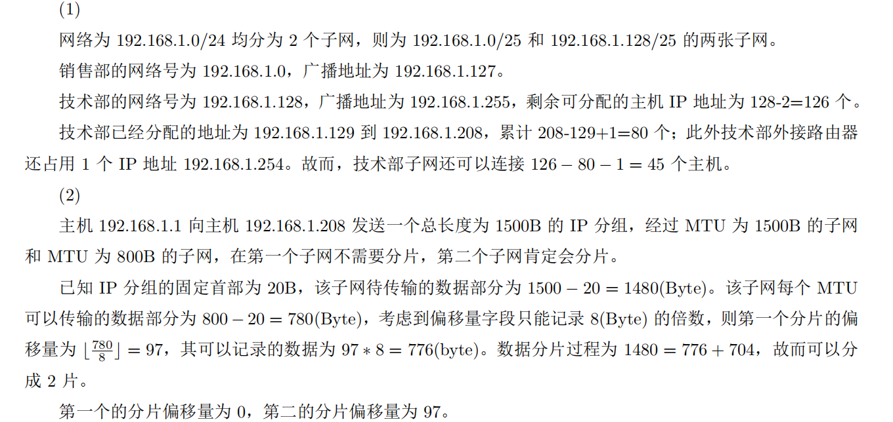

**59.** 图给出了一个小型校园网的网络结构。已知校园网获得了一个 202.15.20.0/24 的 C 类 IP 地址，LAN1，LAN2 与 LAN3 各有最多为 60 台计算机或服务器；路由器 R3 通过市教 育科研网中心接入 Internet。回答以下问题: (1) 给出一种充分利用地址块的子网划分方案，给出 LANl、LAN2、LAN3 的主机 IP 地址范围。 (2) 路由器 R2 的路由表。 (3) 路由器 R1 聚合后的路由表。

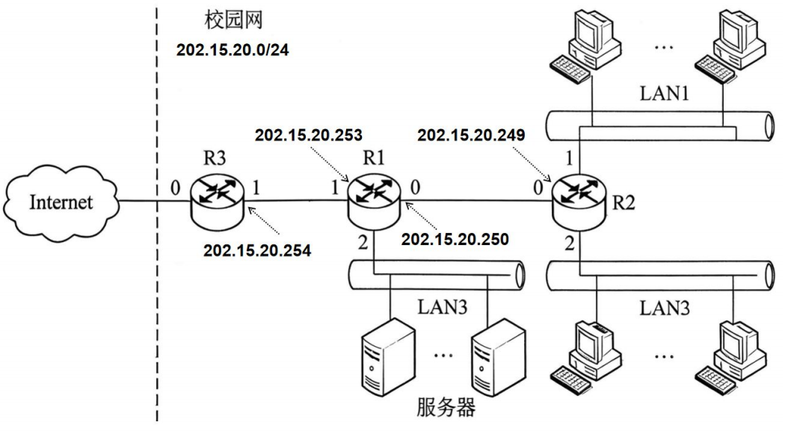

参考答案

参考答案见下图：

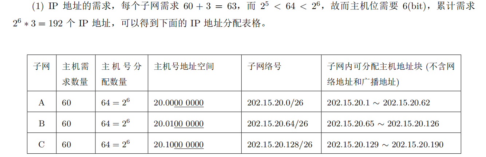

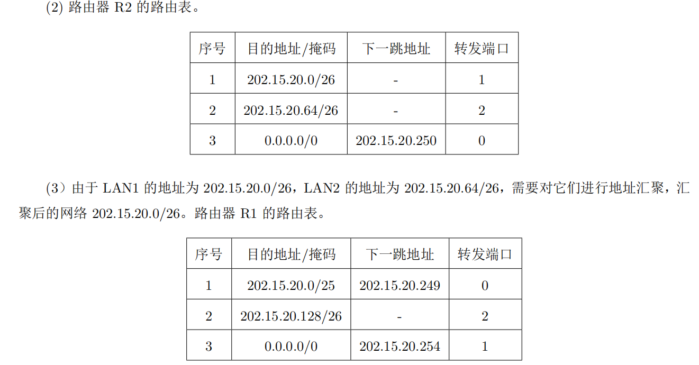

**60.** 某网络在 t0 时刻的网络拓扑和 R1 的路由表如下图所示。R1 ∼ R4 是路由器，基于 链路状态路由算法计算路由。S0 ∼ S4 是路由器 R1 的接口，链路上的数值为链路费用，若 t1 （t1 &gt; t0）时刻，R1 检测到 R1 到 R2 的链路断开，则 R1 重新计算路由并进行充分路由聚合 后的表中路由项的数量为（ ）

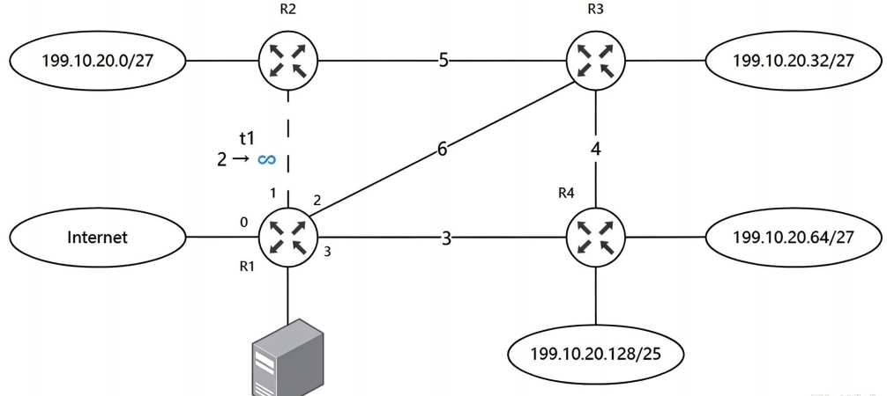

参考答案

R1-R2断开后，R1通过R3/R4可达各网络。路由聚合后：Internet、199.10.20.0/25（聚合/27的两个子网）、199.10.20.64/27、199.10.20.128/25，共4条路由。

**61.** 某校园网有两个局域网，通过路由器 R1、R2 和 R3 互联后接入 Internet，S1 和 S2 为以太网交换机，局域网采用静态 IP 地址配置，路由器部分接口以及各主机的 IP 地址如图 所示：
假设 NAT 转换表结构为：
请回答下列问题。(1) 为使 H2 和 H3 能够访问服务器 192.168.1.2（使用端口号 80），需要对 NAT 进行什么配置？(2) 若 H2 主动访问服务器 192.168.1.2 的端口 80 时，将请求报文封装 到 IP 数据报 P 中发送，则 H2 发送 P 的源 IP 地址和目的 IP 地址分别是？经过 R3 转发后， P 的源 IP 地址和目的 IP 地址分别是？经过 R2 转发后，P 的源 IP 地址和目的 IP 地址分别 是？

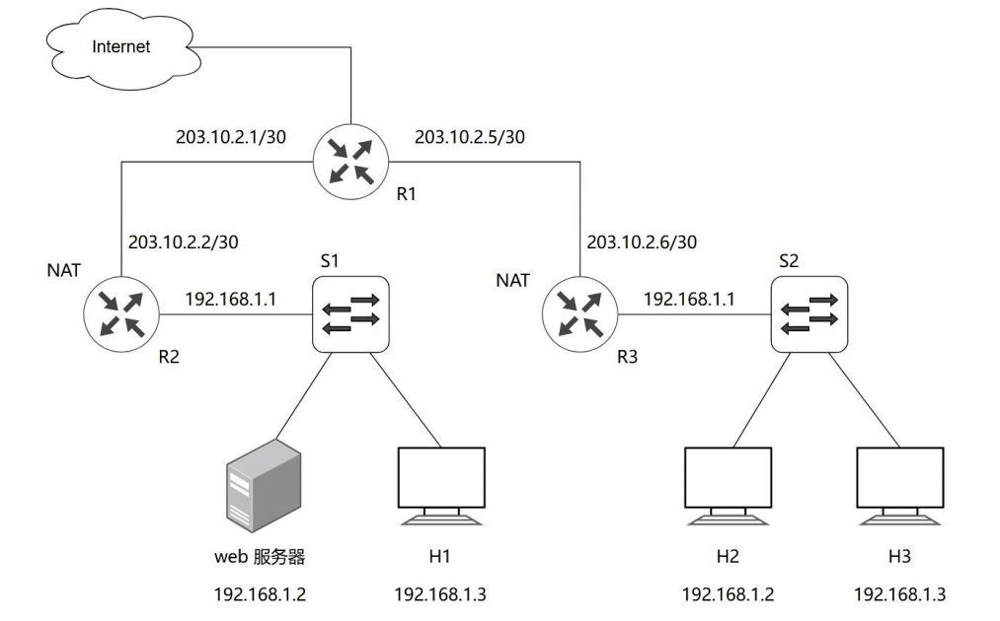

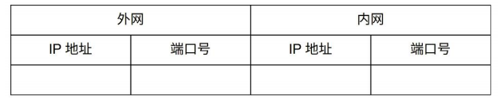

参考答案

（1）两个子网使用了相同网段，且路由器开启NAT，需在R2上配置NAT表（静态端口映射/目的NAT）。外网IP填路由器外网地址203.10.2.2，外网端口80；内网IP填Web服务器地址192.168.1.2，内网端口80（Web默认端口）。即R2的NAT表项为：(外网IP 203.10.2.2, 外网端口 80) → (内网IP 192.168.1.2, 内网端口 80)。
（2）H2发送P时：源IP 192.168.1.2（H2内网地址），目的IP 203.10.2.2（R2外网地址）。经R3转发后（源NAT，把源地址改为R3外网地址）：源IP 203.10.2.6，目的IP 203.10.2.2。经R2转发后（目的NAT，把目的地址改为Web服务器内网地址）：源IP 203.10.2.6，目的IP 192.168.1.2。

**62.** 假设主机 H 通过 TCP 向服务器发送长度为 3000B 的报文，往返时间 RTT=10ms，最长报文段寿命
MSL=30s，最大报文段长度 MSS=1000B，忽略 TCP 段的传输时延，报文传输结束后 H 首先请求断开连接，则
从 H 请求建立 TCP 连接时刻起，到 H 进入 CLOSED 状态为止，所需时间至少是多少？

参考答案

三次握手1RTT(10ms)+数据传输1RTT(10ms)+四次挥手2RTT(20ms)+TIME\_WAIT 2MSL(60s)=60040ms=60.04s。

**63.** Time 是一个提供时间查询服务的 C/S 架构网络应用，支持客户通过 UDP 和 TCP 向 Time 服务器请求时
间。若某客户与 Time 服务器通信往返时间为 8ms，则该客户分别通过 UDP 和 TCP 向该服务器请求服务，所
需的最少时间分别是多少 ms？

参考答案

UDP：无连接，不需要建立连接。客户端直接发请求报文，服务器直接回响应报文，一次往返（RTT）就能拿到时间。题目往返时间 = 8ms，所以 UDP 最少耗时 8ms。
TCP：面向连接，先要完成三次握手（1 个 RTT），之后再发送请求 + 接收时间响应（又 1 个 RTT），一共 2 个 RTT：。
综上，UDP：8ms，TCP：16ms。选 B。

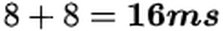

**64.** 主机 A 向主机 B 建立 TCP 连接，B 的接收缓冲区总大小为 5000 字节，MSS = 800 字节，数据起
始序号为 2000。发生的 TCP 事件序列如下：
(1) A 发送 [2000 ∼ 2799]，共 800 字节；
(2) B 收到报文，缓冲区剩余空闲 4200B，回复 ACK：ack = 2800，通告窗口 rwnd = 4200；
(3) A 发送 [2800 ∼ 3599]，共 800 字节；
(4) B 收到这 800 字节；随后应用进程从接收缓冲区读取 1500 字节。B 回复 ACK，ack = 3600。
本题不考虑拥塞窗口对发送方的限制。求：
(1) B 回复的这个 ACK 报文中通告窗口 rwnd 等于多少？
(2) A 收到该 ACK 后，发送窗口大小、下一个待发送起始序号分别是多少？
(3) A 此时最多还能连续发送多少字节？

参考答案

(1) 字节；
(2) 发送窗口字节，下一个待发送起始序号；
(3) 最多连续发送字节。

**65.** 通信信道带宽为 1Gbps，端到端单向传播延时为 10ms，TCP 发送窗口取 16bit 窗口最大值 65535B，
假设传输信道不产生差错。
(1) 不使用 TCP 窗口缩放扩展选项。求该 TCP 连接可达到的最大吞吐率以及信道利用率。
(2) 该 TCP 连接启用 TCP 窗口缩放扩展选项，协商得到窗口缩放因子 S = 5，求此后该 TCP 连接
可达到的最大吞吐率以及信道利用率。

参考答案

(1) 最大吞吐率，利用率；
(2) 最大吞吐率，利用率。

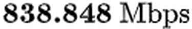

**66.** 假设主机甲和主机乙已建立一个 TCP 连接，最大段长 MSS = 1 KB，甲一直有数据向乙发送。当甲
的拥塞窗口为 16KB 时，计时器发生了超时，则甲的拥塞窗口再次增长到 16KB 所需要的时间至少是多少
倍的 RTT？

参考答案

超时后慢开始门限 ssthresh 变为 cwnd 一半即8，cwnd置为1执行慢开始（指数增长），经3个RTT增长到ssthresh=8；之后执行拥塞避免（线性增长），再经8个RTT增长到16。共 3+8=11 个RTT。

**67.** 假设图中的 H3 访问 Web 服务器 S 时，S 为新建的 TCP 连接分配了 20 KB（K=1024）的接
收缓存，最大段长 MSS=1 KB，平均往返时间 RTT=200 ms。H3 建立连接时的初始序号为 100，且持续
以 MSS 大小的段向 S 发送数据，拥塞窗口初始阈值为 32 KB；S 对收到的每个段进行确认，并通告新的
接收窗口。假定 TCP 连接建立完成后，S 端的 TCP 接收缓存仅有数据存入而无数据取出。请回答下列
问题。
(1) 在 TCP 连接建立过程中，H3 收到的 S 发送过来的第二次握手 TCP 段的 SYN 和 ACK 标志位的
值分别是多少？确认序号是多少？
(2) H3 收到的第 8 个确认段所通告的接收窗口是多少？此时 H3 的拥塞窗口变为多少？H3 的发送窗口
变为多少？
(3) 当 H3 的发送窗口等于 0 时，下一个待发送的数据段序号是多少？H3 从发送第 1 个数据段到发送窗
口等于 0 时刻为止，平均数据传输速率是多少（忽略段的传输延时） ？

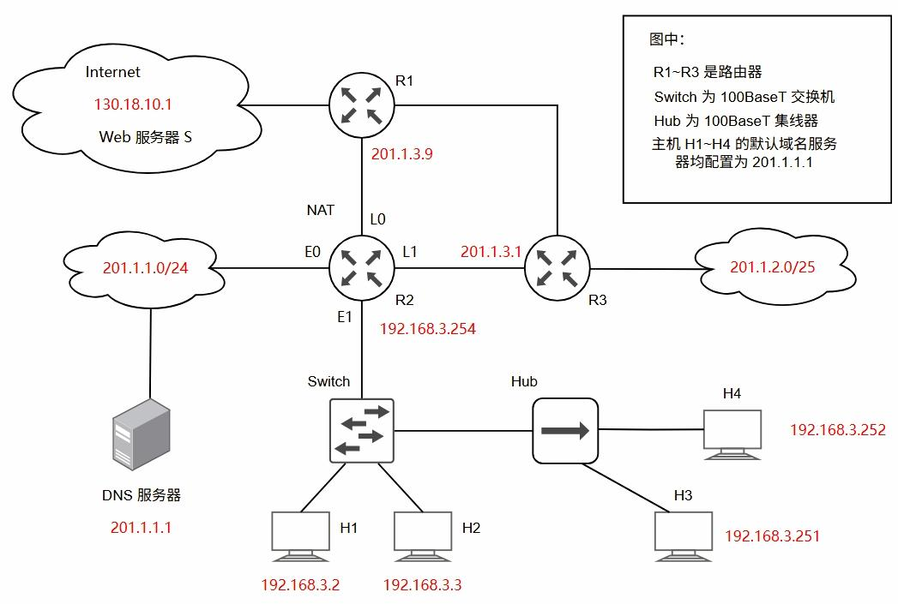

参考答案

(1) 第二次握手段 SYN=1、ACK=1；确认序号 ack=101（H3 的 ISN=100，SYN 占一个序号）。
(2) 接收窗口=20KB−8×1KB=12KB；慢开始下拥塞窗口 cwnd=1+8=9KB；发送窗口=min{9,12}=9KB。
(3) 接收缓存 20KB 全占满时发送窗口才为 0，下一个待发送段序号=20K+101=20×1024+101=20581；从发第 1 段到发送窗口为 0 共经过 5 个 RTT，平均数据传输速率=20KB/(5×200ms)=20KB/s≈20.48kbps。
(4) S 释放连接最短时间=1.5×RTT=1.5×200ms=300ms（H3 释放段→S 确认并释放段→H3 确认段，共 1.5 个往返）。

**68.** 某网络拓扑如图所示， 主机 H 登录服务器后从服务器下载一个大小为 18000B 的文件 File， 假设 H 传
输 File 建立数据连接时， 选择的初始序号为 100， MSS=1000B， 拥塞控制初始阈值为 4MSS， RTT=10ms，
忽略 TCP 的传输时延，在 File 的传输过程中，H 以 MSS 段向服务器发送数据，且未发生差错、丢包和
乱序。
(1) H 通过数据连接发送 File 时，File 的第一个字节序号是多少？在断开数据连接的过程中，发送的
第二次挥手的 ACK 序号是？
(2) File 发送过程中，当 H 收到确认序号为 2101 的确认段时，H 的拥塞窗口调整为多少？收到确认
序号为 7101 的确认段时，H 的拥塞窗口调整为多少？
(3) H 从请求建立数据连接开始，到确认 File 已被服务器全部接收为止，至少需要多长时间，期间应
用层数据平均发送速率是多少？

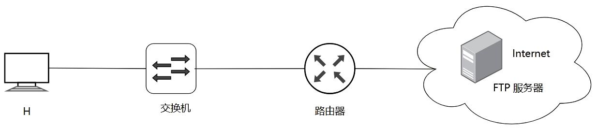

参考答案

(1) F的第一个字节序号为101（初始序号100+SYN消耗1）；第二次挥手ACK序号为18102（数据占101~18100共18000字节，FIN序号18101，ACK=18101+1=18102）。
(2) 收到2101确认段时拥塞窗口=3MSS（慢开始，从2→3）；收到7101确认段时拥塞窗口=5MSS（拥塞避免，从4→5）。
(3) 至少需要6个RTT=60ms；平均发送速率=18000×8bit/0.06s=2.4Mbps。

**69.** 假设主机 H 通过非持久的 HTTP/1.0 协议请求浏览 1 个 web 页，该网页中引用同一个网站上 7 个
小图像文件。若浏览器不支持并行 TCP 连接，则从浏览器传输 web 页请求建立 TCP 连接开始，到接收
完所有内容为止，所需要的往返时间至少是多少倍的 RTT？

参考答案

HTTP/1.0非持久连接，每个对象（1个主页面+7个图像=8个对象）需单独建立TCP连接（1RTT）+请求响应（1RTT），共8×2=16个RTT。

**70.** 假设主机 H 通过 HTTP/1.1 请求浏览某 Web 服务器 S 上的 1 个网页文件，该网页中引用了同目录
下的 1 幅图像，网页文件大小为 1 MSS（最大段长） ，图像文件大小为 3 MSS，H 访问 S 的往返时间 RTT
= 10 ms，忽略 HTTP 响应报文的首部开销和 TCP 段传输时延。若 H 已完成域名解析，则从 H 请求与
S 建立 TCP 连接时刻起，到接收到全部内容止，所需的时间至少是多少 ms？

参考答案

HTTP/1.1默认使用流水线长连接。最理想流程：第1个RTT完成TCP连接（第三次握手捎带HTTP请求）；第2个RTT服务器发送1MSS的html文件；第3个RTT发送2MSS图像；第4个RTT发送剩余1MSS图像。共4个RTT = 40ms。

