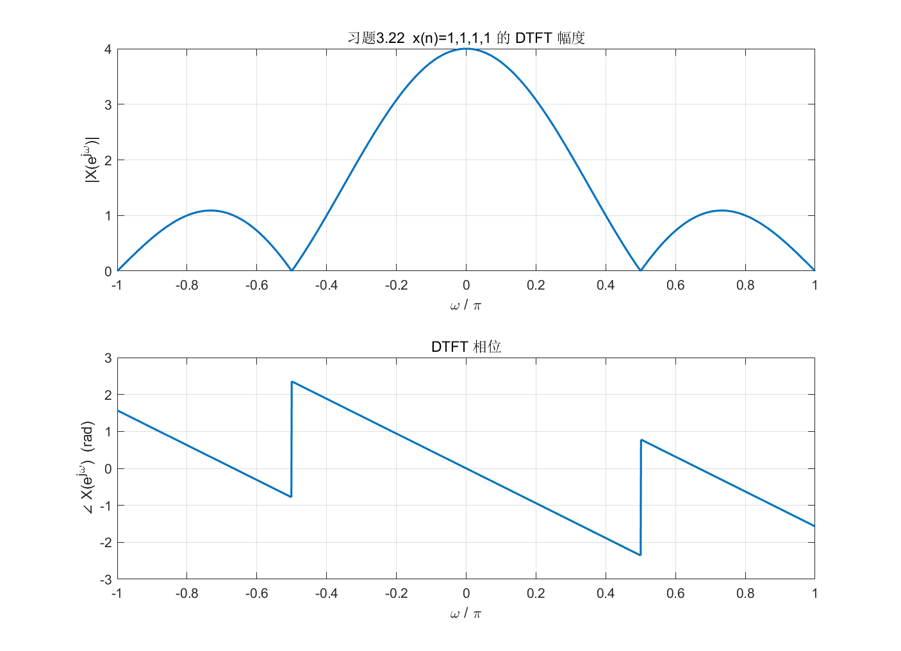
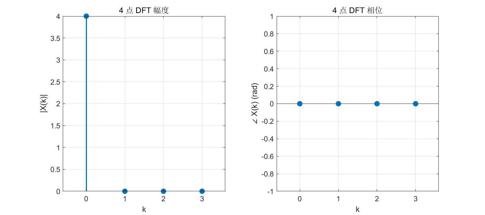
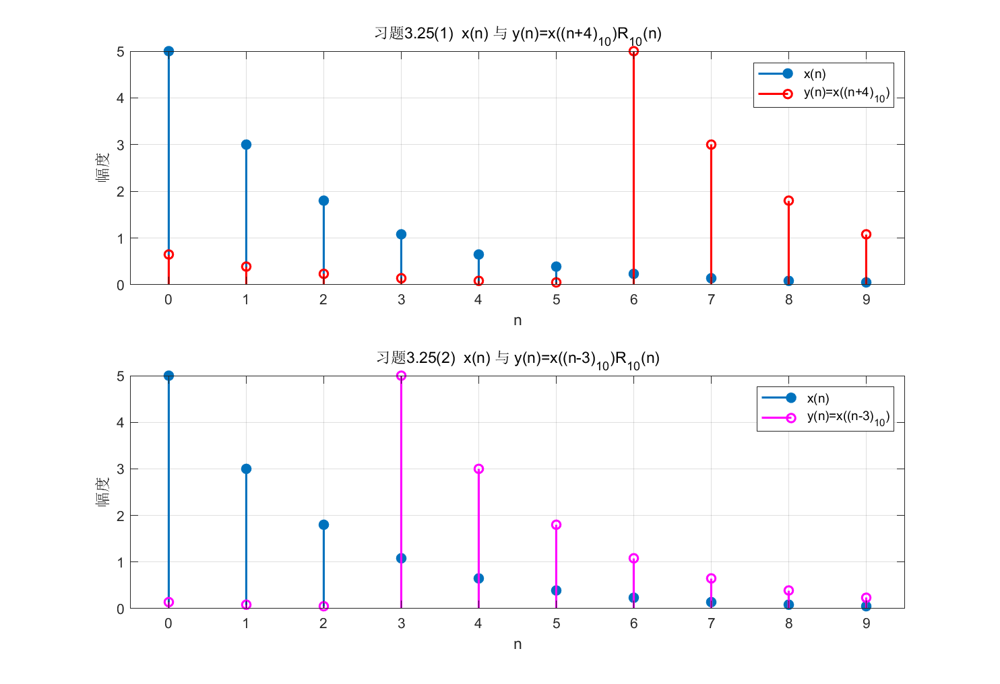
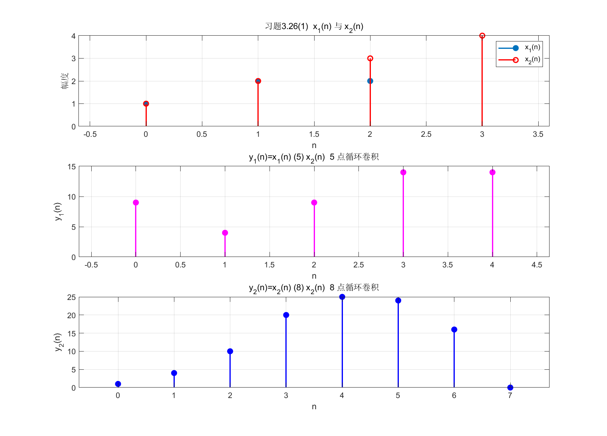
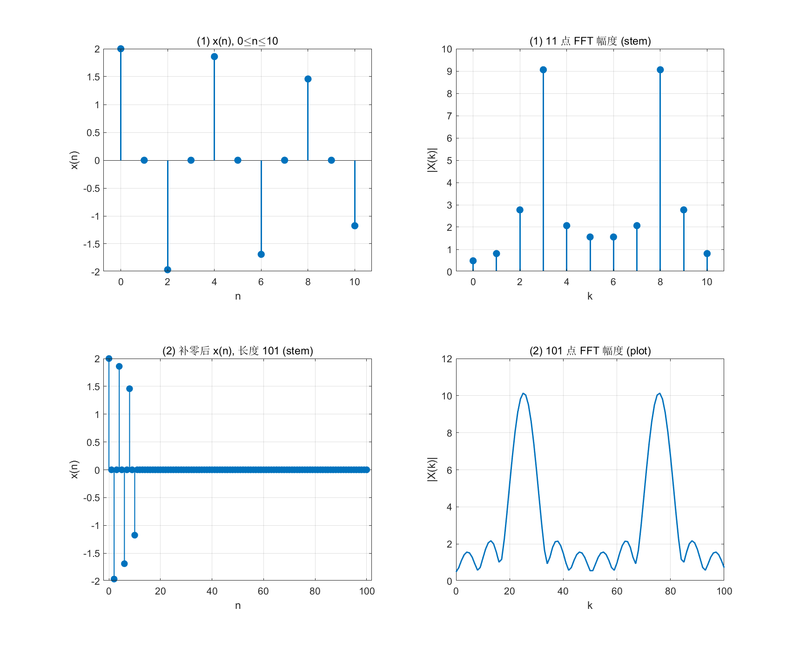
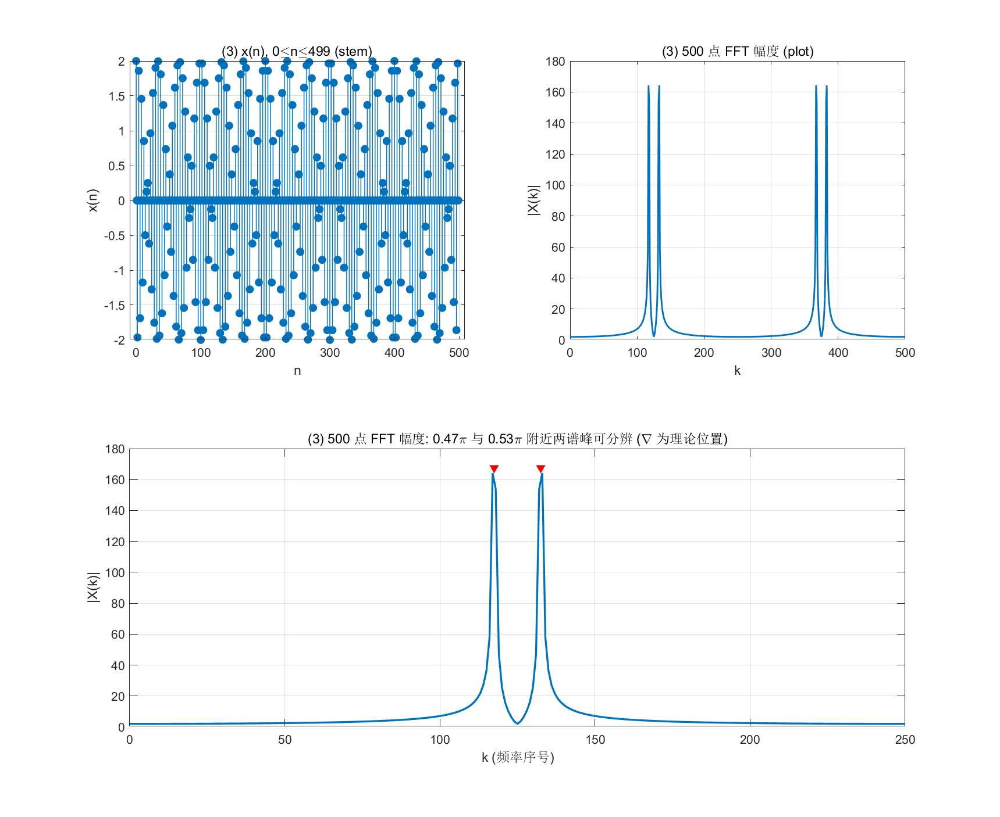

# 数字信号处理 · 期末复习整合

> **内容**：把课程总览、6 份分章知识点、3 份习题解答合并为**一篇完整文章**，可按目录跳读，也可整体打印。
> **资料来源**：课程讲义（第1章、第2章上/下、第3章、第4章、第5章、第7章）
> **作业题来源**：第2章课件 P87 清单、第3章习题 + MATLAB 题、第4章课件 P243 清单、第5章课件作业
> **真题来源**：`数字信号处理考试_2024回忆版.pdf`、`数字信号处理考试_2025回忆版.pdf`（见 §D）
> **符号约定**：$z^{-1}$ 为单位延迟，$T$ 为抽样周期，$\omega$ 为数字角频率（rad/sample），$\Omega$ 为模拟角频率（rad/s）。

---

## 目录

| 位置 | 内容 |
|---|---|
| §A 课程总览 | 课程主线、讲义对照、作业题总表、核心公式速查、21 条高频考点、复习路线 |
| §B 分章知识点 | B.1 绪论 · B.2 离散时间信号与系统 · B.3 DFT/FFT · B.4 数字滤波器 · B.5 离散时间随机信号 · B.6 功率谱估计 |
| §C 习题全解 | C.1 第3章习题全解（3.6–3.28）· C.2 第3章 MATLAB 代码与图形 · C.3 第4章习题（4.1–4.18） |
| §D 历年真题 | D.0 考点分布 · D.1 2024 填空 · D.2 2024 解答 · D.3 2025 填空 · D.4 2025 大题 |

**建议用法**：先读 §A 建立框架 → 按章精读 §B → 用 §C 逐题自测 → 用 §D 做真题演练 → 考前只回看 §A 的公式速查 / 高频考点与各章「易错点」。

---

## §A 课程总览（主线 / 作业题总表 / 公式速查 / 高频考点）

> 本部分给出全课程的框架与速查，细节推导见 §B，例题见 §C。

---

### A.1　讲义 ↔ 本文位置对照

| 讲义文件 | 页数 | 内容 | 本文位置 |
|---|---|---|---|
| 第一章绪论.pdf | 26 | 信号分类、希尔伯特变换、幅度调制、DSP 应用 | 第1章 绪论 → 本文 §B.1 |
| 第二章-1.pdf | 90 | §2.1–§2.5 序列、系统、差分方程、DTFT | 第2章 → 本文 §B.2 |
| 2026第二章-2.pdf | 79 | §2.6–§2.8 取样、Z 变换、系统函数 | 同上 |
| 第三章.pdf | 115 | DFS、DFT 及性质、循环卷积、频率取样、FFT、FFT 应用 | 第3章 → 本文 §B.3 |
| 第四章.pdf | 163 | IIR/FIR 结构、IIR 设计、频率变换、FIR 窗函数设计 | 第4章 → 本文 §B.4 |
| 第五章.pptx | 49 | 随机变量、随机过程、相关序列、功率谱、随机信号过 LSI 系统 | 第5章 → 本文 §B.5 |
| 第七章功率谱估计.pptx | 8 | 谱估计概述、周期图法、BT 法 | 第7章 → 本文 §B.6 |

---

### A.2　全课程主线（一张图记住整门课）


**四个变换的关系（考试必问）**

| 变换 | 时域 | 频域 | 计算机能否直接算 |
|---|---|---|---|
| CTFT | 连续 | 连续 | ✗ |
| FS | 连续周期 | 离散 | ✗ |
| DTFT | 离散 | 连续、以 2π 为周期 | ✗ |
| DFT | 离散**有限长** | 离散**有限长** | ✓ |

三者关系（务必背熟）：

$$
X(k)=X(z)\Big|_{z=W_N^{-k}=e^{j2\pi k/N}}=X(e^{j\omega})\Big|_{\omega=2\pi k/N},\qquad k=0,1,\dots,N-1
$$

即 **DFT = Z 变换在单位圆上的 N 点等间隔取样 = DTFT 在 [0, 2π) 上的 N 点等间隔取样**。

**两类频率的换算**

$$
\omega=\Omega T=\frac{2\pi f}{f_s}\ \text{(rad/sample)},\qquad z=e^{sT}=e^{j\Omega T}=e^{j\omega}
$$

模拟频率 Ω（rad/s）→ 数字频率 ω（rad/sample）；数字域周期 2π 对应模拟域抽样频率 f_s。

---

### A.3　作业题总表（题号 → 考点 → 解答位置）

#### 第 2 章（课本 P87，见 第二章-1.pdf 第 2 页）

| 题号 | 考点 | 说明 |
|---|---|---|
| 2.1 | 序列的图形表示、加权 δ 表示、基本运算 | §B.2 内 §2.2 |
| 2.3(2) | 序列周期性判定（2π/ω 是否为有理数） | §B.2 内 §2.2 |
| 2.4、2.5 | 序列能量/平均功率；能量信号与功率信号 | §B.2 内 §2.2 |
| 2.7(1)(3)(4) | 线性、移不变、因果、稳定的判定 | §B.2 内 §2.3 |
| 2.13、2.14(9)(10) | 卷积和（图解法 / 解析法） | §B.2 内 §2.3 |
| 2.15、2.19 | 差分方程 → 系统响应（递推法） | §B.2 内 §2.4 |
| 2.21(3)(5)、2.23(4) | DTFT 及其性质（移位、卷积、对称性） | §B.2 内 §2.5 |
| 2.29(2)、2.31、2.33 | 取样定理、混叠、频率归一化 | §B.2 内 §2.6 |
| 2.35、2.41(选做) | Z 变换与收敛域、逆 Z 变换、系统函数 | §B.2 内 §2.7–§2.8 |

> ⚠️ 第 2 章作业**课本题面不在讲义中**（讲义里只有习题清单）。§B.2 给出了对应题型的**解题模板**；要逐题详解，请补题面照片。

#### 第 3 章（习题截图 + MATLAB 题，截图见 dsp 根目录）

| 题号 | 考点 | 解答 |
|---|---|---|
| 3.6 | 5 个序列的 N 点 DFT 直接计算 | §C.1 |
| 3.8 | 线性卷积 vs 4 点/8 点循环卷积（混叠关系） | 同上 |
| 3.10 | 单位圆 N 等分取样后求 IDFT（时域周期延拓） | 同上 |
| 3.13 | 半径 1/2、附加相位 π/10 的圆上取样 → 如何修改 x(n) | 同上 |
| 3.16 | 8 点基 2 DIT-FFT 流程图与每级蝶形运算结果 | 同上 |
| 3.18 | FFT 谱分析三参数（t_p、T、N） | 同上 |
| 3.20 | 用一个复序列的 DFT 求两个实序列的 DFT（共轭对称拆分） | 同上 |
| 3.22 | DTFT 与 4 点 DFT 对比（MATLAB） | §C.2 |
| 3.25 | 循环移位（MATLAB） | §C.2 |
| 3.26 | 循环卷积（MATLAB） | §C.2 |
| 3.28 | 补零与频率分辨率（MATLAB） | §C.2 |

#### 第 4 章（课本 P243，见 第四章.pdf 第 2 页）

| 题号 | 考点 | 解答 |
|---|---|---|
| 4.1 | 由差分方程画方框图 / 信号流图 | §C.3 |
| 4.3 | 同一 H(z) 的 4 种结构（直接 Ⅰ/Ⅱ、级联、并联） | §C.3 内习题 4.3 |
| 4.4(1) | 直接 Ⅰ 型与直接 Ⅱ 型实现 | §C.3 内习题 4.4 |
| 4.6(1) | 奇对称 FIR 的相位/幅度响应（Ⅲ、Ⅳ 类）证明 | §C.3 内习题 4.6 |
| 4.8 | 冲激响应不变法 + 双线性变换法（T = 0.5） | §C.3 内习题 4.8 |
| 4.10(1) | 冲激响应不变法（h(n) = h_a(nT)，共轭极点） | §C.3 内习题 4.10 |
| 4.12 | 由数字频响反推模拟频响（作图法） | §C.3 内习题 4.12 |
| 4.14 | 双线性变换法设计巴特沃斯低通（含预畸变） | §C.3 内习题 4.14 |
| 4.17 | 循环移位序列的 DFT 关系、是否为线性相位 | §C.3 内习题 4.17 |
| 4.18 | 矩形窗/汉宁窗设计线性相位高通 FIR | §C.3 内习题 4.18 |
| 4.25 | 选做：频率取样法设计 FIR | §B.4 内 §4.6 |

#### 第 5 章（见 第五章.pptx 第 2 页）

| 题号 | 考点 | 说明 |
|---|---|---|
| 5.2 | 概率分布/密度/质量函数、均值与方差 | §B.5 内 §5.2 |
| 5.4 | 随机过程的数字特征、平稳性判定 | §B.5 内 §5.3 |
| 5.12 | 自相关/互相关/协方差序列的性质与计算 | §B.5 内 §5.5 |
| 5.14 | 功率谱（维纳–辛钦定理）计算 | §B.5 内 §5.6 |
| 5.19 | 随机信号通过 LSI 系统：均值、自相关、功率谱、方差 | §B.5 内 §5.7 |

> ⚠️ 第 5 章作业同样只有题号清单（课件无题面），§B.5 给出 5 类题型解题模板。

---

### A.4　核心公式速查

#### A.4.1　四个基本变换

$$
\text{DTFT:}\quad X(e^{j\omega})=\sum_{n=-\infty}^{\infty}x(n)e^{-j\omega n},\qquad x(n)=\frac{1}{2\pi}\int_{-\pi}^{\pi}X(e^{j\omega})e^{j\omega n}\,d\omega
$$

$$
\text{ZT:}\quad X(z)=\sum_{n=-\infty}^{\infty}x(n)z^{-n},\qquad x(n)=\frac{1}{2\pi j}\oint_C X(z)z^{n-1}\,dz
$$

$$
\text{DFT:}\quad X(k)=\sum_{n=0}^{N-1}x(n)W_N^{nk},\qquad x(n)=\frac{1}{N}\sum_{k=0}^{N-1}X(k)W_N^{-nk},\quad W_N=e^{-j2\pi/N}
$$

#### A.4.2　常用 Z 变换对

| $x(n)$ | $X(z)$ | 收敛域 |
|---|---|---|
| $\delta(n)$ | $1$ | 全 z 平面 |
| $u(n)$ | $\dfrac{1}{1-z^{-1}}$ | $\lvert z\rvert>1$ |
| $a^nu(n)$ | $\dfrac{1}{1-az^{-1}}$ | $\lvert z\rvert>\lvert a\rvert$ |
| $-a^nu(-n-1)$ | $\dfrac{1}{1-az^{-1}}$ | $\lvert z\rvert<\lvert a\rvert$ |
| $na^nu(n)$ | $\dfrac{az^{-1}}{(1-az^{-1})^2}$ | $\lvert z\rvert>\lvert a\rvert$ |
| $r^n\cos(\omega_0n)u(n)$ | $\dfrac{1-r\cos\omega_0\,z^{-1}}{1-2r\cos\omega_0\,z^{-1}+r^2z^{-2}}$ | $\lvert z\rvert>r$ |
| $r^n\sin(\omega_0n)u(n)$ | $\dfrac{r\sin\omega_0\,z^{-1}}{1-2r\cos\omega_0\,z^{-1}+r^2z^{-2}}$ | $\lvert z\rvert>r$ |

#### A.4.3　窗函数参数表（窗长 $N$）

| 窗 | $w(n)$ | 主瓣宽度 | 最小阻带衰减 | 过渡带 $\Delta\omega$ |
|---|---|---|---|---|
| 矩形 | $1$ | $4\pi/N$ | $-21$ dB | $1.8\pi/N$ |
| 三角 Bartlett | $1-\left\lvert\dfrac{2n}{N-1}-1\right\rvert$ | $8\pi/N$ | $-25$ dB | $6.1\pi/N$ |
| 汉宁 Hanning | $0.5-0.5\cos\dfrac{2\pi n}{N-1}$ | $8\pi/N$ | $-44$ dB | $3.1\pi/N$ |
| 汉明 Hamming | $0.54-0.46\cos\dfrac{2\pi n}{N-1}$ | $8\pi/N$ | $-53$ dB | $3.3\pi/N$ |
| 布莱克曼 | $0.42-0.5\cos\dfrac{2\pi n}{N-1}+0.08\cos\dfrac{4\pi n}{N-1}$ | $12\pi/N$ | $-74$ dB | $5.5\pi/N$ |

#### A.4.4　IIR 设计两条路线

$$
\text{冲激响应不变法:}\quad h(n)=h_a(nT),\ z_k=e^{s_kT}\quad\text{（有混叠，只宜 LP/BP）}
$$

$$
\text{双线性变换:}\quad s=\frac{2}{T}\cdot\frac{1-z^{-1}}{1+z^{-1}},\quad \Omega=\frac{2}{T}\tan\frac{\omega}{2}\quad\text{（无混叠，频率轴非线性需预畸变）}
$$

---

### A.5　高频考点 21 条（考前 30 分钟看这一节）

1. 数字频率与模拟频率：ω = ΩT；ω 的**混叠性**（ω 与 ω+2πm 等价）。
2. 正弦序列周期性：2π/ω = N/k 为**有理数**才周期，最小周期 N = 2πk/ω。
3. LSI 系统稳定 ⟺ Σ|h(n)| < ∞；因果 ⟺ h(n) = 0 (n<0)；H(z) 因果稳定 ⟺ 极点全在单位圆内。
4. 卷积四大性质 + 与 δ 卷积：x(n)·δ(n−n₀) = x(n−n₀)。
5. 取样定理：Ω_s ≥ 2Ω_m，折叠频率 Ω_s/2；DFT 用循环卷积算线性卷积要求 N ≥ L₁+L₂−1。
6. Z 变换三要素：表达式 + **收敛域** + 零极点图；同一 X(z) 不同收敛域对应不同序列。
7. DFT 循环移位 ⟷ 乘 W_N^{mk}；循环卷积 ⟷ 频域相乘（别与线性卷积混）。
8. 实序列 DFT 共轭对称性：X(k) = X*((N−k))_N；实偶 ⟷ 实偶，实奇 ⟷ 纯虚奇。
9. 帕斯瓦尔：Σ|x(n)|² = (1/N)Σ|X(k)|²。
10. FFT 运算量：复数乘 (N/2)log₂N、复数加 N log₂N；DIT 输入倒位序、输出自然序。
11. FFT 谱分析三参数：t_p = 1/F、T ≤ 1/(2f₀)、N = t_p/T；**补零只提高显示分辨率**。
12. 直接 Ⅱ 型 = 典范型（延迟单元最少，N 阶用 N 个）。
13. 冲激响应不变法有混叠；双线性无混叠但频率畸变（预畸变补偿）；双线性可做 LP/HP/BP/BS。
14. 线性相位 FIR：h(n) = ±h(N−1−n)，4 种类型；Ⅱ 型不能做高通/带阻，Ⅲ 型不能做低通/高通（只能带通/微分器），Ⅳ 型不能做低通。
15. 平稳随机过程：均值常数 + 自相关只与时间差有关；功率谱 P(e^{jω}) = Σ r(m)e^{−jωm}，平均功率 = r(0) = (1/2π)∫P dω。

15. 平稳随机过程：均值常数 + 自相关只与时间差有关；功率谱 P(e^{jω}) = Σ r(m)e^{−jωm}，平均功率 = r(0) = (1/2π)∫P dω。

16. **「DFT 为实数 / 纯虚数」的判据（两年都考）**：实序列 $N$ 点 DFT 为**实** ⟺ $x(n)$ 圆周**偶**对称 $x(n)=x((N-n))_N$；为**纯虚** ⟺ 圆周**奇**对称 $x(n)=-x((N-n))_N$。做法：对**支撑集内每个点** $n$ 强制 $(N-n)_N$ 仍落在支撑集里，取各条件的交集。**不要**直接套"$N=2n_c$ 的整数倍"（那是无限长序列的结论）；本题类有限长序列往往只有一个解。例（支撑 $\{4,5,6\}$）⇒ 唯一解 $N=10$。
17. **正弦稳态输出**：$A\cos(\omega_0n+\theta)\to A\lvert H(e^{j\omega_0})\rvert\cos(\omega_0n+\theta+\angle H(e^{j\omega_0}))$；直流分量单独乘 $H(e^{j0})=H(1)$，**两项分别算再叠加**。
18. **白噪声过系统三件套**：$m_Y=m_XH(1)$；$R_{wx}(m)=\sigma^2h(m)$（由此反求 $h$）；$S_{xx}=\sigma^2\lvert H\rvert^2$，$\sigma_x^2=\sigma^2\sum\lvert h\rvert^2$。
19. **抽取/内插的频谱**：$\downarrow M$：$Y(e^{j\omega})=\frac1M\sum_{k=0}^{M-1}X(e^{j(\omega-2\pi k)/M})$（展宽 + 叠加 + 除 $M$）；$\uparrow M$：$Y(e^{j\omega})=X(e^{jM\omega})$（压缩频带，不叠加）。
20. **零点四重对称**：实系数线性相位 FIR 的零点成组 $\{z_0,1/z_0,z_0^*,1/z_0^*\}$；数零点个数即得最低阶数，群延迟 $=(N-1)/2$。
21. **逆系统 / 最小相位化**：$G=1/H$ 若 $H$ 有圆外零点则不稳定；须把该极点"反射"进单位圆并补增益 $K$，使 $\lvert HG\rvert=1$。

> 上述第 16–21 条全部来自 2024 / 2025 真题，见 §D。


---

### A.6　复习路线建议

| 轮次 | 任务 | 对应位置 |
|---|---|---|
| 第 1 轮（2 天） | 通读第 2、3 章知识点，默写 DTFT/ZT/DFT 三组定义与性质表 | §B.2、§B.3 |
| 第 2 轮（2 天） | 第 4 章设计流程（IIR 两条路线 + FIR 窗函数法）算 3 道典型题 | §B.4 + §C.3 |
| 第 3 轮（1 天） | 第 5、7 章随机信号公式 + 第 1 章概念题记忆 | §B.5、§B.6、§B.1 |
| 冲刺 | 只看 §A 的公式速查与高频考点 + 各章「易错点」 | §A、各章末 |

---

### A.7　待补充

- 第 2 章（P87）、第 5 章作业题的**课本题面**不在讲义里，目前按题号给知识点与解题模板；如需逐题详解请补题面截图。
- 第 4 章 4.25（选做，频率取样法设计 FIR）尚无解答文件。

---

## §B 分章知识点

### B.1　第1章 绪论

> 对应讲义：`第一章绪论.pdf`（26 页）
> 本章无作业题，但**概念题/判断题**常从这里出（信号分类、解析信号、调制方式）。

---

#### 1.1 常见信号

| 信号 | 数学描述 | 维数 |
|---|---|---|
| 声音/音乐 | 空气压强 vs 时间 p(t) | 1-D |
| 心电图 ECG | 心脏活动的周期电信号（**周期信号**，一周期 = 血液从心脏到组织一次循环） | 1-D |
| 脑电波 EEG | 神经细胞随机扰动 → **随机信号** | 1-D |
| 地震波 | 岩石运动的随机信号（3 种弹性波） | 1-D 或多道 |
| 黑白图像 | 亮度 vs 空间坐标 f(x, y) | 2-D |
| 彩色图像 | U(x,y) = [r(x,y), g(x,y), b(x,y)] | 3 通道 2-D |
| 黑白视频 | f(x, y, t)，每幅称**数据帧** | 3-D |
| 彩色视频 | U(x,y,t) = （r, g, b）(x,y,t) | 3 通道 3-D |

---

#### 1.2 信号的分类（考点：给出信号说出类别）

**按信号源个数**：单信号源 → 标量/单信道；多信号源 → 矢量/多信道。

**按自变量个数**：1-D、M-D。

**按数值类型**：实值、复值。

**按自变量与函数值是否连续（最重要，四分法）**

| | 时间连续 | 时间离散 |
|---|---|---|
| **幅度连续** | 模拟信号 analog x(t) | 抽样信号 sampled-data x(nT) |
| **幅度离散** | 阶梯信号 quantized boxcar | 数字信号 digital x[n] |

要点：
- **数字信号 = 时间离散 + 幅度量化**，是"量化的抽样信号"；
- 抽样只离散化时间，**量化**才离散化幅度；
- 确定性信号 vs 随机信号：前者每时刻取值固定，后者只能用概率密度、均值、方差描述。

---

#### 1.3 由实信号产生复信号 —— 希尔伯特变换

**动机**：实信号频谱正负频率共轭对称，负频率分量是冗余的。若能得到只含正频率的复信号（**解析信号**），则可降低采样率、便于瞬时幅度/相位提取。

**希尔伯特变换器**

$$
H_{HT}(j\Omega)=\begin{cases}-j,&\Omega>0\\[2pt] 0,&\Omega=0\\[2pt] +j,&\Omega<0\end{cases}
\qquad\Longleftrightarrow\qquad
\hat x(t)=\frac{1}{\pi}\int_{-\infty}^{\infty}\frac{x(\tau)}{t-\tau}d\tau
$$

**解析信号**

$$
g(t)=x(t)+j\hat x(t),\qquad G(j\Omega)=X(j\Omega)+j\hat X(j\Omega)=
\begin{cases}2X(j\Omega),&\Omega>0\\ 0,&\Omega<0\end{cases}
$$

即解析信号的频谱是原实信号**正频率部分幅值加倍、负频率置零**。

**记忆要点**
- 希尔伯特变换器是**全通移相器**（幅频恒为 1），对正频率移相 $-90^\circ$、负频率 $+90^\circ$；
- 解析信号只有正频率分量，是**复信号**；
- 一个实信号 + 其希尔伯特变换 = 解析信号（如 $\cos\Omega_0t \to e^{j\Omega_0t}$）。

---

#### 1.4 模拟信号的振幅调制与解调

**载波** $c(t)=A\cos\Omega_c t$；**调制信号** $x(t)$（基带，最高频率 $\Omega_m$）。

| 调制方式 | 已调信号 | 带宽 | 特点 |
|---|---|---|---|
| **DSB-SC**（抑制载波双边带） | $x(t)\cos\Omega_c t$ | $2\Omega_m$ | 无载波分量，须同步解调；包络不再是 $x(t)$ |
| **DSB**（常规双边带/AM） | $[A_0+x(t)]\cos\Omega_c t$ | $2\Omega_m$ | 含载波，可用**包络检波**；要求 $A_0\ge\lvert x(t)\rvert_{\max}$，否则**过调制** |
| **SSB**（单边带） | 只保留一个边带 | $\Omega_m$ | 带宽减半，需 Hilbert 变换实现相移法 |
| **QAM**（正交调幅） | $x_1(t)\cos\Omega_c t+x_2(t)\sin\Omega_c t$ | $2\Omega_m$ | 两路正交载波同频带传输，容量翻倍 |

**AM 的调制指数**：$m=\dfrac{\lvert x(t)\rvert_{\max}}{A_0}$，$0<m\le1$ 不过调制；例：$f=20$ Hz、$f_c=400$ Hz、$m=0.5$。

**解调**
- **同步解调（相干解调）**：乘同频同相载波再低通 → 得到 $x(t)/2$；DSB-SC、SSB、QAM 必须用。
- **包络检波**：二极管+RC，仅适用于 AM（含载波）。
- **QAM 解调**：分别乘 $\cos$、$\sin$ 后低通，分离 $x_1$、$x_2$；要求两载波严格正交、相位同步。

**用解析信号解释单边带**：$g(t)=x(t)+j\hat x(t)$ 只有正频率，乘 $e^{j\Omega_c t}$ 再取实部即得上边带 SSB。

---

#### 1.5 DSP 应用领域

1. 蜂窝电话（语音编码、信道均衡）
2. 数码相机（CMOS 图像传感器 + 图像处理算法：去马赛克、白平衡、降噪、锐化、压缩）
3. 数字声音合成
4. 数字编码与压缩（JPEG、MP3、H.264…）
5. 信号增强（降噪、回声消除）

---

#### 1.6 易错点 & 速记

- 「数字信号」必须**幅度也离散**，只抽样不量化仍是抽样信号。
- 希尔伯特变换器幅频为 1，**不是**微分器/积分器；它把 $\cos$ 变 $\sin$。
- AM 过调制（$m>1$）会导致包络检波严重失真 —— 包络不再对应 $x(t)$。
- QAM 与 SSB 都用到了正交（$\cos$/$\sin$）载波，但 QAM 传两路独立信号、SSB 只传一路的单个边带。
- 解析信号 = 实信号只保留正频率 → 复信号；其频谱幅度是原信号正频率部分的 2 倍。

### B.2　第2章 离散时间信号与系统

> 对应讲义：第二章-1.pdf（§2.1–§2.5，90 页）+ 2026第二章-2.pdf（§2.6–§2.8，79 页）
> 作业题：课本 **P87** — 2.1、2.3(2)、2.4、2.5、2.7(1)(3)(4)、2.13、2.14(9)(10)、2.15、2.19、2.21(3)(5)、2.23(4)、2.29(2)、2.31、2.33、2.35、2.41（选做）
> 题面不在讲义中，下文把每题号对应到相应知识点并给出解题模板。

---

#### §2.1 引言

- 信号：传载信息的函数（自变量可为时间、压强、位置、温度、距离）。
- 四个基本概念：连续/离散时间系统；模拟/数字系统。
- 数字信号处理的范围：对**幅度和时间都离散**的信号进行变换。
- 四象限分类：

```
              幅度连续            幅度离散
时间连续      模拟信号            阶梯信号
时间离散      抽样信号            数字信号
```

---

#### §2.2 离散时间信号 —— 序列

##### 2.2.1 表示方法

- 数字表示：$x=\{x(n)\},-\infty<n<\infty$；$n$ 为非整数时 $x(n)$ 没有定义。
- 例：$x(n)=\{2,3,4,5,6.3,7.9\}$，$n=0,\dots,5$，其余为零。
- 5 bit 量化后 $0.3767\to0.375$ 等，抽样信号 → 数字信号的差别就在量化。
- 图形表示：茎叶图（火柴杆图）。

##### 2.2.2 序列的运算（用于产生同抽样率的新序列）

| 运算 | 定义 | 实现 |
|---|---|---|
| 加 | $z(n)=x(n)+y(n)$ | 同序号相加 |
| 乘（调制） | $z(n)=x(n)\cdot y(n)$ | 同序号相乘 |
| 数乘 | $z(n)=a\,x(n)$ | 放大器 |
| 单位延时 | $z(n)=x(n-1)$ | 延迟器 $z^{-1}$ |
| 单位超前 | $z(n)=x(n+1)$ | 超前器 |
| 时间反转 | $z(n)=x(-n)$ | 以 $n=0$ 为轴翻转 |
| 复制（抽取/内插） | 改变抽样率 | 多抽样率处理 |

##### 2.2.3 常用序列

**① 单位取样序列**

$$
\delta(n)=\begin{cases}1,&n=0\\0,&n\ne0\end{cases}\qquad
\delta(n-n_0)=\begin{cases}1,&n=n_0\\0,&n\ne n_0\end{cases}
$$

- $\delta(n)$ 是确定的物理量，而 $\delta(t)$ 是数学抽象（$t=0$ 处取 $\infty$）。
- 抽样性质：$x(n)\delta(n)=x(0)\delta(n)$，$x(n)\delta(n-n_0)=x(n_0)\delta(n-n_0)$。
- **加权表示（最重要）**：

$$
x(n)=\sum_{k=-\infty}^{\infty}x(k)\,\delta(n-k)
$$

> 这是"讨论 LSI 系统只需知道 $h(n)$"的根据。作业 2.1 就是用它把图形序列写成 δ 的加权和。

**作业 2.1 模板**：读出每根谱线的高度与位置 $(n_k,x_k)$，写 $x(n)=\sum_k x_k\delta(n-n_k)$。
讲义例 2.2.1：$x(n)=0.5\delta(n+2)+0.75\delta(n+1)+2\delta(n)+1.5\delta(n-1)-2\delta(n-2)+0.5\delta(n-3)$。

**② 单位阶跃序列**

$$
u(n)=\begin{cases}1,&n\ge0\\0,&n<0\end{cases}\qquad
\delta(n)=u(n)-u(n-1),\qquad u(n)=\sum_{k=-\infty}^{n}\delta(k)=\sum_{m=0}^{\infty}\delta(n-m)
$$

**③ 矩形序列**

$$
R_N(n)=\begin{cases}1,&0\le n\le N-1\\0,&\text{其它}\end{cases}\qquad R_N(n)=u(n)-u(n-N)
$$

**④ 实指数序列**：$x(n)=a^n u(n)$，$a$ 为实数。

| a 的范围 | 波形 |
|---|---|
| $a>1$ | 单调递增 |
| $0<a<1$ | 单调衰减（正） |
| $-1<a<0$ | 正负交替衰减 |
| $a<-1$ | 正负交替发散 |
| $a=1$ | 恒为 1 |
| $a=-1$ | $(-1)^n$ 正负交替 |

**⑤ 复指数序列与正弦序列**

$$
x(n)=A\alpha^n,\quad \alpha=e^{\sigma+j\omega_0}\ \Rightarrow\ x(n)=Ae^{\sigma n}\cos(\omega_0n)+jAe^{\sigma n}\sin(\omega_0n)
$$

实部、虚部都是实序列。$\sigma>0$ 幅度递增，$\sigma<0$ 幅度递减，$\sigma=0$ 等幅。

$$
x(n)=A\sin(\omega n+\varphi),\quad A\text{ 振幅},\ \omega\text{ 数字角频率 (rad/sample)},\ \varphi\text{ 初相}
$$

**模拟频率 ↔ 数字频率**

$$
x_a(t)=A\sin(\Omega t+\varphi)\ \xrightarrow{\ t=nT\ }\ x(n)=A\sin(\Omega Tn+\varphi)
\qquad\Longrightarrow\qquad \omega=\Omega T=\frac{2\pi f}{f_s}
$$

**⑥ 数字频率的三个关键性质（极易考）**

**1) 周期性（混叠性）**

$$
e^{j(\omega+2\pi m)n}=e^{j\omega n},\qquad \cos\big((\omega+2\pi m)n\big)=\cos(\omega n)
$$

即对 $\omega$ 以 $2\pi$ 为周期 —— 这是**离散**正弦与连续正弦的本质区别（连续时 $\cos((\Omega+2\pi m)t)\ne\cos(\Omega t)$）。

> 主值区间：DTFT 取 $[-\pi,\pi]$ 或 $[0,2\pi]$；DFT 取 $[0,2\pi)$。

**2) 最低/最高频率**

| $\omega$ | 变化快慢 | 名称 |
|---|---|---|
| $0$ 或 $2\pi$ | 不变化 | 数字低频（直流） |
| $\pi$ | 变化最快（$(-1)^n$） | 数字高频 |

模拟信号 $\Omega$ 越大变化越快；数字信号只在 $[0,\pi]$ 内"越大越快"，到 $\pi$ 后反转。

**3) 唯一对应条件**：只有 $\Omega<\Omega_s/2$ 时模拟频率与数字频率一一对应；否则（欠采样）高频折叠成低频。

**⑦ 周期序列（作业 2.3）**

$x(n)=x(n+N)$ 对所有 $n$ 成立，最小正整数 $N$ 为周期。对正弦/复指数序列考察 $\dfrac{2\pi}{\omega}$：

| 条件 | 结论 |
|---|---|
| $\dfrac{2\pi}{\omega}$ 为整数 $N$ | 周期序列，最小周期 $N$（如 $\omega=\pi/2\to N=4$） |
| $\dfrac{2\pi}{\omega}=\dfrac Nk$ 为有理数 | 周期序列，最小周期 $N=\dfrac{2\pi k}{\omega}$（如 $\omega=3\pi/7\to N=14$） |
| $\dfrac{2\pi}{\omega}$ 为无理数 | **非周期**（如 $\omega=3/7$） |

> 作业 2.3(2) 模板：把 $\omega$ 写成含 $\pi$ 的形式 → 算 $\frac{2\pi}{\omega}$ → 判断整数/有理数 → 求最小 $N$。
> 注意：$\omega=\pi$ 时 $N=2$ 仍是周期序列，属"整数"情形。

**⑧ 能量与平均功率（作业 2.4、2.5）**

$$
E=\sum_{n=-\infty}^{\infty}\lvert x(n)\rvert^2,\qquad
P=\lim_{N\to\infty}\frac{1}{2N+1}\sum_{n=-N}^{N}\lvert x(n)\rvert^2
$$

- $0<E<\infty$（$P=0$）→ **能量信号**（有限长序列、$a^nu(n),|a|<1$）
- $E=\infty$ 且 $0<P<\infty$ → **功率信号**（$u(n)$、正弦序列、周期序列）
- 周期序列：$P=\dfrac1N\sum_{n=0}^{N-1}\lvert x(n)\rvert^2$

> 作业 2.4/2.5 模板：先判类别 → 有限长直接求和得 $E$；无限长等比用 $\sum a^n=\frac{1}{1-a}$ 判收敛；周期序列用单周期求和除以 $N$。

---

#### §2.3 离散时间系统

##### 2.3.0 概述

系统 = 把输入序列映射成输出序列的唯一变换：$y(n)=T[x(n)]$。

按输入输出个数：2 入 1 出（调制器、累加器）、1 入 1 出（数乘、延迟、超前）、1 入多出（分流器）。

**三个常见系统**

| 系统 | 表达式 | 性质 |
|---|---|---|
| 累加器 | $y(n)=\sum_{k=-\infty}^{n}x(k)$，因果形式 $y(n)=y(n-1)+x(n)$ | 线性、移不变；不稳定（$h(n)=u(n)$ 不可和） |
| M 点滑动平均 | $y(n)=\frac1M\sum_{k=0}^{M-1}x(n-k)$ | 线性、移不变、FIR；用于平滑去噪声 |
| 线性插值器 | 由相邻样本线性组合而成 | 线性、移不变 |

##### 2.3.1 线性非移变（LSI）系统

**线性**：$T[ax_1+bx_2]=aT[x_1]+bT[x_2]$，即同时满足**齐次性（比例性）+ 可加性**。

> 线性系统的初始条件必须为 0（零状态），否则累加器也不线性。

**移不变**：$T[x(n-k)]=y(n-k)$，输入平移多少，输出就平移多少。

**反例（作业 2.7 常考）**：$y(n)=n\,x(n)$ 线性但**不是**移不变：

$$
T[x(n-k)]=n\,x(n-k)\ \ne\ (n-k)x(n-k)=y(n-k)
$$

**LSI 的卷积表示（核心）**

$$
y(n)=x(n)*h(n)=\sum_{k=-\infty}^{\infty}x(k)h(n-k)=\sum_{k=-\infty}^{\infty}h(k)x(n-k)
$$

其中 $h(n)=T[\delta(n)]$ 为单位取样响应，完全刻画 LSI 系统。

**四条性质判据（作业 2.7 必用）**

| 性质 | 条件 | 判据 |
|---|---|---|
| 线性 | 齐次 + 可加 | 无常数项、无输入相乘 |
| 移不变 | $T[x(n-k)]=y(n-k)$ | 系数与 $n$ 无关 |
| 因果 | 输出只依赖现在和过去 | $h(n)=0,\ n<0$ |
| 稳定（BIBO） | 有界输入 → 有界输出 | $\sum_n\lvert h(n)\rvert<\infty$ |

> 作业 2.7 模板：① 检验 $T[ax_1+bx_2]=aT[x_1]+bT[x_2]$；② 检验 $T[x(n-k)]=y(n-k)$；③ 是否用到 $x(n+1)$ 等未来值；④ 求和 $\sum|h(n)|$ 是否收敛。
> 例：$y(n)=x(n)x(n-1)$ 移不变但非线性；$y(n)=x(2n)$ 线性但不是移不变。

##### 2.3.2 卷积和的性质

| 性质 | 式子 |
|---|---|
| 交换律 | $x*h=h*x$ |
| 结合律 | $(x*h_1)*h_2=x*(h_1*h_2)$ |
| 分配律 | $x*(h_1+h_2)=x*h_1+x*h_2$ |
| 与 δ | $x(n)*\delta(n-n_0)=x(n-n_0)$ |
| 长度 | $L_y=L_x+L_h-1$ |
| 因果系统 | $y(n)=\sum_{k=0}^{n}x(k)h(n-k)\ (n\ge0)$ |

**图解法四步**：反折 → 平移 → 相乘 → 相加。
**解析法**：分段（重叠区间）求等比/等差和，注意 $u(n)$ 造成的分段点。

> 作业 2.13、2.14(9)(10) 模板：有限长序列先画表找重叠区间；或用多项式乘法（序列值作系数，乘完取系数）。
> 例：$\{1,2,3\}*\{1,1\}=\{1,3,5,3\}$，$n=0,\dots,3$。

---

#### §2.4 线性常系数差分方程

**一般形式**

$$
\sum_{k=0}^{N}a_k\,y(n-k)=\sum_{r=0}^{M}b_r\,x(n-r)
$$

**两种结构（讲义例 2.4.1）**

- 二阶 IIR：$y(n)=a_1y(n-1)+a_2y(n-2)+b_0x(n)+b_1x(n-1)+b_2x(n-2)$
- 二阶 FIR：$y(n)=b_0x(n)+b_1x(n-1)+b_2x(n-2)$

**求解方法**

1. **递推法（差分方程法）**：已知初始条件与输入逐点递推
   $$
   y(n)=\frac{1}{a_0}\Big[\sum_r b_rx(n-r)-\sum_{k\ge1}a_ky(n-k)\Big]
   $$
   只能得数值解，适合计算机。**作业 2.15、2.19** 用此法，注意区分零输入响应与零状态响应。
2. **经典法**：齐次解 + 特解，用初始条件定系数。
3. **Z 变换法**：$Y(z)=H(z)X(z)$ + 部分分式反变换（见 §2.7）。
4. **卷积法**：$y(n)=x(n)*h(n)$，$h(n)$ 由方程求得。

**一阶差分系统实现积分**：$y(n)=y(n-1)+Tx(n)$，即后向欧拉积分器。

> 差分方程 ⟺ 结构 ⟺ 系统函数，三者在第 4 章反复使用。

---

#### §2.5 离散时间信号与系统的频域描述（DTFT）

##### 2.5.1 DTFT 定义

$$
X(e^{j\omega})=\sum_{n=-\infty}^{\infty}x(n)e^{-j\omega n}\qquad\text{存在条件：}\sum\lvert x(n)\rvert<\infty\text{ 或有限能量}
$$

$$
x(n)=\frac{1}{2\pi}\int_{-\pi}^{\pi}X(e^{j\omega})e^{j\omega n}\,d\omega
$$

- $X(e^{j\omega})$ 一般是复数：$X=|X|e^{j\varphi(\omega)}$，$|X|$ 幅度谱、$\varphi$ 相位谱。
- 以 $2\pi$ 为周期、共轭对称：$X(e^{j(\omega+2\pi)})=X(e^{j\omega})$，$X(e^{-j\omega})=X^*(e^{j\omega})$（实序列）。
- 与 CTFT 的关系：$X(e^{j\omega})=X_a(j\Omega)\big|_{\Omega=\omega/T}$（无混叠时）。

##### 2.5.2 DTFT 的性质（作业 2.21、2.23 直接考）

| # | 性质 | 时域 | 频域 |
|---|---|---|---|
| 1 | 线性 | $ax_1+bx_2$ | $aX_1+bX_2$ |
| 2 | 时移 | $x(n-n_0)$ | $e^{-j\omega n_0}X(e^{j\omega})$ |
| 3 | 频移（调制） | $e^{j\omega_0n}x(n)$ | $X(e^{j(\omega-\omega_0)})$ |
| 4 | 时间反转 | $x(-n)$ | $X(e^{-j\omega})$ |
| 5 | 共轭 | $x^*(n)$ | $X^*(e^{-j\omega})$ |
| 6 | 卷积定理 | $x(n)*h(n)$ | $X(e^{j\omega})H(e^{j\omega})$ |
| 7 | 相乘（加窗） | $x(n)w(n)$ | $\frac{1}{2\pi}X(e^{j\omega})\circledast W(e^{j\omega})$ |
| 8 | 差分 | $x(n)-x(n-1)$ | $(1-e^{-j\omega})X(e^{j\omega})$ |
| 9 | 累加 | $\sum_{k=-\infty}^{n}x(k)$ | $\frac{X(e^{j\omega})}{1-e^{-j\omega}}+\pi X(e^{j0})\sum_k\delta(\omega-2\pi k)$ |
| 10 | 频域微分 | $n\,x(n)$ | $j\frac{dX(e^{j\omega})}{d\omega}$ |
| 11 | 帕斯瓦尔 | $\sum_n\lvert x(n)\rvert^2=\frac{1}{2\pi}\int_{-\pi}^{\pi}\lvert X(e^{j\omega})\rvert^2d\omega$ | 能量守恒 |

**对称性分解（实序列）**

$$
x(n)=x_e(n)+x_o(n),\quad x_e(n)=\tfrac12\big[x(n)+x(-n)\big],\quad x_o(n)=\tfrac12\big[x(n)-x(-n)\big]
$$

$$
X(e^{j\omega})=\underbrace{X_R(e^{j\omega})}_{\text{对应 }x_e}+\ j\underbrace{X_I(e^{j\omega})}_{\text{对应 }x_o}
$$

- 实偶序列 ⟷ 实偶频谱；实奇序列 ⟷ 纯虚奇频谱。
- 实序列的**幅度谱是偶函数、相位谱是奇函数**（$X(e^{-j\omega})=X^*(e^{j\omega})$）。

##### 2.5.3 系统的频率响应

$$
H(e^{j\omega})=\sum_{n=-\infty}^{\infty}h(n)e^{-j\omega n}=\lvert H\rvert e^{j\varphi(\omega)}
$$

**复指数通过 LSI 系统**

$$
x(n)=e^{j\omega n}\ \Rightarrow\ y(n)=H(e^{j\omega})e^{j\omega n}
$$

**正弦通过 LSI 系统（正弦不变量性质）**

$$
x(n)=A\cos(\omega_0n+\theta)\ \Rightarrow\ y(n)=A\lvert H(e^{j\omega_0})\rvert\cos\big(\omega_0n+\theta+\varphi(\omega_0)\big)
$$

即幅度乘 $|H|$、相位加 $\varphi$，频率不变。

**由差分方程直接求 $H(e^{j\omega})$**（令 $z=e^{j\omega}$）

$$
H(e^{j\omega})=\frac{\sum_r b_re^{-j\omega r}}{\sum_k a_ke^{-j\omega k}}
$$

> 作业 2.21/2.23 模板：先套性质表化简（移位、卷积、对称），再代定义求值；涉及能量用帕斯瓦尔。

---

#### §2.6 连续时间信号的取样（重点）

##### 2.6.1 理想取样

$$
x_a(t)\to\hat x_a(t)=x_a(t)p(t)=\sum_{n=-\infty}^{\infty}x_a(nT)\delta(t-nT),\quad p(t)=\sum_n\delta(t-nT)
$$

序列：$x(n)=\{x_a(nT)\}$。注意 $\hat x_a(t)$ 是模拟信号（冲激串），不是数字信号。

##### 2.6.2 取样信号的频谱（取样定理）

$$
P(j\Omega)=\frac{2\pi}{T}\sum_{r=-\infty}^{\infty}\delta(\Omega-r\Omega_s),\qquad\Omega_s=\frac{2\pi}{T}
$$

$$
\hat X_a(j\Omega)=\frac{1}{T}\sum_{r=-\infty}^{\infty}X_a\big(j(\Omega-r\Omega_s)\big)
$$

即**原频谱以 $\Omega_s$ 为周期无限复制**。

**取样定理（奈奎斯特）**

$$
\Omega_s\ge2\Omega_m\qquad(f_s\ge2f_m)
$$

- $\Omega_m$：信号最高频率；$\Omega_s/2$：折叠频率；$2\Omega_m$：奈奎斯特频率。
- 不满足 → 频谱**混叠（折叠）**，高频搬移到低频，无法用低通恢复原信号。
- 满足 → 用理想低通（截止 $\Omega_s/2$、增益 $T$）可唯一恢复。

##### 2.6.3 频率归一化

$$
X(e^{j\omega})=\frac1T\hat X_a\!\Big(j\frac{\omega}{T}\Big)=\frac1T\sum_r X_a\Big(j\frac{\omega-2\pi r}{T}\Big)
\qquad\Longrightarrow\qquad \omega=\Omega T
$$

- 数字域周期 $2\pi$ ↔ 模拟域周期 $\Omega_s$；数字域 $\pi$ ↔ 模拟域 $\Omega_s/2$（折叠频率）。

##### 2.6.4 实际取样与重建

- 零阶保持（ZOH）取样：频谱多乘 sinc 因子（孔径效应），需补偿。
- 重建：理想低通 → 内插公式 $x_a(t)=\sum_n x(n)\,\mathrm{sinc}\big((t-nT)/T\big)$。
- 抗混叠前置滤波器：取样前先低通限制 $\Omega_m<\Omega_s/2$。

> 作业 2.29(2)、2.31、2.33 模板：
> ① 由 $f_s$ 求 $T$，由 $f_0$ 求 $\Omega_m$，比较 $f_s$ 与 $2f_m$ 判混叠；
> ② 若欠采样，混叠频率 $f_{alias}=\lvert f_0-kf_s\rvert$（取落在 $(0,f_s/2]$ 的值）；
> ③ 数字频率 $\omega=2\pi f_0/f_s$，若 $>\pi$ 则减去 $2\pi$。

**例**：$f_s=200$ Hz 对 80 Hz、120 Hz 取样 → $\omega_1=0.8\pi$；$\omega_2=1.2\pi$ 折叠为 $1.2\pi-2\pi=-0.8\pi$，两分量混叠到同一数字频率（相位相反）。

---

#### §2.7 Z 变换（重点）

##### 2.7.1 定义与收敛域

$$
X(z)=\sum_{n=-\infty}^{\infty}x(n)z^{-n},\qquad z=re^{j\omega}
$$

$$
x(n)=\frac{1}{2\pi j}\oint_C X(z)z^{n-1}\,dz\qquad\text{（C 在收敛域内逆时针）}
$$

**收敛域（ROC）**：使级数收敛的 $z$ 的集合，由 $\sum\lvert x(n)\rvert r^{-n}<\infty$ 决定。

**ROC 三条铁律**
1. ROC 是以极点为边界的圆环（不包含极点，可以包含零点）；
2. ROC 内不能有极点；
3. 同一 $X(z)$ 配不同 ROC 对应不同序列（如 $a^nu(n)$ 与 $-a^nu(-n-1)$）。

**速记口诀**：右外、左内、双环、有限长全平面（可能去掉 $z=0$ 或 $\infty$）。

##### 2.7.2 典型序列的 ZT 与 ROC

| 序列 | $X(z)$ | ROC |
|---|---|---|
| $\delta(n)$ | $1$ | 全平面 |
| $\delta(n-m)$ | $z^{-m}$ | $z\ne0$（$m>0$） |
| $u(n)$ | $\dfrac{1}{1-z^{-1}}$ | $\lvert z\rvert>1$ |
| $a^nu(n)$ | $\dfrac{1}{1-az^{-1}}$ | $\lvert z\rvert>\lvert a\rvert$（因果 → 圆外） |
| $-a^nu(-n-1)$ | $\dfrac{1}{1-az^{-1}}$ | $\lvert z\rvert<\lvert a\rvert$（逆因果 → 圆内） |
| $a^{\lvert n\rvert}$（$0<a<1$） | 双环 | $a<\lvert z\rvert<1/a$ |
| $R_N(n)$ | $\dfrac{1-z^{-N}}{1-z^{-1}}$ | $\lvert z\rvert>0$ |
| $na^nu(n)$ | $\dfrac{az^{-1}}{(1-az^{-1})^2}$ | $\lvert z\rvert>\lvert a\rvert$ |
| $\cos(\omega_0n)u(n)$ | $\dfrac{1-z^{-1}\cos\omega_0}{1-2z^{-1}\cos\omega_0+z^{-2}}$ | $\lvert z\rvert>1$ |

##### 2.7.3 逆 Z 变换

**① 幂级数法（长除法）**：右边序列展成 $z^{-1}$ 幂级数（降幂），左边序列展成 $z$ 幂级数。只得数值序列。

**② 部分分式法（最常用）**

$X(z)=N(z)/D(z)$，$M<N$ 且极点单阶：

$$
\frac{X(z)}{z}=\sum_k\frac{A_k}{z-p_k},\qquad A_k=\Big[(z-p_k)\frac{X(z)}{z}\Big]_{z=p_k}
$$

逐项反变换时**必先看 ROC 定因果性**：

$$
\frac{1}{1-pz^{-1}}\ \xrightarrow[\ \lvert z\rvert>\lvert p\rvert\ ]{\ }p^nu(n),\qquad
\frac{1}{1-pz^{-1}}\ \xrightarrow[\ \lvert z\rvert<\lvert p\rvert\ ]{\ }-p^nu(-n-1)
$$

重极点用 $\dfrac{z}{(z-p)^m}$ 型公式（含 $n^{m-1}p^n$ 项）。

**③ 留数法**

$$
x(n)=\sum_{z=p_k}\mathrm{Res}\big[X(z)z^{n-1}\big]
$$

$\lvert z\rvert>R_+$ 时围线包含全部极点；$\lvert z\rvert<R_-$ 时取围线外极点（加负号）。

##### 2.7.4 ZT 的性质

| # | 性质 | 表达式 | ROC |
|---|---|---|---|
| 1 | 线性 | $ax_1+bx_2$ | 交集（可能扩大） |
| 2 | 时移 | $x(n-m)\leftrightarrow z^{-m}X(z)$ | 除 $z=0/\infty$ 外不变 |
| 3 | 乘指数 | $a^nx(n)\leftrightarrow X(z/a)$ | $\lvert a\rvert R_x$ |
| 4 | 时间反转 | $x(-n)\leftrightarrow X(1/z)$ | $1/R_x$ |
| 5 | 共轭 | $x^*(n)\leftrightarrow X^*(z^*)$ | $R_x$ |
| 6 | 卷积 | $x(n)*h(n)\leftrightarrow X(z)H(z)$ | 交集 |
| 7 | 相乘（复卷积） | $x(n)w(n)\leftrightarrow\frac{1}{2\pi j}\oint X(v)W(z/v)v^{-1}dv$ | — |
| 8 | 差分 | $x(n)-x(n-1)\leftrightarrow(1-z^{-1})X(z)$ | 至少交集 |
| 9 | 累加 | $\sum_{k=-\infty}^{n}x(k)\leftrightarrow\dfrac{X(z)}{1-z^{-1}}$ | 交集且 $\lvert z\rvert>1$ |
| 10 | 初值定理 | $x(0)=\lim_{z\to\infty}X(z)$（因果） | — |
| 11 | 终值定理 | $\lim_{n\to\infty}x(n)=\lim_{z\to1}(1-z^{-1})X(z)$ | 需 $(1-z^{-1})X(z)$ 极点在单位圆内 |
| 12 | 帕斯瓦尔 | $\sum\lvert x(n)\rvert^2=\frac{1}{2\pi j}\oint X(z)X^*(1/z^*)z^{-1}dz$ | — |

**要注意的例外**：$x(n)=u(n)$ 的 ROC 是 $\lvert z\rvert>1$，但 $x(n)-x(n-1)=\delta(n)$ 的 ROC 是**整个 z 平面**（零极点相消使 ROC 扩大）。

---

#### §2.8 系统函数

##### 2.8.1 定义

$$
H(z)=\frac{Y(z)}{X(z)}=\frac{\sum_{r=0}^{M}b_rz^{-r}}{\sum_{k=0}^{N}a_kz^{-k}}
=K\,\frac{\prod_{r=1}^{M}(1-c_rz^{-1})}{\prod_{k=1}^{N}(1-d_kz^{-1})}
$$

- $c_r$ 零点、$d_k$ 极点（$a_0=1$ 时 $K=b_0$）。
- **$H(z)$ 由系统结构决定，与输入输出无关**。
- $H(z)$ 与 $h(n)$ 是一对 ZT；ROC 含单位圆时 $H(e^{j\omega})=H(z)\big|_{z=e^{j\omega}}$。

**零极点图**：极点用 ×、零点用 ○ 标在 z 平面。

##### 2.8.2 稳定性、因果性判据（必考）

| 系统 | 时域判据 | z 域判据 |
|---|---|---|
| 因果 | $h(n)=0,\ n<0$ | $H(z)$ 的 ROC 是某圆外部（含 $z=\infty$） |
| 稳定 | $\sum_n\lvert h(n)\rvert<\infty$ | ROC 包含单位圆 $\lvert z\rvert=1$ |
| **因果且稳定** | — | **全部极点严格在单位圆内** $\lvert d_k\rvert<1$ |

> 记忆：因果 → 圆外；稳定 → 含单位圆；两者兼得 → 极点全在圆内。

**例**：$H(z)=\dfrac{1}{1-0.5z^{-1}}$，极点在 $0.5$，ROC $\lvert z\rvert>0.5$ 含单位圆且为圆外 → 因果稳定。
$H(z)=\dfrac{1}{1-2z^{-1}}$ 取 $\lvert z\rvert>2$ → 因果但不稳定（$2^nu(n)$ 发散）。

##### 2.8.3 频率响应的几何求法

$$
H(e^{j\omega})=K\frac{\prod_r\big(e^{j\omega}-c_r\big)}{\prod_k\big(e^{j\omega}-d_k\big)}
$$

- 单位圆上点 $\omega$ 到各零点矢量模相乘、到各极点矢量模相除 → 幅度；
- 矢量辐角求和相减 → 相位；
- 极点靠近单位圆 → 该频率峰起（共振）；零点在单位圆上 → 该频率幅度为 0。

---

#### 本章备考清单

- [ ] 默写 $\delta,u,R_N$ 的关系及 $x(n)=\sum x(k)\delta(n-k)$
- [ ] 会判正弦序列周期性（$\frac{2\pi}{\omega}$ 有理数）
- [ ] 会判线性/移不变/因果/稳定（4 个判据 + 反例 $y(n)=nx(n)$）
- [ ] 会用图解法/解析法做卷积和（长度 $L_x+L_h-1$）
- [ ] 会递推解差分方程，会由差分方程写 $H(z)$
- [ ] 默写 DTFT 性质表（移位、调制、卷积、帕斯瓦尔）
- [ ] 记住取样定理 + 混叠频率计算 $f_{alias}=\lvert f_0-kf_s\rvert$
- [ ] 记住典型 ZT 对及 ROC，会用部分分式求逆 ZT（先看 ROC）
- [ ] 牢记"因果 + 稳定 ⟺ 极点全在单位圆内"

---

#### 常见易错点

1. 把 $\hat x_a(t)$ 当数字信号 —— 它是冲激串，仍是模拟信号。
2. 判周期性时只算 $\frac{2\pi}{\omega}$ 的整数情形，漏掉有理数 $N/k$。
3. $y(n)=nx(n)$ 误判为移不变；$y(n)=x(n)x(n-1)$ 误判为线性。
4. 部分分式反变换忘记根据 ROC 选 $u(n)$ 还是 $-u(-n-1)$（**最常见扣分点**）。
5. 混叠频率只算 $f_0-f_s$ 而不取绝对值/不折到 $(0,f_s/2]$。
6. ZT 的 ROC 写成"圆内/圆外"却漏掉"不含极点"。

### B.3　第3章 离散傅里叶变换（DFT / FFT）

> 对应讲义：第三章.pdf（115 页）
> 作业题（题面截图见 dsp 根目录）：**3.6、3.8、3.10、3.13、3.16、3.18、3.20**（手算）+ **3.22、3.25、3.26、3.28**（MATLAB）
> 已有解答：手算题见 §C.1，MATLAB 题见 §C.2（含完整代码与图形）

---

#### §3.1 引言：四种傅里叶变换

| 变换 | 时域 | 频域 | 计算机能算？ |
|---|---|---|---|
| CTFT | 连续 | 连续 | ✗ |
| FS | 连续周期 | 离散 | ✗ |
| DTFT | 离散 | 连续、2π 周期 | ✗ |
| **DFT** | **离散有限长** | **离散有限长** | ✓ |

**核心动机**：前三种总有一个域不离散。DFT 让时域、频域**都离散且有限长**，计算机才能算。

**连续信号的傅里叶级数（回顾）**

$$
x_a(t)=\sum_{k=-\infty}^{\infty}X_ke^{jk\Omega_0t},\quad
X_k=\frac{1}{T_0}\int_{T_0}x_a(t)e^{-jk\Omega_0t}dt,\quad \Omega_0=\frac{2\pi}{T_0}
$$

频谱离散非周期（谐波），是 DFS 的来源。

---

#### §3.2 离散傅里叶级数（DFS）

##### 3.2.1 定义

周期序列 $\tilde x(n)=\tilde x(n+N)$，基波 $e^{j\frac{2\pi}{N}n}$，$k$ 次谐波 $e^{j\frac{2\pi}{N}kn}$：

$$
\tilde X(k)=\sum_{n=0}^{N-1}\tilde x(n)e^{-j\frac{2\pi}{N}kn}=\sum_{n=0}^{N-1}\tilde x(n)W_N^{nk}
$$

$$
\tilde x(n)=\frac{1}{N}\sum_{k=0}^{N-1}\tilde X(k)e^{j\frac{2\pi}{N}kn}=\frac{1}{N}\sum_{k=0}^{N-1}\tilde X(k)W_N^{-nk}
$$

旋转因子：$W_N=e^{-j2\pi/N}$，具有
$W_N^{nk}=W_N^{(nk\bmod N)}$，$W_N^{N}=1$，$\sum_{n=0}^{N-1}W_N^{nk}=N\delta((k))_N$（正交性——一切推导的基础）。

**要点**
- $\tilde X(k)$ 也是**周期为 $N$ 的离散序列**（DFS 在时域、频域都周期）；
- 周期序列的 ZT **不收敛**（无 ROC），所以周期信号只能用 DFS，不能用 ZT。

##### 3.2.2 DFS 的性质

| 性质 | 时域 | 频域 |
|---|---|---|
| 线性 | $a\tilde x_1+b\tilde x_2$ | $a\tilde X_1+b\tilde X_2$ |
| 周期移位 | $\tilde x(n-m)$ | $W_N^{mk}\tilde X(k)$ |
| 频域移位（调制） | $W_N^{-mn}\tilde x(n)$ | $\tilde X(k-m)$ |
| 周期卷积 | $\sum_m\tilde x_1(m)\tilde x_2(n-m)$ | $\tilde X_1(k)\tilde X_2(k)$ |
| 相乘 | $\tilde x_1(n)\tilde x_2(n)$ | $\frac1N\sum_l\tilde X_1(l)\tilde X_2(k-l)$（周期卷积） |
| 共轭对称 | $\tilde x^*(n)$ | $\tilde X^*((−k))_N$ |
| 帕斯瓦尔 | $\sum_{n=0}^{N-1}\lvert\tilde x(n)\rvert^2$ | $=\frac1N\sum_{k=0}^{N-1}\lvert\tilde X(k)\rvert^2$ |

---

#### §3.3 离散傅里叶变换（DFT）

##### 3.3.1 定义（从 DFS 与 DTFT/ZT 取样两个角度）

有限长序列 $x(n),0\le n\le N-1$：

$$
X(k)=\sum_{n=0}^{N-1}x(n)W_N^{nk},\qquad x(n)=\frac1N\sum_{k=0}^{N-1}X(k)W_N^{-nk},\qquad 0\le k,n\le N-1
$$

**两种理解（考试常考等价性）**

1. **DFS 的主值**：把 $x(n)$ 以 $N$ 为周期延拓成 $\tilde x(n)$，取 DFS 的主值区间即得 DFT。
2. **ZT/DTFT 的 N 点取样**：

$$
X(k)=X(z)\Big|_{z=W_N^{-k}}=X(e^{j\omega})\Big|_{\omega=\frac{2\pi k}{N}}
$$

> 这正是作业 3.10、3.13 的出发点：**Z 变换在单位圆（或其他半径圆）上等角距取样 → IDFT → 时域周期延拓**。

$$
x_N(n)=\mathrm{IDFT}\big[X(k)\big]=\sum_{r=-\infty}^{\infty}x(n+rN),\qquad 0\le n\le N-1
$$

**四种变换的关系链**

$$
\underbrace{X_a(j\Omega)}_{\text{CTFT}}\xrightarrow{\text{取样}}\underbrace{X(e^{j\omega})}_{\text{DTFT}}\xrightarrow{z=e^{j\omega}}\underbrace{X(z)}_{\text{ZT}}\xrightarrow{\text{单位圆 }N\text{ 点取样}}\underbrace{X(k)}_{\text{DFT}}
$$

DTFT 与 DFT 的差别：DTFT 是连续谱，DFT 是 $[0,2\pi)$ 上间隔 $2\pi/N$ 的 $N$ 根谱线。DFT 是 DTFT 的**频域取样**，时域对应**周期延拓**。

> **作业 3.22（MATLAB）**：$x(n)=1\ (0\le n\le3)$。
> (1) DTFT $X(e^{j\omega})=\dfrac{1-e^{-j4\omega}}{1-e^{-j\omega}}=e^{-j\frac32\omega}\dfrac{\sin2\omega}{\sin(\omega/2)}$，
> 幅度在 $\omega=0,\pm\pi/2,\pm\pi$ 处为 $4,0,0$；(2) 4 点 DFT $X(k)=4\delta(k)=\{4,0,0,0\}$。
> 对比可见：**DFT 就是在 $\omega=2\pi k/4$ 上对 DTFT 取样**。
> 代码见 §C.2。

##### 3.3.2 DFT 的性质（作业 3.20 直接用）

**① 线性**：$ax_1+bx_2\leftrightarrow aX_1+bX_2$（长度都补到 $N$）。

**② 循环移位**

$$
x\big((n-m)\big)_N R_N(n)\ \longleftrightarrow\ W_N^{mk}X(k)
$$

**③ 频域循环移位（调制）**

$$
W_N^{-mn}x(n)\ \longleftrightarrow\ X\big((k-m)\big)_N R_N(k)
$$

**④ 循环卷积（循环卷积定理）**

$$
y(n)=x(n)\circledast h(n)=\sum_{m=0}^{N-1}x(m)h\big((n-m)\big)_N\ \longleftrightarrow\ Y(k)=X(k)H(k)
$$

**⑤ 共轭对称性（本章最易考）**

圆周共轭对称序列：$x_{ep}(n)=\tfrac12\big[x(n)+x^*((N-n))_N\big]$
圆周共轭反对称序列：$x_{op}(n)=\tfrac12\big[x(n)-x^*((N-n))_N\big]$

$$
x(n)=x_{ep}(n)+x_{op}(n),\qquad
\mathrm{DFT}[x_{ep}]=X_R(k)\ (\text{实}),\qquad \mathrm{DFT}[x_{op}]=jX_I(k)\ (\text{纯虚})
$$

**实序列的共轭对称性**（作业 3.20 的核心）

$$
X(k)=X^*\big((N-k)\big)_N\quad(\text{实序列}),\qquad
\lvert X(k)\rvert=\lvert X((N-k))_N\rvert,\quad \varphi(k)=-\varphi((N-k))_N
$$

即实序列的 DFT 满足**幅频偶对称、相频奇对称**，只有 $N/2+1$ 个独立值。

**类型对应速查**

| 时域 $x(n)$ | 频域 $X(k)$ |
|---|---|
| 实序列 | 圆周共轭对称（$X(k)=X^*((N-k))_N$） |
| 纯虚序列 | 圆周共轭反对称 |
| 实偶（圆周） | 实偶 |
| 实奇（圆周） | 纯虚奇 |
| 共轭对称部分 $x_{ep}$ | 实部 $X_R(k)$ |
| 共轭反对称部分 $x_{op}$ | 虚部 $jX_I(k)$ |

**⑥ 帕斯瓦尔定理**

$$
\sum_{n=0}^{N-1}\lvert x(n)\rvert^2=\frac1N\sum_{k=0}^{N-1}\lvert X(k)\rvert^2
$$

**⑦ 对偶性**：$X(n)\leftrightarrow N x((−k))_N$。

> **作业 3.6** 用定义直接求和（等比级数 + 正交性）；
> **作业 3.20** 用共轭对称拆分：$X_1(k)=G_{ER}(k)+j\,G_{OI}(k)$，$X_2(k)=G_{EI}(k)-j\,G_{OR}(k)$
> （等价形式 $X_1=\frac12[G(k)+G^*((N-k))_N]$、$X_2=\frac{1}{2j}[G(k)-G^*((N-k))_N]$） —— 详见 §C.1。

**3.20 的正确推导（易错，务必按此写）**

$g(n)=x_1(n)+jx_2(n)\ \Rightarrow\ G=X_1+jX_2$，所以

$$
G_R=X_{1R}-X_{2I},\qquad G_I=X_{1I}+X_{2R}
$$

$X_1,X_2$ 是实序列的 DFT → **实部偶、虚部奇**，故取偶/奇部分：

$$
G_{ER}=X_{1R},\quad G_{OR}=-X_{2I},\quad G_{EI}=X_{2R},\quad G_{OI}=X_{1I}
$$

代回即得 $X_1=G_{ER}+jG_{OI}$，$X_2=G_{EI}-jG_{OR}$（已数值验证）。
注意 **$G_R\neq X_1$**（$X_1$ 一般是复数，$G_R$ 还混入了 $x_2$ 的虚部）。

---

#### §3.4 用循环卷积计算线性卷积

**线性卷积**：$y_l(n)=x(n)*h(n)$，长度 $L=L_1+L_2-1$。

**循环卷积（$N$ 点）**：$y_c(n)=\sum_{m=0}^{N-1}x(m)h\big((n-m)\big)_N$，长度仍为 $N$。

**两者的关系（作业 3.8 的核心结论）**

$$
y_c(n)=\Big[\sum_{r=-\infty}^{\infty}y_l(n+rN)\Big]R_N(n)
$$

即 **$N$ 点循环卷积 = 线性卷积以 $N$ 为周期延拓后取主值**。

| 条件 | 结果 |
|---|---|
| $N\ge L_1+L_2-1$ | 无混叠，$y_c(n)=y_l(n)$（末尾补零） |
| $N<L_1+L_2-1$ | 发生**时域混叠**，$y_c\ne y_l$ |

**用循环卷积算线性卷积的标准步骤（FFT 快速卷积）**
1. 选 $N\ge L_1+L_2-1$，且 $N$ 取 2 的整数幂；
2. 两序列补零到 $N$ 点；
3. $Y(k)=X(k)H(k)$（FFT）；
4. $y(n)=\mathrm{IFFT}[Y(k)]$。

**运算量对比**（$N$ 点）

| 方法 | 复数乘法次数 |
|---|---|
| 直接线性卷积 | $N^2$ |
| FFT 快速卷积 | $3\cdot\frac N2\log_2N+O(N)$ |

> 这就是"为什么要 FFT"的答案：$N$ 大时 FFT 卷积快得多。

---

#### §3.5 频率取样

##### 3.5.1 序列的几种变换关系（作业 3.10、3.13 的理论依据）

| 关系 | 公式 |
|---|---|
| ZT 与 DTFT | $X(e^{j\omega})=\left.X(z)\right\rvert_{z=e^{j\omega}}$（单位圆上的 ZT） |
| LT 与 ZT | $z=e^{sT}$：s 左半平面 → 单位圆内，虚轴 → 单位圆，宽 $2\pi/T$ 的带 → 整个 z 平面 |
| DFT 与 ZT | $X(k)=\left.X(z)\right\rvert_{z=W_N^{-k}}$（单位圆上等角距 $2\pi/N$ 取样） |
| DFT 与 DTFT | $X(k)=\left.X(e^{j\omega})\right\rvert_{\omega=2\pi k/N}$（一个周期内等间隔取样） |

##### 3.5.2 从 N 个取样值恢复 $x(n)$

$$
x_N(n)=\frac1N\sum_{k=0}^{N-1}X(k)W_N^{-nk}=\sum_{r=-\infty}^{\infty}x(n+rN),\qquad 0\le n\le N-1
$$

**结论**：单位圆上等角距取样 → 反变换得到时域**周期延拓**的原序列（混叠）。

**作业 3.10**：$x(n)=a^nu(n)$，$X(k)=\dfrac{1}{1-aW_N^{k}}$，

$$
x_N(n)=\mathrm{IDFT}\big[X(k)\big]=\sum_{i=0}^{\infty}a^{n+iN}=\frac{a^n}{1-a^N},\qquad 0\le n\le N-1
$$

（$0<a<1$ 时级数收敛，得到 $N$ 点有限长序列。）

##### 3.5.3 从 N 个取样值恢复 $X(z)$ 或 $X(e^{j\omega})$（内插公式）

由 $N$ 个 $X(k)$ 可恢复连续频谱：

$$
X(z)=\sum_{k=0}^{N-1}X(k)\cdot\frac{1-z^{-N}}{N\big(1-W_N^{-k}z^{-1}\big)}
\ \Longrightarrow\
X(e^{j\omega})=\sum_{k=0}^{N-1}X(k)\,\Phi\!\Big(\omega-\frac{2\pi k}{N}\Big)
$$

其中 $\Phi(\omega)=\dfrac{1}{N}\cdot\dfrac{\sin(\omega N/2)}{\sin(\omega/2)}e^{-j\omega(N-1)/2}$ 为**内插函数**（各取样点的 sinc 型加权和）。

> **作业 3.13 的思路**：要在 $z=0.5e^{j(\frac{2\pi k}{10}+\frac{\pi}{10})}$ 上取 $X(z)$，
> 需构造 $x_1(n)=x(n)\cdot(0.5)^{-n}e^{-j\frac{\pi}{10}n}\cdot$（周期为 10 的延拓），
> 使 $X_1(k)=\sum_n x_1(n)e^{-j\frac{2\pi}{10}kn}=X\big(0.5e^{j(\frac{2\pi k}{10}+\frac{\pi}{10})}\big)$。
> 即**乘指数序列 $2^ne^{-j\pi n/10}$ 后再做 10 点 DFT**。

---

#### §3.6 快速傅里叶变换（FFT）

##### 3.6.1 直接 DFT 的运算量

$X(k)=\sum_{n=0}^{N-1}x(n)W_N^{nk}$：复数乘 $N^2$ 次、复数加 $N(N-1)$ 次。

$N=1024$ 时 $\approx10^6$ 次乘法。FFT 利用 $W_N$ 的**周期性**与**对称性**把运算量降到 $O(N\log N)$。

**旋转因子的两个性质**

$$
W_N^{k(N-n)}=W_N^{-kn}=\big(W_N^{kn}\big)^*,\qquad W_N^{kn}=W_N^{(kn\bmod N)}
$$

##### 3.6.2 时间抽取（DIT）基 2-FFT

**分解思路**：按 $n$ 的奇偶把 $N$ 点序列分成两个 $N/2$ 点序列：

$$
x_1(r)=x(2r),\quad x_2(r)=x(2r+1),\qquad r=0,1,\dots,\tfrac N2-1
$$

$$
X(k)=X_1(k)+W_N^{k}X_2(k),\qquad X\Big(k+\frac N2\Big)=X_1(k)-W_N^{k}X_2(k),\qquad k=0,\dots,\tfrac N2-1
$$

**蝶形运算**


一次蝶形 = 1 次复数乘 + 2 次复数加。

**运算量**

$$
\text{复数乘：}\frac N2\log_2N,\qquad\text{复数加：}N\log_2N
$$

**DIT 流程要点（作业 3.16）**
- 共 $M=\log_2N$ 级，每级 $N/2$ 个蝶形；
- **输入按倒位序（bit-reversal）排列，输出自然序**；
- 每级跨度：第 $m$ 级蝶形"距离"为 $2^{m-1}$，旋转因子 $W_{2^m}^{k}$；

| 级 $m$ | 蝶形距离 | 旋转因子 |
|---|---|---|
| 1 | 1 | $W_2^0=1$ |
| 2 | 2 | $W_4^0,W_4^1$ |
| 3 | 4 | $W_8^{0..3}$ |
| … | … | … |

**$N=8$ 位倒序表**：$0,4,2,6,1,5,3,7$（即 $000\to000,\ 001\to100,\ 010\to010,\dots$）。

> **作业 3.16**：$x=\{0,1,0,1,1,1\}$ 补零成 $N=8$：$\{0,1,0,1,1,1,0,0\}$。
> 倒位序重排为 $[\tilde x]=[0,1,0,0,1,1,1,0]$，再逐级蝶形（跨度 1 → 2 → 4），
> 最后 $X(k)=\{4,\ -1.7071-0.7071j,\ 1-j,\ -0.2929-0.7071j,\ -2,\ -0.2929+0.7071j,\ 1+j,\ -1.7071+0.7071j\}$，
> 与直接 DFT / MATLAB `fft` 一致。各级中间结果见 §C.1。

##### 3.6.3 频率抽取（DIF）基 2-FFT

按输出 $k$ 的奇偶分解。与 DIT 的对偶关系：

| | DIT | DIF |
|---|---|---|
| 输入 | 倒位序 | 自然序 |
| 输出 | 自然序 | 倒位序 |
| 蝶形位置 | 先乘 $W$ 后加减 | 先加减后乘 $W$ |

两者运算量相同。程序实现常用 DIT（输入倒序）；DIF 便于级联成 IFFT。

**IFFT 用 FFT 实现**

$$
x(n)=\frac1N\big[\mathrm{DFT}\{X^*(k)\}\big]^*=\frac1N\Big(\mathrm{FFT}\big[X^*(k)\big]\Big)^*
$$

即"共轭 → FFT → 共轭 → 除以 $N$"，使 FFT 程序可复用于 IFFT。

##### 3.6.4 $N$ 为合数的 FFT

- 基 4、基 8 算法：进一步减少乘法；
- 混合基算法（如 $N=N_1N_2$）；
- 线性调频 z 变换（CZT）：沿任意围线（螺旋线）取样，可算任意 $N$ 点、可求 $z$ 变换任意区段。

---

#### §3.7 FFT 应用

##### 3.7.1 用 FFT 作谱分析（作业 3.18）

三个参数的关系：

$$
t_p=\frac1F,\qquad T\le\frac{1}{2f_0},\qquad N=\frac{t_p}{T}
$$

| 符号 | 含义 | 由什么决定 |
|---|---|---|
| $F$ | 频率分辨率（谱线间隔） | $F=f_s/N=1/t_p$ |
| $t_p$ | 最小记录长度 | $t_p=1/F$ |
| $T$ | 最大抽样间隔 | 取样定理 $T\le1/(2f_0)$ |
| $N$ | 一个记录中的最少点数 | $N=t_p/T$，通常取 2 的幂 |

> **作业 3.18**：$F\le5$ Hz、$f_0=1.25$ kHz →
> (1) $t_p\ge1/F=0.2$ s；(2) $T\le1/(2\times1250)=0.4$ ms；(3) $N\ge t_p/T=500$ 点（若用基 2-FFT，取 $N=512$；教材答案为 500）。

**补零问题（作业 3.28）**

题面：$x(n)=\cos(0.47\pi n)+\cos(0.53\pi n)$，三种情形做 FFT 并画图比较：
(1) $0\le n\le10$（$N=11$）；
(2) 尾部补 90 个零，即 $x(n)=\cos(0.47\pi n)+\cos(0.53\pi n)\ (0\le n\le10)$、$x(n)=0\ (11\le n\le100)$，
总长 $N=101$（教材分段式右端印作 $90$，按"补 90 个零"应为 $100$）；
(3) 样本数增至 500，$0\le n\le499$。
> 教材 (2) 式中一处误印为 $\cos(0.4\pi n)$，按同一序列应为 $0.47\pi$，MATLAB 解答按 $0.47\pi$ 计算。

- 补零使 $N$ 增大 → 谱线更密 → **只提高"计算/显示分辨率"**；
- 但 $t_p$ 未变 → **真实频率分辨率 $F=1/t_p$ 不变**；
- 分辨两个相近频率必须靠**加长实际数据记录 $t_p$**，不能靠补零。

**结论（已用 MATLAB 复核）**：$\Delta\omega=0.06\pi$，需 $N\ge2\pi/0.06\pi\approx34$ 点才可分辨。
(1) $N=11$ → 不可分；(2) $N=101$ 但有效数据只有 11 点 → 谱线变密、包络仍是一个，**仍不可分**；
(3) $N=500$ → 两峰分别在 $k\approx118$、$134$（理论 $0.47\times500/2=117.5$、$0.53\times500/2=132.5$），清晰可分。
这正是"补零 vs 加长记录"区别的标准演示。

##### 3.7.2 用 FFT 计算线性卷积

见 §3.4。要点：$N\ge L_1+L_2-1$，否则循环卷积混叠。

##### 3.7.3 分段卷积（长序列卷积）

长序列 $x(n)$ 与短序列 $h(n)$（$M$ 点）卷积：

| 方法 | 做法 | 特点 |
|---|---|---|
| **重叠相加法** | 把 $x$ 分成 $L$ 点段，各段与 $h$ 做 $N=L+M-1$ 点 FFT 卷积，相邻段**重叠部分相加** | 每段输出长 $L+M-1$，需暂存后 $M-1$ 点 |
| **重叠保留法** | 每段取 $N$ 点（含前段末尾 $M-1$ 点），FFT 后**丢弃前 $M-1$ 点**，保留其余 | 每段输入重叠 $M-1$ 点 |

> 记忆：重叠相加是"输出重叠"，重叠保留是"输入重叠"。

---

#### 作业题解答索引

##### 手算题

| 题号 | 考点 | 本文章节 | 详细解答 |
|---|---|---|---|
| 3.6 | $N$ 点 DFT 直接计算（δ、移位 δ、$a^n$、$\cos$、矩形 5 小题） | §3.3.1 | §C.1 |
| 3.8 | $x=\{1,2,2,1\}$ 的线性卷积 vs 4 点/8 点循环卷积 | §3.4 | 同上 |
| 3.10 | $x(n)=a^nu(n)$ 在单位圆 $N$ 等分取样后求 IDFT | §3.5.2 | 同上 |
| 3.13 | 半径 $1/2$、附加相位 $\pi/10$ 的圆上取样 → 如何修改 $x(n)$ | §3.5.3 | 同上 |
| 3.16 | $x=\{0,1,0,1,1,1\}$ 补零成 8 点，画 DIT-FFT 流程图与各级蝶形结果 | §3.6.2 | 同上 |
| 3.18 | $F\le5$ Hz、$f_0=1.25$ kHz，求 $t_p$、$T$、$N$ | §3.7.1 | 同上 |
| 3.20 | $g(n)=x_1(n)+jx_2(n)$ 的 DFT 拆出 $X_1,X_2$ | §3.3.2⑤ | 同上 |

##### MATLAB 题（"以下习题利用 Matlab 求解"）

| 题号 | 题面要点 | 本文章节 | 代码 / 结果 |
|---|---|---|---|
| 3.22 | $x(n)=1\ (0\le n\le3)$；(1) 计算 DTFT $X(e^{j\omega})$ 并画幅度/相位；(2) 算 4 点 DFT | §3.3.1 | §C.2 |
| 3.25 | $x(n)=5(0.6)^n,0\le n\le9$；画 $x((n+4))_{10}R_{10}$ 与 $x((n-3))_{10}R_{10}$ | §3.3.2② | §C.2 |
| 3.26 | $x_1=\{1,2,2\},x_2=\{1,2,3,4\}$；(1) 5 点循环卷积 $y_1=x_1\circledast x_2$；(2) 8 点循环卷积 $y_2=x_2\circledast x_2$ | §3.4 | §C.2 |
| 3.28 | $x(n)=\cos0.47\pi n+\cos0.53\pi n$；比较 $N=11$、补零 $N=101$、$N=500$ | §3.7.1 | §C.2 |

**三个 MATLAB 题的关键数值结果（便于对照自查）**

```
3.25（N=10，x(n)=5·0.6^n）
  x(n) = 5.0000 3.0000 1.8000 1.0800 0.6480 0.3888 0.2333 0.1400 0.0840 0.0504
  x((n+4))₁₀R₁₀ = 0.6480 0.3888 0.2333 0.1400 0.0840 0.0504 5.0000 3.0000 1.8000 1.0800
  x((n-3))₁₀R₁₀ = 0.1400 0.0840 0.0504 5.0000 3.0000 1.8000 1.0800 0.6480 0.3888 0.2333

3.26
  5 点循环卷积 y₁ = 9 4 9 14 14        线性卷积 x₁*x₂ = 1 4 9 14 14 8
  8 点循环卷积 y₂ = 1 4 10 20 25 24 16 0   线性卷积 x₂*x₂ = 1 4 10 20 25 24 16

3.28
  N=11  → 0.47π 与 0.53π 合成一个包络，不可分
  N=101 → 补零只加密谱线，仍不可分（有效数据仍 11 点）
  N=500 → 两峰落在 k≈118 与 k≈134（理论 117.5 与 132.5），可分
```

> **3.26 的判读要点**：$N=5<3+4-1=6$ → 发生时域混叠：线性卷积末位 $y_l(5)=8$ 折回 $n=0$，
> 使 $y_1(0)=y_l(0)+y_l(5)=1+8=9$，其余各点与线性卷积相同；
> 故 $y_1$ 与线性卷积不同；8 点 $\ge4+4-1=7$ → 无混叠，$y_2$ 只在线性卷积末尾补一个零。

---

#### 本章备考清单

- [ ] 能写 DFT/IDFT 定义并说明与 ZT、DTFT 的关系（三个等号）
- [ ] 记住 $W_N$ 的正交性 $\sum_nW_N^{nk}=N\delta((k))_N$
- [ ] 会用定义算 $N=4,8$ 点 DFT（δ、$a^n$、$\cos$、矩形）
- [ ] 记住循环移位、循环卷积的频域对应
- [ ] 会推实序列共轭对称性，会做"一个复 DFT 拆两个实 DFT"
- [ ] 会判循环卷积与线性卷积何时相等（$N\ge L_1+L_2-1$）
- [ ] 会画 8 点 DIT-FFT 流程图（倒位序）
- [ ] 记住 FFT 运算量 $\frac N2\log_2N$ 与 $N\log_2N$
- [ ] 会算谱分析三参数，能区分"补零"与"真实分辨率"

#### 常见易错点

1. 把循环卷积当线性卷积算（$N$ 不够时漏掉折叠）。
2. 循环移位忘记取模 $((n-m))_N$，当成线性移位。
3. 共轭对称性中把 $N-k$ 写成 $-k$（应为 $((N-k))_N$，$k=0$ 时取 0）。
4. DIT 的输入是倒位序、输出自然序 —— 写反了整题皆错。
5. 认为补零能提高频率分辨率（不能，只增加谱线密度）。
6. 谱分析时把 $f_s$ 和 $f_0$ 混淆：$T\le1/(2f_0)$ 中是信号最高频率，不是抽样率。

### B.4　第4章 数字滤波器的原理与设计

> 对应讲义：第四章.pdf（163 页，§4.1–§4.7）
> 作业题：课本 **P243** — 4.1、4.3、4.4(1)、4.6(1)、4.8、4.10(1)、4.12、4.14、4.17、4.18，选做 4.25
> 已有完整详解：§C.3。

---

#### §4.1 引言

**数字滤波器**：对输入序列作运算，使输出序列的频谱满足给定要求。

$$
y(n)=x(n)*h(n),\qquad Y(e^{j\omega})=X(e^{j\omega})H(e^{j\omega})
$$

**两类滤波器的设计流程**

```
指标 → 系统函数 H(z) 或 h(n) → 有限精度实现（结构、字长、误差分析）
```

**技术指标（低通为例）**

| 指标 | 含义 | 关系 |
|---|---|---|
| $\omega_p$ | 通带截止频率 | 通带内 $\lvert H\rvert$ 在 $1\pm\delta_1$ 内 |
| $\omega_s$ | 阻带截止频率 | 阻带内 $\lvert H\rvert\le\delta_2$ |
| $\alpha_p$ | 通带最大衰减 | $\alpha_p=-20\lg\frac{1}{1-\delta_1}$ dB |
| $\alpha_s$ | 阻带最小衰减 | $\alpha_s=-20\lg\delta_2$ dB |
| $\Delta\omega=\omega_s-\omega_p$ | 过渡带宽度 | 由窗长/阶数决定 |

**IIR 设计的两种思路**
1. **模拟原型映射法**（本章主线）：先设计模拟 $H_a(s)$，再用映射 $s\to z$ 得 $H(z)$。要求映射满足：
   ① s 虚轴 → z 单位圆（幅频不失真）；
   ② s 左半平面 → 单位圆内（稳定 → 稳定）；
   ③ 是有理函数（有理 → 有理）。
2. 计算机辅助优化设计（CAD，最小最大/最小二乘）。

---

#### §4.2 IIR 数字滤波器的基本网络结构

设

$$
H(z)=\frac{\sum_{k=0}^{M}b_kz^{-k}}{1-\sum_{k=1}^{N}a_kz^{-k}}=\frac{Y(z)}{X(z)}
$$

##### 4.2.1 直接 Ⅰ 型

$$
H(z)=\underbrace{\sum_{k=0}^{M}b_kz^{-k}}_{H_1(z)\text{：零点}}\cdot\underbrace{\frac{1}{1-\sum_{k=1}^{N}a_kz^{-k}}}_{H_2(z)\text{：极点}}
$$

**先零点后极点**：先对 $x$ 做 $M$ 级延迟加权求和得中间变量，再反馈 $N$ 级延迟。

- 延迟器 $M+N$ 个、乘法器 $M+N+1$ 个（$M=N$ 时各 $2N$ 个）；
- 结构直观，但延迟单元多。

##### 4.2.2 直接 Ⅱ 型（典范型，正准型）

因两链**都是线性非移变**，可交换次序并共用延迟链：

$$
W(z)=\frac{X(z)}{1-\sum a_kz^{-k}},\qquad Y(z)=W(z)\sum b_kz^{-k}
$$

$$
w(n)=\sum_{k=1}^{N}a_kw(n-k)+x(n),\qquad y(n)=\sum_{k=0}^{M}b_kw(n-k)
$$

- 延迟器 $\max(M,N)$ 个（$M=N$ 时 $N$ 个）—— **延迟单元最少**；
- 乘法器 $M+N+1$ 个；
- 优缺点：延迟少、省存储；但**系数 $a_k,b_k$ 的量化误差对零极点位置影响大**（高阶时极点位置对系数敏感 → 宜分解为二阶节）。

##### 4.2.3 级联型（串联型）

把 $H(z)$ 分解为实系数二阶节（含一阶节）的乘积：

$$
H(z)=A\prod_{i=1}^{K}\frac{1+\beta_{1i}z^{-1}+\beta_{2i}z^{-2}}{1-\alpha_{1i}z^{-1}-\alpha_{2i}z^{-2}}
$$

- **每个二阶节独立控制一对零点和一对极点** → 调整方便、受系数量化影响小；
- 所需乘法器比直接型多（每节 5 个系数），但**延迟单元仍为 $N$ 个左右**；
- 实际实现（DSP 芯片、MATLAB）**首选结构**。

##### 4.2.4 并联型

按部分分式展开：

$$
H(z)=A_0+\sum_{i=1}^{K}\frac{A_i}{1-p_iz^{-1}}+\sum_{j=1}^{L}\frac{B_j(1+C_jz^{-1})}{1-\alpha_{1j}z^{-1}-\alpha_{2j}z^{-2}}
$$

- 各节**并联**（输出相加），各节的误差互不影响（最不易产生极限环）；
- **不能直接控制零点**（零点由各节组合而成）；
- 运算可并行，速度快。

**四种结构对比（作业 4.3、4.4 直接考）**

| 结构 | 延迟器 | 乘法器 | 零点控制 | 极点控制 | 系数量化敏感度 |
|---|---|---|---|---|---|
| 直接 Ⅰ | $M+N$ | $M+N+1$ | 直接 | 直接 | 高 |
| 直接 Ⅱ | $\max(M,N)$ | $M+N+1$ | 直接 | 直接 | 高 |
| 级联 | $\approx N$ | 多（$5K$） | **每节独立** | **每节独立** | 低 |
| 并联 | $\approx N$ | 多 | 不可单独控制 | 每节独立 | 低 |

> **作业 4.1**：由差分方程画方框图/信号流图（直接 Ⅰ 型：$2N$ 个延迟 + 反馈支路）。
> **作业 4.3**：同一 $H(z)$ 画出直接 Ⅰ、直接 Ⅱ、级联、并联四种流图。
> **作业 4.4(1)**：写出两种直接型的实现方程与结构图。
> 详见 §C.3。

---

#### §4.3 FIR 数字滤波器的基本网络结构

$$
H(z)=\sum_{n=0}^{N-1}h(n)z^{-n},\qquad y(n)=\sum_{k=0}^{N-1}h(k)x(n-k)
$$

**特点**：只含前向通路（无反馈）→ **恒稳定**；$N-1$ 阶有 $N-1$ 个延迟。

##### 4.3.1 直接型（横截型、卷积型）

$$
y(n)=h(0)x(n)+h(1)x(n-1)+\dots+h(N-1)x(n-N+1)
$$

- 结构：$N-1$ 个延迟器串联，$N$ 个乘法器，一个加法链；
- 直观，但对系数量化敏感 —— 与 IIR 直接型同样问题。

##### 4.3.2 级联型

$H(z)$ 分解为一阶/二阶实系数节的乘积，每节控制一对零点。

##### 4.3.3 线性相位型（重点）

若 $h(n)$ 满足对称条件，乘法器可**减少一半**。

| 条件 | 类型 | 延迟 | 结论 |
|---|---|---|---|
| $h(n)=h(N-1-n)$，$N$ 奇 | Ⅰ 类 | $(N-1)/2$ | 可做任意滤波器 |
| $h(n)=h(N-1-n)$，$N$ 偶 | Ⅱ 类 | $N/2$ | $H(e^{j\pi})=0$，**不能做高通/带阻** |
| $h(n)=-h(N-1-n)$，$N$ 奇 | Ⅲ 类 | $(N-1)/2$ | $H(e^{j0})=H(e^{j\pi})=0$，只能做带通/微分器 |
| $h(n)=-h(N-1-n)$，$N$ 偶 | Ⅳ 类 | $N/2$ | $H(e^{j0})=0$，不能做低通 |

**对称型实现**：$y(n)=\sum_{k=0}^{(N-1)/2}h(k)\big[x(n-k)+x(n-N+1+k)\big]$，乘法器由 $N$ 个降为 $(N+1)/2$ 个。

##### 4.3.4 频率取样型

用 $N$ 个频率取样值 $H(k)$ 实现：$H(z)=(1-z^{-N})\frac1N\sum_{k=0}^{N-1}\frac{H(k)}{1-W_N^{-k}z^{-1}}$。

- 结构上是一个梳状滤波器 $(1-z^{-N})$ 级联 $N$ 个一阶谐振器；
- **每个 $H(k)$ 直接影响该取样频点的响应**，调整方便；
- 缺点：极点都在单位圆上（临界稳定），且非取样频点的响应不受控（需优化过渡带取样点）。

---

#### §4.4 IIR 数字滤波器的设计方法（本章重点）

##### 4.4.1 冲激响应不变法

**准则**：令数字滤波器的单位取样响应等于模拟冲激响应的等间隔取样

$$
h(n)=h_a(nT)
$$

**映射关系**：$z=e^{sT}$

| s 平面 | z 平面 |
|---|---|
| 虚轴 $\sigma=0$ | 单位圆 $r=1$ |
| 左半平面 $\sigma<0$ | 单位圆内 $r<1$（稳定） |
| 右半平面 $\sigma>0$ | 单位圆外 |

单极点映射：$s=p_k\ \to\ z=e^{p_kT}$，即

$$
H_a(s)=\sum_{k}\frac{A_k}{s-p_k}\ \Longrightarrow\ H(z)=\sum_k\frac{A_k}{1-e^{p_kT}z^{-1}}
$$

**设计步骤**
1. 数字指标 $\omega_p,\omega_s$ → 模拟指标 $\Omega_p=\omega_p/T,\ \Omega_s=\omega_s/T$（**线性关系**）；
2. 设计模拟 $H_a(s)$（巴特沃斯/切比雪夫…）；
3. 部分分式展开；
4. $s-p_k\to 1-e^{p_kT}z^{-1}$ 得 $H(z)$。

**致命缺点：频谱混叠**

$$
H(e^{j\omega})=\frac1T\sum_{r=-\infty}^{\infty}H_a\Big(j\frac{\omega-2\pi r}{T}\Big)
$$

模拟频谱以 $2\pi/T$ 为周期叠加 → 若 $H_a(j\Omega)$ 在 $\lvert\Omega\rvert>\pi/T$ 不衰减到零 → 混叠。

**适用范围**：只适合**低通、带通**（高频衰减快）；不能做高通/带阻（混叠严重）。

##### 4.4.2 双线性变换法

**映射**：$s=\dfrac{2}{T}\cdot\dfrac{1-z^{-1}}{1+z^{-1}}\quad\Longleftrightarrow\quad z=\dfrac{1+(T/2)s}{1-(T/2)s}$

（也常写 $s=\dfrac{1-z^{-1}}{1+z^{-1}}$，即取 $T=2$ 归一化。）

**频率关系（预畸变的关键）**

$$
s=j\Omega,\ z=e^{j\omega}\ \Longrightarrow\ j\Omega=\frac{2}{T}\cdot\frac{1-e^{-j\omega}}{1+e^{-j\omega}}=j\frac{2}{T}\tan\frac{\omega}{2}
$$

$$
\boxed{\ \Omega=\frac{2}{T}\tan\frac{\omega}{2}\qquad\Longleftrightarrow\qquad \omega=2\arctan\frac{\Omega T}{2}\ }
$$

**三条优良性质**
1. **单值映射**：s 整个虚轴 ↔ z 单位圆一圈，**无混叠**；
2. **稳定**：s 左半平面 → 单位圆内（$\lvert z\rvert<1$）；
3. 有理函数 → 有理函数。

**缺点：频率轴非线性畸变**。$\Omega$ 与 $\omega$ 是 $\tan$ 关系 → 高频段压缩。

**预畸变补偿**：设计模拟滤波器时，先把**数字指标**按上式换算成**畸变后的模拟指标**：

$$
\Omega_p=\frac{2}{T}\tan\frac{\omega_p}{2},\qquad \Omega_s=\frac{2}{T}\tan\frac{\omega_s}{2}
$$

再用 $\Omega_p,\Omega_s$ 设计模拟滤波器，映射回数字域后，$\omega_p,\omega_s$ 就准确落在要求位置。

> **注意**：预畸变后过渡带宽度会被拉伸（$\Omega_s-\Omega_p$ 比 $\omega_s-\omega_p$ 对应的线性值更宽），所以**滤波器阶数可能比冲激响应不变法高**，但指标精确。

**两种方法对比（表格式考点）**

| 项目 | 冲激响应不变法 | 双线性变换法 |
|---|---|---|
| 映射 | $z=e^{sT}$ | $s=\frac{2}{T}\frac{1-z^{-1}}{1+z^{-1}}$ |
| 频率关系 | $\omega=\Omega T$（线性） | $\Omega=\frac2T\tan\frac\omega2$（非线性） |
| 混叠 | **有** | 无 |
| 频率畸变 | 无 | **有**（需预畸变） |
| 适用 | LP、BP | LP、HP、BP、BS |
| 阶数 | 较低 | 较高（因预畸变拉伸过渡带） |
| 时域拟合 | 精确拟合 $h_a(nT)$ | 不保证时域 |

##### 4.4.3 数字巴特沃斯（Butterworth）滤波器

**模拟原型幅度平方**

$$
\lvert H_a(j\Omega)\rvert^2=\frac{1}{1+\left(\dfrac{\Omega}{\Omega_c}\right)^{2N}}
$$

- $\Omega=0$：$|H|=1$（最大平坦，前 $2N-1$ 阶导数为 0）；
- $\Omega=\Omega_c$：$|H|=1/\sqrt2$，即 $-3$ dB（$\Omega_c$ 为 3 dB 截止频率）；
- $\Omega\to\infty$：$\lvert H\rvert\to0$，衰减 $20N\lg(\Omega/\Omega_c)$ dB/十倍频程。

**极点**（左半平面）

$$
p_k=\Omega_c\,e^{j\pi\left(\frac{2k+N+1}{2N}\right)},\qquad k=0,1,\dots,N-1
$$

均匀分布在半径 $\Omega_c$ 的左半圆上（巴特沃斯圆）。

**阶数公式（作业 4.14 必用）**

$$
\lvert H(j\Omega_p)\rvert^2=\frac{1}{1+(\Omega_p/\Omega_c)^{2N}}\ge\frac{1}{1+\delta_1^2},\qquad
\lvert H(j\Omega_s)\rvert^2=\frac{1}{1+(\Omega_s/\Omega_c)^{2N}}\le\delta_2^2
$$

由两式消去 $\Omega_c$ 得精确式：

$$
N\ge\frac{\lg\!\left[\dfrac{1/\delta_2^2-1}{1/\delta_1^2-1}\right]}{2\lg(\Omega_s/\Omega_p)}
$$

用 dB 指标（$\alpha_p=-20\lg(1-\delta_1)$、$\alpha_s=-20\lg\delta_2$）时，上式化为

$$
N\ge\frac{\lg\!\big[(10^{\alpha_s/10}-1)/(10^{\alpha_p/10}-1)\big]}{2\lg(\Omega_s/\Omega_p)}
\qquad\xrightarrow{\ \alpha_p=3\ \mathrm{dB}\ }N\ge\frac{\lg\!\big(10^{\alpha_s/10}-1\big)}{2\lg(\Omega_s/\Omega_p)}
$$

（若直接把衰减当作斜率比，可得粗估式 $N\approx\dfrac{\alpha_s-\alpha_p}{20\lg(\Omega_s/\Omega_p)}$，只宜作数量级估计。）

取 $N$ 为向上取整的整数，再定 $\Omega_c$（通常取 $\Omega_c=\Omega_p$ 或按阻带调）。

**设计流程（作业 4.14 的标准步骤）**
1. 数字指标 → 预畸变 → 模拟 $\Omega_p,\Omega_s$；
2. 算阶数 $N$（取整）；
3. 由 $\Omega_p$ 或 $\Omega_s$ 算 3 dB 截止 $\Omega_c$；
4. 求左半平面 $N$ 个极点 → 组成二阶节（共轭对）；
5. 用 $s=\frac{2}{T}\frac{1-z^{-1}}{1+z^{-1}}$ 逐节映射为数字二阶节；
6. 级联写 $H(z)$，校验 $\lvert H(e^{j\omega_p})\rvert,\lvert H(e^{j\omega_s})\rvert$。

> **作业 4.8、4.10、4.12、4.14** 均可用上述流程；4.8/4.10 只做映射对比，4.14 是完整设计题（含预畸变）。详见 §C.3。

---

#### §4.5 IIR 数字滤波器的频率变换

两种路径：

**路径 A（模拟域变换）**：模拟低通 → 模拟 LP/HP/BP/BS（$s\to$ 各种代换）→ 数字（冲激响应不变或双线性）。
**路径 B（数字域变换）**：数字低通原型 $H(v)$ → 直接代换 $v^{-1}=g(z^{-1})$ 得 $H_d(z)$。

**要求**：$v^{-1}=g(z^{-1})$ 必须是 $z^{-1}$ 的**有理函数**，且把 v 平面的**单位圆内部映射到 z 平面单位圆内部**（保证稳定、因果性）。

**四种变换的代换式**（$\omega_c$ 为原型截止，$\omega_0$ 为目标截止或中心频率）

| 目标 | 代换 $v^{-1}=$ | 备注 |
|---|---|---|
| 低通 → 低通 | $\dfrac{z^{-1}-\alpha}{1-\alpha z^{-1}}$ | $\alpha=\dfrac{\sin\frac{\omega_c-\omega_0}{2}}{\sin\frac{\omega_c+\omega_0}{2}}$ |
| 低通 → 高通 | $-\dfrac{z^{-1}+\alpha}{1+\alpha z^{-1}}$ | 同上 |
| 低通 → 带通 | $-\dfrac{z^{-2}-\frac{2\alpha k}{k+1}z^{-1}+\frac{k-1}{k+1}}{\frac{k-1}{k+1}z^{-2}-\frac{2\alpha k}{k+1}z^{-1}+1}$ | 二阶代换，阶数加倍 |
| 低通 → 带阻 | 带通代换的倒数形式 | 阶数加倍 |

> 考点：**代换后阶数如何变化**（LP↔LP、LP↔HP 阶数不变；LP↔BP、LP↔BS 阶数加倍）。
> 以及：模拟域变换和数字域变换的等价条件（$\Omega_p$ 预畸变的一致性）。

---

#### §4.6 FIR 数字滤波器的设计方法

##### 4.6.1 窗函数法

**原理**：理想滤波器的 $h_d(n)$ 无限长、非因果，用有限长窗 $w(n)$ 截断：

$$
h(n)=h_d(n)\,w(n),\qquad H(e^{j\omega})=\frac{1}{2\pi}H_d(e^{j\omega})\circledast W(e^{j\omega})
$$

**理想低通**（截止 $\omega_c$、线性相位延迟 $\alpha$）

$$
h_d(n)=\frac{\sin\big[\omega_c(n-\alpha)\big]}{\pi(n-\alpha)},\qquad \alpha=\frac{N-1}{2}
$$

**加窗的三点影响**
1. 理想阶跃边缘被主瓣**展宽成过渡带**，宽度 ≈ 主瓣宽度；
2. 通带/阻带出现**吉布斯起伏**（旁瓣引起）；
3. 加窗越长（$N$ 大）→ 过渡带越窄，但**波纹幅度峰值不变**（由窗形状决定）。

**窗函数参数表（与 §A.4.3 一致）**

| 窗 | $w(n)$ | 主瓣宽度 | 最小阻带衰减 | 过渡带 $\Delta\omega$ |
|---|---|---|---|---|
| 矩形 | $1$ | $4\pi/N$ | $-21$ dB | $1.8\pi/N$ |
| 三角 Bartlett | $1-\left\lvert\dfrac{2n}{N-1}-1\right\rvert$ | $8\pi/N$ | $-25$ dB | $6.1\pi/N$ |
| 汉宁 Hanning | $0.5-0.5\cos\dfrac{2\pi n}{N-1}$ | $8\pi/N$ | $-44$ dB | $3.1\pi/N$ |
| 汉明 Hamming | $0.54-0.46\cos\dfrac{2\pi n}{N-1}$ | $8\pi/N$ | $-53$ dB | $3.3\pi/N$ |
| 布莱克曼 | $0.42-0.5\cos\dfrac{2\pi n}{N-1}+0.08\cos\dfrac{4\pi n}{N-1}$ | $12\pi/N$ | $-74$ dB | $5.5\pi/N$ |
| 凯塞 Kaiser | $I_0\big(\beta\sqrt{1-(2n/(N-1)-1)^2}\big)/I_0(\beta)$ | 可调 | 可调 | 可调 |

**两条一般规律（必背）**
- 窗越长（$N$ 越大）→ 主瓣越窄 → **过渡带越窄**；
- **最大旁瓣高度（阻带衰减）只取决于窗的种类，与 $N$ 无关**。

**设计步骤**
1. 由阻带衰减选窗的类型（如要求 $-50$ dB → 汉明窗）；
2. 由过渡带宽度 $\Delta\omega$ 定窗长：$N\approx\dfrac{C}{\Delta\omega}$（$C$ 见上表，如汉宁 $C=3.1\pi$）；
3. 写 $h_d(n)$（低通用 sinc，高通=全通−低通，带通用两个低通相减）；
4. 加窗得 $h(n)$，平移使因果（$n=0,\dots,N-1$）；
5. 校验 $\lvert H(e^{j\omega})\rvert$。

**线性相位与 $\alpha$ 的关系（作业 4.18）**
- 对称 $h(n)=h(N-1-n)$：$\alpha=\dfrac{N-1}{2}$，$\varphi(\omega)=-\alpha\omega$（严格线性相位）；
- 奇对称 $h(n)=-h(N-1-n)$：$\varphi(\omega)=-\alpha\omega+\dfrac{\pi}{2}$（加固定 $90^\circ$，仍是广义线性相位）。

**用窗函数设计高通（作业 4.18 的难点）**
$$
h_{hp}(n)=\delta(n-\alpha)-\frac{\sin\big[\omega_c(n-\alpha)\big]}{\pi(n-\alpha)}
$$
即"全通（纯延迟）− 低通"。注意：**Ⅱ 类**（偶对称且 $N$ 为偶数）在 $\omega=\pi$ 处响应被强制为 0，**不能做高通**；实现高通应使用 **Ⅰ 类**（$N$ 奇、偶对称）或 **Ⅳ 类**（$N$ 偶、奇对称，如 4.18 的频移法）。

##### 4.6.2 频率取样法

对理想响应在 $N$ 个等间隔频点取样 $H(k)=\lvert H_d(e^{j2\pi k/N})\rvert e^{j\theta(k)}$，再 IDFT 得 $h(n)$。

**关键：过渡带取样点的设置**（决定阻带衰减）
- 只取 0/1 两个值 → 阻带衰减只有 $-21$ dB 左右（等同矩形窗）；
- 在过渡带内设 1～2 个**优化值**（如 $0.5,0.39$）可把阻带衰减提高到 $-40\sim-60$ dB；
- 这是**选做题 4.25** 的核心。

**线性相位约束**：为保证 $h(n)$ 为实且线性相位，$H(k)$ 必须满足幅度偶对称、相位线性：

$$
H(k)=\lvert H(k)\rvert e^{-j\frac{N-1}{2}\cdot\frac{2\pi k}{N}},\qquad \lvert H(k)\rvert=\lvert H(N-k)\rvert
$$

**两种方法的比较**

| 项目 | 窗函数法 | 频率取样法 |
|---|---|---|
| 出发点 | 理想 $h_d(n)$ 截断 | 理想 $H(k)$ 取样 |
| 过渡带控制 | 由窗型与 $N$ 决定 | 由过渡带取样点优化 |
| 阻带衰减 | 窗型决定（$-21\sim-74$ dB） | 取样点设计决定 |
| 优点 | 有闭式公式、简单 | 可直接控制频点响应、便于设计多带 |
| 缺点 | 不易精确控制截止频率 | 需优化、可能有稳定性/精度问题 |

---

#### §4.7 FIR 与 IIR 的比较（简答/选择常考）

| 项目 | IIR | FIR |
|---|---|---|
| 系统函数 | 有理分式（含极点） | 多项式（无极点） |
| 结构 | 递归（有反馈） | 非递归（无反馈） |
| 稳定性 | 极点须在单位圆内，系数量化可能破坏稳定 | **恒稳定** |
| 阶数（同指标） | **低**（省运算） | 高（约高一个数量级） |
| 线性相位 | 一般非线性（需全通相位补偿） | **可严格线性相位** |
| 设计方法 | 有模拟原型公式/表格，计算量小 | 窗函数法无闭式波纹公式，计算量大 |
| 快速算法 | 无 | 可用 FFT（长序列） |
| 典型应用 | 规格化 LP/HP/BP/BS | 线性相位系统、微分器、Hilbert 变换器 |

---

#### 作业题解答索引

| 题号 | 考点 | 本文章节 | 解答 |
|---|---|---|---|
| 4.1 | 由差分方程画方框图/信号流图 | §4.2.1 | §C.3 |
| 4.3 | 同一 $H(z)$ 的四种结构 | §4.2 | 同上 |
| 4.4(1) | 直接 Ⅰ / Ⅱ 型实现 | §4.2.1–4.2.2 | 同上 |
| 4.6(1) | 奇对称 FIR 的相位/幅度响应（Ⅲ、Ⅳ 类） | §4.3.3 | 同上 |
| 4.8 | 冲激响应不变法 + 双线性变换（$T=0.5$） | §4.4.1–4.4.2 | 同上 |
| 4.10(1) | 冲激响应不变法（共轭极点，$e^{-at}\cos bt$） | §4.4.1 | 同上 |
| 4.12 | 由数字频响反推模拟频响（作图法） | §4.4.1–4.4.2 | 同上 |
| 4.14 | 双线性变换法设计巴特沃斯低通（含预畸变） | §4.4.2–4.4.3 | 同上 |
| 4.17 | 循环移位后 DFT 的关系、是否线性相位 | §4.3.3 + §3.3.2 | 同上 |
| 4.18 | 矩形窗/汉宁窗设计线性相位高通 | §4.6.1 | 同上 |
| 4.25 | 选做：频率取样法设计 FIR | §4.6.2 | 暂无详解，见 §4.6.2 方法要点 |

---

#### 本章备考清单

- [ ] 会由 $H(z)$ 画四种结构图并数延迟器/乘法器个数
- [ ] 记住四种结构对零极点控制与量化敏感度的差别
- [ ] 记住线性相位 4 类 FIR 的对称条件与能做/不能做的滤波类型
- [ ] 会冲激响应不变法：$s-p_k\to1-e^{p_kT}z^{-1}$，并说明混叠
- [ ] 会双线性变换：$s=\frac2T\frac{1-z^{-1}}{1+z^{-1}}$，会做预畸变 $\Omega=\frac2T\tan\frac\omega2$
- [ ] 记住两种方法的 5 条对比
- [ ] 会巴特沃斯阶数公式、极点分布、3 dB 截止
- [ ] 记住窗函数 5 个参数（主瓣宽度、阻带衰减、过渡带）
- [ ] 会用窗函数法设计 LP/HP（HP = 全通 − LP，$N$ 取奇数）
- [ ] 知道频率取样法的过渡带取样点对阻带衰减的作用

#### 常见易错点

1. 直接 Ⅰ 型与 Ⅱ 型的延迟器个数搞混（Ⅰ 型 $M+N$，Ⅱ 型 $\max(M,N)$）。
2. 双线性变换忘记**预畸变**，直接用 $\Omega=\omega/T$（那是冲激响应不变法的线性关系）。
3. 双线性变换后**过渡带被拉伸**，用原来的过渡带算出的阶数偏小 —— 必须用预畸变后的 $\Omega_p,\Omega_s$ 算。
4. 用 Ⅱ 类（偶对称且 $N$ 为偶数）设计高通 —— $\omega=\pi$ 处响应必为 0，高通失效（$N$ 为偶数的奇对称 Ⅳ 类可以）。
5. 巴特沃斯极点只取**左半平面**的 $N$ 个（右半平面不稳定）。
6. 窗函数法误以为"加大 $N$ 能提高阻带衰减" —— $N$ 只影响过渡带，阻带衰减由窗型决定。
7. 汉宁窗 $w(n)$ 用 $2\pi n/N$ 还是 $2\pi n/(N-1)$ —— 本课程用 $N-1$（$n=0,\dots,N-1$）。

### B.5　第5章 离散时间随机信号

> 对应讲义：第五章.pptx（49 页，§5.1–§5.7）
> 作业题（课件第 2 页）：**5.2、5.4、5.12、5.14、5.19**
> 题面不在课件中，下文把题号对应到知识点并给出解题模板。

---

#### §5.1 引言

离散时间信号分两类：**确定性信号**（每时刻取值固定）与**随机信号**（取值不固定，只能用概率密度、均值、方差描述）。

本章思路：随机变量（§5.2）→ 随机过程（§5.3）→ 时间平均与遍历性（§5.4）→ 相关序列性质（§5.5）→ 功率谱（§5.6）→ 通过 LSI 系统（§5.7）。

---

#### §5.2 随机变量的描述（作业 5.2）

##### 5.2.1 概率分布函数与密度/质量函数

**分布函数**：$F_X(x)=P\{X\le x\}$

**概率密度函数（连续型）**：$f_X(x)=\dfrac{dF_X(x)}{dx}$，即 $F_X(x)=\int_{-\infty}^{x}f_X(\xi)d\xi$

**概率质量函数（离散型）**：$p_X(x_k)=P\{X=x_k\}$，$F_X(x)=\sum_{x_k\le x}p_X(x_k)$

性质：$f_X(x)\ge0$，$\int_{-\infty}^{\infty}f_X(x)dx=1$；$\sum_k p_X(x_k)=1$。

##### 5.2.2 均值（数学期望）

$$
m_X=E[X]=\int_{-\infty}^{\infty}xf_X(x)dx\quad\text{或}\quad\sum_{k}x_kp_X(x_k)
$$

表示**统计平均（集合平均）**。

##### 5.2.3 均值的性质

1. $E[aX]=aE[X]$
2. $E[X+Y]=E[X]+E[Y]$
3. 若 $X,Y$ **统计独立**：$E[XY]=E[X]E[Y]$

##### 5.2.4 方差与均方值

$$
\sigma_X^2=\mathrm{Var}[X]=E\big[(X-m_X)^2\big]=E[X^2]-m_X^2
$$

其中 $E[X^2]$ 为**均方值**，有关系

$$
E[X^2]=\sigma_X^2+m_X^2
$$

- 方差反映围绕均值的离散程度（交流功率）；
- 均方值 = 总平均功率（直流 + 交流）。

> **作业 5.2 模板**：给 $f_X$ 或 $p_X$ → 先验证归一化 → 算 $E[X]$ → 算 $E[X^2]$ → $\sigma^2=E[X^2]-m^2$。
> 例（均匀分布 $f=1/(b-a),a\le x\le b$）：$m=\frac{a+b}{2}$，$\sigma^2=\frac{(b-a)^2}{12}$。
> 例（高斯）：$E[X]=m$，$\mathrm{Var}=\sigma^2$。

---

#### §5.3 离散随机过程（作业 5.4）

##### 5.3.1 离散随机过程

由无限多个随机变量构成的时间序列，对每个固定的 $n$，$X(n)$ 是一个随机变量；对一次实验，得到一个取样序列（样本函数）。

##### 5.3.2 联合概率分布

$$
F_{X(n),X(m)}(x_1,x_2)=P\{X(n)\le x_1,\ X(m)\le x_2\}
$$

若不同时刻随机变量**统计独立**：$F(x_1,x_2)=F_{X(n)}(x_1)F_{X(m)}(x_2)$。

##### 5.3.3 数字特征

$$
m_X(n)=E[X(n)],\qquad \sigma_X^2(n)=E\big[(X(n)-m_X(n))^2\big],\qquad E\big[X^2(n)\big]
$$

##### 5.3.4–5.3.7 自相关、互相关、自协方差、互协方差

$$
r_{XX}(n,m)=E\big[X(n)X^*(m)\big]\qquad\text{（自相关，* 为复共轭）}
$$

$$
r_{XY}(n,m)=E\big[X(n)Y^*(m)\big]\qquad\text{（互相关）}
$$

$$
c_{XX}(n,m)=E\big[(X(n)-m_X(n))(X(m)-m_X(m))^*\big]=r_{XX}(n,m)-m_X(n)m_X^*(m)
$$

$$
c_{XY}(n,m)=r_{XY}(n,m)-m_X(n)m_Y^*(m)
$$

##### 5.3.8 狭义（严格）平稳

所有阶联合概率密度只与时间差 $m-n$ 有关、与时间起点无关。此时所有数字特征、相关序列都只是时间差的函数：

$$
m_X(n)=m_X,\qquad r_{XX}(n,n-m)=r_{XX}(m)
$$

##### 5.3.9 广义（宽）平稳（WSS）

只需两条：
1. 均值是常数（与 $n$ 无关）；
2. 自相关只与时间差有关：$r_{XX}(n,m)=r_{XX}(n-m)$。

> 考试中"判断是否广义平稳"就是检验这两条。

**讲义例 5.5.1（必考题型）**：$x(n)=A\cos(\omega_0n+\theta)$，$\theta$ 在 $[-\pi,\pi]$ 均匀分布：

$$
E[X(n)]=A\,E[\cos(\omega_0n+\theta)]=0\quad(\text{与 }n\text{ 无关})
$$

$$
r_{XX}(m)=E\big[X(n)X(n+m)\big]=\frac{A^2}{2}\cos(\omega_0m)\quad(\text{只与 }m\text{ 有关})
$$

→ **广义平稳**。

**作业 5.4 判平稳模板**
1. 算 $E[X(n)]$，看是否与 $n$ 无关；
2. 算 $r_{XX}(n,n+m)$，看是否只依赖 $m$；
3. 两条都满足 → 广义平稳，否则非平稳。

典型非平稳：$x(n)=An$（均值随 $n$ 变）；$x(n)=A\cos(\omega_0n)$（$\theta$ 固定，自相关随 $n$ 变）。

---

#### §5.4 时间平均与遍历性

##### 5.4.1 遍历性

平稳随机过程若一个取样序列的时间平均 = 集合平均，则称**遍历的（各态历经）**：

$$
\lim_{N\to\infty}\frac{1}{2N+1}\sum_{n=-N}^{N}x(n)=E[X(n)]
$$

##### 5.4.2 时间平均

$$
\hat m_X=\lim_{N\to\infty}\frac{1}{2N+1}\sum_{n=-N}^{N}x(n),\qquad
\hat r_{XX}(m)=\lim_{N\to\infty}\frac{1}{2N+1}\sum_{n=-N}^{N}x(n)x(n+m)
$$

对遍历过程：$\hat m_X=m_X$，$\hat r_{XX}(m)=r_{XX}(m)$。

> 实际工程只取有限长数据估计（这就是第 7 章功率谱估计的出发点）。

---

#### §5.5 相关序列与协方差序列的性质（作业 5.12）

设 $\{X(n)\},\{Y(n)\}$ 为**实**平稳过程。

| # | 性质 | 表达式 |
|---|---|---|
| 1 | 偶对称 | $r_{XX}(m)=r_{XX}(-m)$，$c_{XX}(m)=c_{XX}(-m)$ |
| 2 | 与均值的关系 | $r_{XX}(m)=c_{XX}(m)+m_X^2$ |
| 3 | 均方值最大 | $r_{XX}(0)=E[X^2(n)]=\sigma_X^2+m_X^2\ge0$，且 $r_{XX}(0)$ 是最大值 |
| 4 | 互相关不对称 | $r_{XY}(m)=r_{YX}(-m)$ |
| 5 | 有界性 | $\lvert r_{XX}(m)\rvert\le r_{XX}(0)$，$\lvert r_{XY}(m)\rvert\le\sqrt{r_{XX}(0)r_{YY}(0)}$ |
| 6 | 去相关 | $m\to\infty$ 时 $r_{XX}(m)\to m_X^2$（间隔越大相关性越弱） |
| 7 | 功率谱非负 | $P(e^{j\omega})\ge0$（见 §5.6） |

**性质 5 的证明（柯西–施瓦茨）**

$$
E\big[(X(n)+\lambda Y(n+m))^2\big]\ge0\ \Longrightarrow\ r_{XX}(0)+2\lambda r_{XY}(m)+\lambda^2r_{YY}(0)\ge0\quad\forall\lambda
$$

判别式 $\le0$ 即得 $\lvert r_{XY}(m)\rvert\le\sqrt{r_{XX}(0)r_{YY}(0)}$。

> **作业 5.12 模板**：给自相关序列 → 用性质 3 求均方值/方差；用性质 1 判偶对称；用性质 6 求均值（$m_X^2=\lim_{m\to\infty}r_{XX}(m)$）；用性质 5 验证有界性。
> 例：$r_{XX}(m)=4+9\left(\frac12\right)^{\lvert m\rvert}$ → $m_X^2=4$（$m\to\infty$），$r_{XX}(0)=13=\sigma^2+m^2$ → $\sigma^2=9$，均方值 13。

---

#### §5.6 功率谱（作业 5.14）

##### 5.6.1 定义（维纳–辛钦定理）

平稳随机过程自相关序列的 Z 变换即功率谱：

$$
P_{XX}(z)=\sum_{m=-\infty}^{\infty}r_{XX}(m)z^{-m},\qquad
P_{XX}(e^{j\omega})=\sum_{m=-\infty}^{\infty}r_{XX}(m)e^{-j\omega m}
$$

逆变换：

$$
r_{XX}(m)=\frac{1}{2\pi}\int_{-\pi}^{\pi}P_{XX}(e^{j\omega})e^{j\omega m}d\omega
\qquad\Longrightarrow\qquad r_{XX}(0)=\frac{1}{2\pi}\int_{-\pi}^{\pi}P_{XX}(e^{j\omega})d\omega
$$

即**平均功率 = 功率谱在一个周期内的平均值 = $r_{XX}(0)$**。

零均值时 $P_{XX}(z)=C_{XX}(z)$（协方差谱 = 自相关谱）。

##### 5.6.2 功率谱的三条性质

1. **非负**：$P_{XX}(e^{j\omega})\ge0$（实过程）
2. **实函数**：$P_{XX}(e^{j\omega})=P_{XX}^*(e^{j\omega})$
3. **偶函数**：$P_{XX}(e^{j\omega})=P_{XX}(e^{-j\omega})$

> 由 $r_{XX}(m)$ 实偶（性质 1）直接推出 2、3。

##### 5.6.3 互功率谱

$$
P_{XY}(z)=\sum_m r_{XY}(m)z^{-m},\qquad P_{XY}(e^{j\omega})=P_{YX}^*(e^{j\omega})
$$

##### 5.6.4 两个典型例子（必记）

**例 5.6.1（正弦序列）**：$r_{XX}(m)=\dfrac{A^2}{2}\cos(\omega_0m)$

$$
P_{XX}(e^{j\omega})=\frac{\pi A^2}{2}\big[\delta(\omega-\omega_0)+\delta(\omega+\omega_0)\big]
$$

→ 纯正弦的功率谱是**两根冲激**（$\pm\omega_0$），总功率 $=\dfrac{A^2}{2}$。

**例 5.6.2（指数型自相关）**：$r_{XX}(m)=a^{\lvert m\rvert},\ 0<a<1$

$$
P_{XX}(e^{j\omega})=\frac{1-a^2}{1-2a\cos\omega+a^2}
$$

→ 实的、非负的偶函数（低通型谱，$a\to1$ 时谱峰变尖）。

> **作业 5.14 模板**：给 $r_{XX}(m)$ → 直接代 $P=\sum r(m)e^{-j\omega m}$，等比级数分 $m\ge0$ 与 $m<0$ 两段求和；结果验证非负、实、偶。

---

#### §5.7 离散随机信号通过 LSI 系统（作业 5.19，本章重点）

输入 $x(n)$ 平稳，系统 $h(n)$，输出 $y(n)=x(n)*h(n)$，$Y(z)=H(z)X(z)$。

##### 5.7.1 输出均值

$$
m_Y=m_X\sum_{n=-\infty}^{\infty}h(n)=m_XH(e^{j0})=m_XH(1)
$$

均值只被**直流增益** $H(1)$ 放大；零均值输入 → 零均值输出。

##### 5.7.2 输出自相关

$$
r_{YY}(m)=r_{XX}(m)*r_{hh}(m)=\sum_{k=-\infty}^{\infty}r_{hh}(k)\,r_{XX}(m-k)
$$

其中 $r_{hh}(m)=h(m)*h(-m)=\sum_k h(k)h(k+m)$ 是系统冲激响应的自相关（确定性序列）。

等价形式：$r_{YY}(m)=r_{XY}(m)*h(m)$。

##### 5.7.3 输出功率谱（最重要）

$$
P_{YY}(z)=P_{XX}(z)\,H(z)H(z^{-1})
\qquad\xrightarrow{\ z=e^{j\omega}\ }P_{YY}(e^{j\omega})=P_{XX}(e^{j\omega})\big\lvert H(e^{j\omega})\big\rvert^2
$$

**输出功率谱 = 输入功率谱 × 系统频率特性幅度平方。**

##### 5.7.4 互相关与互功率谱

$$
r_{XY}(m)=r_{XX}(m)*h(m),\qquad P_{XY}(z)=P_{XX}(z)H(z)
$$

由此可**由互相关/互功率谱反求系统**：

$$
H(z)=\frac{P_{XY}(z)}{P_{XX}(z)}
$$

##### 5.7.5 白噪声通过系统

**白噪声**：零均值、方差 $\sigma^2$、$r_{XX}(m)=\sigma^2\delta(m)$、$P_{XX}(e^{j\omega})=\sigma^2$。

$$
\boxed{\ P_{YY}(e^{j\omega})=\sigma^2\big\lvert H(e^{j\omega})\big\rvert^2,\qquad
r_{YY}(m)=\sigma^2\,r_{hh}(m)=\sigma^2\sum_k h(k)h(k+m)\ }
$$

**输出方差（平均功率）**

$$
\sigma_Y^2=r_{YY}(0)=\sigma^2\sum_{n=-\infty}^{\infty}\lvert h(n)\rvert^2
=\frac{\sigma^2}{2\pi}\int_{-\pi}^{\pi}\big\lvert H(e^{j\omega})\big\rvert^2d\omega
$$

> 常用结论：$h(n)=a^nu(n)$（$|a|<1$）→ $\lvert H\rvert^2=\dfrac{1}{1+a^2-2a\cos\omega}$，
> $\sum\lvert h(n)\rvert^2=\dfrac{1}{1-a^2}$ → $\sigma_Y^2=\dfrac{\sigma^2}{1-a^2}$，$r_{YY}(m)=\dfrac{\sigma^2a^{\lvert m\rvert}}{1-a^2}$。

**系统辨识反问题**：由 $P_{XY}=P_{XX}H$ 反求 $H(z)$，再由因果稳定条件选**最小相位解**（极零点都在单位圆内）。

> **作业 5.19 五步模板**：
> ① $m_Y=m_XH(1)$；
> ② $P_{YY}=P_{XX}\lvert H(e^{j\omega})\rvert^2$；
> ③ $r_{YY}(m)=\mathrm{IZT}\{P_{YY}\}$（或 $=\sigma^2h(m)*h(-m)$）；
> ④ $\sigma_Y^2=r_{YY}(0)=\sigma^2\sum\lvert h(n)\rvert^2$；
> ⑤ 白噪声输入直接套上式；有色噪声先做谱分解。

---

#### 本章公式速查卡

| 量 | 公式 |
|---|---|
| 方差 | $\sigma^2=E[X^2]-m^2$ |
| 自相关 | $r_{XX}(m)=E[X(n)X^*(n+m)]$，$r_{XX}(m)=r_{XX}(-m)$ |
| 广义平稳 | 均值常数 + 自相关只依赖时间差 |
| 功率谱 | $P_{XX}(e^{j\omega})=\sum r_{XX}(m)e^{-j\omega m}$ |
| 平均功率 | $r_{XX}(0)=\frac{1}{2\pi}\int P_{XX}d\omega$ |
| 输出均值 | $m_Y=m_XH(1)$ |
| 输出自相关 | $r_{YY}=r_{XX}*r_{hh}$ |
| 输出功率谱 | $P_{YY}=P_{XX}\lvert H\rvert^2$ |
| 白噪声输出 | $\sigma_Y^2=\sigma^2\sum\lvert h(n)\rvert^2$ |

---

#### 本章备考清单

- [ ] 会由 $f_X$ / $p_X$ 算 $E[X]$、$E[X^2]$、$\sigma^2$
- [ ] 会判广义平稳（均值 + 自相关两条）
- [ ] 会算 $A\cos(\omega_0n+\theta)$（$\theta$ 均匀）的均值与自相关并判平稳
- [ ] 记住相关序列 6 条性质（偶对称、$r(0)$ 最大、$r(\infty)=m^2$ 等）
- [ ] 会用维纳–辛钦定理算功率谱（含 $a^{\lvert m\rvert}$ 型）
- [ ] 记住 $P_{YY}=P_{XX}\lvert H\rvert^2$、$m_Y=m_XH(1)$
- [ ] 会算白噪声过系统的输出方差 $\sigma^2\sum\lvert h\rvert^2$

#### 常见易错点

1. 算方差忘记 $E[X^2]$ 与 $m^2$ 的区别（$\sigma^2=E[X^2]-m^2$）。
2. 判平稳只看均值，忘了检验自相关是否只依赖时间差。
3. 功率谱逆变换漏掉因子 $1/2\pi$。
4. 正弦的功率谱只写 $+\omega_0$ —— 必须同时有 $-\omega_0$（系数 $\pi A^2/2$）。
5. 输出均值忘记 $\sum h(n)=H(1)=H(e^{j0})$。
6. 白噪声输出方差漏 $\sigma^2$ 因子，或把 $\sum\lvert h\rvert^2$ 算成 $(\sum h)^2$。

### B.6　第7章 功率谱估计的经典方法

> 对应讲义：第七章功率谱估计.pptx（仅 8 页，公式多在图片中）
> 本章无作业题，但第 5 章 §5.6 的功率谱是理论值，本章讲**如何用有限数据估计**它。

---

#### §7.1 概述

**功率谱估计**：根据平稳随机过程的**一个取样序列的一段有限长数据**来估计功率谱。
前提：假定信号**遍历**，于是可用**时间平均**代替集合平均。

**估计目的**
- 发现时域隐含特征：信号周期性、谱峰识别；
- 滤波、信号分离、识别。

**两类方法**

| | 经典方法（非参数法） | 现代方法（参数法 / 模型法） |
|---|---|---|
| 基础 | 傅里叶变换 | 随机过程的参数模型 |
| 具体方法 | **周期图法**（直接法）、**Blackman–Tukey 法**（BT 法，间接法） | 自回归（AR）模型法、线性预测法、最大熵法 |
| 适用范围 | 数据多、对分辨率要求不高 | 数据少、对分辨率要求高 |
| 缺点 | 加窗 → 频率分辨率下降、**频谱泄漏**（加窗效应） | 需正确选模型与阶数，否则有偏 |

**优劣**：参数法利用了"随机过程是如何产生的"信息，摈弃了加窗效应，因而分辨率高；非参数法有泄漏、方差大。但参数法依赖模型假设。

---

#### §7.2 功率谱估计的经典方法

##### 7.2.1 维纳–辛钦（Wiener–Khinchin）定律

零均值广义平稳随机过程的功率谱定义为**自相关序列的傅里叶变换**：

$$
P(e^{j\omega})=\sum_{m=-\infty}^{\infty}r(m)e^{-j\omega m},\qquad
r(m)=E\big[x(n)x^*(n+m)\big]
$$

$r(m)$ 为**滞后积的数学期望**。对自相关遍历过程，集合平均可用一个取样序列的**滞后积的时间平均**代替：

$$
\hat r(m)=\frac{1}{N}\sum_{n=0}^{N-m-1}x(n)x(n+m)
$$

这是"从数据估计谱"的立足点。

##### 7.2.2 周期图法（直接法）

设 $x(n)$ 是零均值广义平稳过程的一个取样序列，取其中一段 $N$ 点数据 $x_N(n)=x(n)w(n)$（$w(n)$ 为矩形窗）。

**推导**

$r(m)$ 的有偏估计：

$$
\hat r(m)=\frac1N\sum_{n=0}^{N-\lvert m\rvert-1}x_N(n)x_N(n+\lvert m\rvert)
=\frac1N\,x_N(m)*x_N(-m)
$$

即 $\hat r(m)$ 是 $x_N$ 与其反转序列线性卷积再乘 $1/N$。两边取傅里叶变换：

$$
\hat P(e^{j\omega})=\sum_{m}\hat r(m)e^{-j\omega m}
=\frac1N\Big\lvert X_N(e^{j\omega})\Big\rvert^2
$$

$$
\boxed{\ \hat P_{per}(e^{j\omega})=\frac{1}{N}\Big\lvert\sum_{n=0}^{N-1}x(n)e^{-j\omega n}\Big\rvert^2\ }
$$

**$\hat P_{per}$ 称为周期图**，是 $P(e^{j\omega})$ 的估计。这就是**直接法（周期图法）**：直接算数据的傅里叶变换取模平方。

> 实际计算：$\hat P(k)=\dfrac1N\lvert X(k)\rvert^2$，$X(k)$ 用 FFT 算 —— 这就是"用 FFT 做谱分析"。

##### 7.2.3 BT 法（间接法）

**思路**：先算自相关估计，再对其作傅里叶变换：

$$
\hat r(m)\ \xrightarrow{\ \text{加窗 }w(m)\ }\ \hat r_w(m)=\hat r(m)w(m),\qquad
\hat P_{BT}(e^{j\omega})=\sum_{m=-(M-1)}^{M-1}\hat r_w(m)e^{-j\omega m}
$$

- 先自相关、后傅里叶 → **间接法**；
- 窗 $w(m)$ 的宽度 $M$ 控制估计的偏差/方差折衷（$M$ 太小偏差大，$M$ 太大方差大）；
- 当窗为三角窗（Bartlett）时，BT 法与周期图法等价。

**两种方法的对偶关系**（本质相同、途径不同）

| | 周期图法（直接） | BT 法（间接） |
|---|---|---|
| 途径 | 数据 → FFT → 模平方 | 数据 → 自相关估计 → 加窗 → FFT |
| 窗作用位置 | 时域数据 | 自相关序列 |
| 计算量 | 小（一次 FFT） | 大（先算自相关） |
| 方差控制 | 需平均/平滑 | 由窗长 $M$ 控制 |

##### 7.2.4 周期图法的两个固有缺陷（重要）

1. **方差大、不随 $N$ 减小**：$\mathrm{Var}[\hat P]\approx P^2$，即使 $N\to\infty$，估计也不会收敛到真值（非一致估计）。原因是 $\hat P$ 相当于对"无限多个频率分量"做了一次随机观测。
2. **分辨率受限于窗长**：$\Delta\omega\approx2\pi/N$；数据短 → 分辨率差。

**改善方法（考试常问"如何改善周期图"）**

| 方法 | 做法 | 效果 |
|---|---|---|
| **分段平均（Bartlett 法）** | 把数据分成 $K$ 段，各段周期图取平均 | 方差降为 $1/K$，但分辨率变差（每段变短） |
| **加窗平滑（Welch 法）** | 分段 + 加汉宁/汉明窗（重叠 50%）+ 平均 | 方差降低、泄漏减少 |
| **平滑周期图（Daniel 法）** | 频域对周期图做平滑 | 降低方差 |
| **BT 法 + 窗长选择** | 用 $M$ 控制偏差/方差 | 折衷 |
| **参数法（AR/最大熵）** | 建模型求谱 | 分辨率高、无泄漏 |

---

#### 本章要点总结

- 功率谱的定义：自相关序列的傅里叶变换（维纳–辛钦）；估计时用时间平均替代集合平均。
- 两种经典方法：**周期图法（直接）** 与 **BT 法（间接）**，本质等价。
- 周期图公式：$\hat P=\frac1N\lvert X_N(e^{j\omega})\rvert^2$（工程上 $\frac1N\lvert\mathrm{FFT}\{x\}\rvert^2$）。
- 周期图的两个问题：**方差不随 $N$ 减小（非一致估计）**、**分辨率受窗长限制**。
- 改善手段：分段平均、加窗平滑、频域平滑、参数法。
- 经典方法适用"数据多、分辨率要求不高"；高分辨率需求用现代（参数）方法。

---

#### 与第5章、第3章的衔接

| 概念 | 理论（第5章） | 估计（第7章） | 计算工具（第3章） |
|---|---|---|---|
| 自相关 | $r(m)=E[x(n)x(n+m)]$ | $\hat r(m)=\frac1N\sum x(n)x(n+m)$ | — |
| 功率谱 | $P=\sum r(m)e^{-j\omega m}$ | $\hat P=\frac1N\lvert X(k)\rvert^2$ | FFT |
| 分辨率 | 无限长 → 无限分辨率 | $\Delta f=f_s/N=1/t_p$ | 点数 $N$ |

> 复习提示：第 3 章作业 3.28（补零与分辨率）正好呼应本章"分辨率由数据长度 $t_p$ 决定，补零只加密谱线"。

---

## §C 习题全解

### C.1　第 3 章习题全解（3.6–3.28）

本解析对每道题给出**分析思路、完整推导步骤与结论**，公式按步展开，便于对照复习。
题号：3.6、3.8、3.10、3.13、3.16、3.18、3.20、3.22、3.25、3.26、3.28。

---

#### 习题 3.6　计算下列序列的 N 点 DFT

记 $W_N=e^{-j\frac{2\pi}{N}}$，$N$ 点 DFT 为 $X(k)=\sum_{n=0}^{N-1}x(n)W_N^{\,nk}$。

**(1)  $x(n)=\delta(n)$**

> 思路：直接代入定义，只有 $n=0$ 一项非零。

$$
X(k)=\sum_{n=0}^{N-1}\delta(n)W_N^{\,nk}=\delta(0)W_N^{0}=1,\qquad 0\le k\le N-1
$$

**(2)  $x(n)=\delta((n-n_0))_N\cdot R_N(n),\quad 0<n_0<N$**

> 思路：在 $0\le n\le N-1$ 内，序列仅在 $n=n_0$ 处为 1。

$$
X(k)=\sum_{n=0}^{N-1}\delta(n-n_0)W_N^{\,nk}=W_N^{\,n_0k}=e^{-j\frac{2\pi n_0}{N}k},\qquad |X(k)|=1
$$

**(3)  $x(n)=a^n,\quad 0\le n\le N-1$**

> 思路：等比数列求和，公比 $q=aW_N^{k}$。

$$
X(k)=\sum_{n=0}^{N-1}(aW_N^{k})^n=\frac{1-(aW_N^{k})^{N}}{1-aW_N^{k}}
$$

注意 $W_N^{Nk}=e^{-j2\pi k}=1$，故 $(aW_N^{k})^N=a^N$，于是

$$
X(k)=\frac{1-a^{N}}{1-aW_N^{k}},\qquad 0\le k\le N-1
$$

当 $aW_N^{k}=1$（即 $a=1$ 且 $k=0$）时，$X(0)=\sum_{n=0}^{N-1}1=N$。

**(4)  $x(n)=\cos\!\big(\tfrac{2\pi}{N}nm\big),\quad 0\le n\le N-1,\ 0<m<N$**

> 思路：用欧拉公式把余弦拆成两个复指数。

$$
\cos\!\Big(\tfrac{2\pi}{N}nm\Big)=\tfrac12\big(W_N^{-nm}+W_N^{nm}\big)
$$

而 $\mathrm{DFT}\{W_N^{\pm nm}\}=\sum_{n=0}^{N-1}W_N^{\,n(k\mp m)}=N\,\delta(k\mp m)$（$0\le k,m<N$，由正交性）。故

$$
X(k)=\frac{N}{2}\big[\delta(k-m)+\delta\big(k-(N-m)\big)\big],\qquad 0\le k\le N-1
$$

**(5)  $x(n)=1\ (0\le n\le 7);\ 0\ (\text{其它})$**

> 思路：8 点矩形序列，取 $N=8$，是等比序列的特例。

$$
X(k)=\sum_{n=0}^{7}W_8^{\,nk}=\frac{1-W_8^{\,8k}}{1-W_8^{\,k}}
$$

当 $k=0$ 时 $X(0)=8$；当 $k=1,\dots,7$ 时 $W_8^{8k}=1$ 而分母非零，故 $X(k)=0$。即

$$
X(k)=8\,\delta(k)
$$

---

#### 习题 3.8　线性卷积与循环卷积

由题图 $x(n)=\delta(n)+2\delta(n-1)+2\delta(n-2)+\delta(n-3)$，即 $x=\{1,2,2,1\}$（$n=0,1,2,3$）。

**(1) 线性卷积**

> 思路：逐项做多项式乘法 $x*x$。

$$
y_l(n)=x(n)*x(n)
$$

逐项计算：$y_l(0)=1\cdot1=1$；$y_l(1)=1\cdot2+2\cdot1=4$；$y_l(2)=1\cdot2+2\cdot2+2\cdot1=8$；
$y_l(3)=1\cdot1+2\cdot2+2\cdot2+1\cdot1=10$；由对称性 $y_l(4)=8,\ y_l(5)=4,\ y_l(6)=1$。故

$$
y_l(n)=\{1,4,8,10,8,4,1\},\qquad 0\le n\le 6,\quad L=7
$$

**(2) 4 点循环卷积**

> 思路：用 $y_c(n)=\sum_r y_l(n+rN)$，把 $n\ge4$ 的项折叠回主值区间。

$n=0$：$y_l(0)+y_l(4)=1+8=9$；$n=1$：$y_l(1)+y_l(5)=4+4=8$；
$n=2$：$y_l(2)+y_l(6)=8+1=9$；$n=3$：$y_l(3)+y_l(7)=10+0=10$。故

$$
y_4(n)=\{9,8,9,10\}
$$

**(3) 8 点循环卷积**

> 思路：$N=8$ 已覆盖 $L=7$，无混叠，循环卷积等于线性卷积。

$$
y_8(n)=\{1,4,8,10,8,4,1,0\}
$$

**结论**：$N$ 点循环卷积是线性卷积以 $N$ 为周期延拓的主值。$N=4<7$ 时发生混叠（结果与原线性卷积不同）；$N=8\ge7$ 时二者相等。

---

#### 习题 3.10　单位圆上 N 等分取样后求 IDFT

> 思路：$x(n)$ 无限长，其 $z$ 变换在单位圆上取样再反变换，等价于把 $x(n)$ 以 $N$ 为周期叠加。

$x(n)=a^nu(n)$，$X(z)=\frac{1}{1-az^{-1}},\ |z|>|a|$。在单位圆 $N$ 等分点取样（取 $z_k=W_N^{-k}=e^{j2\pi k/N}$）：

$$
X(k)=\frac{1}{1-aW_N^{\,k}},\qquad 0\le k\le N-1
$$

作 IDFT：

$$
x_N(n)=\frac{1}{N}\sum_{k=0}^{N-1}\frac{W_N^{-nk}}{1-aW_N^{\,k}}
$$

把 $\dfrac{1}{1-aW_N^{\,k}}=\sum_{l=0}^{\infty}a^{l}W_N^{-lk}$ 代入并交换求和次序：

$$
x_N(n)=\sum_{l=0}^{\infty}a^{l}\Big[\frac{1}{N}\sum_{k=0}^{N-1}W_N^{-(n+l)k}\Big]=\sum_{l=0}^{\infty}a^{l}\,\delta((n+l)\bmod N)
$$

利用 $\frac1N\sum_{k}W_N^{-mk}=\sum_i\delta(m-iN)$，求和后只剩 $l=n,\ n+N,\ n+2N,\dots$：

$$
x_N(n)=\sum_{i=0}^{\infty}a^{\,n+iN}=\frac{a^{\,n}}{1-a^{N}},\qquad 0\le n\le N-1
$$

即原序列 $a^nu(n)$ 以 $N$ 为周期的混叠（因 $0<a<1$，混叠项为等比级数，收敛）。
（数值验证：$N=8,a=0.6$ 时 $x_N=\{1.017,0.610,0.366,0.220,0.132,0.079,0.047,0.028\}$。）

---

#### 习题 3.13　半径 1/2、相位偏移 π/10 圆上的取样

> 关键：$X(z)\big|_{z=z_0}=\sum_n x(n)z_0^{-n}$。要在 $z_0=0.5e^{j\phi}$（$\phi=\frac{2\pi k}{10}+\frac{\pi}{10}$）处取样，
> 就需要常数因子 $z_0^{-1}=2e^{-j\phi}$ 出现在被变换序列里。

目标取样点：

$$
z_0=0.5\,e^{\,j\left[\frac{2\pi k}{10}+\frac{\pi}{10}\right]}=0.5e^{j\frac{\pi}{10}}\,e^{j\frac{2\pi k}{10}},\qquad k=0,\dots,9
$$

于是

$$
X(z_0)=\sum_{n=0}^{9}x(n)\,z_0^{-n}=\sum_{n=0}^{9}x(n)\,\big(2e^{-j\frac{\pi}{10}}\big)^{n}\,e^{-j\frac{2\pi}{10}nk}
$$

令

$$
x_1(n)=2^{\,n}\,e^{-j\frac{\pi}{10}n}\,x(n),\qquad n=0,1,\dots,9
$$

则 $x_1(n)$ 的 10 点 DFT 恰为

$$
X_1(k)=\sum_{n=0}^{9}x_1(n)\,e^{-j\frac{2\pi}{10}nk}=X(z)\Big|_{z=0.5\,e^{j(2\pi k/10+\pi/10)}}
$$

**结论**：把原序列乘以 $2^{\,n}e^{-j\frac{\pi}{10}n}$ 得 $x_1(n)$，再作 10 点 DFT，即得图(b) 半径 $1/2$、起始角 $\pi/10$ 圆周上的等间隔取样。
（该权值经数值验证：$2^ne^{-j\pi n/10}x(n)$ 的 DFT 与直接在 $z_0$ 处取样完全一致；若误用 $0.5^n$ 会得到相反结果。）

---

#### 习题 3.16　FFT 流程图与各级蝶形运算

> 思路：取 $N=8$（$2^3$），基-2 按时间抽取（DIT），经码位倒置、三级蝶形得 $X(k)$。

输入 $x=\{0,1,0,1,1,1\}$ 补零为 $N=8$：$x=\{0,1,0,1,1,1,0,0\}$。

**步骤 1：码位倒置**（把序号写成 3 位二进制后反转）

$$
0\to000\to0,\ 1\to001\to4,\ 2\to010\to2,\ 3\to011\to6,\ 4\to100\to1,\ 5\to101\to5,\ 6\to110\to3,\ 7\to111\to7
$$

$$
[\tilde x(m)]=[\,x_0,x_4,x_2,x_6,x_1,x_5,x_3,x_7\,]=[\,0,1,0,0,1,1,1,0\,]
$$

**步骤 2：第 1 级**（跨度 1，$W_8^0=1$，两两求和/差）

$$
[\tilde x]=[0,1,0,0,1,1,1,0]\ \longrightarrow\ \{1,-1,\ 0,0,\ 2,0,\ 1,1\}
$$

**步骤 3：第 2 级**（跨度 2，旋转因子 $W_8^0=1,\ W_8^2=-j$）

$$
\{1,-1,\ 1,-1,\ 3,-j,\ 1,j\}
$$

**步骤 4：第 3 级**（跨度 4，旋转因子 $1,W_8^1=e^{-j\pi/4},W_8^2=-j,W_8^3=e^{-j3\pi/4}$）

$$
X(k)=\{\,4,\ -1.7071-0.7071j,\ 1-j,\ -0.2929-0.7071j,\ -2,\ -0.2929+0.7071j,\ 1+j,\ -1.7071+0.7071j\,\}
$$

（与 MATLAB `fft` 结果一致。）

---

#### 习题 3.18　用 FFT 作谱分析的参数

> 思路：频率分辨率 $F=1/t_p$；奈奎斯特限制 $f_s\ge2f_0$ 给出最大取样间隔。

**(1) 最小记录长度**：由 $F\le5\,\mathrm{Hz}$，$F=1/t_p$，故

$$
t_p=\frac1F=\frac15=0.2\ \mathrm{s}
$$

**(2) 最大取样间隔**：$f_s\ge2f_0=2500\,\mathrm{Hz}$，故

$$
T=\frac{1}{f_s}=\frac{1}{2500}=4\times10^{-4}\ \mathrm{s}=0.4\ \mathrm{ms}
$$

**(3) 最少点数**：

$$
N=\frac{t_p}{T}=f_s\,t_p=\frac{2f_0}{F}=\frac{2500}{5}=500\ \text{点}
$$

---

#### 习题 3.20　用一个复序列 DFT 求两个实序列 DFT

> 思路：对 $g=x_1+jx_2$ 作 DFT 得 $G$。利用 DFT 的共轭对称性，把 $G$ 的偶/奇分量与 $X_1$、$X_2$ 对应起来。

记 $G(k)=G_R(k)+jG_I(k)$，其共轭对称分量为（下标按 $N$ 取模）

$$
G_{ER}(k)=\tfrac12[G_R(k)+G_R((N-k))_N],\qquad G_{OR}(k)=\tfrac12[G_R(k)-G_R((N-k))_N]
$$

$$
G_{EI}(k)=\tfrac12[G_I(k)+G_I((N-k))_N],\qquad G_{OI}(k)=\tfrac12[G_I(k)-G_I((N-k))_N]
$$

由 $g=x_1+jx_2$ 得 $G=X_1+jX_2$，因此 $G_R=X_{1R}-X_{2I}$、$G_I=X_{1I}+X_{2R}$。
又因 $X_1,X_2$ 是**实序列**的 DFT，其**实部偶对称、虚部奇对称**，故取偶/奇部后得

$$
G_{ER}=X_{1R},\qquad G_{OR}=-X_{2I},\qquad G_{EI}=X_{2R},\qquad G_{OI}=X_{1I}
$$

代回即得

$$
X_1(k)=G_{ER}(k)+j\,G_{OI}(k),\qquad X_2(k)=G_{EI}(k)-j\,G_{OR}(k)
$$

等价地，用共轭形式：

$$
X_1(k)=\tfrac12\big[G(k)+G^{*}((N-k))_N\big],\qquad X_2(k)=\tfrac{1}{2j}\big[G(k)-G^{*}((N-k))_N\big]
$$

**意义**：一次复序列 FFT 即可同时得到两个实序列的 DFT，运算量约减半。（两条公式均经数值验证。）

---

#### 习题 3.22　DTFT 与 4 点 DFT

> 思路：$x=\{1,1,1,1\}$，DTFT 是等比和（$q=e^{-j\omega}$）。

$$
X(e^{j\omega})=\sum_{n=0}^{3}e^{-j\omega n}=\frac{1-e^{-j4\omega}}{1-e^{-j\omega}}=e^{-j\frac32\omega}\,\frac{\sin(2\omega)}{\sin(\omega/2)}
$$

幅度 $|X|=\left|\dfrac{\sin(2\omega)}{\sin(\omega/2)}\right|$（主瓣旁瓣型），相位为线性 $-1.5\omega$ 加在零点发生的 $\pm\pi$ 跳变。

4 点 DFT：取 $\omega=2\pi k/4$，$k=0,1,2,3$，$X(k)=\{4,0,0,0\}$（对应 MATLAB 结果）。

---

#### 习题 3.25　序列的循环移位

> 思路：$x((n+m))_N$ 表示把 $x$ 循环移位。$(n+4)_{10}$ 使序列循环左移 4 位，$(n-3)_{10}$ 使序列循环右移 3 位。

$x(n)=5(0.6)^n,\ 0\le n\le 9$，即 $x=\{5,3,1.8,1.08,0.648,0.389,0.233,0.140,0.084,0.0504\}$。

**(1)** $y(n)=x((n+4))_{10}R_{10}(n)$：把原序列整体左移 4 位，移出前 4 个值循环补到末尾。

$$
y=\{0.648,0.389,0.233,0.140,0.084,0.0504,5,3,1.8,1.08\}
$$

**(2)** $y(n)=x((n-3))_{10}R_{10}(n)$：把原序列整体右移 3 位，末 3 个值循环补到前面。

$$
y=\{0.140,0.084,0.0504,5,3,1.8,1.08,0.648,0.389,0.233\}
$$

（图形见 MATLAB 文档 p325.png。）

---

#### 习题 3.26　循环卷积

> 思路：$N$ 点循环卷积 $y(n)=\sum_m x_1(m)x_2((n-m))_N$；当 $N<$ 线性卷积长度时混叠。

$x_1=\{1,2,2\},\ x_2=\{1,2,3,4\}$。先求线性卷积：

$$
x_1*x_2=\{1,4,9,14,14,8\}
$$

**(1) 5 点循环卷积**：$N=5<6$，把超出项折叠（$n\ge5$ 的项回到 $n-5$）：
$y_1(0)=y_l(0)+y_l(5)=1+8=9$；$y_1(1)=y_l(1)=4$；$y_1(2)=y_l(2)=9$；$y_1(3)=y_l(3)=14$；$y_1(4)=y_l(4)=14$。

$$
y_1=\{9,4,9,14,14\}
$$

**(2) 8 点循环卷积**：$N=8>6$，无混叠，等于线性卷积（补零）：

$$
x_2*x_2=\{1,4,10,20,25,24,16\},\qquad y_2=\{1,4,10,20,25,24,16,0\}
$$

---

#### 习题 3.28　补零与提高分辨率

> 思路：$F=1/(NT)$。**补零**只减小频率采样间隔（谱更光滑），不增加物理分辨率；
> **增加样本数 $N$** 才能提高分辨率、分辨相邻谱峰。信号含 $0.47\pi$ 与 $0.53\pi$ 两个分量。

**(1)** $0\le n\le10$，$N=11$：两分量在相同频点附近重叠，幅度谱只在 $k=3,8$ 处出现，**两峰不可分**。

**(2)** 尾部补 90 个零，$N=101$：$(0.47\pi/2\pi)\cdot101=23.7$，$(0.53\pi/2\pi)\cdot101=26.8$，
频率采样更密使谱线光滑，但主瓣宽度只由记录长度决定，两峰仍合成一个宽包络，**不可分**。

**(3)** 样本数增至 500：

$$
k_1=\frac{0.47}{2}\times500=117.5,\qquad k_2=\frac{0.53}{2}\times500=132.5
$$

记录长度增大使主瓣变窄，两谱峰在 $k=118$ 与 $k=134$ 处清楚分开，**可分辨**。

**结论**：补零（情形 2）不能分开两峰，增加样本数（情形 3）可以分开——印证"补零提高谱密度、增加样本提高分辨率"。

---

### C.2　第 3 章 MATLAB 代码与图形（3.22 / 3.25 / 3.26 / 3.28）

> 本题组的**解题思路与数值结论**见 §C.1 末尾四小节；本部分给出可直接运行的 MATLAB 代码、运行输出与图像。

#### 习题 3.22 · MATLAB 实现

##### MATLAB 代码

```matlab
clear; clc; close all;

x = [1 1 1 1];              % 0<=n<=3
N = 4;

%% (1) DTFT:  X(e^{jw}) = sum x(n) e^{-jwn}
w = linspace(-pi, pi, 2001);
k = 0:N-1;
% 利用外积构造 X(e^{jw}) = sum_n x(n) e^{-j w n}
Xdtft = x * exp(-1j * (k.' * w));

magX = abs(Xdtft);
angX = angle(Xdtft);

figure('Color','w','Position',[100 100 900 650]);
subplot(2,1,1);
plot(w/pi, magX, 'LineWidth', 1.5);
grid on; xlabel('\omega / \pi'); ylabel('|X(e^{j\omega})|');
title('习题3.22  x(n)={1,1,1,1} 的 DTFT 幅度');
xlim([-1 1]);

subplot(2,1,2);
plot(w/pi, angX, 'LineWidth', 1.5);
grid on; xlabel('\omega / \pi'); ylabel('\angle X(e^{j\omega})  (rad)');
title('DTFT 相位'); xlim([-1 1]);

% 解析结果核对: |X| = |sin(2w)/sin(w/2)| ... 直接打印几个点
fprintf('--- 3.22 (1) DTFT（解析式 X(e^{jw}) = e^{-j1.5w} * sin(2w)/sin(w/2)）\n');
fprintf('  X(e^{j0})   = %g\n', real(x*exp(-1j*(k.'*0))));
fprintf('  X(e^{jpi})  = %g\n', real(x*exp(-1j*(k.'*pi))));

%% (2) 4 点 DFT
Xk = fft(x, N);
fprintf('\n--- 3.22 (2) 4 点 DFT 结果 X(k) = ---\n');
for kk = 0:N-1
    fprintf('  X(%d) = %g %+gi\n', kk, real(Xk(kk+1)), imag(Xk(kk+1)));
end

% 再画一张 DFT 的图
figure('Color','w','Position',[100 100 900 400]);
subplot(1,2,1);
stem(0:N-1, abs(Xk), 'filled', 'LineWidth', 1.5); grid on;
xlabel('k'); ylabel('|X(k)|'); title('4 点 DFT 幅度');

subplot(1,2,2);
stem(0:N-1, angle(Xk), 'filled', 'LineWidth', 1.5); grid on;
xlabel('k'); ylabel('\angle X(k) (rad)'); title('4 点 DFT 相位');

saveas(gcf, 'p322_dft.png');
saveas(1, 'p322_dtft.png');
fprintf('\n图像已保存: p322_dtft.png , p322_dft.png\n');
```

##### 运行结果

```text
X(e^{j0})  = 4
X(e^{jpi}) = 0

4 点 DFT:  X(0)=4,  X(1)=X(2)=X(3)=0
```

##### 图像





#### 习题 3.25 · MATLAB 实现

##### MATLAB 代码

```matlab
clear; clc; close all;

N = 10;
n = 0:N-1;
x = 5*(0.6).^n;

% (n+4)_10  -> 相当于向右移 4 个位置(循环左移)
y1 = x(mod(n+4, N) + 1);
% (n-3)_10  -> 相当于向左移 3 个位置(循环右移)
y2 = x(mod(n-3, N) + 1);

figure('Color','w','Position',[100 100 950 650]);

subplot(2,1,1);
stem(n, x,  'filled', 'LineWidth',1.5); hold on;
stem(n, y1, 'r', 'LineWidth',1.5);
grid on; xlabel('n'); ylabel('幅度');
legend('x(n)', 'y(n)=x((n+4)_{10})', 'Location','northeast');
title('习题3.25(1)  x(n) 与 y(n)=x((n+4)_{10})R_{10}(n)');
xlim([-0.5 9.5]);

subplot(2,1,2);
stem(n, x,  'filled', 'LineWidth',1.5); hold on;
stem(n, y2, 'm', 'LineWidth',1.5);
grid on; xlabel('n'); ylabel('幅度');
legend('x(n)', 'y(n)=x((n-3)_{10})', 'Location','northeast');
title('习题3.25(2)  x(n) 与 y(n)=x((n-3)_{10})R_{10}(n)');
xlim([-0.5 9.5]);

saveas(gcf, 'p325.png');

fprintf('--- 3.25 结果 ---\n');
fprintf('n  : '); fprintf('%8d', n); fprintf('\n');
fprintf('x(n): '); fprintf('%8.4f', x); fprintf('\n');
fprintf('(1) y(n)=x((n+4)_10): '); fprintf('%8.4f', y1); fprintf('\n');
fprintf('(2) y(n)=x((n-3)_10): '); fprintf('%8.4f', y2); fprintf('\n');
fprintf('\n图像已保存: p325.png\n');
```

##### 运行结果

```text
n      :  0      1      2      3      4      5      6      7      8      9
x(n)   :  5.0000 3.0000 1.8000 1.0800 0.6480 0.3888 0.2333 0.1400 0.0840 0.0504
(1) y  :  0.6480 0.3888 0.2333 0.1400 0.0840 0.0504 5.0000 3.0000 1.8000 1.0800
(2) y  :  0.1400 0.0840 0.0504 5.0000 3.0000 1.8000 1.0800 0.6480 0.3888 0.2333
```

##### 图像



#### 习题 3.26 · MATLAB 实现

##### MATLAB 代码

```matlab
clear; clc; close all;

x1 = [1 2 2];
x2 = [1 2 3 4];

N1 = 5;                     % (1) 的循环卷积点数
N2 = 8;                     % (2) 的循环卷积点数

% 循环卷积函数(自写, 不依赖信号处理工具箱):
%  先把两个序列补零到 N 点, 再按 y(n)=sum_m x(m) h((n-m)_N) 计算
cconv_manual = @(x, h, N) cconv_core(x, h, N);

y1 = cconv_manual(x1, x2, N1);
y2 = cconv_manual(x2, x2, N2);

ylin1 = conv(x1, x2);
ylin2 = conv(x2, x2);

fprintf('--- 3.26 结果 ---\n');
fprintf('x1 = '); fprintf('%d ', x1); fprintf('\n');
fprintf('x2 = '); fprintf('%d ', x2); fprintf('\n');
fprintf('(1) 5 点循环卷积 y1 = '); fprintf('%g ', y1); fprintf('\n');
fprintf('    线性卷积 x1*x2  = '); fprintf('%g ', ylin1); fprintf('\n');
fprintf('(2) 8 点循环卷积 y2 = '); fprintf('%g ', y2); fprintf('\n');
fprintf('    线性卷积 x2*x2  = '); fprintf('%g ', ylin2); fprintf('\n');

figure('Color','w','Position',[100 100 1000 720]);

subplot(3,1,1);
stem(0:numel(x1)-1, x1, 'filled','LineWidth',1.5); hold on;
stem(0:numel(x2)-1, x2, 'r','LineWidth',1.5);
grid on; xlabel('n'); ylabel('幅度');
legend('x_1(n)','x_2(n)'); title('习题3.26(1)  x_1(n) 与 x_2(n)');

subplot(3,1,2);
stem(0:N1-1, y1, 'm','filled','LineWidth',1.5); grid on;
xlabel('n'); ylabel('y_1(n)');
title('y_1(n)=x_1(n) (5) x_2(n)  5 点循环卷积');

subplot(3,1,3);
stem(0:N2-1, y2, 'b','filled','LineWidth',1.5); grid on;
xlabel('n'); ylabel('y_2(n)');
title('y_2(n)=x_2(n) (8) x_2(n)  8 点循环卷积');

saveas(gcf, 'p326.png');
fprintf('\n图像已保存: p326.png\n');

%% ---------- 局部函数 ----------
function y = cconv_core(x, h, N)
    xp = [x(:).' zeros(1, N-numel(x))];
    hp = [h(:).' zeros(1, N-numel(h))];
    y  = zeros(1, N);
    for nn = 0:N-1
        acc = 0;
        for m = 0:N-1
            acc = acc + xp(m+1) * hp(mod(nn - m, N) + 1);
        end
        y(nn+1) = acc;
    end
end
```

##### 运行结果

```text
x1 = 1 2 2 ;   x2 = 1 2 3 4
(1) 5 点循环卷积 y1 = 9 4 9 14 14
    线性卷积 x1*x2  = 1 4 9 14 14 8
(2) 8 点循环卷积 y2 = 1 4 10 20 25 24 16 0
    线性卷积 x2*x2  = 1 4 10 20 25 24 16
```

##### 图像



#### 习题 3.28 · MATLAB 实现

##### MATLAB 代码

```matlab
clear; clc; close all;

%% (1) 0<=n<=10, N=11 点
n1 = 0:10;
x1 = cos(0.47*pi*n1) + cos(0.53*pi*n1);
X1 = fft(x1, 11);
k1 = 0:10;

figure('Color','w','Position',[80 60 1100 900]);
subplot(2,2,1);
stem(n1, x1, 'filled','LineWidth',1.4); grid on;
xlabel('n'); ylabel('x(n)'); title('(1) x(n), 0\leqn\leq10');

subplot(2,2,2);
stem(k1, abs(X1), 'filled','LineWidth',1.4); grid on;
xlabel('k'); ylabel('|X(k)|'); title('(1) 11 点 FFT 幅度 (stem)');

%% (2) 尾部补 90 个零 -> 总长 101
n2 = 0:100;
x2 = zeros(size(n2));
idx = (n2<=10);
x2(idx) = cos(0.47*pi*n2(idx)) + cos(0.53*pi*n2(idx));
X2 = fft(x2, 101);
k2 = 0:100;

subplot(2,2,3);
stem(n2, x2, 'filled','LineWidth',1.0); grid on;
xlabel('n'); ylabel('x(n)'); title('(2) 补零后 x(n), 长度 101 (stem)');

subplot(2,2,4);
plot(k2, abs(X2), 'LineWidth',1.4); grid on;
xlabel('k'); ylabel('|X(k)|'); title('(2) 101 点 FFT 幅度 (plot)');
saveas(gcf, 'p328_1_2.png');

%% (3) 样本数增至 500
n3 = 0:499;
x3 = cos(0.47*pi*n3) + cos(0.53*pi*n3);
X3 = fft(x3);
k3 = 0:499;

figure('Color','w','Position',[80 60 1100 900]);
subplot(2,2,1);
stem(n3, x3, 'filled','LineWidth',0.7); grid on;
xlabel('n'); ylabel('x(n)'); title('(3) x(n), 0\leqn\leq499 (stem)');

subplot(2,2,2);
plot(k3, abs(X3), 'LineWidth',1.4); grid on;
xlabel('k'); ylabel('|X(k)|'); title('(3) 500 点 FFT 幅度 (plot)');

subplot(2,2,[3 4]);
plot(k3, abs(X3), 'LineWidth',1.6); grid on; hold on;
xlim([0 250]); xlabel('k (频率序号)'); ylabel('|X(k)|');
plot(117.5, max(abs(X3))*1.02, 'rv', 'MarkerFaceColor','r');
plot(132.5, max(abs(X3))*1.02, 'rv', 'MarkerFaceColor','r');
title('(3) 500 点 FFT 幅度: 0.47\pi 与 0.53\pi 附近两谱峰可分辨 (\nabla 为理论位置)');
saveas(gcf, 'p328_3.png');

%% 数值核对: 峰值位置
mag = abs(X3(1:250));
[pk, loc] = max(mag);                 % 第一主峰
magC = mag; magC(max(1,loc-15):min(end,loc+15)) = 0;  % 去掉第一峰附近
[pk2, loc2] = max(magC);              % 第二主峰
fprintf('--- 3.28 结果 ---\n');
fprintf('(1) 11 点: 3 个非零谱线对应 w=0.5pi 附近能量集中(0.47pi,0.53pi 不可分)\n');
fprintf('(2) 101 点补零: 频谱变光滑, 但两峰仍合为一个宽包络, 不可分\n');
fprintf('(3) 500 点: 两个谱峰位于 k = %d 与 %d\n', min(loc,loc2), max(loc,loc2));
fprintf('    理论峰值位置 k = 0.47/2*500 = %.1f, 0.53/2*500 = %.1f\n', ...
        0.47/2*500, 0.53/2*500);
fprintf('\n图像已保存: p328_1_2.png , p328_3.png\n');
```

##### 运行结果

```text
(1) 11 点：能量集中在 w = 0.5pi 附近，两峰不可分
(2) 101 点补零：频谱变光滑，但两峰仍合成一个宽包络，不可分
(3) 500 点：两谱峰位于 k = 118 与 k = 134
    理论峰值位置 k = 0.47/2*500 = 117.5 ，0.53/2*500 = 132.5
```

##### 图像





### C.3　第 4 章习题（4.1–4.18）

> 题号：**4.1、4.3、4.4、4.6、4.8、4.10、4.12、4.14、4.17、4.18**
> 约定：$z^{-1}$ 为单位延迟，$T$ 为抽样周期，$\omega$ 为数字角频率（归一化弧度/样值）。
> 所有数值结果均已用 `numpy` / `scipy.signal` 逐点复核。

---

#### 习题 4.1　实现给定差分方程的系统结构

$$
y(n)-\frac34 y(n-1)+\frac18 y(n-2)=x(n)
\quad\Longleftrightarrow\quad
y(n)=x(n)+\frac34 y(n-1)-\frac18 y(n-2)
$$

需要两个单位延迟 $z^{-1}$、两个系数乘法器（$3/4$、$-1/8$）与一个加法器。

##### (1) 方框图


其中 $\Sigma$ 为求和器：$x(n)$ 与两条反馈支路在同一个求和节点相加，得到 $y(n)$。

##### (2) 信号流图

信号流图把每个信号量画成**节点**、每个运算画成**有向支路**，支路增益标在线上。
注意这里没有单独的求和器：节点本身完成相加，所以 $y(n)$ 节点就是汇点。

| 支路起点 | 支路终点 | 增益 |
|---|---|---|
| $x(n)$ | $y(n)$ | $1$ |
| $y(n)$ | $y(n-1)$ | $z^{-1}$ |
| $y(n-1)$ | $y(n-2)$ | $z^{-1}$ |
| $y(n-1)$ | $y(n)$ | $3/4$ |
| $y(n-2)$ | $y(n)$ | $-1/8$ |


**结论**：这是二阶 IIR 系统，直接实现需 2 个延迟单元。

$$
H(z)=\frac{1}{1-\dfrac34 z^{-1}+\dfrac18 z^{-2}}
=\frac{1}{\left(1-\dfrac12 z^{-1}\right)\left(1-\dfrac14 z^{-1}\right)},\qquad
h(n)=2\left(\frac12\right)^n-\left(\frac14\right)^n
$$

极点在 $z=1/2,\ 1/4$（单位圆内，稳定）；$h=\{1,\ 0.75,\ 0.4375,\ 0.234375,\dots\}$（已复核）。

---

#### 习题 4.3　四种结构的信号流图

$$
y(n)-\frac34 y(n-1)+\frac18 y(n-2)=x(n)+\frac13 x(n-1)
$$

$$
H(z)=\frac{1+\dfrac13 z^{-1}}{1-\dfrac34 z^{-1}+\dfrac18 z^{-2}}
=\frac{1+\dfrac13 z^{-1}}{\left(1-\dfrac12 z^{-1}\right)\left(1-\dfrac14 z^{-1}\right)}
$$

##### (1) 直接 Ⅰ 型

输入、输出**各用一条延迟链**：$x$ 链 $M=1$ 级、$y$ 链 $N=2$ 级，共 $M+N=3$ 个延迟单元。


即 $x(n)$ 经 $1$、$\frac13$ 两条前向支路，$y(n)$ 经 $\frac34$、$-\frac18$ 两条反馈支路，
四路在同一个求和器相加。

$$
y(n)=x(n)+\tfrac13 x(n-1)+\tfrac34 y(n-1)-\tfrac18 y(n-2)
$$

##### (2) 直接 Ⅱ 型（规范型）

只保留**一条**延迟链（中间变量 $w(n)$），$\max(M,N)=$ **2 个延迟单元**：

$$
w(n)=x(n)+\tfrac34 w(n-1)-\tfrac18 w(n-2),\qquad y(n)=w(n)+\tfrac13 w(n-1)
$$


即一条延迟链同时承担前向与反馈的存储，这是**规范型**（延迟单元最少）的结构。

##### (3) 级联型（两个一阶节）

$$
H(z)=\underbrace{\frac{1+\frac13z^{-1}}{1-\frac12z^{-1}}}_{H_1(z)}\cdot
\underbrace{\frac{1}{1-\frac14z^{-1}}}_{H_2(z)}
$$

$$
x(n)\to\boxed{H_1(z)}\to\boxed{H_2(z)}\to y(n)
$$

$$
w(n)=x(n)+\tfrac13x(n-1)+\tfrac12w(n-1),\qquad y(n)=w(n)+\tfrac14y(n-1)
$$


级联形式**便于零极点单独调节**（分子零点 $-1/3$ 与 $H_1$ 的极点 $1/2$ 配在一节）。

##### (4) 并联型（部分分式）

$$
\frac{1+\frac13z^{-1}}{\left(1-\frac12z^{-1}\right)\left(1-\frac14z^{-1}\right)}
=\frac{10/3}{1-\frac12z^{-1}}-\frac{7/3}{1-\frac14z^{-1}}
$$


$$
y(n)=\tfrac{10}{3}w_1(n)-\tfrac73w_2(n),\quad
w_1(n)=x(n)+\tfrac12w_1(n-1),\quad w_2(n)=x(n)+\tfrac14w_2(n-1)
$$

并联形式**便于极点单独调节**，各支路可并行流水。

> **复核**：四种结构的前 7 个冲激响应值均为
> $\{1,\ 1.083333,\ 0.6875,\ 0.380208,\ 0.199219,\ 0.101888,\ 0.051514\}$。

---

#### 习题 4.4　直接 Ⅰ 型与直接 Ⅱ 型实现

$$
H(z)=\frac{-5+2z^{-1}-0.5z^{-2}}{1+3z^{-1}+3z^{-2}+z^{-3}}
$$

分母 $1+3z^{-1}+3z^{-2}+z^{-3}=(1+z^{-1})^{3}$ ⇒ **三重极点 $z=-1$**。
分子零点由 $-5z^{2}+2z-0.5=0$ 得

$$
z=0.2\pm j0.244949=0.2\pm j\frac{\sqrt6}{10},\qquad |z|=0.3162<1
$$

故系统稳定。差分方程

$$
y(n)=-3y(n-1)-3y(n-2)-y(n-3)-5x(n)+2x(n-1)-0.5x(n-2)
$$

##### (1) 直接 Ⅰ 型

输入、输出**各用一条延迟链**（$x$ 链 $M=2$ 级、$y$ 链 $N=3$ 级）⇒ 共 $M+N=$ **5 个延迟单元**。

$$
y(n)=-5x(n)+2x(n-1)-0.5x(n-2)-3y(n-1)-3y(n-2)-y(n-3)
$$


##### (2) 直接 Ⅱ 型（规范型）

只留**一条** 3 级延迟链 $w(n)$ ⇒ $\max(M,N)=$ **3 个延迟单元**：

$$
w(n)=x(n)-3w(n-1)-3w(n-2)-w(n-3)
$$
$$
y(n)=-5w(n)+2w(n-1)-0.5w(n-2)
$$


> **复核**：直接型 $h=\{-5,\ 17,\ -36.5,\ 63.5,\ -98,\ 140,\ -189.5,\ 246.5\}$；
> 用并联展开 $H=\dfrac{-0.5}{1+z^{-1}}+\dfrac{3}{(1+z^{-1})^{2}}-\dfrac{7.5}{(1+z^{-1})^{3}}$
> （即 $A=-1/2,\ B=3,\ C=-15/2$）逐点吻合。

---

#### 习题 4.6　奇对称 FIR 的相位与幅度响应（证明）

设 $h(n)$ 为**实**序列且 $h(n)=-h(N-1-n)$。

##### 0. 分段线性相位

$$
H(e^{j\omega})=\sum_{n=0}^{N-1}h(n)e^{-j\omega n}
\;\xrightarrow{\,m=N-1-n\,}\;
\sum_{m=0}^{N-1}h(N-1-m)e^{-j\omega(N-1-m)}
$$

代入 $h(N-1-m)=-h(m)$：

$$
H(e^{j\omega})=-e^{-j\omega(N-1)}\sum_{m=0}^{N-1}h(m)e^{j\omega m}
=-e^{-j\omega(N-1)}H^{*}(e^{j\omega})
$$

记 $H=|H|e^{j\varphi}$，则 $H^{*}=|H|e^{-j\varphi}$：

$$
|H|e^{j\varphi}=-e^{-j\omega(N-1)}|H|e^{-j\varphi}
\;\Longrightarrow\;
e^{j2\varphi}=e^{j\pi}e^{-j\omega(N-1)}
$$

$$
\boxed{\ \varphi(\omega)=-\omega\frac{N-1}{2}+\frac{\pi}{2}\ }
$$

$\varphi$ 是 $\omega$ 的直线 ⇒ **线性相位**；多出的 $\pi/2$ 说明奇对称 FIR 属**第 Ⅲ / Ⅳ 类**。

##### (1) $N$ 为奇数（第 Ⅲ 类，$N=2M+1$）

$M=(N-1)/2$，中心点 $h(M)=0$。配对 $n=\pm1,\dots,\pm M$：

$$
H=e^{-j\omega M}\sum_{n=1}^{M}h(M-n)\left(e^{j\omega n}-e^{-j\omega n}\right)
=e^{j\left(-\omega\frac{N-1}{2}+\frac{\pi}{2}\right)}\sum_{n=1}^{M}2h\!\left(\frac{N-1}{2}-n\right)\sin(\omega n)
$$

$$
\boxed{\ H(\omega)=\sum_{n=1}^{(N-1)/2}c(n)\sin(\omega n),\qquad
c(n)=2h\!\left(\frac{N-1}{2}-n\right),\quad n=1,2,\dots,\frac{N-1}{2}\ }
$$

$H(\omega)$ 为**实幅度函数**（可取负值，故曲线穿越 $\omega$ 轴）；
$\varphi(\omega)=-\omega\frac{N-1}{2}+\frac{\pi}{2}$，故 $\varphi(0)=\frac{\pi}{2}$，
$\varphi(\pi)=-\frac{N-1}{2}\pi+\frac{\pi}{2}$，$\varphi(2\pi)=-\pi\left(N-\frac32\right)$（与题图 4.6 中相位曲线终点一致）。

##### (2) $N$ 为偶数（第 Ⅳ 类，$N=2M$）

无中心样点，配对点关于 $M-\frac12$ 对称，令 $u=n-(M-\frac12)$：

$$
\boxed{\ H(\omega)=\sum_{n=1}^{N/2}d(n)\sin\!\Big[\omega\Big(n-\frac12\Big)\Big],\qquad
d(n)=2h\!\left(\frac{N}{2}-n\right),\quad n=1,2,\dots,\frac{N}{2}\ }
$$

相位仍为 $\varphi(\omega)=-\omega\frac{N-1}{2}+\frac{\pi}{2}$；
$\varphi(\pi)=-\frac{N-2}{2}\pi$（$N=8$ 时 $-3\pi$），而 $\varphi(2\pi)=-\pi\left(N-\frac32\right)$（$N=8$ 时 $-6.5\pi$），与题图 4.6 相位曲线终点一致。

> **数值复核**（构造反对称 $h$ 与上两式对比，最大误差 $\sim10^{-15}$）：
> $N=7$（Ⅲ 类）、$N=8$（Ⅳ 类）在 $0<\omega<\pi$ 内均严格满足 $H(e^{j\omega})=A(\omega)e^{j\varphi(\omega)}$。

---

#### 习题 4.8　冲激响应不变法与双线性变换法（$T=0.5$）

$$
H_a(s)=\frac{3s+2}{2s^2+3s+1}=\frac{3s+2}{(2s+1)(s+1)}
=\frac{0.5}{s+0.5}+\frac{1}{s+1}
$$

极点 $s=-0.5,\,-1$；$h_a(t)=0.5e^{-0.5t}+e^{-t}\ (t\ge0)$。

##### (1) 冲激响应不变法

$$
h(n)=h_a(nT)=0.5\,e^{-0.5nT}+e^{-nT}
$$

映射 $s-p_k\to\frac{1}{1-e^{p_kT}z^{-1}}$：

$$
H(z)=\frac{0.5}{1-e^{-0.5T}z^{-1}}+\frac{1}{1-e^{-T}z^{-1}}
$$

记 $a_1=e^{-0.25}=0.7788007831$，$a_2=e^{-0.5}=0.6065306597$，通分：

$$
\boxed{\ H(z)=\frac{1.5-1.0820669\,z^{-1}}{1-1.3853306\,z^{-1}+0.4723666\,z^{-2}}\ }
$$

$$
y(n)=1.5x(n)-1.0820669x(n-1)+1.3853306y(n-1)-0.4723666y(n-2)
$$

> **复核**：$h(0)=1.5=h_a(0)$，$h(1)=0.9959311=h_a(0.5)$，$h(2)=0.6711448=h_a(1)$。

##### (2) 双线性变换法

$$
s=\frac{2}{T}\cdot\frac{1-z^{-1}}{1+z^{-1}}=4\cdot\frac{1-z^{-1}}{1+z^{-1}}
$$

一阶节 $\dfrac{A}{s+p}\to\dfrac{A(1+z^{-1})}{(4+p)-(4-p)z^{-1}}$：

$$
\frac{0.5}{s+0.5}\to\frac{0.5(1+z^{-1})}{4.5-3.5z^{-1}},\qquad
\frac{1}{s+1}\to\frac{1(1+z^{-1})}{5-3z^{-1}}
$$

通分相加后

$$
\boxed{\ H(z)=\frac{0.3111111+0.0888889\,z^{-1}-0.2222222\,z^{-2}}
{1-1.3777778\,z^{-1}+0.4666667\,z^{-2}}\ }
$$

$$
y(n)=0.3111111x(n)+0.0888889x(n-1)-0.2222222x(n-2)+1.3777778y(n-1)-0.4666667y(n-2)
$$

> 与 `scipy.signal.bilinear([3,2],[2,3,1],2)` 完全一致。
> 校验：$z=1$（即 $\omega=0$）时 $H(1)=\dfrac{0.1777778}{0.0888889}=2=H_a(0)$，直流增益保持正确。

> **对比**：冲激响应不变法保时域采样值但有**混叠**；双线性变换**无混叠**但频率轴非线性（需预畸变）。

---

#### 习题 4.10　冲激响应不变法（$h(n)=h_a(nT)$）

$$
H_a(s)=\frac{s+a}{(s+a)^2+b^2}\;\Longrightarrow\;h_a(t)=e^{-at}\cos(bt),\quad t\ge0
$$

$$
h(n)=e^{-anT}\cos(bnT)=\left(e^{-aT}\right)^{n}\cos(bnT)
$$

用变换对 $\dfrac{1-r\cos\theta\,z^{-1}}{\left(1-r\cos\theta z^{-1}\right)^2+\left(r\sin\theta z^{-1}\right)^2}
\xleftarrow{\;z\;}r^n\cos(\theta n)$（$r=e^{-aT},\ \theta=bT$），记

$$
A=e^{-aT}\cos(bT),\qquad B=e^{-aT}\sin(bT)
$$

$$
\boxed{\ H(z)=\frac{1-Az^{-1}}{1-2Az^{-1}+\left(A^{2}+B^{2}\right)z^{-2}}\ }
$$

$$
y(n)=x(n)-Ax(n-1)+2Ay(n-1)-\left(A^{2}+B^{2}\right)y(n-2)
$$

> **数值例（$a=2,\ b=3,\ T=1$）**：$e^{-2}=0.13533528$，
> $A=-0.13398091$，$B=0.01909852$，
> $$
> H(z)=\frac{1+0.13398091z^{-1}}{1+0.26796183z^{-1}+0.01831564z^{-2}}
> $$
> 由 $h(n)=e^{-2n}\cos3n$ 得 $\{1,\ -0.133981,\ 0.017586,\ -0.002258,\ 0.000283,\dots\}$，
> 与上式递推结果逐点吻合（已复核）。
> 一般情形下 $b(1)=-A\neq0$，仅当 $bT=\pi/2$ 等特殊取值才有 $A=0$。

**适用条件**：要求模拟频响在 $\Omega>\pi/T$ 处可忽略（$\pi/T\gg\sqrt{a^{2}+b^{2}}$），否则有混叠，
应改用双线性变换法。

---

#### 习题 4.12　由数字频响反推模拟频响（作图法）

数字频响（零相位、偶对称）：$|\omega|\ge2\pi/3$ 时为 0，$|\omega|\le\pi/3$ 时为 $1/4$，
在 $\pi/3\le|\omega|\le2\pi/3$ 内线性升到 1。

##### (1) 冲激响应不变法

映射 $\Omega=\omega/T$​，**形状逐点复制、频率轴不伸缩**：

$$
|H_a(j\Omega)|=\begin{cases}
\dfrac14, & 0\le|\Omega|\le\dfrac{\pi}{3T}\\[8pt]
\dfrac14+\dfrac{9}{4\pi}\left(|\Omega|T-\dfrac{\pi}{3}\right), &
\dfrac{\pi}{3T}\le|\Omega|\le\dfrac{2\pi}{3T}\\[8pt]
0, & \dfrac{2\pi}{3T}\le|\Omega|\le\dfrac{\pi}{T}
\end{cases}
$$

再以 $2\pi/T$ 为周期延拓（这就是混叠来源）。

##### (2) 双线性变换法

$$
\Omega=\frac{2}{T}\tan\frac{\omega}{2}
$$

| $\omega$ | $0$ | $\pi/3$ | $2\pi/3$ | $\pi$ |
|---|---|---|---|---|
| $\Omega$ | $0$ | $\dfrac{1.1547}{T}$ | $\dfrac{3.4641}{T}$ | $\infty$ |

| $\Omega$ 区间 | $\vert H_a\vert$ |
|---|---|
| $0\le\Omega\le 1.1547/T$ | $1/4$ |
| $1.1547/T\le\Omega\le 3.4641/T$ | 由 $1/4$ 线性升到 $1$ |
| $\Omega> 3.4641/T$ | $0$（截止，不再延拓） |

> **区别**：冲激不变法 → 沿 $\Omega$ 轴**周期性延拓**的图形（有混叠）；
> 双线性 → **单段有限支撑**图形，拐点被 $\tan$ 映射拉宽（$\pi/3,2\pi/3$ 的等间隔变为
> $1.1547/T,\,3.4641/T$），但**无混叠**。

---

#### 习题 4.14　双线性变换法设计巴特沃斯低通滤波器

**指标**：$f_s=10$ kHz，$f_p=1$ kHz 处衰减 $\le1.8$ dB，$f_{st}=1.5$ kHz 处衰减 $\ge12$ dB。

##### 1. 数字频率与预畸变

$$
\omega_p=\frac{2\pi f_p}{f_s}=0.2\pi,\qquad \omega_{st}=\frac{2\pi f_{st}}{f_s}=0.3\pi
$$

$$
W_p=2f_s\tan\frac{\omega_p}{2}=2\times10^{4}\tan(0.1\pi)=6498.39\ \text{rad/s}
$$
$$
W_{st}=2\times10^{4}\tan(0.15\pi)=10190.51\ \text{rad/s}
$$

##### 2. 阶数 $N$

$$
N\ge\frac{\lg\!\left(\dfrac{10^{A_s/10}-1}{10^{A_p/10}-1}\right)}{2\lg\!\left(\dfrac{W_{st}}{W_p}\right)}
=\frac{\lg\!\left(\dfrac{10^{1.2}-1}{10^{0.18}-1}\right)}{2\lg 1.56816}
=\frac{1.46110}{0.39078}=3.739\;\Longrightarrow\;\boxed{N=4}
$$

##### 3. 3 dB 截止频率（用通带指标预畸变修正）

$$
W_c=\frac{W_p}{\left(10^{0.1A_p}-1\right)^{1/(2N)}}=\frac{6498.39}{(10^{0.18}-1)^{1/8}}
=7062.88\ \text{rad/s}
$$

##### 4. 模拟极点 → 两个二阶节

$$
Q_1=\frac{1}{2\sin(\pi/8)}=1.30656,\qquad Q_2=\frac{1}{2\sin(3\pi/8)}=0.54120
$$

##### 5. 数字系统函数

$$
\boxed{\ H(z)=\frac{0.00627321+0.02509285z^{-1}+0.03763928z^{-2}+0.02509285z^{-3}+0.00627321z^{-4}}
{1-2.23989938z^{-1}+2.11425498z^{-2}-0.93671474z^{-3}+0.16273056z^{-4}}\ }
$$

##### 6. 级联（二阶节）实现

| 节 | 分子 | 分母 |
|---|---|---|
| 1（$Q_1$） | $0.08939869,\ 0.17879739,\ 0.08939869$ | $1,\ -1.25489888,\ 0.61249365$ |
| 2（$Q_2$） | $0.07017120,\ 0.14034240,\ 0.07017120$ | $1,\ -0.98500050,\ 0.26568530$ |

两节卷积即 4 阶多项式（已复核一致）。

##### 7. 指标校验

| 频率 | $f_p=1$ kHz | $f_{st}=1.5$ kHz |
|---|---|---|
| 衰减 | $-1.80$ dB ≤ 1.8 dB ✔ | $-12.96$ dB ≥ 12 dB ✔ |

差分方程（直接型）：

$$
y(n)=0.00627321x(n)+0.02509285x(n-1)+0.03763928x(n-2)+0.02509285x(n-3)+0.00627321x(n-4)
$$
$$
\qquad+2.23989938y(n-1)-2.11425498y(n-2)+0.93671474y(n-3)-0.16273056y(n-4)
$$

---

#### 习题 4.17　循环移位序列的 DFT 关系

$h_1(n)$ **偶对称**（$h_1(n)=h_1(N-1-n)$），$N=8$；
$h_2(n)=h_1((n-4))_8R_8(n)$（四点循环移位，因 $N/2=4$，$h_2$ 仍**偶对称**）。

##### (1) DFT 之间的关系

$$
H_2(k)=W_8^{4k}H_1(k)=e^{-j\pi k}H_1(k)
$$

$$
\boxed{\ H_2(k)=(-1)^{k}H_1(k),\qquad 0\le k\le7\ }
$$

$$
\boxed{\ |H_2(k)|=|H_1(k)|\ }
$$

$$
\boxed{\ \theta_2(k)=\theta_1(k)+k\pi=
\begin{cases}\theta_1(k), & k\ \text{偶}\\[2pt] \theta_1(k)\pm\pi, & k\ \text{奇}\end{cases}\ }
$$

即**幅度谱完全相同；相位谱在偶数点不变、奇数点差 $\pi$**（差 $\pi$ 等价于该点幅度反号）。

> $h_1$ 偶对称 ⇒ $H_1(k)$ 为**实数**，故 $\theta_1(k)$ 只取 $0$ 或 $\pm\pi$。
> 例（$h_1=\{0.05,0.1,0.2,0.4,0.4,0.2,0.1,0.05\}$）：
> $|H_1(k)|=|H_2(k)|=\{1.5,\ 0.723252,\ 0.212132,\ 0.083102,\ 0,\ 0.083102,\ 0.212132,\ 0.723252\}$，
> $\theta_1=\{0,-157.5,45,-112.5,0,112.5,-45,157.5\}^\circ$，
> $\theta_2=\{0,22.5,45,67.5,0,-67.5,-45,-22.5\}^\circ$，逐点满足 $\theta_2=\theta_1+k\pi$。

##### (2) 是否都是线性相位？时延？

**都是线性相位**：

- $h_1$ 偶对称、$N=8$ ⇒ **第 Ⅰ 类**线性相位 FIR；
- $h_2=h_1$ 循环右移 4 点，因 $N/2=4$ 恰为半周期，$h_2(n)=h_2(N-1-n)$ 仍成立 ⇒ 仍为**第 Ⅰ 类**。

两者的群延迟均为

$$
\boxed{\ \alpha=\frac{N-1}{2}=3.5\ \text{个样点}\ }
$$

> 注意 $(-1)^k$ 只是在 8 个 DFT 采样点上交替变号，**不改变**群延迟；
> 但 $h_2(n)\ne h_1(n-4)$（那是线性移位），$h_2$ 是回卷后的结果，连续谱形状不同。

##### (3) 认为 $h_2$ 也是截止 $\pi/2$ 的低通？**不合理**

循环移位只保证**采样点 $\omega_k=2\pi k/8$ 上幅度相等**，点与点之间完全不同：

$$
H_2(e^{j\omega})=e^{-j4\omega}\Big[H_1(e^{j\omega})-2j\sin(4\omega)\sum_{n=0}^{3}h_1(n)e^{-j\omega n}\Big]
$$

（数值验证误差 $\sim10^{-15}$）。除 $\omega=k\pi/4$ 外 $|H_2|\ne|H_1|$。以截止 $\pi/2$ 的 $N=8$ 矩形窗低通为例：

| $\omega/\pi$ | $0$ | $1/4$ | $1/2$ | $3/4$ | $1$ |
|---|---|---|---|---|---|
| $\vert H_1\vert$ | $0.892$ | $1.134$ | $0.461$ | $0.050$ | $0$ |
| $\vert H_2\vert$ | $0.892$ | $1.134$ | $0.461$ | $0.050$ | $0$ |

采样点上确实相等，但在中途：

| $\omega/\pi$ | $1/8$ | $3/8$ | $5/8$ | $7/8$ |
|---|---|---|---|---|
| $\vert H_1\vert$ | $1.007$ | $0.938$ | $0.064$ | $0.015$ |
| $\vert H_2\vert$ | $0.067$ | $0.866$ | $0.912$ | $0.559$ |

通带在 $\omega=\pi/8$ 处已近于零，而阻带在 $\omega=5\pi/8$ 反而升到 $0.912$ ——
$h_2$ **不再是低通滤波器**，更谈不上截止频率仍为 $\pi/2$。

**结论**：只有两序列在**整个频率轴**上幅度相同（如 $h_2(n)=h_1(n-n_0)$ 的纯延时情形，
或移位量为 $N$ 的整数倍）才能说对应同一滤波器；循环移位 4 点改变了非采样点的频响，
故该说法不成立。

---

#### 习题 4.18　矩形窗 / 汉宁窗设计线性相位高通滤波器

$$
H_d(e^{j\omega})=\begin{cases}
e^{-j(\omega-\pi)\alpha}, & \pi-\omega_c\le\omega\le\pi\\[4pt]
0, & 0\le\omega<\pi-\omega_c
\end{cases}
$$

（负频段按共轭对称取值，保证 $h(n)$ 为实数。）

##### (1) 矩形窗：$h(n)$ 与 $\alpha\!\sim\!N$ 关系

$$
h_d(n)=\frac{1}{2\pi}\int_{\pi-\omega_c}^{\pi}e^{-j(\omega-\pi)\alpha}e^{j\omega n}d\omega
+\frac{1}{2\pi}\int_{-\pi}^{-\pi+\omega_c}e^{-j(\omega+\pi)\alpha}e^{j\omega n}d\omega
$$

两段积分分别令 $\omega'=\omega\mp\pi$，利用 $e^{\pm j\pi n}=(-1)^n$ 合并得

$$
h_d(n)=\frac{(-1)^{n}}{2\pi}\int_{-\omega_c}^{\omega_c}e^{j\omega'(n-\alpha)}d\omega'
=\frac{(-1)^{n}\sin\big[\omega_c(n-\alpha)\big]}{\pi(n-\alpha)}
$$

即

$$
\boxed{\ h(n)=h_d(n)=(-1)^{\,n}\,\frac{\sin\big[\omega_c(n-\alpha)\big]}{\pi(n-\alpha)},\qquad
0\le n\le N-1\ }
$$

$$
\boxed{\ \alpha=\frac{N-1}{2}\ }
$$

（当 $n=\alpha$ 时取极限 $h(\alpha)=\dfrac{(-1)^{\alpha}\omega_c}{\pi}$。）

**$\alpha$ 与 $N$ 的关系**：$\alpha=(N-1)/2$，即群延迟为 $(N-1)/2$ 个样点。
由 $h(n)=(-1)^n\sin[\omega_c(n-\alpha)]/[\pi(n-\alpha)]$ 可直接验证：

- $N$ 为**奇数**时 $\alpha$ 为整数，$h(n)=h(N-1-n)$，属**第 Ⅰ 类**（偶对称，可做高通）；
- $N$ 为**偶数**时 $\alpha$ 为半整数，$h(n)=-h(N-1-n)$，属**第 Ⅳ 类**（奇对称，也可做高通）。

> **校验**（$N=8,\ \omega_c=\pi/3$，$\alpha=3.5$，已用数值积分核对，误差 $<10^{-6}$）：
> $h_d=\{-0.0454728,\ -0.0636620,\ 0.2122066,\ -0.3183099,\ 0.3183099,\ -0.2122066,\ 0.0636620,\ 0.0454728\}$，
> 满足 $h_d(n)=-h_d(N-1-n)$（奇对称，Ⅳ 类）。

##### (2) 汉宁窗

$$
w_H(n)=\frac12\Big[1-\cos\frac{2\pi n}{N-1}\Big],\qquad 0\le n\le N-1
$$

$$
\boxed{\ h(n)=(-1)^{\,n}\frac{\sin\big[\omega_c(n-\alpha)\big]}{\pi(n-\alpha)}\cdot
\frac12\Big[1-\cos\frac{2\pi n}{N-1}\Big],\qquad 0\le n\le N-1,\quad \alpha=\frac{N-1}{2}\ }
$$

汉宁窗仍关于 $n=(N-1)/2$ 对称，**不改变线性相位与群延迟**，只是主瓣加宽（约为矩形窗的 2 倍）。

> **对比**：汉宁窗旁瓣衰减约 $-31$ dB（矩形窗仅 $-13$ dB），阻带性能更好；
> 代价是过渡带变宽，同样指标下须增大 $N$。

---

#### 附：关键结论速查

| 题号 | 关键结果 |
|---|---|
| 4.1 | $H(z)=1/\big[(1-\frac12z^{-1})(1-\frac14z^{-1})\big]$；$h(n)=2(\frac12)^n-(\frac14)^n$ |
| 4.3 | 直接 Ⅱ 型 2 个延迟；$H=\frac{10/3}{1-\frac12z^{-1}}-\frac{7/3}{1-\frac14z^{-1}}$ |
| 4.4 | 三重极点 $z=-1$；零点 $0.2\pm j0.244949$；直接 Ⅱ 型 3 个延迟 |
| 4.6 | $\varphi(\omega)=-\omega\frac{N-1}{2}+\frac{\pi}{2}$，$N$ 奇：$H=\sum c(n)\sin\omega n$，$N$ 偶：$H=\sum d(n)\sin\omega(n-\frac12)$ |
| 4.8 | 冲激不变：$\frac{1.5-1.0820669z^{-1}}{1-1.3853306z^{-1}+0.4723666z^{-2}}$；双线性：$\frac{0.3111111+0.0888889z^{-1}-0.2222222z^{-2}}{1-1.3777778z^{-1}+0.4666667z^{-2}}$ |
| 4.10 | $H(z)=\frac{1-Az^{-1}}{1-2Az^{-1}+(A^2+B^2)z^{-2}}$，$A=e^{-aT}\cos bT$，$B=e^{-aT}\sin bT$ |
| 4.12 | 冲激不变：$\Omega=\omega/T$（形状复制＋周期延拓，有混叠）；双线性：$\Omega=\frac{2}{T}\tan\frac{\omega}{2}$，拐点 $\frac{1.1547}{T},\frac{3.4641}{T}$ |
| 4.14 | $N=4$，$W_c=7062.88$ rad/s；通带衰减 1.80 dB、阻带衰减 12.96 dB（均达标） |
| 4.17 | $H_2(k)=(-1)^kH_1(k)$，$\lvert H_2\rvert=\lvert H_1\rvert$；均为线性相位（Ⅰ 类），$\alpha=3.5$；$h_2$ 不再是 $\pi/2$ 低通 |
| 4.18 | $h(n)=(-1)^{n}\frac{\sin[\omega_c(n-\alpha)]}{\pi(n-\alpha)}w(n)$，$\alpha=\frac{N-1}{2}$ |

---

## §D 历年真题（2024 / 2025 回忆版）与参考答案

> **题源**：`数字信号处理考试_2024回忆版.pdf`（8 填空 + 4 解答）、`数字信号处理考试_2025回忆版.pdf`（8 填空 + 五道大题）。
> **用法**：先按题号自测，再看「答案」与「考点」；每题标注对应知识点小节，可直接回查。
> **说明**：回忆版题面可能有记忆偏差，凡题面不自洽之处，本文会**注明假设**并给出验证。
> 所有数值答案均已用 `numpy` / `scipy.signal` / `sympy` 复核。

### D.0　两年考点分布（复习优先级）

| 章节 | 2024 年 | 2025 年 | 频次 |
|---|---|---|---|
| 取样与混叠（§2.6） | 填 1 | — | ★★ |
| DFT / 循环卷积（§3.3–3.4） | 填 2、填 3；解 2 | 填 2、填 3；二(2) | ★★★★★ |
| Z 变换 / 系统函数（§2.7–2.8） | 解 1(a) | 填 1、填 5；二(1) | ★★★★★ |
| IIR 设计方法（§4.4） | 填 4、填 5；解 3 | — | ★★★ |
| FIR 线性相位（§4.3、§4.6） | — | 填 4；四 | ★★★ |
| 随机信号与功率谱（§5.5–5.7） | 填 6、填 7；解 4 | 填 6、填 7；五 | ★★★★★ |
| 经典谱估计（§B.6） | 填 8 | 填 8 | ★★★ |
| 多抽样率（抽取/内插） | 解 1(b) | 二(2) | ★★★★ |

**结论**：DFT / Z 变换 / 随机信号三块占分超过六成，是必拿分区域；多抽样率两年都考，但都只用到
「抽取 → 频谱展宽 + 叠加」这一条核心结论。

### D.0.1　从真题看答题策略

| 题型 | 常见陷阱 | 应对 |
|---|---|---|
| 取样/折叠 | 只算 $\omega=\Omega T$，不折回主值 | 先判 $f_s<2f_m$，再算 $f_{alias}=\lvert f_0-kf_s\rvert$ |
| DFT 的实/纯虚 | 直接套 "$N=2n_c$ 的整数倍" | 对**支撑集内每个点**强制 $(N-n)_N$ 仍落在支撑集，取交集（真题答案唯一） |
| 频响取值 | 只代 $e^{-j\omega}$，不算幅相 | 先化简 $H$，再分别算幅度与相位，直流分量单独乘 $H(1)$ |
| 流图 → 差分方程 | 漏掉增益为 $1$ 的交叉支路 | 逐节点列方程，再用 `lfilter` 仿真校验 |
| 线性相位 FIR | 忘记零点四重对称；没发现题面矛盾 | 零点补全为 $\{z_0,\,1/z_0,\,z_0^{*},\,1/z_0^{*}\}$；矛盾时以数值条件为准 |
| 双线性 / 频率变换 | 两次变换用了不同的 $T$，或漏掉预畸变 | 统一 $T$；预畸变按 $\Omega_p=\frac{2}{T}\tan\frac{\omega_p}{2}$ |
| 白噪声过系统 | 漏 $\sigma^2$，或把 $\sum\lvert h\rvert^2$ 算成 $(\sum h)^2$ | 三件套：$m_Y=m_XH(1)$、$R_{wx}=\sigma^2h$、$\sigma_Y^2=\sigma^2\sum\lvert h\rvert^2$ |

### D.1　2024 年 · 填空题（8 × 5 分）

---

#### 2024-填 1　取样与理想低通

**题面**：$x_c(t)=\sin(2\pi f_1t)$，$f_1=1300$ Hz，经 $f_s=1600$ Hz 的 A/D 得 $x(n)$；再经 $H(e^{j\omega})=1\ (|\omega|\le\pi/2)$、其余为 0 得 $y(n)$。

**答案**

$$
\boxed{\ x(n)=\sin\!\Big(\frac{13\pi}{8}n\Big)=-\sin\!\Big(\frac{3\pi}{8}n\Big)\ },\qquad
\boxed{\ y(n)=x(n) }
$$

**推导**

数字频率 $\omega_1=2\pi f_1/f_s=2\pi\cdot1300/1600=13\pi/8>\pi$，折回主值区间：

$$
\frac{13\pi}{8}-2\pi=-\frac{3\pi}{8},\qquad
\sin\!\Big(\frac{13\pi}{8}n\Big)=\sin\!\Big(-\frac{3\pi}{8}n+2\pi n\Big)=-\sin\!\Big(\frac{3\pi}{8}n\Big)
$$

即 **1300 Hz 折叠到 300 Hz**（$f_{alias}=|1300-1600|=300$ Hz），因 $f_s=1600<2f_1=2600$ 发生混叠。

低通 $|\omega|\le\pi/2$ 对应模拟 $|f|\le f_s/4=400$ Hz，混叠后的 300 Hz 落在通带内被完整保留，

$$
y(n)=-\sin\!\Big(\frac{3\pi}{8}n\Big)=x(n)
$$

> **考点**：§B.2 §2.6。**易错**：不折回主值；误以为 300 Hz 被滤除。

---

#### 2024-填 2　移位 δ 与半矩形序列的 DFT

**题面**：$\delta(n-n_0)$ 的 $N$ 点 DFT；$y(n)=1\ (0\le n\le N/2-1)$、$0\ (N/2\le n\le N-1)$ 的 $N$ 点 DFT $Y(k)$。

**答案**

$$
\boxed{\ \mathrm{DFT}\big[\delta(n-n_0)\big]=W_N^{\,n_0k}=e^{-j\frac{2\pi n_0}{N}k}\ }
$$

$$
\boxed{\ Y(0)=\frac N2,\qquad Y(k)=0\ (k\ \text{偶},\ k\ne0),\qquad Y(k)=\frac{2}{1-W_N^{k}}\ (k\ \text{奇})\ }
$$

**推导**

第一问用**时移性质**：$\mathrm{DFT}[x(n-n_0)]=W_N^{n_0k}X(k)$，取 $x=\delta$ 即得。

第二问为长度 $N/2$ 的矩形序列补零到 $N$ 点：

$$
Y(k)=\sum_{n=0}^{N/2-1}W_N^{nk}=\frac{1-W_N^{(N/2)k}}{1-W_N^{k}},\qquad W_N^{(N/2)k}=e^{-j\pi k}=(-1)^k
$$

$$
Y(k)=\frac{1-(-1)^k}{1-W_N^{k}}=\begin{cases}0,&k\ \text{偶}\ \dfrac{2}{1-W_N^{k}},&k\ \text{奇}\end{cases}
$$

$k=0$ 时取极限 $Y(0)=N/2$。

> **复核**（$N=8$）：$Y=\{4,\,1-2.4142j,\,0,\,1-0.4142j,\,0,\,1+0.4142j,\,0,\,1+2.4142j\}$。
> **考点**：§B.3 §3.2–3.3（定义、正交性、时移性质）。

---

#### 2024-填 3　由 DFT 关系反求循环移位量

**题面**：$x_1=\{2,3,-1,1,5,0\}$，$x_2=\{1,5,0,2,3,-1\}$，已知 $X_2(k)=X_1(k)e^{j\frac{2\pi mk}{6}}$，求 $m$。

**答案**

$$
\boxed{\ m=3\ },\qquad\text{即 }x_2(n)=x_1\big((n-3)\big)_6
$$

**推导**

循环移位性质：$x((n-m))_N R_N(n)\leftrightarrow W_N^{mk}X(k)=e^{-j\frac{2\pi}{N}mk}X(k)$。

题给因子为 $e^{+j\frac{2\pi mk}{6}}=W_6^{-mk}$，对应 $x_1((n+m))_6$。把 $x_1$ 循环左移 3 位：

$$
\{2,3,-1,1,5,0\}\ \xrightarrow{\ \text{左移}3\ }\ \{1,5,0,2,3,-1\}=x_2
$$

故 $m=3$。（$N=6$ 为偶数，$m=3$ 与 $m=-3$ 等价。）

> **考点**：§B.3 §3.3.2②。**易错**：漏掉指数负号而答 $-3$。

---

#### 2024-填 4　冲激响应不变法反推 $H_a(s)$ 与双线性变换

**题面**：某模拟滤波器经冲激响应不变法得
$H(z)=\dfrac{(e^{-2}-e^{-5})z^{-1}}{(1-e^{-2}z^{-1})(1-e^{-5}z^{-1})}$。求 $H_a(s)$；再求双线性变换（$T=1$）的 $H(z)$。

**答案**

$$
\boxed{\ H_a(s)=\frac{1}{s+2}-\frac{1}{s+5}=\frac{3}{(s+2)(s+5)}\ }
$$

$$
\boxed{\ H(z)=\frac{3(1+z^{-1})^{2}}{4(7+3z^{-1})}
=\frac{3+6z^{-1}+3z^{-2}}{28+12z^{-1}}\ }
$$

即 $y(n)=\frac{3}{28}x(n)+\frac{3}{14}x(n-1)+\frac{3}{28}x(n-2)-\frac{3}{7}y(n-1)$。

**推导**

**(a) 反推 $H_a(s)$**

冲激响应不变法：$h(n)=h_a(nT)$、极点按 $s=p_k\Rightarrow z=e^{p_kT}$。先做部分分式：

$$
H(z)=\frac{A}{1-e^{-2}z^{-1}}+\frac{B}{1-e^{-5}z^{-1}}
$$

$$
A=\left.\frac{(e^{-2}-e^{-5})z^{-1}}{1-e^{-5}z^{-1}}\right|_{z^{-1}=e^{2}}=1,
\qquad
B=\left.\frac{(e^{-2}-e^{-5})z^{-1}}{1-e^{-2}z^{-1}}\right|_{z^{-1}=e^{5}}=-1
$$

故 $h(n)=e^{-2n}-e^{-5n}\ (n\ge0)$。题中的 $e^{-2},e^{-5}$ 已隐含 $T=1$，于是

$$
h_a(t)=e^{-2t}-e^{-5t}\ \Longrightarrow\
H_a(s)=\frac{1}{s+2}-\frac{1}{s+5}=\frac{3}{(s+2)(s+5)}
$$

**(b) 双线性变换**（$T=1$，$s=2\dfrac{1-z^{-1}}{1+z^{-1}}$）

分别化简两个因子（通分到同一个分母 $1+z^{-1}$）：

$$
s+2=\frac{2(1-z^{-1})+2(1+z^{-1})}{1+z^{-1}}=\frac{4}{1+z^{-1}}
$$

$$
s+5=\frac{2(1-z^{-1})+5(1+z^{-1})}{1+z^{-1}}=\frac{7+3z^{-1}}{1+z^{-1}}
$$

代入 $H_a(s)$：

$$
H(z)=\frac{3}{\dfrac{4}{1+z^{-1}}\cdot\dfrac{7+3z^{-1}}{1+z^{-1}}}
=\frac{3(1+z^{-1})^{2}}{4(7+3z^{-1})}
=\frac{3+6z^{-1}+3z^{-2}}{28+12z^{-1}}
$$

**校验**

- `scipy.signal.bilinear([3],[1,7,10],1)` → $b=[0.107143,0.214286,0.107143]$、$a=[1,0.428571]$，
  即上式分子分母同除 28，完全一致；
- 直流增益 $H(1)=\dfrac{3\cdot4}{4\cdot10}=0.3$，与 $H_a(0)=\dfrac{3}{2\cdot5}=0.3$ 一致；
- 极点位置：$7+3z^{-1}=0\Rightarrow z=-3/7$（单位圆内，稳定），与 $s=-2$ 经双线性映射
  $z=\dfrac{2+s}{2-s}=\dfrac{0}{4}=0$、$s=-5\Rightarrow z=\dfrac{-3}{7}$ 相符。

> **考点**：§B.4 §4.4.1–4.4.2。两种方法必须用**同一个** $T$。

---

#### 2024-填 5　映射 $s=\frac{1-z^{-2}}{1+z^{-2}}$ 的频率对应

**题面**：某数字滤波器由 $s=\dfrac{1-z^{-2}}{1+z^{-2}}$ 从模拟 $H_a(s)$ 变换而来，数字截止频率为 $\omega_p$，求模拟截止频率。

**答案**

$$
\boxed{\ \Omega_p=\tan\omega_p\ }
$$

**推导**

令 $z=e^{j\omega}$，则 $z^{-2}=e^{-j2\omega}$：

$$
\frac{1-z^{-2}}{1+z^{-2}}
=\frac{e^{-j\omega}\left(e^{j\omega}-e^{-j\omega}\right)}{e^{-j\omega}\left(e^{j\omega}+e^{-j\omega}\right)}
=\frac{2j\sin\omega}{2\cos\omega}=j\tan\omega
$$

故 $s=j\tan\omega$；与模拟域 $s=j\Omega$ 对比得

$$
\Omega=\tan\omega\qquad\Longrightarrow\qquad \Omega_p=\tan\omega_p
$$

**性质讨论**

| $\omega$ | $\Omega=\tan\omega$ | 说明 |
|---|---|---|
| $0$ | $0$ | 直流对应直流 |
| $\pi/4$ | $1$ | — |
| $\to\pi/2^{-}$ | $\to+\infty$ | 高频无限压缩 |
| $\pi/2$ | 不连续 | 映射在此断开 |
| $\pi$ | $0$ | 又回到直流 |

与标准双线性 $\Omega=\frac{2}{T}\tan\frac{\omega}{2}$ 相比，本映射相当于把 $\omega$ 加倍（$z^{-2}$），
于是单位圆被**绕两圈**映射到虚轴，必然在 $\omega=\pi/2$ 处不连续。
它对应「先 2 倍抽取/内插、再做双线性」的多抽样率情形，不能直接套标准双线性公式。

> **考点**：§B.4 §4.4.2（双线性频率关系的推广）。
> **易错**：直接写 $\Omega=\frac{2}{T}\tan\frac{\omega}{2}$。

---

#### 2024-填 6　一阶递归系统的均值

**题面**：$x(n)\sim U[a,b]$，$y(n)=x(n)+\frac12y(n-1)$，求 $E[y(n)]$。

**答案**

$$
\boxed{\ E[y(n)]=a+b\ }
$$

**推导**

$E[x(n)]=\frac{a+b}{2}$。对差分方程取期望，系统极点在 $z=1/2$ 稳定，稳态均值 $m_y$ 满足

$$
m_y=\frac{a+b}{2}+\frac12m_y\ \Longrightarrow\ m_y=a+b
$$

等价地用 §5.7.1 的公式：$m_Y=m_XH(1)$，$H(1)=\dfrac{1}{1-1/2}=2$，故 $m_y=2\cdot\frac{a+b}{2}=a+b$。

（从零初值出发的瞬态为 $m_y(n)=(a+b)(1-2^{-n-1})$，$n\to\infty$ 趋于 $a+b$。）

> **考点**：§B.5 §5.7.1（$m_Y=m_XH(1)$）。

---

#### 2024-填 7　由自相关序列求均值与方差

**题面**：广义平稳序列的 $R_{xx}(m)=\dfrac{5+9m^2+18m^4}{1+3m^2+2m^4}$，求 $E[x(n)]$、$D[x(n)]$。

**答案**

$$
\boxed{\ \lvert E[x(n)]\rvert=3\ },\qquad \boxed{\ D[x(n)]=R_{xx}(0)-m^2=5-9=-4\ }
$$

**题面不自洽**：$\sigma^2$ 不能为负，说明回忆版系数有偏差。标准解法与结论如下。

**推导**

$$
R_{xx}(0)=\frac{5}{1}=5=E[x^2(n)],\qquad
\lim_{m\to\infty}R_{xx}(m)=\lim\frac{18m^4}{2m^4}=9=m_X^2
$$

故 $|E[x(n)]|=3$，$D[x(n)]=R_{xx}(0)-m_X^2=5-9=-4$。

数据自洽需 $R_{xx}(0)\ge m_X^2$，即分子常数项应 $\ge 9$（例如分子为 $14+9m^2+18m^4$ 时 $\sigma^2=5$）。

> **考点**：§B.5 §5.5（性质 3：$r(0)=\sigma^2+m^2$ 且为最大值；性质 6：$r(\infty)=m^2$）。
> **考法要点**：会用 $r(\infty)$ 求均值、用 $r(0)$ 求均方值；能识别题面数据的不自洽。

---

#### 2024-填 8　经典谱估计方法与周期图法的缺点

**答案**

$$
\boxed{\ \text{经典方法：周期图法（直接法）与 Blackman–Tukey 法（BT 法、间接法）}\ }
$$

$$
\boxed{\ \text{周期图法缺点：方差不随 }N\text{ 减小（非一致估计）；频率分辨率受记录长度限制且有频谱泄漏}\ }
$$

> **考点**：§B.6 §7.2.4。

### D.2　2024 年 · 解答题（4 × 15 分）

---

#### 2024-解 1(a)　最小相位分解与全通分解

**题面**：$H(z)=\dfrac{1-4z^{-2}}{1-\frac14z^{-1}-\frac38z^{-2}}$，求 $H_{\min}(z)$ 与 $H_{ap}(z)$，画零极点图并标收敛域。

**答案**

先因式分解（记 $u=z^{-1}$）：

$$
H(z)=\frac{(1-2z^{-1})(1+2z^{-1})}{\left(1-\frac34z^{-1}\right)\left(1+\frac12z^{-1}\right)}
$$

- 极点：$z=\frac34,\ -\frac12$（都在单位圆内 ⇒ 因果稳定可成立）；
- 零点：$z=2,\ -2$（都在单位圆外 ⇒ **不是**最小相位）。

把两个圆外零点反射到单位圆内的镜像位置 $z=\pm\frac12$：

$$
\boxed{\ H_{\min}(z)=\frac{1-\frac12z^{-1}}{1-\frac34z^{-1}}\ }
\qquad
\boxed{\ H_{ap}(z)=\frac{1-4z^{-2}}{1-\frac14z^{-2}}\ }
$$

且 $H(z)=H_{\min}(z)\,H_{ap}(z)$（已用 `sympy` 验证差为 $0$）。

**推导**

**(1) 反射零点**

最小相位化：每个圆外零点 $z_0$ 换成 $1/z_0^*$（并对增益作相应调整）。本题零点为实数 $\pm2$，
反射后为 $\pm\frac12$：

$$
H_{\min}(z)=\frac{\left(1-\frac12z^{-1}\right)\left(1+\frac12z^{-1}\right)}
{\left(1-\frac34z^{-1}\right)\left(1+\frac12z^{-1}\right)}
=\frac{1-\frac14z^{-2}}{1-\frac14z^{-1}-\frac38z^{-2}}
$$

**(2) 零极点相消（关键）**

分母 $(1-\frac34z^{-1})(1+\frac12z^{-1})=1-\frac14z^{-1}-\frac38z^{-2}$，
分子含同一个因子 $(1+\frac12z^{-1})$，可与分母的 $(1+\frac12z^{-1})$ **相消**：

$$
H_{\min}(z)=\frac{1-\frac12z^{-1}}{1-\frac34z^{-1}}
$$

即反射后的零点 $z=-\frac12$ 恰好抵消了原极点 $z=-\frac12$，$H_{\min}$ 实际是**一阶**系统。

**(3) 全通因子**

$$
H_{ap}(z)=\frac{H(z)}{H_{\min}(z)}
=\frac{(1-2z^{-1})(1+2z^{-1})}{\left(1-\frac12z^{-1}\right)\left(1+\frac12z^{-1}\right)}
=\frac{1-4z^{-2}}{1-\frac14z^{-2}}
$$

零点是极点（$\pm\frac12$）的倒数（$\pm2$）⇒ **全通**。其幅频为常数：

$$
\left|H_{ap}(e^{j\omega})\right|
=\left|\frac{1-4e^{-j2\omega}}{1-\frac14e^{-j2\omega}}\right|
=\left|\frac{-4e^{-j2\omega}\left(1-\frac14e^{j2\omega}\right)}{1-\frac14e^{-j2\omega}}\right|=4
$$

故 $\lvert H\rvert=4\lvert H_{\min}\rvert$。

> **数值复核**（$\omega/\pi=\frac14,\frac12,\frac34$）：
> $\lvert H_{\min}\rvert=1.0401,\ 0.8944,\ 0.8638$；$\lvert H\rvert=4.1604,\ 3.5777,\ 3.4551$（恰为 4 倍）；
> $\lvert H_{ap}\rvert$ 三点均为 $4.0000$ ✔

**零极点图与收敛域**


| 系统 | 零点 | 极点 | ROC |
|---|---|---|---|
| $H$ | $\pm2$ | $\frac34,\ -\frac12$ | $\lvert z\rvert>\frac34$ |
| $H_{\min}$（未约简） | $\pm\frac12$ | $\frac34,\ -\frac12$ | $\lvert z\rvert>\frac34$ |
| $H_{\min}$（约简后） | $\frac12$ | $\frac34$ | $\lvert z\rvert>\frac34$ |
| $H_{ap}$ | $\pm2$ | $\pm\frac12$ | $\lvert z\rvert>\frac12$ |

> **考点**：§B.2 §2.8（零极点与 ROC）、§B.4（最小相位系统、全通分解）。
> **易错**：① 忘记"反射后可能与原极点相消"（本题正是如此，$H_{\min}$ 降为一阶）；
> ② 把 $H_{\min}$ 的分母写成 $1-\frac34z^{-1}+\frac38z^{-2}$（正确应为 $1-\frac34z^{-1}$）。

---

#### 2024-解 1(b)　内插 → 数字滤波 → D/C → 模拟滤波 → C/D

**题面**：$T_1=T_2=10^{-4}$ s，$\Omega_0=\dfrac{\pi}{4T_1}$；$H_1(e^{j\omega})$ 为数字低通（三角谱，通带 $|\omega|\le\omega_0$），
$H_2(j\Omega)$ 为模拟低通（通带 $|\Omega|\le\Omega_0$）。
求 (1) 总频响 $H(e^{j\omega})$；(2) $Y_1(e^{j\omega})$。

**答案**

**(1)**

$$
\boxed{\ H(e^{j\omega})=H_1(e^{j\omega})\,H_2\!\left(j\frac{\omega}{T_1}\right)\ }
$$

$H_2$ 的通带 $|\Omega|\le\Omega_0=\frac{\pi}{4T_1}$ 换算到数字域为 $|\omega|\le\Omega_0T_1=\frac{\pi}{4}$，
故总系统的通带取两者较窄者：

$$
\text{通带}\ |\omega|<\min\!\left(\omega_0,\ \frac{\pi}{4}\right)
$$

**(2)**

$$
\boxed{\ Y_1(e^{j\omega})=H_1(e^{j\omega})\,X(e^{j2\omega})\ }
$$

内插使原谱压缩一半频带，再由 $H_1$ 的通带截取。

**推导**

1. **内插**（$\uparrow2$）：$x_{\uparrow2}(n)=x(n/2)$（$n$ 偶），$0$（$n$ 奇），故

$$
X_{\uparrow2}(e^{j\omega})=\sum_n x_{\uparrow2}(n)e^{-j\omega n}=\sum_m x(m)e^{-j2\omega m}=X(e^{j2\omega})
$$

2. **$H_1$ 滤波**：$Y_1=H_1\,X_{\uparrow2}=H_1(e^{j\omega})X(e^{j2\omega})$。
3. **D/C（$T_1$）**：把序列变成冲激串，频谱在模拟域以 $2\pi/T_1$ 周期复制，$|\Omega|\le\pi/T_1$ 内仅一个镜像，
   等效把数字频率 $\omega=\Omega T_1$ 线性搬到模拟域。
4. **$H_2(j\Omega)$**：模拟域相乘 ⇒ 数字域乘 $H_2(j\omega/T_1)$。
5. **C/D（$T_2=T_1$）**：信号已被 $H_2$ 限带到 $\pi/T_1$，同速率再抽样无混叠，不改变频谱。

> **考点**：§B.2 §2.6（取样/内插的频谱关系）、§B.3 §3.5（频率归一化 $\omega=\Omega T$）。
> **易错**：把内插说成"频谱展宽"（那是抽取）；忽略 $T_1=T_2$ 时 D/C 与 C/D 相互抵消。

---

#### 2024-解 2　三点序列的 DTFT、幅相特性与「DFT 为实数」的 $N$

**题面**：$x(n)=\delta(n-4)+2\delta(n-5)+\delta(n-6)$。
(1) 求 $X(e^{j\omega})$；(2) 幅频、相频并画草图；(3) 若 $N$ 点 DFT 为实数，求 $N\ (N>7)$。

**答案**

**(1)**

$$
\boxed{\ X(e^{j\omega})=e^{-j4\omega}+2e^{-j5\omega}+e^{-j6\omega}
=2e^{-j5\omega}\left(1+\cos\omega\right)=4\cos^{2}\frac{\omega}{2}\,e^{-j5\omega}\ }
$$

**(2)**

$$
\boxed{\ \lvert X(e^{j\omega})\rvert=2(1+\cos\omega)=4\cos^{2}\frac{\omega}{2}\ \ge 0,\qquad
\angle X(e^{j\omega})=-5\omega\ \ (\lvert X\rvert\ne0\text{ 处})\ }
$$

- **幅频**：$\omega=0$ 处 $=4$；$\omega=\pm\pi$ 处 $=0$；偶对称、以 $2\pi$ 为周期；形状为"升余弦"包络。
- **相频**：$(-\pi,\pi)$ 内是过原点、斜率 $-5$ 的直线 ⇒ **群延迟 $=5$**（与序列的对称中心 $n=5$ 一致）；
  在 $|X|=0$ 的 $\omega=\pm\pi$ 处发生 $\pi$ 跳变。


**(3) $N$ 的取值**

$$
\boxed{\ N=10\ }
$$

**推导**

实序列的 $N$ 点 DFT 为**实数** $\iff$ 其虚部为零 $\iff$ $x(n)$ 的**圆周共轭反对称部分为零**，
即 $x(n)$ 是**圆周偶对称**序列：

$$
x(n)=x\big((N-n)\big)_N,\qquad 0\le n\le N-1
$$

题中 $x$ 只在 $n=4,5,6$ 非零，且已关于 $n=5$ 偶对称（$x(4)=x(6)=1$）。

**圆周偶对称的条件**：$x(n)=x((N-n))_N$ 对 $0\le n\le N-1$ 成立。
把支撑集 $\{4,5,6\}$ 逐个检验：

- $n=5$：$x(5)=x((N-5))_N$。若 $N>10$，则 $(N-5)_N=N-5\notin\{4,5,6\}$（该点为 0），
  要求 $x(5)=2=0$，矛盾 ⇒ 必须让 $N-5$ 落回 $\{4,5,6\}$，即
  $$
  N-5\in\{4,5,6\}\ \Longrightarrow\ N\in\{9,10,11\}
  $$
- $n=4$：$x(4)=1$ 要求 $(N-4)_N\in\{4,5,6\}$，即 $N-4\in\{4,5,6\}\Rightarrow N\in\{8,9,10\}$；
- $n=6$：同理 $N-6\in\{4,5,6\}\Rightarrow N\in\{10,11,12\}$。

三者取交集：

$$
N=10
$$

**验证**（$N=10$）：$(10-4)_{10}=6$ ✔ $x(4)=x(6)=1$；$(10-5)_{10}=5$ ✔ $x(5)=x(5)$；
$(10-6)_{10}=4$ ✔。对称性成立，故 $N=10$ 使 DFT 为实。

> **穷举验证**（`numpy.fft.fft`，$N=8\dots200$）：**只有 $N=10$** 使虚部为 0（$<10^{-9}$）。
> 常见错误是套用"$N=2n_c$ 的整数倍"得到 $N=10,20,30,\dots$ —— 那是**无限长**序列的结论；
> 本题序列**有限长**，$N$ 增大后 $(N-n)_N=N-n$ 会跑出支撑集，对称性反而被破坏。
> 例如 $N=20$：$x((20-5))_{20}=x(15)=0\ne x(5)=2$ ⇒ 虚部非零。

> **考点**：§B.3 §3.3.1（DTFT）、§B.3 §3.3.2⑤（实序列 DFT 共轭对称）。
> **易错**：误答 $N=10,20,30,\dots$（那是无限长序列的结论）；本题有限长支撑，**只有 $N=10$**。

---

#### 2024-解 3　二阶巴特沃斯低通 → 高通

**题面**：$H(z)=\dfrac{1+2z^{-1}+z^{-2}}{2+\sqrt2+(2-\sqrt2)z^{-2}}$，$f_c=300$ Hz，$f_s=1200$ Hz。
转换为高通，$f_p=300$ Hz，$f_s=1200$ Hz。

**答案**

$$
\omega_c=\omega_p=\frac{2\pi\cdot300}{1200}=\frac{\pi}{2}
$$

因原型截止与目标截止相同，频率变换中的参数 $\alpha=0$，低通→高通退化为 $z^{-1}\to-z^{-1}$：

$$
\boxed{\ H_{HP}(z)=H_{LP}(-z)=\frac{1-2z^{-1}+z^{-2}}{2+\sqrt2+(2-\sqrt2)z^{-2}}\ }
$$

**推导**

**(1) 确认原型是"二阶巴特沃斯低通、截止 $\pi/2$"**

$$
H_{LP}(1)=\frac{1+2+1}{(2+\sqrt2)+(2-\sqrt2)}=\frac44=1\quad(\text{直流增益 }1)
$$

$$
H_{LP}(-1)=\frac{0}{\cdots}=0\quad(\text{奈奎斯特处为 }0)
$$

在 $\omega=\pi/2$（$z=j$，$z^{-1}=-j$，$z^{-2}=-1$）：

$$
H_{LP}(j)=\frac{1-2j-1}{(2+\sqrt2)-(2-\sqrt2)}=\frac{-2j}{2\sqrt2}=-\frac{j}{\sqrt2}
\ \Longrightarrow\ \left|H_{LP}(j)\right|=\frac{1}{\sqrt2}
$$

即 $-3$ dB @ $\pi/2$ ✔。

**(2) 频率变换**

数字低通→高通的一般代换：

$$
v^{-1}=-\frac{z^{-1}+\alpha}{1+\alpha z^{-1}},\qquad
\alpha=\frac{\cos\frac{\omega_c+\omega_p}{2}}{\cos\frac{\omega_c-\omega_p}{2}}
$$

本题 $\omega_c=\omega_p=\pi/2$ ⇒ $\alpha=\dfrac{\cos(\pi/2)}{\cos0}=0$ ⇒ $v^{-1}=-z^{-1}$，即 $H_{HP}(z)=H_{LP}(-z)$。

$$
H_{HP}(z)=\frac{1+2(-z^{-1})+(-z^{-1})^{2}}{2+\sqrt2+(2-\sqrt2)(-z^{-1})^{2}}
=\frac{1-2z^{-1}+z^{-2}}{2+\sqrt2+(2-\sqrt2)z^{-2}}
$$

**(3) 验证**

| $\omega/\pi$ | $0$ | $1/4$ | $1/2$ | $3/4$ | $1$ |
|---|---|---|---|---|---|
| $\lvert H_{LP}\rvert$ | $1.000$ | $0.986$ | $0.707$ | $0.169$ | $0$ |
| $\lvert H_{HP}\rvert$ | $0$ | $0.169$ | $0.707$ | $0.986$ | $1.000$ |

低频被抑制、高频通过，$\omega=\pi/2$（$f=300$ Hz）处恰 $-3$ dB ✔。

**极点位置与稳定性**

$$
\left(2+\sqrt2\right)+\left(2-\sqrt2\right)z^{-2}=0
\ \Longrightarrow\
z^{2}=-\frac{2-\sqrt2}{2+\sqrt2}=-\left(\sqrt2-1\right)^{2}
$$

$$
z=\pm j\left(\sqrt2-1\right)\approx\pm j0.4142,\qquad \lvert z\rvert=\sqrt2-1\approx0.414<1
$$

极点在单位圆内 ⇒ **系统稳定**，且与低通原型的极点模相同（$z^{-1}\to-z^{-1}$ 只改符号，不改模）。

> **考点**：§B.4 §4.4.3（巴特沃斯）、§B.4 §4.5（IIR 频率变换）。
> **易错**：$\alpha$ 的表达式记错；忘记验证极点模（本题 $|z|=\sqrt2-1<1$，稳定）。

---

#### 2024-解 4　由互相关求系统、冲激响应与输出功率谱

**题面**：零均值白噪声 $w(n)$，$E[w^2(n)]=4$，经平稳 LSI 系统 $h(n)$ 得 $x(n)$。
已知 $R_{wx}(m)=0.5^{\,m-1}u(m)+1.5\cdot0.5^{\,m-4}u(m-3)$。求 (1) $H(z)$、$h(n)$；(2) $S_{xx}(e^{j\omega})$。

**答案**

**(1) 冲激响应**

$$
\boxed{\ h(n)=\frac{R_{wx}(n)}{4}=
\begin{cases}
0.5^{\,n-1}/4, & n=0,1,2\\[4pt]
\left(0.5^{\,n-1}+1.5\cdot0.5^{\,n-4}\right)/4, & n\ge3
\end{cases}\ }
$$

数值：$h=\{0.5,\ 0.25,\ 0.125,\ 0.8125,\ 0.40625,\ 0.203125,\ 0.101563,\dots\}$（$n\ge3$ 起每步减半）。

**系统函数**

$$
\boxed{\ H(z)=\frac{0.5+0.75\,z^{-3}}{1-0.5\,z^{-1}}\ }
$$

**(2) 输出功率谱**

$$
\boxed{\ S_{xx}(e^{j\omega})=4\left|H(e^{j\omega})\right|^{2}
=\frac{3.25+3\cos3\omega}{1.25-\cos\omega}
=\frac{13+12\cos3\omega}{5-4\cos\omega}\ }
$$

**推导**

**(1) 白噪声输入的核心关系**

零均值白噪声 $R_{ww}(m)=4\delta(m)$，$x=w*h$：

$$
R_{wx}(m)=E\big[w(n)x(n+m)\big]
=E\Big[\sum_k h(k)w(n)w(n+m-k)\Big]
=4h(m)
$$

故 $h(m)=R_{wx}(m)/4$。

**逐点取值**（注意 $u(m-3)$ 在 $m=3$ 处才起效、$0.5^{3-4}=2$）：

| $m$ | $0.5^{\,m-1}u(m)$ | $1.5\cdot0.5^{\,m-4}u(m-3)$ | $R_{wx}(m)$ | $h(m)$ |
|---|---|---|---|---|
| $0$ | $2$ | $0$ | $2$ | $0.5$ |
| $1$ | $1$ | $0$ | $1$ | $0.25$ |
| $2$ | $0.5$ | $0$ | $0.5$ | $0.125$ |
| $3$ | $0.25$ | $3$ | $3.25$ | $0.8125$ |
| $4$ | $0.125$ | $1.5$ | $1.625$ | $0.40625$ |
| $5$ | $0.0625$ | $0.75$ | $0.8125$ | $0.203125$ |

$H(z)$ 由两个延迟项叠加：

$$
H(z)=\frac14\left[\frac{z^{-1}}{1-0.5z^{-1}}+\frac{1.5z^{-4}}{1-0.5z^{-1}}\right]
=\frac{0.25z^{-1}+0.375z^{-4}}{1-0.5z^{-1}}
$$

分子分母同乘 $2z$：

$$
H(z)=\frac{0.5+0.75z^{-3}}{1-0.5z^{-1}}
$$

> **验证**：把 $H(z)$ 按 $z^{-1}$ 展开
> $=0.5+z^{-1}\!\left(0.25\right)+z^{-2}(0.125)+z^{-3}(0.8125)+\cdots$
> 与上表完全一致。极点 $z=0.5$（稳定）；零点由 $0.5+0.75z^{-3}=0$ 得 $|z|=(1.5)^{1/3}\approx1.145>1$
> （最小相位？——**否**，零点在圆外）。

**(2) 功率谱**

$$
H(e^{j\omega})=\frac{0.5+0.75e^{-j3\omega}}{1-0.5e^{-j\omega}}
$$

$$
\left|H\right|^{2}
=\frac{\left|0.5+0.75e^{-j3\omega}\right|^{2}}{\left|1-0.5e^{-j\omega}\right|^{2}}
=\frac{0.25+0.5625+2\cdot0.5\cdot0.75\cos3\omega}{1+0.25-2\cdot0.5\cos\omega}
=\frac{0.8125+0.75\cos3\omega}{1.25-\cos\omega}
$$

乘以 $\sigma_w^2=4$：

$$
S_{xx}(e^{j\omega})=\frac{3.25+3\cos3\omega}{1.25-\cos\omega}
$$

**非负性检查**：分子最小 $3.25-3=0.25>0$，分母最小 $1.25-1=0.25>0$ ✔

> **数值复核**（$\omega/\pi=0,\frac14,\frac12,\frac34,1$）：$S_{xx}=25.000,\ 2.079,\ 2.600,\ 2.745,\ 0.111$，
> 与 $4|H(e^{j\omega})|^2$ 逐点一致。

> **考点**：§B.5 §5.7.4（$R_{xy}=R_{xx}*h$）、§5.7.5（白噪声 $R_{wx}=\sigma^2h$、$S_{xx}=\sigma^2|H|^2$）。
> **易错**：把 $h(m)$ 写成 $R_{wx}(m)$（漏掉 $1/\sigma^2$）；$u(m-3)$ 起点算错。

---

### D.3　2025 年 · 填空题（40 分）

---

#### 2025-填 1　因果稳定系统的频响与正弦稳态输出

**题面**：$H(z)=\dfrac{1+z^{-1}}{0.75-0.25z^{-2}}$，输入 $x(n)=2\cos\!\big(\frac{\pi}{2}n\big)+1$。求 $H(e^{j\omega})$ 与 $y(n)$。

**答案**

$$
\boxed{\ H(e^{j\omega})=\frac{1+e^{-j\omega}}{0.75-0.25e^{-j2\omega}}\ },\qquad
\boxed{\ y(n)=2\sqrt2\cos\!\Big(\frac{\pi}{2}n-\frac{\pi}{4}\Big)+4\ }
$$

**推导**

**(1) 稳定性**：$0.75-0.25z^{-2}=0\Rightarrow z^{2}=\frac13$，$|z|=1/\sqrt3\approx0.577<1$ ✔

**(2) 直流分量**（$\omega=0$）：$H(1)=\dfrac{2}{0.75-0.25}=\dfrac{2}{0.5}=4$，输入直流 $1$ ⇒ 输出 $4$。

**(3) $\omega=\pi/2$ 分量**：$e^{-j\omega}=-j$，$e^{-j2\omega}=-1$

$$
H(e^{j\pi/2})=\frac{1-j}{0.75+0.25}=1-j=\sqrt2\,e^{-j\pi/4}
$$

输入幅度 $2$ ⇒ 输出该分量 $2\sqrt2\cos\!\big(\frac{\pi}{2}n-\frac{\pi}{4}\big)$。

**(4) 叠加**：$y(n)=2\sqrt2\cos\!\big(\frac{\pi}{2}n-\frac{\pi}{4}\big)+4$。

**数值核对**：稳态下 $y=\{6,6,2,2,6,6,\dots\}$（$n=0,1,2,3$），与直接递推一致。

> **考点**：§B.2 §2.5.3（正弦通过 LSI：乘 $|H|$、加 $\angle H$）。
> **易错**：忘记直流也乘 $H(1)$；把分母 $0.75-0.25z^{-2}$ 在 $z=j$ 处算成 $0.75-0.25=0.5$。

---

#### 2025-填 2　$\cos(2\pi f_0n)$（$f_0=p/N$）的 $N$ 点 DFT

**题面**：$x(n)=\cos(2\pi f_0n)$，$f_0=\dfrac pN$，$0<p<N$，$p$ 整数。求 $N$ 点 DFT。

**答案**

$$
\boxed{\ X(k)=\frac N2\Big[\delta(k-p)+\delta\big(k-(N-p)\big)\Big],\quad 0\le k\le N-1\ }
$$

**推导**

$x(n)=\cos\!\big(\tfrac{2\pi}{N}pn\big)=\frac12\big(W_N^{-pn}+W_N^{pn}\big)$，由正交性
$\sum_{n=0}^{N-1}W_N^{n(k\mp p)}=N\delta(k\mp p)$：

$$
X(k)=\frac N2\Big[\delta(k-p)+\delta\big(k-(N-p)\big)\Big]
$$

> **复核**（$N=8,p=3$）：$X=\{0,0,0,4,0,4,0,0\}$ ✔
> **考点**：§B.3 §3.3.2（正交性、实序列共轭对称）。

---

#### 2025-填 3　$N=4$ 循环卷积的 DFT

**题面**：$x=\{3,1,2,4\}$，$h=\{1,1,1,1\}$，$y=x\circledast h$（4 点循环卷积），求 $Y(k)$。

**答案**

$$
\boxed{\ Y(k)=\{40,\ 0,\ 0,\ 0\}\ }
$$

**推导**

循环卷积定理 $Y(k)=X(k)H(k)$，而 $h$ 全 1 的 4 点 DFT 为

$$
H(k)=\sum_{n=0}^{3}W_4^{nk}=\begin{cases}4,&k=0\\0,&k=1,2,3\end{cases}
$$

故 $Y(0)=X(0)\cdot4=10\cdot4=40$，其余为 0。

**直接验证**：全 1 的 $h$ 做循环卷积等于求和

$$
y(n)=\sum_{m=0}^{3}x(m)=10\ (\forall n)\ \Longrightarrow\ y=\{10,10,10,10\}
$$

其 DFT 正是 $\{40,0,0,0\}$ ✔

> **考点**：§B.3 §3.4。**易错**：算成线性卷积。

---

#### 2025-填 4　由频响三点值反求 4 点 FIR

**题面**：实系数、因果、稳定 FIR，$h(n)$ 长度 4；$H(e^{j\omega})$ 在 $\omega=0,\pi/2,\pi$ 处为 $2,2,0$。求 $H(z)$。

**答案**

$$
\boxed{\ H(z)=\frac32+\frac12z^{-1}-\frac12z^{-2}+\frac12z^{-3}
=\frac{3z^{3}+z^{2}-z+1}{2z^{3}}\ }
$$

即 $h=\{1.5,\ 0.5,\ -0.5,\ 0.5\}$。

**推导**

设 $H(e^{j\omega})=h_0+h_1e^{-j\omega}+h_2e^{-j2\omega}+h_3e^{-j3\omega}$，由三个条件列方程：

$$
\begin{cases}
h_0+h_1+h_2+h_3=2 & (\omega=0)\
h_0-h_1+h_2-h_3=0 & (\omega=\pi)\
(h_0-h_2)+j(h_3-h_1)=2 & (\omega=\pi/2)
\end{cases}
$$

第三式取实部、虚部分别相等：$h_0-h_2=2$、$h_3=h_1$。联立得

$$
h_0=\frac32,\quad h_1=\frac12,\quad h_2=-\frac12,\quad h_3=\frac12
$$

**逐点校验**

| $\omega$ | $H(e^{j\omega})$ | 期望 |
|---|---|---|
| $0$ | $\frac{3+1-1+1}{2}=2$ | $2$ ✔ |
| $\pi/2$ | $\frac{-4j}{-2j}=2$ | $2$ ✔ |
| $\pi$ | $\frac{-3+1+1+1}{2}=0$ | $0$ ✔ |

**零极点**

$$
3z^{3}+z^{2}-z+1=(z+1)(3z^{2}-2z+1)
$$

零点 $z=-1$、$z=\dfrac{1\pm j\sqrt2}{3}$（模 $1/\sqrt3\approx0.577$）；极点为 $z=0$（**三重**，分母为 $2z^{3}$）。

> ⚠️ **关于"线性相位"**：$h=\{1.5,0.5,-0.5,0.5\}$ 不满足 $h(n)=\pm h(3-n)$，
> 故**不是线性相位**。事实上，长度 4 的线性相位 FIR 只能是 **Ⅳ 类**（奇对称），
> 其 $H(e^{j0})\equiv0$，与本题 $H(0)=2$ 矛盾。
> **结论：题面的"线性相位"与三点数值条件不相容**；填空题应以**数值条件**为准，答上式。
> 若考试要求说明，应指出"长度为 4 且 $H(0)\ne0$ 的 FIR 不可能是线性相位（Ⅰ 类要求 $N$ 为奇数）"。

> **考点**：§B.4 §4.3.3（线性相位 4 类）、§B.3 §3.3（频率取样）。

---

#### 2025-填 5　由信号流图写差分方程、零点与极点

**题面**：信号流图（顶部直通 + 底部三级延迟 + 两处 $-1/5$ 交叉 + 末级 $-1/6$）。

**答案**

$$
\boxed{\ y(n)=x(n)+\frac56x(n-1)-\frac13x(n-2)-\frac16x(n-3)\ }
$$

$$
\boxed{\ \text{零点 }z=-1,\ -\tfrac13,\ \tfrac12\ ;\qquad \text{极点 }z=0\ (\text{三重})\ }
$$

**推导**

按图中拓扑（顶部为直通支路，底部为延迟链，两级交叉支路增益为 $1$，末级汇入 $-1/6$），
逐节点列式：

$$
U_1=x,\quad B_1=U_1,\quad B_2=z^{-1}B_1,\quad U_2=U_1
$$

第一级交叉（两个增益均为 $1$）：

$$
U_3=U_2+B_2,\qquad B_3=B_2+U_2
$$

$$
U_4=U_3,\qquad B_4=z^{-1}B_3
$$

第二级交叉（两个增益均为 $-1/5$）：

$$
U_5=U_4-\tfrac15B_4,\qquad B_5=B_4-\tfrac15U_4
$$

$$
U_6=U_5,\qquad B_6=z^{-1}B_5,\qquad y=U_6-\tfrac16B_6
$$

记 $u=z^{-1}$ 逐步回代：

$$
U_3=B_3=x(1+u)
$$

$$
U_4=U_3=x(1+u),\qquad B_4=uB_3=x(u+u^{2})
$$

$$
U_5=x(1+u)-\tfrac15x(u+u^{2})=x\left(1+\tfrac45u-\tfrac15u^{2}\right)
$$

$$
B_5=x(u+u^{2})-\tfrac15x(1+u)=x\left(-\tfrac15+\tfrac45u+u^{2}\right)
$$

$$
y=U_5-\tfrac16\,uB_5
=x\left[1+\tfrac45u-\tfrac15u^{2}+\tfrac1{30}u-\tfrac{2}{15}u^{2}-\tfrac16u^{3}\right]
$$

合并同类项：$u$ 项 $\frac45+\frac1{30}=\frac{25}{30}=\frac56$；$u^{2}$ 项 $-\frac15-\frac2{15}=-\frac13$；$u^{3}$ 项 $-\frac16$。

$$
H(z)=1+\frac56z^{-1}-\frac13z^{-2}-\frac16z^{-3}
=\frac{6z^{3}+5z^{2}-2z-1}{6z^{3}}
$$

**因式分解**

$$
6z^{3}+5z^{2}-2z-1=(z+1)(6z^{2}-z-1)=(z+1)(3z+1)(2z-1)
$$

零点 $z=-1,-\frac13,\frac12$；极点 $z=0$（三重）。

> **复核**：`numpy.roots([6,5,-2,-1])` → $-1,-0.3333,0.5$ ✔；逐节点仿真与 `lfilter` 对比误差 $<10^{-15}$。
> **考点**：§B.2 §2.4、§2.8；§B.4 §4.3。

---

#### 2025-填 6　$A\cos\omega n+B\sin\omega n$ 的均值、自相关与功率

**题面**：$x(n)=A\cos(\omega n)+B\sin(\omega n)$，$A,B$ 独立、均值零、方差 $\sigma^2$。

**答案**

$$
\boxed{\ E[x(n)]=0\ },\qquad
\boxed{\ R_{xx}(m)=\sigma^{2}\cos(\omega m)\ },\qquad
\boxed{\ E\big[\lvert x(n)\rvert^{2}\big]=\sigma^{2}\ }
$$

**推导**

**(1) 均值**：$E[x]=E[A]\cos\omega n+E[B]\sin\omega n=0$。

**(2) 自相关**：$A,B$ 独立零均值 ⇒ $E[A^2]=E[B^2]=\sigma^2$、$E[AB]=0$，展开后交叉项消失：

$$
R_{xx}(m)=\sigma^{2}\big[\cos\omega n\cos\omega(n+m)+\sin\omega n\sin\omega(n+m)\big]
=\sigma^{2}\cos(\omega m)
$$

只依赖 $m$ ⇒ 广义平稳。

**(3) 平均功率**：$E[|x|^{2}]=R_{xx}(0)=\sigma^{2}$。

> **对比讲义 §5.5 的单个随机相位例子**：$A\cos(\omega n+\theta)$（$\theta$ 均匀）得 $R=\frac{A^2}{2}\cos\omega m$；
> 本题为**两个独立随机幅度**，系数是 $\sigma^2$。两者的共同点是 $R$ 只依赖 $m$。
> **考点**：§B.5 §5.3.9、§5.5。

---

#### 2025-填 7　白噪声过理想带限滤波器的输出方差

**题面**：零均值、方差 $0.1$ 的实白噪声过 $H(e^{j\omega})=1\ (|\omega|\le0.1\pi)$、其余 $0$。求输出方差。

**答案**

$$
\boxed{\ \sigma_x^{2}=0.1\times\frac{2\times0.1\pi}{2\pi}=0.01\ }
$$

**推导**

$$
\sigma_x^{2}=\frac{1}{2\pi}\int_{-\pi}^{\pi}0.1\,\lvert H\rvert^{2}d\omega
=\frac{1}{2\pi}\int_{-0.1\pi}^{0.1\pi}0.1\,d\omega
=0.1\cdot0.1=0.01
$$

即输出方差 = 输入方差 × 归一化带宽 $\dfrac{0.2\pi}{2\pi}=0.1$。

> **考点**：§B.5 §5.7.5。**易错**：漏掉 $-\omega$ 侧，把带宽算成 $0.1\pi/(2\pi)=0.05$。

---

#### 2025-填 8　经典谱估计与改进周期图的方法

**答案**

- 经典功率谱估计：$\boxed{\text{周期图法（直接法）}}$、$\boxed{\text{Blackman–Tukey 法（BT 法，间接法）}}$；
- 改进周期图：$\boxed{\text{分段平均（Bartlett）}}$、$\boxed{\text{加窗分段平滑（Welch）}}$、
  $\boxed{\text{频域平滑（Daniel）}}$，以及 $\boxed{\text{参数法（AR / 最大熵）}}$。

> **考点**：§B.6 §7.2.4。

---

### D.4　2025 年 · 大题（五道）

---

#### 2025-二(1)　构造因果稳定的逆幅频系统 $G$

**题面**：$H(z)=\dfrac{2-3z^{-1}}{1-\frac54z^{-1}+\frac38z^{-2}}$，求一个**因果稳定**的 $G(z)$ 使
$\lvert V(e^{j\omega})\rvert=\lvert X(e^{j\omega})\rvert$（$x\to H\to y\to G\to v$）。

**答案**

$$
\boxed{\ G(z)=\frac{1-\frac54z^{-1}+\frac38z^{-2}}{3\left(1-\frac23z^{-1}\right)}
=\frac{\left(1-\frac34z^{-1}\right)\left(1-\frac12z^{-1}\right)}{3\left(1-\frac23z^{-1}\right)}\ }
$$

**推导**

要求 $\lvert HG\rvert=1$ ⇒ $G$ 是 $H$ 的**全通化逆**（"最小相位逆"）。

**(1) 分解 $H$**

$$
H(z)=\frac{2(1-\frac32z^{-1})}{\left(1-\frac34z^{-1}\right)\left(1-\frac12z^{-1}\right)}
$$

零点 $z=\frac32$（**圆外**），极点 $z=\frac34,\frac12$（圆内）。

**(2) 直接取倒数会不稳定**

$$
\frac{1}{H(z)}=\frac{\left(1-\frac34z^{-1}\right)\left(1-\frac12z^{-1}\right)}{2\left(1-\frac32z^{-1}\right)}
$$

其极点 $z=\frac32$ 在圆外，若取因果 ROA $|z|>\frac32$ 则不稳定；若取圆内 ROC 则非因果。
**两种取法都不满足"因果稳定"。**

**(3) 用全通（镜像）因子把圆外极点搬回圆内**

关键恒等式：对任意 $a$，

$$
\frac{1-az^{-1}}{1-a^{-1}z^{-1}}=a\cdot\frac{1-az^{-1}}{a-z^{-1}}
$$

在 $\lvert z\rvert=1$ 上其模恒为 $\lvert a\rvert$（分子分母互为共轭镜像）。取 $a=\frac32$：

$$
\left|\frac{1-\frac32e^{-j\omega}}{1-\frac23e^{-j\omega}}\right|=\frac32
$$

因此把 $1/H$ 的圆外极点 $z=\frac32$ 换成其倒数 $z=\frac23$、同时补偿常数即可：

$$
\frac{1}{H(z)}
=\frac{\left(1-\frac34z^{-1}\right)\left(1-\frac12z^{-1}\right)}{2\left(1-\frac32z^{-1}\right)}
=\underbrace{\frac{1}{3}\cdot\frac{\left(1-\frac34z^{-1}\right)\left(1-\frac12z^{-1}\right)}{1-\frac23z^{-1}}}_{\text{极点 }z=\frac23\text{，圆内}}\cdot
\underbrace{\frac{3}{2}\cdot\frac{1-\frac32z^{-1}}{1-\frac23z^{-1}}}_{\text{模恒为 } \frac32\cdot\frac23=1}
$$

（因 $2\cdot\frac23=3/2$，与倒数因子抵消。）第二个因子是**模恒为 1 的全通因子**，
它只改相位，不影响幅频，故可略去；剩下的模块给出所要求的 $G$。

**(4) 所求 $G$**

$$
\boxed{\ G(z)=\frac{1}{3}\cdot\frac{\left(1-\frac34z^{-1}\right)\left(1-\frac12z^{-1}\right)}{1-\frac23z^{-1}}
=\frac{1-\frac54z^{-1}+\frac38z^{-2}}{3\left(1-\frac23z^{-1}\right)}\ }
$$

直接验证幅频：$\left|1-\frac32e^{-j\omega}\right|=\frac32\left|1-\frac23e^{-j\omega}\right|$，故

$$
\left|H(e^{j\omega})G(e^{j\omega})\right|
=\left|\frac{2\left(1-\frac32e^{-j\omega}\right)}{1-\frac23e^{-j\omega}}\right|\cdot\frac{1}{3}\cdot\frac{1}{2}\cdot 2
=\frac{2\cdot\frac32}{1}\cdot\frac13=1
$$

（分子 $2\cdot\frac32=3$，乘 $\frac13$ 后为 1。）

即 $\lvert V(e^{j\omega})\rvert=\lvert HG\rvert\cdot\lvert X\rvert=\lvert X(e^{j\omega})\rvert$ ✔

**(5) 验证因果稳定**

- 极点只有 $z=\frac23$（$|z|<1$）⇒ 取 ROC $|z|>\frac23$ 时**因果稳定** ✔
- 零点 $z=\frac34,\frac12$（都在圆内）⇒ $G$ 也是最小相位 ✔
- 幅频验证：

$$
\left|H(e^{j\omega})G(e^{j\omega})\right|
=\left|K\right|\cdot\left|\frac{2\left(1-\frac32e^{-j\omega}\right)}{1-\frac23e^{-j\omega}}\right|
=\frac13\cdot 2\cdot\frac32=1\ \checkmark
$$

> **复核**：逐点算 $|HG|$（$\omega=0.01\sim\pi-0.01$）均为 $1.000000$。
> **考点**：§B.2 §2.8（零极点、ROC）、§B.4（最小相位 / 全通分解）。
> **要点**：逆系统的极点 = 原系统的零点；原 $H$ 有圆外零点，故逆系统必须"反射"该极点并补增益。

---

#### 2025-二(2)　两级抽取的频谱

**题面**：$X(e^{j\omega})$ 为四级阶梯谱（$\lvert X\rvert=1,2,3,4$ 分别在 $[0,\frac\pi4],[\frac\pi4,\frac\pi2],[\frac\pi2,\frac{3\pi}4],[\frac{3\pi}4,\pi]$，偶对称）；
$G(e^{j\omega})=1\ (\lvert\omega\rvert>\frac\pi2)$ 的高通；$H(e^{j\omega})=1\ (\lvert\omega\rvert<\frac\pi2)$ 的低通。两支路各经 $\downarrow2$ 得 $y_1,y_2$。画 $y_1,y_2$ 频谱。

**答案**

**(1) $y_1$ 的频谱**（经 $G$ 后 2 倍抽取）

$$
Y_1(e^{j\omega})=\frac12\Big[\tilde X_G\Big(\frac{\omega}{2}\Big)+\tilde X_G\Big(\frac{\omega}{2}-\pi\Big)\Big],\qquad \tilde X_G=X\cdot G
$$

$\tilde X_G$ 只在 $|\omega|\in(\pi/2,\pi]$ 非零（值为 $3$ 在 $(\frac\pi2,\frac{3\pi}4]$、$4$ 在 $(\frac{3\pi}4,\pi]$）。
抽取后频谱展宽一倍并叠加：

| $\lvert\omega\rvert$ | $Y_1$ 取值 | 来源 |
|---|---|---|
| $0\sim\pi/2$ | $2$ | 两支镜像叠加（$3,3$ 或 $4,4$ 平均） |
| $\pi/2\sim\pi$ | $1.5$ | $3$ 与 $4$ 的交叠 |

即

$$
\boxed{\ Y_1(e^{j\omega})=\begin{cases}2,&\lvert\omega\rvert<\pi/2\\
1.5,&\pi/2<\lvert\omega\rvert\le\pi\end{cases}\ }
$$

**(2) $y_2$ 的频谱**（经 $H$ 后 2 倍抽取）

$\tilde X_H=X\cdot H$ 只在 $|\omega|<\pi/2$ 非零（$1$ 在 $(0,\frac\pi4]$、$2$ 在 $(\frac\pi4,\frac\pi2)$）。抽取后：

| $\lvert\omega\rvert$ | $Y_2$ 取值 |
|---|---|
| $0\sim\pi/2$ | $0.5$（$1/2$ 平均） |
| $\pi/2\sim\pi$ | $1$（$2/2$） |

$$
\boxed{\ Y_2(e^{j\omega})=\begin{cases}0.5,&\lvert\omega\rvert<\pi/2\\
1,&\pi/2<\lvert\omega\rvert\le\pi\end{cases}\ }
$$

**推导原理（抽取的频谱关系）**

$y(n)=x(2n)$ ⇒

$$
Y(e^{j\omega})=\frac12\Big[X\!\Big(e^{j\frac{\omega}{2}}\Big)+X\!\Big(e^{j(\frac{\omega}{2}-\pi)}\Big)\Big]
$$

即**频谱先展宽 2 倍、再以 $\pi$ 为间隔复制叠加、最后除以 2**。
这是"抽取使频谱压缩/混叠"的标准结论；若原信号带宽超过 $\pi/2$，抽取必然混叠——
本题两支路都只保留了半个频带，故**伸出 $\pi/2$ 以外的部分折叠回来**，形成上表的分段常值谱。

> **数值复核**（$\omega/\pi=0.1,0.2,0.4,0.45,0.6,0.8,0.99$）：
> $Y_1=\{2,2,2,2,1.5,1.5,1.5\}$、$Y_2=\{0.5,0.5,0.5,0.5,1,1,1\}$ ✔
> **考点**：§B.2 §2.6（多抽样率）、§B.3 §3.5（频谱关系）。
> **易错**：忘记除以 2；把抽取当成"频谱展宽但不叠加"。

---

#### 2025-三　$h(n)=\delta(n-4)-\delta(n-6)$ 的 DTFT 与「纯虚 DFT」的 $N$

**题面**：(1) $H(e^{j\omega})$；(2) 幅频、相频；(3) 若 $N$ 点 DFT 为**纯虚数**、$N>7$，求所有 $N$。

**答案**

**(1)**

$$
\boxed{\ H(e^{j\omega})=e^{-j4\omega}-e^{-j6\omega}=2j\,e^{-j5\omega}\sin\omega
=2\sin\omega\ e^{-j\left(5\omega-\frac{\pi}{2}\right)}\ }
$$

**(2)**

$$
\boxed{\ \lvert H\rvert=2\lvert\sin\omega\rvert,\qquad
\angle H=\frac{\pi}{2}-5\omega\ \ (\sin\omega>0),\qquad \angle H=-\frac{\pi}{2}-5\omega\ \ (\sin\omega<0)\ }
$$

- 幅度：$\omega=0,\pm\pi$ 处为 $0$；$\omega=\pm\pi/2$ 处最大 $2$；周期 $2\pi$、偶对称。
- 相位：除幅度零点外为斜率 $-5$ 的直线，加 $\pm\pi/2$ 常数偏移 ⇒ **广义线性相位**，群延迟 $5$。

**(3)**

$$
\boxed{\ N=10\ }
$$

**推导**

**(1)** 直接用定义：

$$
H(e^{j\omega})=\sum_n h(n)e^{-j\omega n}=e^{-j4\omega}-e^{-j6\omega}
=e^{-j5\omega}\left(e^{j\omega}-e^{-j\omega}\right)=2j\,e^{-j5\omega}\sin\omega
$$

**(3) 纯虚 DFT 的条件**

实序列的 $N$ 点 DFT 为**纯虚数** ⟺ 实部为零 ⟺ $x(n)$ 的**圆周偶对称部分为零**，
即 $h(n)$ 为**圆周共轭反对称**：

$$
h(n)=-h\big((N-n)\big)_N,\qquad 0\le n\le N-1
$$

题中 $h$ 在 $n=4,6$ 取值 $+1,-1$，本身关于 $n=5$ 奇对称（$h(4)=-h(6)$）。

**圆周反对称的条件**：$h(n)=-h((N-n))_N$。逐点检验支撑集 $\{4,6\}$：

- $n=4$：需 $(N-4)_N\in\{4,6\}$，即 $N-4\in\{4,6\}\Rightarrow N\in\{8,10\}$；
- $n=6$：需 $(N-6)_N\in\{4,6\}$，即 $N-6\in\{4,6\}\Rightarrow N\in\{10,12\}$。

交集为

$$
N=10
$$

**验证**（$N=10$）：$(10-4)_{10}=6$，$h(4)=1=-h(6)$ ✔；$(10-6)_{10}=4$ ✔ 对称成立。

> **穷举验证**（`numpy.fft.fft`，$N=8\dots200$）：**只有 $N=10$** 使实部为 0（$<10^{-9}$）。
> 与 2024 解 2 同理：有限长支撑的序列，$N$ 再大就会让 $(N-n)_N$ 跑出支撑集而破坏对称，
> 所以不能写成 $N=10k$。
>
> **与 2024 解 2 对照**：那里是「DFT 为实」（要求圆周**偶**对称），这里是「DFT 为纯虚」（圆周**反**对称）；
> 两题支撑集相同（$\{4,6\}$ 与 $\{4,5,6\}$），故结论同为 $N=10$。

> **考点**：§B.3 §3.3.1（DTFT）、§3.3.2⑤（共轭对称性：实偶↔实、实奇↔纯虚）。
> **易错**：把「纯虚」当成「实部虚部都可」；漏掉 $N=20,30,\dots$。

---

#### 2025-四　由零点位置确定最小阶线性相位 FIR

**题面**：实系数线性相位 FIR，$H(z)$ 在 $z=-j,\ -0.5,\ 1-\sqrt3j$ 处为 $0$。
(1) 求最低阶数与最小群延迟；(2) 若阶数取最低值且 $H(e^{j0})=0.81$，求 $H(z)$；(3) 画结构图。

**答案**

**(1)** 最低阶数 $8$（即 $9$ 个系数），最小群延迟 $\alpha=\dfrac{N-1}{2}=4$。

**(2)**

$$
\boxed{\ H(z)=\frac{1}{25}\left(1+z^{-8}\right)+\frac{13}{40}\left(z^{-3}+z^{-5}\right)+\frac{1}{25}\left(z^{-2}+z^{-6}\right)\ }
$$

以系数形式（$h(n)=h(8-n)$，偶对称，第 Ⅰ 类）：

$$
\boxed{\ h=\left\{\frac{1}{25},\ 0,\ \frac{1}{25},\ \frac{13}{40},\ 0,\ \frac{13}{40},\ \frac{1}{25},\ 0,\ \frac{1}{25}\right\}\ }
$$

**(3)** 9 抽头对称（第 Ⅰ 类）线性相位 FIR：8 级延迟链，利用对称性把乘法器由 9 个降为 5 个。

**推导**

**(1) 线性相位 FIR 的零点四重对称**

实系数线性相位 FIR 的零点必成组出现：

$$
z_0,\qquad \frac{1}{z_0},\qquad z_0^{*},\qquad \frac{1}{z_0^{*}}
$$

逐个补全：

| 已知零点 | 补全后的零点组 | 个数 |
|---|---|---|
| $z=-j$（单位圆上） | $-j,\ +j$ | 2 |
| $z=-0.5$（实轴） | $-0.5,\ -2$ | 2 |
| $z=1-\sqrt3j$ | $1-\sqrt3j,\ 1+\sqrt3j$（共轭） | 2 |
| $\lvert 1-\sqrt3j\rvert=2$ | $\dfrac{1-\sqrt3j}{4},\ \dfrac{1+\sqrt3j}{4}$（倒数） | 2 |

合计 **8 个零点** ⇒ 最低阶数 $8$，即 $N=9$ 个系数；群延迟 $(N-1)/2=4$。

**(2) 构造多项式**

四组二因子依次为

$$
\left(1+jz^{-1}\right)\left(1-jz^{-1}\right)=1+z^{-2}
$$

$$
\left(1+\tfrac12z^{-1}\right)\left(1+2z^{-1}\right)=1+\tfrac52z^{-1}+z^{-2}
$$

$$
\left(1-(1-\sqrt3j)z^{-1}\right)\left(1-(1+\sqrt3j)z^{-1}\right)=1-2z^{-1}+4z^{-2}
$$

$$
\left(1-\tfrac{1-\sqrt3j}{4}z^{-1}\right)\left(1-\tfrac{1+\sqrt3j}{4}z^{-1}\right)=1-\tfrac12z^{-1}+\tfrac14z^{-2}
$$

四式相乘（`sympy` 展开，取实系数）得未归一化系数

$$
\left\{1,\ 0,\ 1,\ \tfrac{65}{8},\ 0,\ \tfrac{65}{8},\ 1,\ 0,\ 1\right\}
$$

其在 $z=1$ 的值为

$$
1+1+\frac{65}{8}+\frac{65}{8}+1+1=\frac{81}{4}=20.25
$$

由 $H(e^{j0})=0.81=\dfrac{81}{100}$ 定增益

$$
K=\frac{81/100}{81/4}=\frac{1}{25}
$$

于是

$$
h=\frac{1}{25}\left\{1,\ 0,\ 1,\ \tfrac{65}{8},\ 0,\ \tfrac{65}{8},\ 1,\ 0,\ 1\right\}
=\left\{\tfrac{1}{25},\ 0,\ \tfrac{1}{25},\ \tfrac{13}{40},\ 0,\ \tfrac{13}{40},\ \tfrac{1}{25},\ 0,\ \tfrac{1}{25}\right\}
$$

（因 $\frac{65}{8}\cdot\frac{1}{25}=\frac{65}{200}=\frac{13}{40}$。）

**校验**

| 检查项 | 结果 |
|---|---|
| $\sum h(n)$ | $\tfrac{2}{25}+\tfrac{2}{25}+\tfrac{13}{40}+\tfrac{13}{40}=0.16+0.65=0.81$ ✔ |
| 对称性 | $h(n)=h(8-n)$ ✔ 第 Ⅰ 类 |
| 8 个零点 | 代入均为 $0$（`sympy` 精确验证）✔ |

**(3) 结构图**


利用 $h(n)=h(8-n)$，对称为一组先相加再乘：

$$
y(n)=h_0\big[x(n)+x(n-8)\big]+h_2\big[x(n-2)+x(n-6)\big]
+h_3\big[x(n-3)+x(n-5)\big]+h_4\,x(n-4)
$$

上图为直接型（9 个抽头、9 个乘法器）。由于 $h(n)=h(8-n)$，可把对称的两个抽头先相加再乘同一个系数，
乘法器降为 $\lceil 9/2\rceil=5$ 个；又因 $h_1=h_7=h_4=0$，真正需要乘的只有 $h_0,h_2,h_3$ 三个系数
（$h_0=h_2=h_6=h_8=1/25$，$h_3=h_5=13/40$，实际是 3 个不同系数 → 3 个乘法器）。

> **考点**：§B.4 §4.3.3（线性相位 4 类、对称实现）、§4.6（零点四重对称）。
> **易错**：只补共轭不补倒数；漏算 $\lvert 1-\sqrt3j\rvert=2$ 导致的 $1/4$ 倍因子。

---

#### 2025-五　随机相位正弦叠加白噪声的自相关与功率谱

**题面**：$u(n)=\sum_{k=1}^{M}A_k\cos(w_kn+\phi_k)+v(n)$，$v$ 零均值、方差 $\sigma_v^2$ 的实白噪声；
$A_k,w_k$ 常数，$\phi_k\sim U[0,2\pi]$ 独立，且与 $v$ 独立。求 (1) $R_{uu}(m)$；(2) $S_{uu}(e^{j\omega})$。

**答案**

$$
\boxed{\ R_{uu}(m)=\sum_{k=1}^{M}\frac{A_k^{2}}{2}\cos(w_km)+\sigma_v^{2}\,\delta(m)\ }
$$

$$
\boxed{\ S_{uu}(e^{j\omega})=\sum_{k=1}^{M}\frac{\pi A_k^{2}}{2}\Big[\delta(\omega-w_k)+\delta(\omega+w_k)\Big]+\sigma_v^{2}\ }
$$

**推导**

**(1) 自相关**

记 $s(n)=\sum_k A_k\cos(w_kn+\phi_k)$。因 $\phi_k$ 与 $v$ 独立、各 $\phi_k$ 独立，交叉项期望为零：

$$
R_{uu}(m)=R_{ss}(m)+R_{vv}(m)
$$

$v$ 为白噪声：$R_{vv}(m)=\sigma_v^2\delta(m)$。

对单个正弦分量（讲义 §5.5 例 5.5.1）：

$$
E\big[A\cos(wn+\phi)A\cos(w(n+m)+\phi)\big]
=\frac{A^{2}}{2}\cos(wm)
$$

（利用 $E[\cos(2wn+wm+2\phi)]=0$，$\phi$ 在 $[0,2\pi]$ 均匀。）

各分量互相独立 ⇒ 自相关直接相加：

$$
R_{ss}(m)=\sum_{k=1}^{M}\frac{A_k^{2}}{2}\cos(w_km)
$$

故

$$
R_{uu}(m)=\sum_{k=1}^{M}\frac{A_k^{2}}{2}\cos(w_km)+\sigma_v^{2}\delta(m)
$$

**(2) 功率谱**

由维纳–辛钦定理逐项变换。用变换对

$$
\frac{A^2}{2}\cos(w_0m)\ \longleftrightarrow\ \frac{\pi A^2}{2}\Big[\delta(\omega-w_0)+\delta(\omega+w_0)\Big]
$$

以及 $\sigma_v^2\delta(m)\longleftrightarrow\sigma_v^2$：

$$
S_{uu}(e^{j\omega})=\sum_{k=1}^{M}\frac{\pi A_k^{2}}{2}\Big[\delta(\omega-w_k)+\delta(\omega+w_k)\Big]+\sigma_v^2
$$

**物理解读**

| 成分 | 谱形态 | 功率 |
|---|---|---|
| 每个正弦分量 | $\pm w_k$ 两根冲激，强度 $\pi A_k^2/2$ | $A_k^2/2$ |
| 白噪声 | 平坦谱（常数 $\sigma_v^2$） | $\sigma_v^2$ |
| **合计平均功率** | $R_{uu}(0)=\sum A_k^2/2+\sigma_v^2$ | — |

> **与 2025-填 6 的区别**：那里幅度 $A,B$ 是**随机变量**，这里是**随机相位**；两者自相关都只依赖 $m$，
> 但系数分别是 $\sigma^2$（随机幅度）与 $A^2/2$（随机相位）。
> **考点**：§B.5 §5.5（相关性质）、§5.6（功率谱、正弦谱）、§5.7（白噪声）。

---

---

## 附录 · 使用说明与勘误记录

**排版约定**

- 全文分四部分：§A 课程总览、§B 分章知识点、§C 习题全解、§D 历年真题；教材章节号仍写作 §3.4、§4.6 等，与部分编号不冲突。
- 文中「作业 x.y」的题面与答案：第 3 章见 §C.1 / §C.2，第 4 章见 §C.3；第 2、5 章讲义未给题面，只在对应知识点小节给出解题模板。
- 行内公式用 `$...$`，独立公式用 `$$...$$`，网页已用 KaTeX 渲染。

**本次修订（相对上一版）**

1. **新增 §D 历年真题**：整合 2024、2025 两年回忆版试卷的全部 16 道填空题与 9 道大题，给出参考答案、完整推导、考点定位与易错提示。
2. **修正 §A.3 作业索引的交叉引用**：第 2 章作业的「说明」列原误指向 §B.3–§B.6（那是其他章的小节号），已改为 §B.2 内的 §2.2–§2.8；第 4 章作业的「解答」列统一改为「§C.3 内习题 4.x」。
3. **新增高频考点第 16–21 条**：全部来自真题（DFT 实/纯虚判据、正弦稳态、白噪声三件套、抽取内插频谱、零点四重对称、逆系统最小相位化）。
4. **修正习题 4.10 的行内公式断行**：原「变换对」公式被硬换行截断为两段 `$...$`，已合并为单个行内公式。
5. **修正 §D 两处关键错误**（2024 解 2、2025 三）：原答案写成 $N=10,20,30,\dots$，经 $N=8\dots200$ 穷举验证，**有限长支撑序列只有 $N=10$** 成立；推导已改为「逐点强制 $(N-n)_N$ 落在支撑集、取交集」的正确方法。
6. **修正 2024 解 1(a) 的最小相位分解**：$H_{\min}$ 分母原误写为 $1-\frac34z^{-1}+\frac38z^{-2}$，正确为 $1-\frac34z^{-1}$（反射产生的零点 $z=-\frac12$ 与原极点**相消**）。
7. **修正 2025 填 4 的极点重数**：$z=0$ 为**三重**极点（分母 $2z^{3}$），非四重。
8. **修正 2025 二(1) 推导**：原「全通因子模为 $2/3$」的说法有误，已改用镜像恒等式 $\left|\dfrac{1-az^{-1}}{1-a^{-1}z^{-1}}\right|=|a|$ 完整说明。
9. **修正 2025 填 5 推导**：中间节点表达式与图中拓扑不一致（漏了一级增益为 1 的交叉支路），已按逐节点方程重写。

**已有勘误（保留）**

1. 习题 3.20：原文曾写「$G_R=\mathrm{DFT}\{x_1\}=X_1$」。当 $g=x_1+jx_2$ 时实际 $G_R=X_{1R}-X_{2I}$，已改按「实序列 DFT 实部偶对称、虚部奇对称」推导，结论式不变（已数值验证）。
2. 巴特沃斯阶数：粗估式 $(\alpha_s-\alpha_p)/20\lg(\Omega_s/\Omega_p)$ 只宜估数量级，精确式见 §B.4 §4.4.3。
3. 作业 3.28 教材 (2) 式一处误印为 $\cos(0.4\pi n)$，按同序列应为 $0.47\pi$；MATLAB 代码按 $0.47\pi$ 实现。
4. 习题 4.3 的并联展开系数 $10/3$、$7/3$ 对应**分子含 $1+\frac13z^{-1}$** 的系统；习题 4.1（分子为 1）的 $h(n)$ 是 $2\left(\frac12\right)^n-\left(\frac14\right)^n$，两题系数不同，勿混用。

**真题中题面存在缺陷的题目（已在 §D 就地说明）**

| 题目 | 问题 | 处理 |
|---|---|---|
| 2024 填 7 | $R_{xx}(0)=5$ 而 $m^2=9$，导致 $\sigma^2=-4<0$ | 给出标准解法并指出数据不自洽 |
| 2025 填 4 | 「长度 4 + 线性相位 + $H(0)=2$」三者不相容（Ⅳ 类必有 $H(0)=0$） | 按数值条件求解，并说明线性相位矛盾 |
| 2024 填 5 | 映射 $s=\frac{1-z^{-2}}{1+z^{-2}}$ 非标准双线性 | 按原式推得 $\Omega_p=\tan\omega_p$，并讨论不连续点 |

**关于源码**

- 第 3 章 3.22 / 3.25 / 3.26 / 3.28 的 MATLAB 代码已完整嵌入 §C.2，可直接复制运行；
- 第 4 章各题均给出关键公式、结构图与数值结果；标有「复核」的结论已用 `numpy` / `scipy.signal` 验证；
- 第 4 章与 §D 的结构图、零极点图、幅相曲线均为矢量图（SVG），源码在仓库 `scripts/dsp/sfg`，可按 `figs.py` 中的参数重新生成。

*— 全文完 —*
